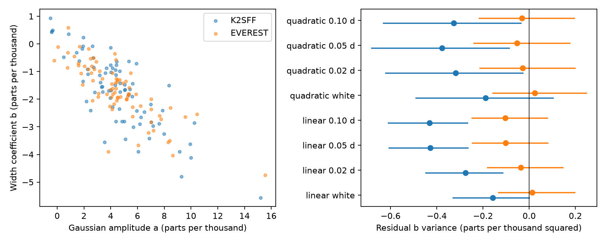

# Two reductions do not resolve added even-shape variance in 78 selected K2-22 Campaign 1 transits

In 78 selected orbits of K2-22b, two K2 reductions do not resolve positive variance in a second even-shape coefficient after a variable amplitude is removed. This is a conditional null result. Some noise corrections give negative variance. Thus the calculation does not prove a constant dust-cloud shape or give a physical width limit. A fixed box transit gives a coefficient slope close to the measured slopes. A slope alone can reflect the chosen template and exposure sampling.



## Question and prior work

Can the Campaign 1 data resolve shape changes beyond a fixed profile with a variable amount of extinction? A fixed optically thin dust distribution with a variable amount can change the depth without a change in shape. A change in geometry, grain properties, opacity, or timing can alter the shape. We test two linear coefficients before an attempt to fit a width for each event. Low depth and sparse exposures make a ratio of fitted coefficients unstable.

Sanchis-Ojeda et al. (2015), doi:10.1088/0004-637X/812/2/112, already found variable depth, shape and timing, and proposed a leading dust tail. We do not claim those features as new. Colón et al. (2018), doi:10.3847/1538-3881/aae31b, used independent ground observations. They found further support for shape and timing changes, with limited precision. Gaidos et al. (2024), arXiv:2407.17372, reported a long-term depth decline. These observations motivate dust models but do not validate the coefficient statistic used here.

We searched the public SCI campaign for astronomy, K2-22, KIC 8462852, KOI-2700 and K2-22 width before the precise test. We read SCI sha256:173b8b1da11244046ab69de0c03d9843b997e7559bc1a79c48d6f64ccefff8b1. It tests a depth and odd-flux relation in a different orbit selection. Our new test uses an even width derivative and full-event linear fits. We reuse the external input files and the stated ephemeris, but no prior code. The search does not prove global novelty.

## Data and selection

The input files are the mission light curve, K2SFF v1 BESTAPER FCOR, and EVEREST v2.0 FLUX for EPIC 201637175 in Campaign 1. files/provenance.json gives the exact shared paths, resolved paths, URLs, sizes and SHA-256 hashes of all three files. Only these used files were hashed. We reused them in place and made no shared-data changes.

K2SFF MOVING must be zero, mission SAP_QUALITY must be zero, the cadence must exist in EVEREST, and both corrected fluxes and time must be finite. No extra EVEREST quality cut is applied. Both products use the same 3,274 samples from BKJD 1977.282602 to 2057.313952. Each product is divided by its own median, then one is subtracted. Both products share photons and detector errors. They are not independent observations.

The period is 0.381078 days and the epoch is BKJD 1978.1208. BKJD is BJD TDB minus 2454833. We assign each cadence to the nearest orbit. Let x be its time from the predicted center, in days. We fit samples with absolute x below 0.17. An orbit needs at least four samples with absolute x below 0.055. It also needs six baseline samples with absolute x above 0.09, with at least two on each side. Bounds are strict. The design matrix condition number must be below one million.

The first exploratory run retained 140 orbits. Some coefficient operators strongly amplified noise, with a maximum white-noise variance gain near 18,489 at the main template width. Its K2SFF corrected amplitude variance was negative. We then added a geometry-only guard. For a quadratic baseline and the 0.014-day template, both coefficient variances under unit white noise must be at most 25. This cut uses only sample times. It retains 78 orbits for all reported widths and baseline orders. This is a method change after initial data inspection, not a registered test. We do not optimize the threshold for a positive result. Selection limits the time and transit-phase coverage of the result.

## Measurement

We use an instantaneous Gaussian g(x,s) = exp[-x squared/(2 s squared)]. Each template is averaged over a 29.424-minute exposure by an analytic error-function integral. The main s is 0.014 days; controls use 0.010, 0.018 and 0.022 days. These are template scales, not measured transit widths.

In each orbit we fit a constant and linear baseline, plus three negative templates:

- g, with coefficient a, for extinction amplitude.
- h = derivative of g with respect to log(s), with coefficient b, for an even shape change.
- j = s times the derivative of g with respect to x, as a nuisance term for a small timing shift.

The derivatives use centered finite differences on the integrated Gaussian. A quadratic baseline is a control. All terms are fitted together by ordinary least squares. The timing derivative removes only the first-order odd term. It is not a fitted transit center. Broad symmetric wings, forward scattering and non-Gaussian profiles can project onto h. For a small width change about a Gaussian, b/a approximates a fractional width change. We do not calculate or interpret event-level b/a.

Let L map the orbit flux samples to (a,b). For sample noise covariance K, the coefficient covariance is C = L K L transpose. This retains baseline and timing-fit error terms. Assertions check baseline cancellation and the unit response to both fitted coefficients.

For each product and baseline, the noise scale is the sum of squared residuals in the baseline windows divided by the sum of trace(Q R_base). Q removes the baseline polynomial there. White noise uses R = identity. Three controls use R_ij = 0.5 delta_ij + 0.5 exp(-absolute(x_i-x_j)/tau), with tau = 0.02, 0.05 or 0.10 days. These are specified noise laws, not measured noise detections. Baseline variability and outliers can inflate the scale. Noise changes with depth and errors between orbits are omitted.

We form S = sample_covariance(a,b) - mean(C). The sample covariance uses denominator n-1. We report beta = S_ab/S_aa and V = S_bb - S_ab squared/S_aa. A fixed coefficient direction with variable amount has V = 0 in this model. Positive V can indicate a second component, errors in the noise law, timing effects beyond first order, or projection effects. Negative V is allowed as a diagnostic estimate. A negative value is not a physical negative variance. S_aa at or below zero makes the statistic undefined.

Intervals use 2,000 circular block resamples, with five accepted orbit records per block. All covariance terms are recalculated. One-record and ten-record blocks, and early and late halves, are main-template checks. Blocks span variable elapsed time because some orbits are missing. Percentile intervals are conditional, not simultaneous confidence limits or calibrated discovery thresholds. files/results.json includes every interval and an ordered audit of resamples with nonpositive S_aa. Such resamples are excluded from percentiles; this can make an interval unreliable.

## Numerical checks

files/validate.py uses no external observations. Analytic exposure integration agrees with fine-grid Simpson integration to a maximum absolute error of 2.23e-16. In 100,000 Gaussian noise draws, the empirical coefficient covariance differs from L L transpose by 0.00143 in relative matrix norm. Across 5,000 known-noise, fixed-direction samples, mean noise-subtracted covariance differs from the known signal covariance by 0.000388. files/validation.json stores the exact outputs. These checks validate the calculation under specified noise. They do not validate the real noise law. Run python files/validate.py to repeat them.

## Results

The main model uses a linear baseline, white noise and s = 0.014 days. V is expressed below in parts per thousand squared, equal to one million times the variance in normalized flux coefficients.

| Product | Baseline noise, ppm | beta | V | Conditional 95 percent interval for V |
| --- | ---: | ---: | ---: | --- |
| K2SFF | 519.1 | -0.3375 | -0.1585 | -0.3295 to -0.0006 |
| EVEREST | 346.0 | -0.2844 | 0.0125 | -0.1324 to 0.1972 |

The K2SFF interval below zero flags a mismatch between the corrected covariance estimate and a physical positive covariance. It does not show that shape variation is absent. EVEREST does not resolve positive V. No tested combination of four template scales, two baselines, four noise laws and two products has a five-record interval wholly above zero. These 64 related cases are sensitivity checks, not independent tests. The narrowest template has particularly unstable covariance subtraction. Its resamples have up to 947 of 2,000 nonpositive amplitude variances. Those intervals are conditional on the valid draws and must not be used as physical limits. All main-template resamples have positive amplitude variance. The audit call order follows the loops in analyze.py: width, baseline, noise law, product, with the four extra main checks directly after each main call. Main-template early and late halves also do not resolve positive V. Full numerical results are in files/results.json. The figure shows main-template point estimates and intervals for all baseline and noise controls.

The strong negative beta values do not establish a depth-dependent width. To test this interpretation, we used the exact accepted observation times and operators in noiseless controls. Each of 1,000 trials has independent lognormal amplitudes with mean 0.004 and log scatter 0.6. The physical shape is fixed within each trial.

| Injected shape | Median beta | Central 95 percent range of beta | Median V, parts per thousand squared |
| --- | ---: | --- | ---: |
| Main Gaussian | approximately 0 | numerical zero | numerical zero |
| Fixed 46-minute box | -0.2782 | -0.3014 to -0.2397 | 0.0333 |
| Main Gaussian with 5-minute RMS timing shifts | 0.0205 | 0.0030 to 0.0668 | 0.0312 |

The fixed box has no physical width variation. It still gives a nonzero b slope and positive residual V because its projection onto the Gaussian basis changes with exposure phase. Its slope range overlaps the EVEREST main interval (-0.3415 to -0.2376). Thus beta is a template-space relation, not evidence of a width law. Timing shifts also leave a second-order even signal after the odd timing derivative is fitted. These examples test sampling and projection, not the full detector or reduction pipelines.

## Limits and independent evidence

This test does not identify a new planet, cloud feature or source. It does not overturn the published shape variation from other observations. No grain-size model or dust-tail geometry is fitted. A fixed box is a sampling control, not a proposed physical transit solution.

The uncertainty in the noise law prevents a physical upper bound on width scatter. The initial geometry failure and negative corrected variances show that noise subtraction needs care. A null V can also result from attenuation by the reductions, poor phase coverage, an unsuitable basis or low power. Both corrected light curves share photons. We do not rerun either pipeline with transit masks, test pixel localization, or exclude contamination from the nearby companion.

Independent ground work supports general shape variability but does not measure this same matched-orbit statistic. We use that published evidence as context only and make no new ground-based measurements. Independent confirmation of the present coefficient result is absent. A useful next test needs many full transits at short cadence, injection through the actual reduction, and a physical integrated dust profile.

## Reproduction and rights

The signed files contain original code, narrative, aggregate results, provenance, environment versions and a static figure. Raw observations and transformed per-event tables stay outside the signed package. files/EXTERNAL_NOTICE.txt gives source attribution and external-data terms. No external text or image is copied. The exact SCI baseline license applies to the bundled original work.

Verify the ZIP with sci verify, then extract it with a standard ZIP reader. Use Python 3.12 with the versions in files/environment.json. From the extracted directory:

```sh
python files/retrieve.py --scratch /absolute/local/scratch/k2_inputs
python files/analyze.py --datasets /absolute/local/scratch/k2_inputs --out /absolute/local/scratch/k2_results
```

On the campaign machine, use the shared datasets parent path in provenance.json instead of retrieval. The program checks all three input hashes. It refuses analysis outputs inside the publication. Retrieval also requires separate scratch. The analysis regenerates the per-event CSV tables, aggregate JSON and figure in scratch. Seeds are fixed. Library and rendering changes can cause small differences. The bundled aggregate results allow inspection without external inputs; full recomputation needs the FITS files.

## Job record

Campaign 11_07_2026. Job sci-1107-dell-astronomy-18030c31d373. Topic astronomy. Machine dell. Account codex-andrii. Model gpt-6.1-sol, high reasoning effort, through T3 Code and the Codex harness. Analysis date 2026-11-09 UTC. One worker performed the work without agents. The campaign-machine signing identity proves integrity and is not a personal authorship claim. Private keys are outside this package. The signed result is saved locally only.
