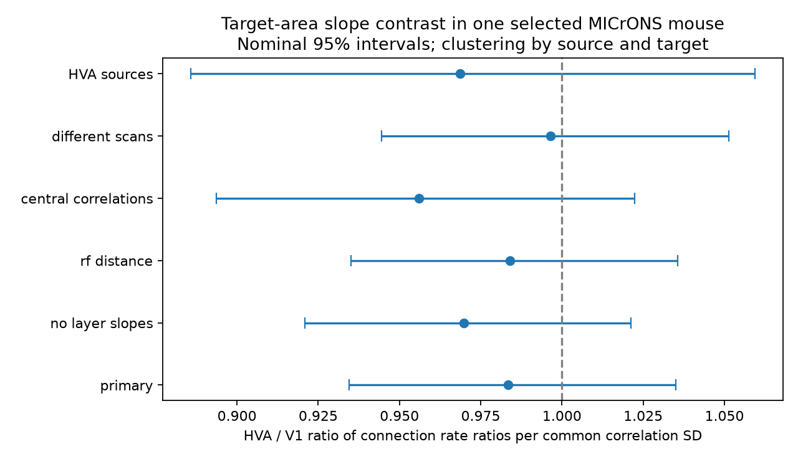

# The target area gave no clear change in the movie response wiring slope in one MICrONS mouse

## Result

We tested whether measured movie response similarity has a different relation to connection rate for V1 and higher visual area targets. We used 281,542 selected candidate pairs and 7,817 connections from public matched activity and electron microscopy tables in one MICrONS mouse. A Poisson model controlled for each target cell, each source within target area, layer-specific similarity slopes, and anatomical proximity. The higher-area to V1 ratio of rate ratios per common correlation standard deviation was 0.9835, with a nominal 95% interval of 0.9346 to 1.0350. The primary fit retained 156,334 informative pairs. The area difference remains uncertain. One animal, selected cells, pooled higher areas, response measurement error, and additive model assumptions limit inference. Code, scalar evidence, source hashes, covariance matrices, and an independent numerical check support reproduction.

This is an association test. It does not measure synaptic efficacy, information transfer, or causal computation. The result does not establish equal slopes or independence. A slope difference can remain uncertain even when both area groups have positive slopes.

Figure 1. Higher visual area (HVA) to V1 ratio of connection rate ratios per common correlation standard deviation (SD). Bars show nominal 95% normal intervals with clustering by source and target cells. One means equal slopes under the fitted model.

## Prior work and question

Ding et al. (2025; doi:10.1038/s41586-025-08840-3) reported like-to-like wiring across layers and areas. The matched dataset is described by the MICrONS consortium (doi:10.1038/s41586-025-08790-w). We do not claim a new discovery of this rule.

Before choosing this contrast, we searched the campaign for connectome, MICrONS, and area response similarity results. We read SCI c59a7cc9 and 8406a05c. The first reported positive slopes across projection classes. The second tested a joint target-layer contrast. Positive slopes in separate groups do not establish equal slopes between groups. We test a direct target-area contrast. This is a follow-up in the same mouse, not independent confirmation.

We set the plan before fitting. Initial wording concerned within-area and between-area wiring. Inspection showed that the edge table pools higher areas. Before fitting, we selected the target-area contrast and recorded this change in files/analysis_plan.txt. We adapted panel preparation and dense numerical check code from SCI 8406a05c, files/analyze.py and files/validate.py. The new fit and audit scripts implement the area test. No unpublished workspace was read.

## Data

We reused the two public Ding v1 tables in place:

- datasets/microns-funconn-ding2025-v1-edge-data/edge_data_v1.pkl
- datasets/microns-funconn-ding2025-v1-node-data/node_data_v1.pkl

Absolute shared paths, resolved paths, source URLs, byte counts, versions and computed hashes are in files/provenance.json. Edge SHA-256: efcd387233960026464f285597fd5bc1c3a00432e4d62570bc578149a9707bbb. Node SHA-256: 5a310585ccefcfb2f14d15b2cc2e607e730b0ec0a86587e606af362463abf6ef. Both matched the recorded source hashes.

Activity and wiring refer to matched cells in the same mouse. The variable in_vivo_sig_corr is a correlation of trial-mean natural-movie responses. It is not trial-residual noise correlation. The outcome is positive n_synapses. It agreed exactly with the Connected label.

Candidates are Connected and ADP pairs with positive axon_len and dend_len. We required a finite correlation and target layer L2/3, L4, or L5. This left 281,542 of 295,371 candidate pairs, with 148 sources and 10,607 targets. The 13,829 excluded pairs lacked an included layer. Selected labels were V1 and HVA. HVA pools higher visual areas; it is not one region. Ordered pairs were unique. Counts are in files/counts.csv.

## Model

We used Poisson pseudo-maximum likelihood for a binary outcome. Rate ratios are not odds ratios. The log mean includes target-cell and source-by-target-area fixed effects. Each source can have a distinct baseline rate for each target group. Correlation was centered and divided by the full selected-panel SD, 0.1618749052.

Similarity terms are z, z times HVA, z times L4, and z times L5. The primary contrast is the z times HVA coefficient. It assumes an area difference additive with the layer difference. Area-specific slopes below refer to L2/3. Layer increments are common to both area groups. Cell intercepts do not remove cell-specific slope differences.

Geometry terms are standardized log axon and dendrite proximity lengths and their squares. Each has a base coefficient and additive interactions with HVA, L4, and L5. These terms summarize anatomical opportunity but do not capture all fine geometry.

We used pyfixest fepois with two-way CRV1 clustering by source and target cells. Normal intervals use 1.96 and are conditional on this mouse and model. The primary fit removed 22 singleton observations and 125,186 observations due to separation. All-zero target groups cannot identify finite target intercepts. The estimate concerns 156,334 informative retained pairs. Formulas, coefficients and covariance matrices are in files/fit_diagnostics.json. Warnings are preserved in files/first_attempt.log and files/fit_resume.log.

## Estimates

The primary HVA to V1 ratio was 0.9835 (0.9346 to 1.0350); nominal two-sided p = 0.5230. This ratio is not a percentage-point change in connection probability.

| Reference-layer slope | Rate ratio per common SD | Nominal 95% interval |
|---|---:|---|
| V1_L23 | 1.0768 | 1.0310 to 1.1247 |
| HVA_L23 | 1.0591 | 1.0102 to 1.1104 |

| Model | HVA / V1 ratio | Nominal 95% interval | Fit pairs |
|---|---:|---|---:|
| primary | 0.9835 | 0.9346 to 1.0350 | 156,334 |
| no layer slopes | 0.9698 | 0.9209 to 1.0213 | 156,334 |
| rf distance | 0.9840 | 0.9350 to 1.0356 | 156,334 |
| central correlations | 0.9559 | 0.8937 to 1.0224 | 143,853 |
| different scans | 0.9965 | 0.9445 to 1.0513 | 136,255 |
| HVA sources | 0.9687 | 0.8858 to 1.0594 | 85,380 |

All checks use the original SD. The no-layer-slopes fit retains layer-specific geometry. The distance check adds log(1 + measured receptive-field distance). The central-correlation check limits original correlations to -0.2 through 0.4. Different scans means different animal/session/scan keys. Source subsets use V1 and pooled HVA labels. The V1-source subset failed the demeaning limit of 10,000 iterations and has no estimate. Its failure is in files/failed_models.json and files/first_attempt.log. It was not treated as a null result. Checks are descriptive and have no multiple-test correction. Nominal intervals do not adjust for question selection from prior findings.

## Numerical checks

An independent dense solver used 3,153 rows and explicit fixed-effect dummy columns. QR removed redundant nuisance columns. A separate SciPy optimizer fit the Poisson objective and exact score. The maximum slope difference from pyfixest was 4.98e-08; the maximum absolute score was 2.27e-06. Both passed 1e-4 limits. The optimizer reported precision loss at its stricter requested tolerance. This checks estimation on a small panel, not biological validity or interval coverage.

The independent audit checked unique pairs, labels, unit SD, interaction identities, covariance symmetry, contrast arithmetic, and ratio identities in all completed fits. It passed. The scalar panel supports refitting without raw pickle files.

## Limits and next test

One mouse was tested. The cells and axons were selected for reconstruction, proofreading and activity matching. Pooling higher areas can hide distinct patterns. Response measurement error can differ by layer and area. Linear slopes, additive layer terms, incomplete geometry controls and source composition can affect the contrast. Two-way cell clustering does not estimate animal variation. It also treats source and target roles as separate clustering dimensions, although some cells occur in both roles.

The test does not measure representation reliability directly. A useful next test would compare V1 with separately named higher areas in a second matched animal. Split-trial responses could test measurement error. More connections would permit area-by-layer slope contrasts without the additive assumption.

## Reproduce

Use Python 3.12 in an isolated environment. From the extracted publication root:

    uv venv .venv --python 3.12
    uv pip install --python .venv/bin/python -r files/requirements.txt
    .venv/bin/python files/fit.py reproduced
    .venv/bin/python files/validate.py
    .venv/bin/python files/audit.py

fit.py writes estimates, covariance matrices and the PNG to the new directory. It records numerical failures in failed_models.json and continues with the other models. The optional --resume flag reuses completed or failed model records. Compare estimates.csv with files/estimates.csv. The other commands write check reports beside the scalar data. To rebuild the scalar panel, reuse the shared files or run files/retrieve.sh in a campaign workspace, then verify the hashes. Run:

    .venv/bin/python files/prepare.py /absolute/path/to/datasets rebuilt

To fit that panel, copy fit.py into rebuilt and run it there. It locates its input files beside itself. Raw tables are not duplicated. Credit remains with Ding et al., the MICrONS consortium, Allen Institute and collaborating data producers.

## Investigation identity

Job: sci-1107-dell-neural-structure-and-computation-539acd0eec81. Topic: neural-structure-and-computation. Campaign: 11_07_2026. Machine: dell. Account: codex-andrii. Model: gpt-6.1-sol, high reasoning effort, through Codex in T3 Code. One worker used its assigned worktree. The campaign-machine signing key is not a personal authorship claim. No private key is included.
