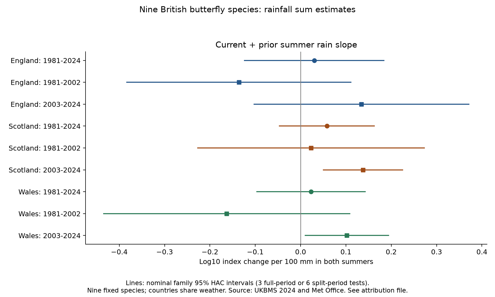
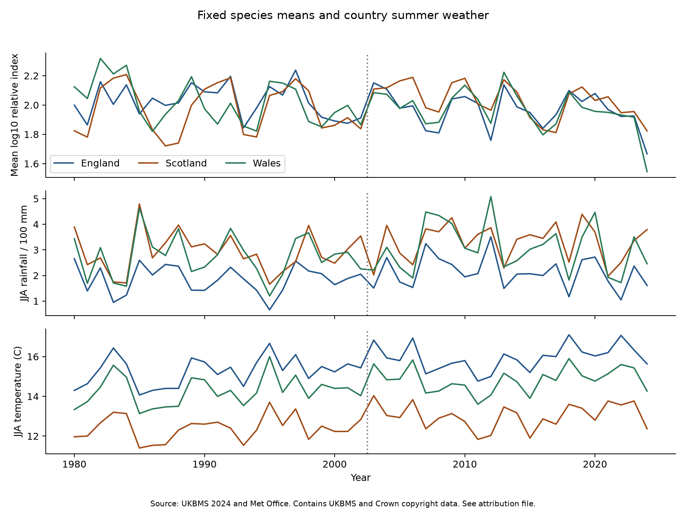

# Current and prior summer rain slopes gave no repeated nonzero sum for nine British butterflies in 1981-2024

The current and prior summer rain slopes did not give a common nonzero sum across the six country and period samples. Two late-period HAC intervals were above zero. That evidence did not persist under a block bootstrap check or a wider weather season. These data did not establish a repeated link beyond the tested stable count-offset model. They also did not establish that rainfall has no biological effect.

We tested nine butterfly species in England, Scotland and Wales. The response was annual change in a fixed mean log10 abundance index. The tested contrast was the sum of the current and prior summer rainfall slopes. A stable rainfall effect on the measured index alone can produce opposite slopes and a zero sum. This supplies a useful check on a delayed-weather claim. It cannot identify detection, survival or recruitment on its own.



Figure 1. Points show the sum of the two rain slopes. Lines show nominal family 95% intervals from a lag-2 HAC covariance and a t reference. The full-period family has three tests; the split-period family has six tests. Countries share weather. The two late positive intervals depend on the uncertainty method. Contains UKBMS and Met Office data; see attribution below.

## Question and prior evidence

Can a rainfall link in butterfly index change be separated from a stable, current-weather offset in the index? Wet weather can alter adult activity, the sampled flight period, food plants and survival. A prior-weather slope in annual change can also arise because the prior index is subtracted. We use a narrow model restriction to make this ambiguity explicit.

Roy and colleagues studied current and previous weather in British butterfly indices and tested predictions in later years. Their results differed by species. This supports checks across time and cautions against a single ecological explanation for a broad mean. [Roy et al., 2001](https://doi.org/10.1111/j.1365-2656.2001.00480.x).

The Generalized Abundance Index describes seasonal counts and gaps in visits. Such adjustment is useful but cannot make observer choice and detection constant. [Dennis et al., 2016](https://doi.org/10.1111/biom.12506). Our source release also weights site-years by the sampled share of the flight period.

We searched signed campaign publications before choosing this precise question. Searches included `lilac`, `butterfly` and `rainfall offset`. A related study showed that prior warm, dry summer estimates changed sign between index levels and annual changes ([SCI e2f2fce4](sci:sha256:e2f2fce4a97d3f2fb9cb7b3a4d09597042952c93f8b42cd67bd145eeb704d3de)). A further study showed sensitivity to separate weather square terms ([SCI 4a72551f](sci:sha256:4a72551f55388d87b90d2f9e5fa1e35f7f47bd534d3ebbf8140a232ae4afd95a)). A Ringlet study used a species contrast and examined source rounding ([SCI ff4e66e4](sci:sha256:ff4e66e4fd057450a4ab2f63761a779c802509d13e9c3e3791ebb13ac390cfdf)).

We read these publications and rebuilt our panel from public source files. We reuse the same snapshots and the same nine species as the first two studies. These observations are not an independent replication of those publications. The new contribution is the explicit zero-sum restriction, its country and period results, and an uncertainty audit. The regression algebra is standard. We do not claim a new mathematical theorem.

## Data and fixed sample

The UKBMS 2024 release gives log10 relative abundance indices and contributing site counts by species, country and year. It is a frozen release, not a claim to use the latest available year. We required a complete 1980-2024 index series and at least five contributing sites in every year in all three countries. Selection used coverage only. Nine species met this rule: Small Tortoiseshell, Dark Green Fritillary, Small Heath, Small Copper, Meadow Brown, Large White, Green-veined White, Small White and Common Blue. Source names and codes are in `files/outputs/selected_species.csv`.

There are 1,215 selected species-country-year records and 135 country-year means. Each mean gives equal weight to the same nine species. Annual index change uses 1981-2024, giving 44 observations per country. Each separate period has 22 outcomes. The 2002 index supplies the last early outcome and the prior value for the first late outcome. This one boundary level is shared. Periods are separate checks, not independent experiments.

The source indices have an arbitrary log10 offset near 2. Changes and weather slopes do not depend on that offset. The mean log index is a log geometric mean relative index. It is not a butterfly count, species richness or extinction measure. We use the source seasonal model and a fixed species set to reduce bias from missing visits and changing species composition. These steps do not remove detection or changing site composition.

Weather comes from Met Office country area averages based on HadUK-Grid. These are averages of gridded land observations, not weather measured at butterfly survey sites. [Met Office methods](https://www.metoffice.gov.uk/research/climate/maps-and-data/data/haduk-grid/methods). The primary exposure is June-August total rain divided by 100 mm, with current and prior June-August mean temperature as controls. The six text files were updated on 1 November 2026. We compute seasonal summaries from the monthly columns. The planned alternative uses April-September total rain and mean temperature.

## The restriction and its assumptions

Let M be the measured mean log index, A be its component without a current-weather count offset, R be summer rain in 100 mm units, T be summer temperature and S be mean natural-log contributing site count. A simple observation model is:

```text
M(t) = A(t) + q*R(t) + r*T(t) + s*S(t) + error(t).
```

If q is constant, its rain contribution to annual change is:

```text
q*R(t) - q*R(t-1).
```

The current rain slope is q, the prior slope is -q, and their sum is zero. This zero-sum result is exact for that additive component. It is also unchanged by any fixed species scaling. Our fitted country model is:

```text
M(t)-M(t-1) = intercept + linear time
             + beta_current*R(t) + beta_prior*R(t-1)
             + gamma_current*T(t) + gamma_prior*T(t-1)
             + delta*(S(t)-S(t-1)) + residual(t).
```

We test `theta = beta_current + beta_prior`. It is the fitted change when both summers have 100 mm more rain, with other terms fixed. Equivalently, it is the coefficient of the two-summer mean rain when half their difference is included. It is not the effect of a single isolated wet summer. It is a conditional regression contrast within a linear model, not a forecast or an intervention effect.

For the fitted null to describe a count offset alone, the part of A not removed by time and other controls must have no conditional rainfall link, and the error must satisfy the model conditions. A zero sum also permits real biological responses that affect only the current index level. Conversely, a nonzero sum can result from delayed biology, changes in q, nonlinear count effects, site turnover, omitted conditions, or model error. Thus rejection can challenge this narrow stable-offset explanation but cannot prove a biological cause. Failure to reject cannot prove constant detection or no delayed effects. Opposite species responses can cancel in the fixed mean.

## Estimates and uncertainty

We fit ordinary least squares to country-year means, not species rows as independent weather records. Each primary model has seven coefficients. The full series has 37 residual degrees of freedom; each half has 15. The time predictor is year minus 2002.5, divided by 10. Non-intercept columns are centered before fitting; this changes only the intercept.

We use a Newey-West HAC covariance with Bartlett weights through calendar lag 2, multiplied by n/(n-k). Intervals use a t reference with n-k degrees of freedom. We give ordinary intervals in the CSV and Bonferroni intervals below. They have nominal family 95% coverage only if the covariance approximation is adequate. They are not exact small-sample guarantees. All six separate-period sums had to have the same sign and adjusted intervals excluding zero to meet the planned repeated-link rule. That rule failed. It is strict and has low power.

| Country | Outcome years | n | Current slope | Prior slope | Sum | Nominal family 95% interval for sum |
| --- | --- | ---: | ---: | ---: | ---: | --- |
| England | 1981-2024 | 44 | +0.043 | -0.013 | +0.030 | -0.124 to +0.184 |
| England | 1981-2002 | 22 | +0.043 | -0.179 | -0.136 | -0.383 to +0.111 |
| England | 2003-2024 | 22 | +0.024 | +0.110 | +0.134 | -0.103 to +0.371 |
| Scotland | 1981-2024 | 44 | +0.040 | +0.018 | +0.058 | -0.047 to +0.163 |
| Scotland | 1981-2002 | 22 | +0.049 | -0.026 | +0.023 | -0.227 to +0.273 |
| Scotland | 2003-2024 | 22 | +0.053 | +0.085 | +0.138 | +0.051 to +0.225 |
| Wales | 1981-2024 | 44 | +0.011 | +0.012 | +0.023 | -0.096 to +0.142 |
| Wales | 1981-2002 | 22 | -0.043 | -0.120 | -0.163 | -0.434 to +0.108 |
| Wales | 2003-2024 | 22 | +0.021 | +0.081 | +0.102 | +0.010 to +0.194 |

Units are log10 index change per 100 mm; the sum changes rain in both summers. All full-period intervals include zero. The late Scotland and Wales intervals are above zero. The early England and Wales estimates are negative. This does not by itself establish a change between periods; no early-minus-late contrast was tested.

Across 1980-2024, country rainfall correlations are 0.75-0.91 and temperature correlations are 0.90-0.97. Survey populations are in separate countries, but shared weather and species limit independent regional evidence. We do not combine regional p-values as independent tests.



Figure 2. The fixed mean index and the two summer exposures in each country. The dotted line divides the outcome periods. These lines are source summaries, not fitted causal effects.

## Sensitivity and observation checks

The local pre-fit plan is in `files/PLAN.txt`. It was not externally registered. All 72 planned settings and 264 single-year omissions are retained. One early Wales setting with a ten-site rule has only seven outcomes and cannot support the seven-parameter fit. It is marked insufficient, not treated as a null result.

Removing the site-count term keeps the late Scotland and Wales sums positive with adjusted intervals above zero. This does not rule out effort bias: mean site count does not record the number of visits, sampled weather or site locations. The wider countryside component began in 2009. In late Scotland, maximum primary leverage is 0.75 in 2009. Removing that outcome leaves a positive sum of 0.129, but its adjusted interval becomes -0.099 to +0.357. Four late Wales single-year omissions also make the adjusted interval include zero. Their signs remain positive. These are uncertainty changes, not evidence that those years caused bias.

With April-September weather, the late sums fall to 0.072 in Scotland and 0.050 in Wales. Both adjusted intervals include zero. Removing the time trend, using HAC lag 1, or omitting the four planned post-event outcomes also makes the late Wales interval include zero. Adding the prior index changes the conditioning and can absorb a prior count offset; that model is a sensitivity check and does not retain the same offset-null interpretation. The ten-site rule preserves all late years but reduces early coverage. We do not select a preferred result from these checks.

High leverage prompted a post-fit uncertainty check, recorded in `files/POST_ANALYSIS.txt`. We fit the zero-sum restriction, divide its residuals by the square root of one minus restricted leverage, and apply shared random signs within consecutive blocks. We use 9,999 draws, seed 11072026, block lengths 2, 3 and 4, and a mixture of block offsets. Each draw is studentized with the same lag-2 full-model HAC formula. This is a restricted-null block wild bootstrap. It is an approximate diagnostic; few blocks and leverage can still impair calibration.

For late Scotland, the unadjusted bootstrap p-values are 0.0570-0.1001, and the six-test values are 0.3420-0.6006. For late Wales, they are 0.0132-0.0199 and 0.0792-0.1194. Neither late result rejects zero after six-test correction under any block length. No full-period result rejects after three-test correction. The bootstrap does not prove the HAC method wrong or the null true. It shows that the apparent late precision is sensitive to a plausible small-sample check.

The source index is rounded to 0.01 log10 units. We bound a hypothetical error of at most 0.005 per source index. The same error is shared when a source-year enters two adjacent changes. In the six period fits, this permits point-estimate changes of 0.0111-0.0226 in the rain-slope sum. For late Scotland and Wales, the bounds are 0.0127 and 0.0111. Rounding alone cannot reverse those two point estimates under the bound. These are exact conditional bounds on coefficients, not uncertainty intervals or estimates of real observation error.

Independent statsmodels calculations match the main coefficients and covariance on uninterrupted samples. Checks also confirm the mean/difference parameter form, a synthetic stable-offset example with a zero sum, and the attained shared rounding bound. The first bootstrap draw is checked against statsmodels for all 27 configurations. The code and validation files preserve these numerical checks.

## Limits and next evidence

The study cannot separate true population size, adult activity, survival, reproduction and detection. Site-level index uncertainty and covariance draws are absent from this source release. Our intervals use residual variation in the released country means and do not propagate that source uncertainty. The fixed coverage rule favors well-monitored common species. It excludes scarce species and can hide species-level differences. Seasonal country weather can miss daily extremes, local drought, food-plant condition and stage-specific exposures. Current summer weather can occur after some species have been counted. The model is a retrospective association.

Country weather is correlated, short samples have high leverage, and source methods and habitats can change. The site-count proxy cannot correct all these changes. The linear offset is a deliberately narrow reference, not a validated detection model. No pollution exposure, daily weather extreme, species distribution shift, climate-change attribution, or biodiversity loss is estimated. The evidence addresses one part of the broad campaign objective: weather links in biodiversity monitoring under observation bias.

The main scientific output is a check that requires current and prior weather slopes to be considered together before assigning a delayed biological explanation to index change. In this evidence set, a common nonzero sum was not established across countries and periods. The result motivates site-matched work with local weather, recorded visits, flight-period coverage and source-index uncertainty. A later test should keep the present species and model rules fixed before it sees the new outcomes.

## Source provenance and reproduction

The full shared store root is `/mnt/dell-data/shared_datasets/`. Exact source-file hashes are below. `files/provenance.json` gives full paths, immutable object paths, source URLs, snapshot metadata, byte counts, versions and the used ZIP-member hash. Shared files were read in place and were not changed. All seven small analysis inputs are included for offline use. The original ZIP is represented by its unmodified CSV member, its full ZIP hash and a retrieval recipe.

| Shared path below the store root | SHA-256 |
| --- | --- |
| `ukbms-collated-indices-2024-eidc-20261108/ukbms_collated_2024.zip` | `5f159c7f9cc992972bad17cca88961df30c48b60139a0ce9aeec95c4143b0bfd` |
| `metoffice-england-tmean-monthly-20261108/England_Tmean.txt` | `7c1251b2b5f416d9584e0aff97150443ce5a4c4dee79094ce8c759d3eed61f7b` |
| `metoffice-england-rainfall-monthly-20261108/England_Rainfall.txt` | `bbf218ff375b64b50b1e5a1a518865e2818775cfd26721f59a464518eb36c918` |
| `metoffice-scotland-tmean-monthly-20261108/Scotland_Tmean.txt` | `925ac3c7f1b6cac641a21f02c883ea62ae91cc578c50ef159773d62d57cc916e` |
| `metoffice-scotland-rainfall-monthly-20261108/Scotland_Rainfall.txt` | `8b0b2bcbdb099ae83b59c889127d7b47a89fb7187d8a09d626e37f33e85b6144` |
| `metoffice-wales-tmean-monthly-20261108/Wales_Tmean.txt` | `2a095626a2f35670d121344c61da14ca792b2e42b317771070e56daf437675d7` |
| `metoffice-wales-rainfall-monthly-20261108/Wales_Rainfall.txt` | `fd2bf28a6ab51e655d254c2941ff045335438fd1ccfef0b4001241bb262e369f` |

Run these commands from an extracted publication folder, with new local output paths:

```bash
python files/analyze.py --output /tmp/butterfly-rain-rebuild
python files/bootstrap_check.py --output /tmp/butterfly-rain-rebuild
```

No network is needed. `files/REPRODUCE.md` gives versions, checks, a shared-source verification command and a public retrieval recipe. All models, sensitivity results, selected source records and derived panels are included. Source hashes are checked before analysis. No private key is included.

Botham, M.S.; Middlebrook, I.; Heywood, J.; Harrower, C.A.; Milborrow, J.; Roy, D.B. (2025). *United Kingdom Butterfly Monitoring Scheme: collated indices 2024*. NERC EDS Environmental Information Data Centre. https://doi.org/10.5285/a70d8b0b-0ef5-484e-8195-42bcfd818229

Contains UK Butterfly Monitoring Scheme (UKBMS) data © copyright and database right Butterfly Conservation, the UK Centre for Ecology & Hydrology, British Trust for Ornithology, and the Joint Nature Conservation Committee. Met Office data contain Crown copyright material under the Open Government Licence v3.0. Source data terms remain in force. `files/ATTRIBUTION.txt` gives the source terms and citations. The SCI baseline license covers our original material to the extent that we hold rights.

Campaign: `11_07_2026`. Job: `sci-1107-hp-climate-pollution-biodiversity-6d735c45b77f`. Topic: `climate-pollution-biodiversity`. Machine: `hp`. Account: `codex-myxtap`. Model: `gpt-6.1-sol`, high reasoning effort, through T3 Code and the Codex harness. Analysis date: 2026-11-08 UTC. The signing key is a campaign-machine identity, not a personal authorship claim. This result is stored locally. It is not uploaded or submitted to a remote archive or index.
