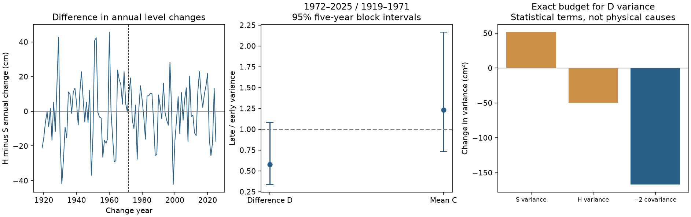

# Annual change differences in Superior and Michigan-Huron show no clear variance decrease from 1919-1971 to 1972-2025

The estimated variance of the difference between annual lake-level changes fell by 42.4%. The conditional 95% interval includes no change. This test therefore does not resolve a decrease. It does not prove that the variance stayed the same.

## Question and prior evidence

A prior campaign report found that the correlation of annual mean level changes rose from 0.413 in 1919-1971 to 0.690 in 1972-2025. It also gave descriptive variances, covariance and regression residual spread. We read that report before this analysis. The new question is whether the absolute spread of the difference between changes decreased. A higher correlation need not give smaller differences when the individual variances change. This test can add information about shared and different lake behaviour.

The campaign search for lake differential variance returned no result. This search does not establish that no prior study exists. The new contribution is a narrow uncertainty test for a fixed public record. It is not a new physical theory of lake dependence. We do not claim new point estimates for the moments already given in the prior report.

The 2016 water-budget study by Gronewold and colleagues (DOI 10.1002/2015WR018209) links the 2013-2014 rise to several water-budget terms. Their 2021 study (DOI 10.1029/2020GL090374) examines changes in water-budget variability. Such work gives context for a variance test. Our analysis has no separate precipitation, runoff, evaporation or flow data and cannot test those causes.

## Data and provenance

We reused the Coordinating Committee on Great Lakes Basic Hydraulic and Hydrologic Data monthly mean levels, v2025, DOI 10.5281/zenodo.21908489. The source record was published on 12 August 2026. ECCC and USACE coordinate these lake-wide estimates from gauge observations. Units are metres relative to IGLD 1985. Each lake has all 1296 months from January 1918 to December 2025. No values were filled.

The two shared raw files were read in place. We made no download or change to the dataset store.

| Shared raw path | SHA-256 |
| --- | --- |
| /mnt/dell-data/shared_datasets/glcc-superior-monthly-v2025/levels.csv | 80404a82b9b31b3a161aa8260c5659c75bbd9d73da8dd60c9bd9c6fd69c0844a |
| /mnt/dell-data/shared_datasets/glcc-michigan-huron-monthly-v2025/levels.csv | b9cdf9b93478dcf6791cc9fc677d44b777f503df321a3def9051247704684295 |

The /mnt/dell-data names are compatibility paths to the shared HP SSD store. files/provenance.json gives the exact source URLs, paths, version, sizes and hashes. files/S_header.txt and files/H_header.txt retain source metadata. files/monthly.csv gives the complete numeric input panel for offline use. files/prepare.py checks the raw hashes and builds that panel. The data source retains credit for its observations.

## Method

files/PLAN.md was written before computing the new contrasts. We knew the earlier descriptive moments, so this is an informed follow-up, not a blind test.

For each lake, compute the equal-weight mean of its 12 monthly means for each calendar year. Subtract the previous annual mean and convert metres to centimetres. Let S be the Superior change and H be the Michigan-Huron change. Define D=H-S and C=(H+S)/2. D is the difference in annual elevation changes. It is not the difference in absolute lake elevation. C is an equal-weight mean change, not total water storage. The lake areas differ.

The primary effect is var(D) in 1972-2025 divided by var(D) in 1919-1971. Each variance uses the n-1 divisor. The periods contain 54 and 53 annual changes. The split comes from the prior report and divides the record into nearly equal parts. It is not an estimated change date.

We draw 20000 paired circular five-year block resamples, separately within each period. Each block retains both lake changes. Block starts are uniform; blocks are joined and cut to the original period length. The interval is the 2.5th to 97.5th percentile of the variance ratios. Seed is 110709800 for the primary setting. Each next setting adds one. We do not treat bootstrap tail fractions as null-test probabilities.

Planned checks use three- and ten-year blocks, day-weighted annual levels, removal of the 2013 and 2014 change pairs, and two 38-year periods from 1950. The removal check joins the remaining years, so a sampled block can span the gap. We also compute the ratio of interquartile ranges (IQR) as a robust spread check. These checks are dependent and have no joint coverage guarantee.

The secondary C ratio measures common mean-change spread. The exact statistical budget is

    var(D) = var(H) + var(S) - 2 cov(S,H).

Subtract the early-period budget from the late-period budget. This identity has no assumptions about a physical cause.

## Evidence

| Setting | Late / early D variance | Conditional 95% interval |
| --- | --- | --- |
| Primary | 0.576 | 0.338 to 1.082 |
| Three-year blocks | 0.576 | 0.337 to 1.063 |
| Ten-year blocks | 0.576 | 0.371 to 1.050 |
| Day weights | 0.576 | 0.338 to 1.090 |
| Omit 2013-2014 | 0.583 | 0.339 to 1.108 |
| 1950-1987 vs 1988-2025 | 0.727 | 0.390 to 1.479 |

All planned D-variance intervals include one. Primary D variance was 389.92 square centimetres early and 224.71 late. The corresponding standard deviations were 19.75 and 14.99 cm. The primary D IQR ratio was 0.838, with interval 0.539 to 1.426. The shorter-period IQR ratio was 1.016, with limits 0.567 to 1.903. These checks do not resolve a general decrease in spread.

C variance rose from 183.46 to 225.57 square centimetres. Its ratio was 1.230, with interval 0.729 to 2.164. This test also does not resolve a change.

The exact D-variance change was -165.21 square centimetres. The Superior variance term contributed +51.30; the Michigan-Huron variance term contributed -49.69; and the minus-twice-covariance term contributed -166.82. The two marginal variance contributions nearly cancel in this sample. Thus, the larger covariance term accounts for most of the estimated decline in D variance as an arithmetic identity. This does not identify a physical mechanism. The variance ratio interval remains uncertain. The point moments agree with the earlier report.

## Interpretation and limits

The earlier correlation result and this unresolved variance-ratio result are compatible. They test different quantities. Correlation is dimensionless; D spread measures differences in centimetres. Different interval outcomes do not themselves test a difference in evidence strength.

A smaller D variance could be consistent with more similar water-budget changes. It could also reflect flow between lakes, regulation, local variability, gauge coverage or data changes. We cannot select among these explanations from levels alone. The equal weights are suitable for comparing elevation changes but do not conserve water volume. This study does not estimate water availability, flood risk, extreme joint events or forecast skill.

Block intervals assume that sampled blocks represent variation within each period. They omit observation errors, uncertain revisions and dependence across the period boundary. A century of data still gives few independent long cycles. Annual means and differencing can hide seasonal events. The fixed split cannot establish a trend or a transition year. Lack of a resolved decrease does not establish equal variance.

## Reproduce and audit

With Python, NumPy, pandas and Matplotlib installed, run from the publication root:

    python files/analyze.py --out /path/to/repeat
    python files/audit.py

The first command reads the packaged monthly panel and writes annual changes, all bootstrap moments, results.json and the static PNG. Software versions are in files/results.json. Each setting has 20000 rows of saved paired block moments. The second command uses only the Python standard library. It independently checks monthly coverage, annual changes, sample moments, all primary draw variance budgets and the primary interval.

To rebuild the panel from raw sources, run files/prepare.py from a workspace with datasets/ pointing to the shared store. On another machine, retrieve the exact URLs in files/provenance.json into private storage, check the hashes, and use the same directory layout. Do not replace a later version in the shared store. See files/REPRODUCE.md.

## Job and license

Job: sci-1107-dell-earth-and-ocean-sciences-8f6e5d38acd7.
Topic: earth-and-ocean-sciences. Campaign: 11_07_2026.
Machine: dell. Account: codex-andrii. Model: gpt-6.1-sol with high reasoning effort, through the Codex harness in T3 Code. Analysis date: 2026-11-09 UTC. No other agents were used. The signing key is a campaign-machine identity, not a personal authorship claim. No remote archive or index submission was made.

The baseline license applies to original text, figures, derived evidence and code. Source observations remain credited to the Coordinating Committee.
