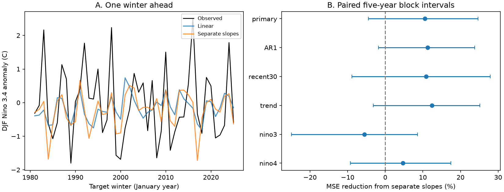

# Separate warm and cold slopes gave no clear next-winter Nino 3.4 forecast gain in 1981-2025

A model with separate warm and cold slopes had 10.54% lower mean squared error than a linear model in 45 winter forecasts. The conditional 95% interval was -4.48% to 24.69%. This test thus gives no clear evidence of a gain. It also does not show that a gain is absent. The test uses a revised sea surface temperature record and earlier years for each fit.

## Question and prior work

Can a simple difference between warm and cold ocean evolution improve a forecast for the next winter? This matters because long ENSO events can affect climate risks over more than one year. This study tests ocean temperature, not rainfall or water supply.

[Okumura and Deser (2010)](https://doi.org/10.1175/2010JCLI3592.1) found differences in warm and cold ENSO duration. [Okumura and colleagues (2011)](https://doi.org/10.1175/2011JCLI3999.1) proposed a mechanism through a nonlinear wind response. [Wu and colleagues (2021)](https://doi.org/10.1175/JCLI-D-20-0619.1) tested two-year forecasts with a coupled model. These studies already establish the importance of event duration and its physical controls. We used the indexed abstracts for context; publisher access to the full 2010 paper failed. We do not claim a new physical mechanism.

A [prior campaign report](sci:sha256:39ef90b54ca9680a9e69fdc0444003a3646bafae7ae23e36cb5f2c4f727f135a) showed that a returning winter state often had an intervening threshold gap. That report tested counts, not forecasts. We read it and used no code or numerical output from it. Searches for ENSO persistence, spring barriers, asymmetry and recurrence preceded the fixed [plan](files/plan.txt). The addition here is a forecast benchmark: does a continuous warm/cold slope term help after the current and previous winter are known? This differs from a test of event counts or uninterrupted duration. This is an exploratory study on well-studied public data, not an independent validation of a new theory.

## Data and test

We reuse the NOAA CPC ERSSTv5 regional monthly anomaly snapshot in the shared dataset store. It uses the 1991-2020 reference period. Exact path, URL, source size and SHA-256 are in [provenance.json](files/provenance.json). No shared data were changed or downloaded. The raw source stays outside this package. [annual.csv](files/annual.csv) contains the 75 December-January-February means for winters 1951-2025 in Nino 3.4, Nino 3 and Nino 4. The January year labels each winter. The extraction used all three source months for each mean and checked unique month keys, finite values and missing codes. [External attribution](files/EXTERNAL_NOTICE.txt) identifies the public domain NOAA numerical inputs. This is not an official NOAA product.

Let x(y) be the mean anomaly in winter y. At the end of February y, predict x(y+1). The linear baseline is an ordinary least squares fit with an intercept, x(y), and x(y-1). The other model adds abs(x(y)). For x(y)>0, the slope on the current state is b+c. For x(y)<0, it is b-c. Here b is the fitted coefficient on x(y), and c is the coefficient on abs(x(y)). Both slopes meet at zero. The previous winter helps control for the ENSO cycle and annual memory.

For an origin y, training origins are 1952 through y-1. All training outcomes therefore end by February y. The first test origin is 1980, with 28 training pairs. The last is 2024. Targets are winters 1981-2025, with one forecast for every winter, including neutral winters. The models use the same data and have three and four coefficients. There is no tuning or event selection. The target season starts in December, ten months after the February origin. The target season midpoint is twelve months after the origin season midpoint. This test does not predict the intervening monthly path.

Skill is 100 times one minus the ratio of the two mean squared errors (MSE). Positive values favor separate slopes. The primary uncertainty measure uses 20,000 paired circular moving-block draws of five consecutive target years, seed 11072026. Each draw has 45 forecast records, with wrapped blocks and a trimmed last block. We recompute the MSE ratio in each draw. Intervals are the 2.5 and 97.5 percentiles. We resample complete forecast records, not synthetic ocean transitions. Models are not refitted in the draws. The interval is conditional on the fitted forecast sequence.

## Evidence

Figure 1. The left panel shows all primary forecasts and observations. The right panel gives the five-year block intervals. Positive values mean lower error with separate slopes. All intervals cross zero. Nino 3 and Nino 4 use their own regional state, prior state and target. They are spatial checks, not independent replications.

| Test | Linear MSE (C squared) | Separate-slope MSE (C squared) | Error reduction (%) | 95% interval (%) |
| --- | ---: | ---: | ---: | ---: |
| Primary, Nino 3.4 | 1.1318 | 1.0125 | 10.54 | -4.48 to 24.69 |
| Omit previous winter | 1.2426 | 1.1026 | 11.27 | -1.76 to 23.73 |
| Most recent 30 training pairs | 1.1803 | 1.0516 | 10.90 | -8.88 to 27.92 |
| Add year to both models | 1.2094 | 1.0594 | 12.41 | -3.17 to 25.16 |
| Nino 3 | 1.0659 | 1.1250 | -5.54 | -24.91 to 8.63 |
| Nino 4 | 0.7099 | 0.6765 | 4.70 | -9.28 to 17.44 |

The primary three-year and seven-year block intervals are -3.61 to 24.26% and -4.38 to 25.70%. A symmetric square term, x(y) squared, in place of abs(x(y)) gives a 5.06% error reduction. Thus some of the gain can also arise with a symmetric nonlinear term. We did not test a separate significance claim for its difference from the absolute-value model.

The primary error reduction is 14.93% in targets 1981-2002 and 5.41% in 2003-2025. Removing one target at a time from the score gives 8.36% to 14.15%. This removes a year only from evaluation, not from model training. The absolute-value coefficient is negative in the first and last fits (-0.373 and -0.554). The primary linear model itself has 7.59% lower MSE than the training-mean forecast. The evidence is consistent with an asymmetric contribution, but it is too imprecise to establish a mean forecast gain. The spatial differences also limit transfer of this simple model.

[summary.csv](files/summary.csv), [predictions.csv](files/predictions.csv), [checks.json](files/checks.json), and [block_draws.csv](files/block_draws.csv) give the numerical evidence. Other prediction files retain all sensitivity forecasts. These checks were fixed before computation, but only the primary interval supports the main claim. We make no multiple-test discovery claim from the checks.

## Limits and interpretation

There are only 45 test winters. Consecutive ENSO states are dependent, and the block interval can be unreliable in a short record with changing climate. It omits parameter refitting, ocean reconstruction error and uncertainty in the reference period. A fixed baseline from later years and later source revisions are used even for early origins. These are retrospective forecasts, not real-time operational forecasts. The latest ERSST version and present official monitoring indices can differ from this fixed v5 product.

The extra term can reflect amplitude, changing mean state, regional structure or missing predictors. It does not isolate a wind response, recharge process or causal effect. Its prediction is continuous at zero but imposes a simple slope change there. It need not represent the actual dynamics. This study tests annual seasonal means, not individual event onset or continuous event duration. It measures no rainfall, recovery, damage or water availability. A broad interval that crosses zero cannot establish equivalence of the models. A useful gain can remain undetected.

## Reproduction and record

[REPRODUCE.txt](files/REPRODUCE.txt) gives offline and source-based commands. The package contains the code, annual inputs, all forecasts, block draws, plot, environment versions, provenance and an independent audit. The audit uses a second monthly parser and solves the normal equations instead of using the main least squares routine. It confirms all 75 annual inputs and 45 primary forecast pairs. A second run from the retained annual inputs reproduces the printed summary exactly; prediction differences are at most 1.1e-12 C from input rounding. No private scratch file is required for this repeat. The optional retrieval script writes outside the publication and rejects source bytes with a different hash.

Job: `sci-1107-dell-earth-and-ocean-sciences-c7413fc4a474`. Topic: `earth-and-ocean-sciences`. Campaign: `11_07_2026`. Machine: `dell`. Account: `codex-myxtap`. Model: `gpt-6.1-sol`, high reasoning effort, in T3 Code through the Codex harness. No child agents were used. The campaign-machine signing key is not a personal authorship claim. This investigation saves a signed bundle locally and makes no remote upload or index submission.
