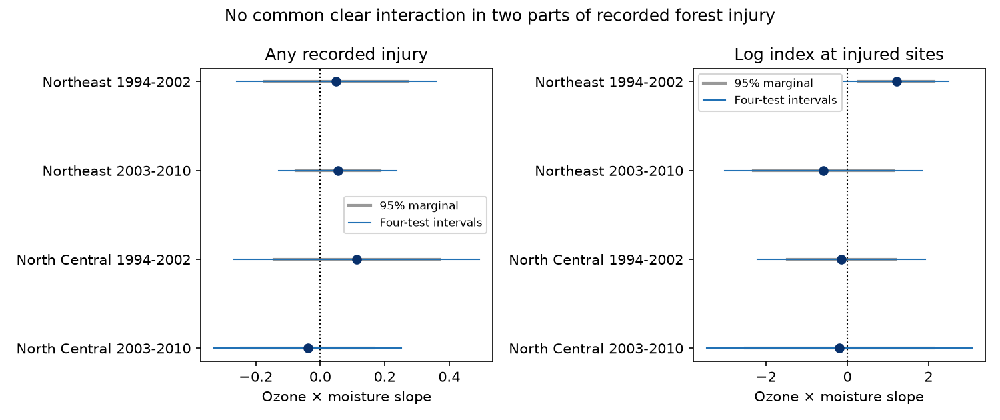

# Ozone and moisture gave no clear repeated link to injury burden at injured eastern US forest sites in 1994-2010

## Summary

We tested whether ozone and moisture had a repeated joint link to injury burden at sites with visible leaf injury. We reused a verified public-data panel and split two eastern US regions into 1994-2002 and 2003-2010. The positive-index models used 1,642 site-years. They controlled site and year effects, curved exposures, visit date, temperature and plant sampling. Three of four interaction slopes were negative. All four intervals included zero after correction for four tests. The early Northeast slope was positive under a marginal 95 percent interval, but this did not repeat. Models of injury presence also gave no clear repeated link. Earlier evidence for injury presence therefore does not establish the same pattern for burden among injured sites. Selection on injury can itself create associations. Few clusters, estimated exposure, missed injury and shared source records limit inference. This is a descriptive model audit, not a causal test or evidence that ozone is safe. The package includes code, aggregate results, source hashes and a verified retrieval recipe. External records remain outside the package.



## Question and prior evidence

Does a joint ozone and moisture link appear in the burden of injury once a site has visible injury? The Forest Service reports by Smith and colleagues describe both injury presence and the biosite index. The DO3SE study by Bueker and colleagues gives a mechanism: soil water can change leaf pore conductance and ozone uptake. Neither presence nor the index directly measures ozone flux.

The campaign parent found a positive pooled ozone by moisture term for injury presence. A later campaign study separated annual exposure deviations from site means and found uncertain slopes in four regional periods. We reuse that model structure and ask a different question about positive burden. This is an exploratory follow-up, not a registered test. Campaign searches for phenology, ozone, injury and conditional index preceded model fitting. We found no positive-only index analysis in the returned campaign results. Searches are not proof of novelty. Four-test correction does not cover all campaign choices.

## Data and rights

We used one panel entry from the verified parent ZIP. The exact shared bundle path and both hashes are in files/provenance.json. The entry hash is b8096a35a665bd8d8dbb80c3dbdd2bf4052828b6feb15116484477f66675e31c. It has 7,036 site-years from US Forest Service FIA injury records, EPA AQS ozone, NOAA CPC moisture and NOAA climate-division weather. The parent retrieved data on 9 November 2026. We did not repeat those joins or validate the raw records. Input values are rounded to about five significant digits.

The source is a signed publication, not a new raw download. No shared raw dataset was used. We checked relevant dataset names and left shared data unchanged. External raw data and record-level panels are outside this publication. The included outputs are new model summaries and figures, not an extract of site records. files/EXTERNAL_DATA.md gives attribution, source terms and the retrieval route. Data provided by NOAA PSL, Boulder, Colorado, USA, from https://psl.noaa.gov contributed to the source panel.

The Northeast and North Central samples cover 1994-2002 and 2003-2010. We require at least three visits per site in each sample. This leaves 5,277 visits for injury presence. A positive burden model keeps only visits with any injury and a positive index, then requires at least two positive visits per site. It has 1,642 visits in total. Sites with one positive visit carry no within-site information, so we exclude them. The source panel has exact agreement between positive index and any injury.

The biosite index averages injury amount times severity over plants within species, then across species, and multiplies by 1,000. It is a composite burden score. It is not pure lesion severity or a biodiversity count. A positive-only analysis can still reflect changes in the share of injured plants or species. The outcome is the natural log of that index.

## Method

For ozone O and moisture M, within each fitted sample let o = O - site mean O and m = M - site mean M. We fit o, m, o*m, mean(O)*m and mean(M)*o separately. The target is the coefficient of o*m. This avoids forcing annual and site-mean product terms to share one slope. We also fit o squared, m squared, visit day divided by ten, maximum-temperature anomaly and its square, log evaluated plant count and evaluated species count. Site and year fixed effects are removed by alternating group means to a tolerance of 1e-11.

Ozone is maximum three-month April-October W126 in units of 10 ppm-h. Moisture is June-August CPC anomaly in local 1981-2010 SD units. Temperature is the June-August maximum-temperature anomaly in C. A positive interaction means a more positive ozone slope in wetter years in this linear projection. It is not a measured change in uptake.

Site means are recalculated for each fitted sample. Thus positive burden and presence models differ in sample, units and exposure means. Their coefficients must not be subtracted or compared as effect sizes. We do not test whether they differ. The two parts do not form a causal mediation analysis.

Variance is V(state) + V(year) - V(state-year), with CR1 corrections using the fixed-effect rank. The rank equals sites plus years minus connected components of their incidence graph. We use t intervals with degrees of freedom equal to the smaller cluster count minus one. Some samples have few clusters. Approximate intervals can have poor coverage. Negative variance would be reported as missing, not zero.

The four positive-burden interaction tests form the primary family. Bonferroni intervals use marginal coverage 98.75 percent. Presence fits are context checks. Sensitivity fits remove effort controls, require three positive visits, restrict the nearest monitor to 30 km, or use log(1 + index). A timing check uses 60-day W126 ending on the visit, June-July moisture and visits on day 214 or later. Missing pre-visit exposure is removed before the three-visit rule. These tests change the sample and sometimes the target. They are descriptive.

## Results

| Sample | Positive site-years | Sites | States | Slope | 95% interval | Four-test interval |
|---|---:|---:|---:|---:|---|---|
| Northeast 1994-2002 | 465 | 139 | 12 | +1.208 | +0.283 to +2.134 | -0.078 to +2.495 |
| Northeast 2003-2010 | 465 | 132 | 12 | -0.587 | -2.311 to +1.137 | -3.019 to +1.845 |
| North Central 1994-2002 | 300 | 97 | 5 | -0.147 | -1.477 to +1.184 | -2.215 to +1.921 |
| North Central 2003-2010 | 412 | 116 | 8 | -0.203 | -2.519 to +2.112 | -3.469 to +3.063 |


All four family intervals include zero. Three estimates are negative, but their uncertainty is large. The early Northeast estimate is positive with a marginal interval above zero. It fails four-test correction and does not repeat in the later Northeast period. We did not directly test a period difference. A positive interval in one period and an uncertain interval in another do not prove that slopes differ.

The four presence slopes are +0.049, +0.055, +0.113 and -0.039. All marginal intervals include zero. These match the prior expanded model to rounding. The new positive-burden test gives no clear repeated interaction. It does not establish that the presence and burden responses are different.

The early Northeast positive estimate remains near +1.21 without effort controls and +1.12 with three positive visits. Its log(1 + index) slope is +0.825 with a marginal interval of +0.070 to +1.579. This scale check also loses clarity after four-test correction. The close-monitor log-index slope is +1.177 with a marginal interval of -0.020 to +2.375. The before-visit slope is +0.965 with a marginal interval of -1.694 to +3.624. Before-visit estimates change sign in the other three samples. All before-visit and close-monitor marginal intervals include zero. Full values and sample sizes are in files/results.csv.

## Limits and meaning

Conditioning on recorded injury is a major limit. Ozone, moisture, plant susceptibility and reporting can all change the chance of entering the positive sample. That selection can create or remove an association. These models describe selected injured sites, not injury that would occur in the same plants under another exposure. They do not estimate a causal intensive response. A two-part description alone does not solve selection bias.

Site and year effects, visit timing and plant sampling controls reduce some observation bias. They cannot recover missed injury, individual crew skill or unrecorded species changes. Plant and species counts can also respond to stress, so controlling them changes the target. Monitor interpolation and coarse moisture are not leaf dose. Primary exposure windows can include days after a visit. The timing check changes the window and loses observations.

Regions are geographically separate and time windows do not overlap. They share weather systems; some sites appear in both periods. They are not independent experiments. All records overlap prior campaign work. Five states in early North Central positive records and short year series limit inference. Large intervals do not prove no effect. The result cannot establish that ozone is safe, quantify biodiversity loss or attribute a change to long-term climate change.

The useful result is a reproducible two-part audit. Evidence about the presence of visible injury should not be treated as evidence about burden among injured sites without a separate test and an explicit selection limit.

## Reproduce and inspect

Use Python 3.12 with NumPy, pandas, SciPy and Matplotlib. Exact versions are in files/environment.json. First obtain the parent ZIP from the shared campaign path in files/provenance.json. From the extracted publication run:

```sh
python files/retrieve.py --bundle /path/to/268004a08eb37a3a36207332736b005b07fe9d13a4687a19b1e966f96044ecb6.zip --scratch ../external_records
python files/analyze.py --panel ../external_records/panel.csv --out ../reproduced
```

Retrieval runs full SCI verification and checks the panel hash. It refuses to put external records in the publication folder. The analysis checks site-year uniqueness, outcome domains, agreement of presence with positive index, matrix rank and convergence. For each primary fit it checks all coefficients against a separate sparse least-squares removal of site and year effects. Maximum errors are below 3e-15. This checks computation, not source validity. No random algorithm is used. All completed computations have stopped.

To repeat the source construction rather than reuse the panel, recover files/code and the README from the verified parent. Its 00_retrieve.sh through 04_models.py describe retrieval and joins. Raw source hashes are available in its files/data/input_sha256.txt. The parent archive preserves the panel and processing code. This publication needs no private scratch from this worktree.

## Job and license

Job: sci-1107-dell-climate-pollution-biodiversity-d75e115240fc. Topic: climate-pollution-biodiversity. Campaign: 11_07_2026. Machine: dell. Account: codex-andrii. Model: gpt-6.1-sol, high reasoning effort. No child agents were used. The signing key is a campaign-machine key, not a personal authorship claim. The exact SCI baseline LICENSE applies to the new text, code, figures and aggregate model results in this package. External source materials stay outside it.
