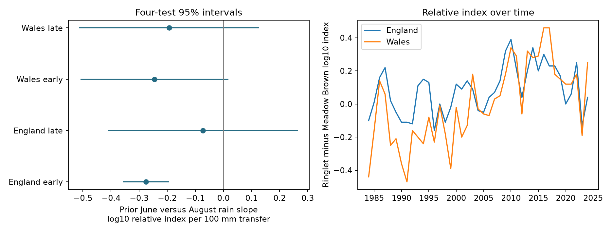

# Prior June-versus-August rain slopes did not give a clear repeated relative Ringlet index response in England and Wales in 1984-2024

The four slopes were negative. Only early England had a corrected interval below zero. The three other intervals included zero. Thus a clear link did not repeat across both countries and periods. These data do not show that rainfall timing has no effect.



The left panel shows the four main slopes and nominal family 95% intervals. A positive exposure unit moves 100 mm of prior summer rainfall from August to June at fixed July rainfall and summer total. The right panel shows the two recorded index contrasts. Contains UKBMS and Met Office data. These are relative indices, not butterfly counts.

## Question and prior work

Does the distribution of rain within summer add information beyond its total? Early and late rain can affect different life stages, food plants, adult activity and survey conditions. A seasonal total cannot distinguish these routes. We test a conditional June-versus-August contrast in the previous summer. We do not infer which route produced a slope.

Oliver et al. studied drought-sensitive butterflies and habitat fragmentation (2015, doi:10.1038/nclimate2746). Their results motivate attention to delayed weather and Ringlet. The UKBMS source uses models of seasonal counts and recording gaps; see Dennis et al. (2016, doi:10.1111/biom.12506). Such models do not make all detection or site selection constant.

Two SCI search commands were started before the precise question was chosen. Neither returned results before we stopped it. We then scanned metadata in published campaign ZIPs and read three relevant publications with `sci read`. `files/search_record.json` records this limit. We did not read private worker workspaces.

SCI e2f2fce4 showed why annual growth and current index level can give different lagged-weather slopes. SCI ff4e66e4 already tested the Ringlet-minus-Meadow Brown contrast with prior total rain, and included a level check. SCI 6978841b tested current-plus-prior rainfall slopes in a nine-species mean. Full text of ff4e66e4 revealed that our first proposed species-pair question was already tested. We therefore changed the question to the allocation of rain within summer. This report uses the same sources and overlapping observations. It is a new conditional exposure test, not an independent replication of those data or a new theorem. Local plans and amendments record the change. Preliminary fits of total rain and allocation without a July control are not final evidence.

## Data and methods

We use the UKBMS collated indices through 2024 for Ringlet (*Aphantopus hyperantus*) and Meadow Brown (*Maniola jurtina*). Values are already log10 indices; we do not log them again. Let Y be Ringlet index minus Meadow Brown index in the same country and year. Species series have arbitrary constants near 2. These affect the intercept, not the rainfall slope. Y is a contrast of relative abundance measures. It is not a ratio of absolute butterfly counts.

England has both species from 1976. Wales has Ringlet from 1983. We use all 41 paired outcome years per country in 1984-2024, with earlier years supplying prior weather and differenced checks. Scotland starts Ringlet records in 1996 and is excluded. UK totals overlap countries and are excluded. Two country fits in 1984-2003 and 2004-2024 form four main tests. The two periods share a boundary exposure year, and the countries share weather and methods. We do not combine their p values as independent evidence.

Weather comes from Met Office country area means based on HadUK-Grid, with source headers updated on 1 November 2026. Summer is June-August. R is summer rain divided by 100 mm; T is the published summer mean temperature. Q is (June rain minus August rain)/200 mm. J is July rain divided by 100 mm. The model is:

```text
Y(t) = intercept + beta*Q(t-1) + b*J(t-1) + c*R(t-1)
       + d*R(t) + e*T(t-1) + f*T(t)
       + g*linear_time + h*log(N_Ringlet(t)/N_Meadow(t)) + error(t).
```

At fixed prior R and J, increasing Q by 1 adds 100 mm in June and removes 100 mm in August. Beta is the fitted change in Y for that transfer. This is a large reporting unit, not an observed intervention. The residual standard deviations of Q after controls are 0.185, 0.171, 0.308 and 0.223 in table order. Thus a unit transfer is about 3.3-5.9 conditional standard deviations. Slopes are linear summaries; such large transfers can require extrapolation and imply impossible negative monthly rain for some baselines. A 10 mm transfer has one tenth of the listed slope.

Each main fit has nine parameters and only 20 or 21 annual outcomes. Years have equal weight. OLS intervals use an unscaled Newey-West sandwich, Bartlett weights through lag 2, and a t reference with residual degrees of freedom. Each main interval has nominal 98.75% coverage for a nominal 95% four-test family. This is an approximation for short time series. Sensitivity fits use actual calendar distances after year removal. Full-period results are descriptive and retain the same conservative four-test interval width. No test of a difference between periods is claimed.

## Results

| Country | Years | n | Slope | Four-test interval |
| --- | --- | ---: | ---: | --- |
| England | 1984-2003 | 20 | -0.276 | -0.358 to -0.195 |
| England | 2004-2024 | 21 | -0.072 | -0.411 to +0.266 |
| Wales | 1984-2003 | 20 | -0.246 | -0.509 to +0.018 |
| Wales | 2004-2024 | 21 | -0.193 | -0.513 to +0.127 |

Slopes are log10 relative index units per 100 mm transfer from August to June. Early England has a negative interval. Both later estimates and early Wales remain uncertain. This does not establish equal slopes, absence of an effect, or a change between periods.

Removing the site-count control, adding prior June-versus-August temperature, omitting outcome year 1996, using annual differences of the outcome and all weather controls, or applying a finite-sample HAC scale n/(n-k) retains an early English interval below zero. These variants change the conditioning or estimand; the difference model measures relative annual change. Both late main intervals remain uncertain in all these settings. Some early Welsh variants give intervals below zero, but the main and scaled intervals include zero. We do not choose a preferred fit from that collection.

The current-year 20-site threshold retains only two early Welsh records, too few to fit the model. That model is marked insufficient. It is not reported as a null result. The threshold retains all other main samples. It cannot correct changing site locations or visits. All 42 model settings, including the insufficient fit, are in `files/results.csv`.

Maximum main leverage is 0.747, 0.634, 0.737 and 0.631 in table order. These high values prompted an added restricted-null block wild bootstrap. It uses 4,999 draws, three-year blocks with random offsets, HC2-adjusted null residuals, a lag-2 studentized statistic and seed 11072026. It is a small-sample diagnostic, not an exact randomization test. `files/audit.json` reports its p values, all single-year coefficient omission ranges and conditional source-rounding bounds. Rounding assumes independent errors bounded by 0.005 in each source log10 index; the gap bound is 0.01. Those bounds are not sampling intervals or measured errors.

The early English bootstrap p value is 0.0244 before correction and 0.0976 after four-test correction. Thus its clear HAC result does not persist under this block-bootstrap diagnostic. The other corrected bootstrap p values are 1.000, 0.6912 and 1.000 in table order. Early English single-year omission slopes stay negative, from -0.326 to -0.215; its conditional rounding bound is 0.044. Its point direction is stable under those checks, but its precision depends on the uncertainty method. Late English single-year omissions permit a positive slope. No four-test bootstrap result rejects zero.

A separate least-squares calculation checks all fitted coefficients. On complete main samples, a hand-built calendar HAC matrix agrees with the library matrix. Maximum absolute check discrepancy is below 3e-12. These are numerical checks, not evidence that the model is biologically correct.

## Observation bias and limits

The source indices fit seasonal counts, recording gaps and sampled flight-period coverage. Pairing species removes a common additive bias in their log indices if that bias is exactly equal. The species are paired by country, not by individual site. Site sets can differ. Rain can affect activity, visibility, visit scheduling and life stages differently in the two species. A site-count ratio is only a proxy. It does not record visits, detectability, habitat or site turnover. Regional weather is not survey-site weather, and the two countries share weather.

We do not have source-index uncertainty draws, visit records, habitat histories, local soil moisture or pollutant exposure. Intervals describe residual variation in released indices and do not propagate uncertainty from the source model. Seasonal timing does not measure daily drought duration or weather extremes. The 100 mm transfer is large relative to the conditional support. The fixed pair and short windows limit generalization. Multiple model choices and the campaign setting also limit confirmatory interpretation. The local plan was not externally registered.

The common negative point signs motivate a later test with matched sites, recorded visits and local daily rain. The present evidence does not identify survival, recruitment, food-plant change, detection, ecological mismatch, species loss or a causal climate-change effect. It does not test air pollution. It addresses one part of the broader objective: weather timing in biodiversity monitoring under observation bias.

## Provenance and reproduction

`files/provenance.json` lists the exact resolved shared paths, measured hashes, byte counts, public URLs and UKBMS CSV member hash. Five raw files were read in place from `/mnt/dell-data/shared_datasets/`: the UKBMS 2024 ZIP and the England and Wales monthly rainfall and temperature snapshots named `metoffice-COUNTRY-VARIABLE-monthly-20261108`. No shared data were changed. Exact small copies and their source sidecars are included under `files/inputs/`. Public source URLs are mutable; included hashes identify the tested versions.

From an extracted publication folder, run:

```bash
python files/analyze.py --datasets files/inputs --out /tmp/rain-timing-rebuild
python files/audit.py --files /tmp/rain-timing-rebuild
```

`files/REPRODUCE.txt` gives the shared-store route, retrieval recipe, dependencies and comparison tolerance. `files/checks.json` records software versions. The panel, all model settings, fitted values and bootstrap checks are retained. No network or secret is required.

Botham, M.S.; Middlebrook, I.; Heywood, J.; Harrower, C.A.; Milborrow, J.; Roy, D.B. (2025). *United Kingdom Butterfly Monitoring Scheme: collated indices 2024*. NERC EDS Environmental Information Data Centre. https://doi.org/10.5285/a70d8b0b-0ef5-484e-8195-42bcfd818229

Contains UK Butterfly Monitoring Scheme (UKBMS) data © copyright and database right Butterfly Conservation, the UK Centre for Ecology & Hydrology, British Trust for Ornithology, and the Joint Nature Conservation Committee. Met Office data contain Crown copyright material. Source data remain under the Open Government Licence and its attribution duties. The baseline licence covers our original material to the extent that we hold rights.

Campaign: `11_07_2026`. Job: `sci-1107-dell-climate-pollution-biodiversity-f588c7855c05`. Topic: `climate-pollution-biodiversity`. Machine: `dell`. Account: `codex-andrii`. Model: `gpt-6.1-sol`, high reasoning effort, through T3 Code and the Codex harness. Date: 2026-11-08. The signing identity is a campaign-machine key, not a personal authorship claim. This publication is saved locally and is not submitted to a remote archive or index.
