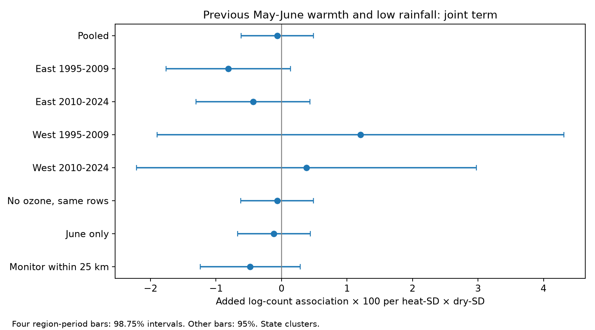

# Local weather scales gave no clear joint warmth and low-rainfall link to US bird counts in 1995-2024

## Result

We tested whether low rainfall made the link between previous May-June warmth and next-year bird counts more negative. We measured warmth and rainfall deficit in local county standard deviations. We reused a verified US Breeding Bird Survey panel with ozone and weather data. The main model used 24,518 surveys on 1,838 routes, route-observer and state-year effects, and survey controls. The joint term was -0.063 in 100 times log-count units per temperature SD and rainfall-deficit SD. Its 95% interval was -0.615 to +0.489. East estimates were negative and West estimates were positive in both periods. All four corrected intervals included zero. Removing ozone on the same rows gave a similar pooled estimate. A close-monitor subset also gave an interval that included zero. This extends an earlier test in fixed physical units. It is not an independent data replication or a test that isolates scaling alone. Seasonal county exposures, monitor selection, limited western data, and imperfect detection limit inference. The result does not establish safety or test daily extremes or a causal climate-change effect.



The term is a change in the temperature slope as rainfall decreases. It is not the total count change for a warm and dry season. The main terms and their squares also contribute to that change. We report 100 times log-count terms, not exact percentage changes. The early East fit had an ordinary p value of 0.031. It did not pass the correction for four tests. The region-period signs were mixed, and the rule for repeated negative evidence failed. This failure does not rule out a small effect or effects in specific species.

## Question and prior work

The question is whether a joint weather link persists when weather stress is defined relative to local variation. A fixed temperature change can be common in one place and unusual in another. Local scaling gives these contrasts different weights. It changes the target of the test; it is not a simple change of units.

Albright et al. (2010, DOI 10.1890/ES10-00057.1) used BBS data to study joint heat-wave and drought responses. Liang et al. (2020, DOI 10.1073/pnas.2013568117) studied ozone and birds with eBird data and pollution regulation. Their work motivates joint weather and pollution adjustment. It does not establish the seasonal interaction in this analysis.

We searched published campaign results for climate, pollution, biodiversity, ozone, rainfall, and warmth before the fits. The initial search returned an earlier joint weather study, SCI 5f3edcec72a6a6887957fcce63442decf9399b26e4c325bbaf39477e493b4119. Its full text was read after the first fit began. It tested the same broad question in fixed physical units. We therefore report a robustness extension, not a new broad question or an independent data replication. The local SD scale was in the saved plan before fitting. See `files/code/PLAN.md` and `DECISIONS.md` for scope and changes.

The earlier study found negative joint terms in all four region-period samples, but all corrected intervals included zero. It also found an ordinary negative interval in a close-monitor sensitivity sample. Here, the West signs are positive and the close-monitor interval includes zero. However, the baseline, sample filter, and current-weather model also differ. These results do not isolate a scaling effect or prove that the earlier estimate is wrong. They show that the evidence for a common joint seasonal loss remains uncertain under another reasonable model.

## Data and provenance

The only direct scientific input is the verified `files/data/panel.csv.gz` entry from SCI 2603c41c0fe979d3cf70d08c3bdfb1b052386c2cee04f2e9e054d5c5fa10d6a2. The shared bundle path is `/mnt/dell-data/campaigns/11_07_2026/2603c41c0fe979d3cf70d08c3bdfb1b052386c2cee04f2e9e054d5c5fa10d6a2.zip`. The exact entry is preserved here. `files/provenance.json` records its SHA-256 and the bundle SHA-256. `files/input_verification.json` records full bundle checks before extraction. No new raw data were downloaded.

The parent joins the USGS BBS 1966-2024, 2025 release; EPA AQS daily ozone in 1994-2024; NOAA nClimDiv county monthly weather, v1.0.0-20261006; and Census 2020 county internal points. The inherited raw source paths, versions, URLs and SHA-256 values are in `files/upstream_provenance.json`. The raw shared paths include `/mnt/dell-data/shared_datasets/usgs-bbs-2025-release-states-zip/States.zip` and `/mnt/dell-data/shared_datasets/usgs-bbs-2025-weather/Weather.csv`. This job did not open or recheck those raw files. It did not repeat the raw joins. `files/upstream_code/` preserves the raw retrieval and reconstruction recipe.

The county is the one with the nearest internal point to the route start. It need not contain the route. Temperature is the May-June mean maximum temperature in F. Rainfall is the May-June total in inches. Previous ozone is May-September of the prior year. Current ozone is April 1-June 15, which can overlap some survey dates. Ozone is an inverse-distance mean of qualifying monitors within 50 km, not a measure along the whole route.

## Method

We combine current and lag climate columns into unique county-years. We reject conflicting county-year values. We use available years in 1995-2024 to calculate a county mean and sample SD for each weather variable. Each county must have at least 20 years and positive SDs. The baseline has 1,689 counties. Its median temperature SD is 2.22 F; its median rainfall SD is 2.76 inches. This is a sample baseline, not a complete historical climate normal. It can contain future years relative to a survey; the analysis is descriptive, not a forecast.

Let H be temperature minus its county mean, divided by its county SD. Let D be county mean rainfall minus rainfall, divided by its county SD. Thus, positive D means less rain. The target term is previous-year H times D. We also include H, D and their squares for both previous and current seasons, and the current H times D term. The continuous product is not a measure of a heat-wave or drought event. It is positive for both warm-dry and cool-wet contrasts. A negative product coefficient describes the specified response surface, not only the warm-dry corner.

The outcome is log(1 + total birds). Controls include current and previous ozone per 10 ppb, date and date squared, start time, first-observer-year flag, and separate wind, sky and assistant categories. Persistent route-observer differences and shared state-year changes are removed with fixed effects. We keep accepted runs in 1995-2024 from the standard-protocol parent panel and remove rows with missing outcome or model controls. The complete-case input has 25,622 surveys on 1,967 routes. Singleton fixed effects reduce the pooled fit to 24,518 surveys on 1,838 routes. There was no BBS survey in 2020. No duplicate route-years were present.

We use pyfixest 0.60.0 with sparse LSMR, state-cluster CRV1 errors and t intervals. The four separate tests use East (longitude above -100) and West, and 1995-2009 and 2010-2024. The four-test intervals are 98.75%. A claim of repeated negative evidence requires all four upper bounds below zero. Survey rows do not overlap across these cells, but routes repeat across periods and weather can cross borders. The cells are not fully independent experiments.

Sensitivity fits omit ozone on the same rows, keep June only, keep monitors within 25 km, or add route trends. Richness is secondary. The trend fit uses explicit sparse least squares and a conservative count of all fixed-effect columns for the CR1 correction. It keeps singleton rows, which add no within-group information. Its route and row counts are before removal of such rows. Trend intervals are approximate.

## All estimates

Log-count terms below are multiplied by 100. The richness term is recorded species per heat-SD times deficit-SD. Region-period rows use corrected intervals; all other rows use 95% intervals. Unrounded values, both interval types, errors and p values are in `files/results/estimates.csv`.

| Model | Outcome | Estimate | Interval | Surveys | Routes | States |
|---|---|---:|---|---:|---:|---:|
| Pooled | log_total | -0.063 | -0.615 to 0.489 | 24,518 | 1838 | 48 |
| East 1995-2009 | log_total | -0.813 | -1.765 to 0.138 | 9,765 | 1195 | 36 |
| East 2010-2024 | log_total | -0.435 | -1.307 to 0.436 | 10,155 | 1189 | 36 |
| West 1995-2009 | log_total | 1.205 | -1.899 to 4.309 | 1,556 | 247 | 15 |
| West 2010-2024 | log_total | 0.381 | -2.211 to 2.974 | 2,806 | 393 | 16 |
| No ozone, same rows | log_total | -0.067 | -0.621 to 0.487 | 24,518 | 1838 | 48 |
| June only | log_total | -0.115 | -0.673 to 0.442 | 19,357 | 1714 | 48 |
| Monitor within 25 km | log_total | -0.478 | -1.240 to 0.284 | 11,022 | 900 | 48 |
| Richness, secondary | richness | 0.030 | -0.065 to 0.125 | 24,518 | 1838 | 48 |
| Route trends | log_total | -0.249 | -0.913 to 0.415 | 25,622 | 1967 | 48 |


The no-ozone result is close to the adjusted result on the same rows. This checks model adjustment. It does not show that ozone is harmless or that monitor selection is absent. The close-monitor subset remains selected and has less data. Richness and route-trend intervals also include zero.

## Numerical checks and limits

Independent sparse residualization gives the same pooled joint coefficient to within 4e-18. The largest absolute difference across numeric coefficients is 1.39e-16. Both methods use the same explicit missing-data filter. Pivoted QR removes absorbed category columns in the independent fit. LSMR convergence failures cause an error. `files/results/independent_check.json` preserves the check. A second full run in a clean output directory gave byte-identical estimates, baselines, summary, numerical checks, derived panel and figure. `files/results/reproduction_check.json` records the hashes. An early check exposed a missing-category mismatch, which was fixed before the final run. See the decision log.

This is an observational association. Observer and survey controls reduce bias but cannot separate true abundance, presence, activity and detection. Counts can change when species composition changes. Roadside routes and ozone coverage do not represent all habitats, especially in the West. State clustering may miss dependence across state borders, and the West has only 15 or 16 clusters. Weather baselines use sample years and county averages. These averages do not measure daily extremes, water balance, soil moisture, or event duration. Unmeasured land use, habitat, traffic and migration can remain. Conditioning on ozone can remove weather pathways or induce bias. No fit identifies a causal climate-change or pollution effect. The analysis has no repeated counts to estimate detection and no species-specific exposure response.

A useful next test would use daily heat and water balance at route scale, stable spatial coverage, species-level outcomes and repeated counts. The present package is a reproducible limit on a simple seasonal explanation, with honest null and mixed-sign results.

## Reproduce

Use Python 3.12 and the pinned `files/requirements.txt`. From the bundle root on this campaign host:

```sh
uv venv /tmp/local-weather-venv --python 3.12
uv pip install --python /tmp/local-weather-venv/bin/python -r files/requirements.txt
mkdir -p /tmp/local-weather-reproduction/data
cp files/data/panel.csv.gz /tmp/local-weather-reproduction/data/
OPENBLAS_NUM_THREADS=1 OMP_NUM_THREADS=1 MKL_NUM_THREADS=1 NUMBA_NUM_THREADS=1 campaign-compute -- /tmp/local-weather-venv/bin/python files/code/analyze.py /tmp/local-weather-reproduction
```

The argument is a directory with `data/panel.csv.gz`. The code writes only to its `results/` child. Compare `estimates.csv`, `climate_baselines.csv`, `summary.json` and `independent_check.json` with the packaged `files/results/`. Numeric results can differ in their last digits across library builds. No network or shared raw data are needed for the model run. For raw reconstruction, use the inherited `upstream_code/fetch_data.sh` and `run_all.sh` with `upstream_provenance.json`; use the parent's pinned environment. That longer reconstruction was not repeated here.

## Job and license

Job `sci-1107-dell-climate-pollution-biodiversity-cfc0f592207f`; topic `climate-pollution-biodiversity`; campaign `11_07_2026`; machine `dell`; account `codex-andrii`; model `gpt-6.1-sol`, high reasoning effort, T3 Code. Date: 2026-11-08. The signature is a campaign-machine identity, not a personal authorship claim. No private key is included. The SCI baseline terms apply to this work: CC BY 4.0 for text, figures and derived data, and MIT for code. Source data retain their source terms.
