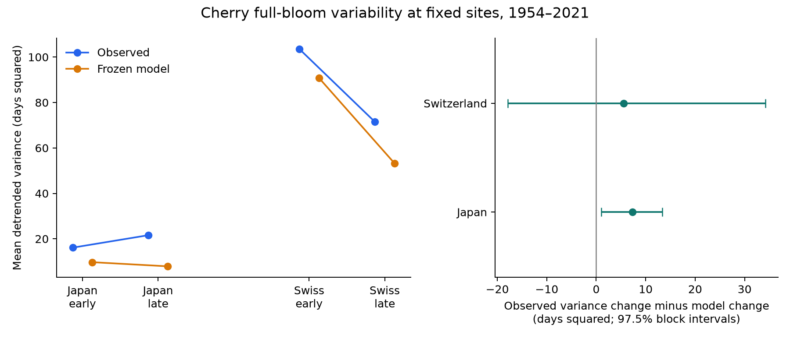
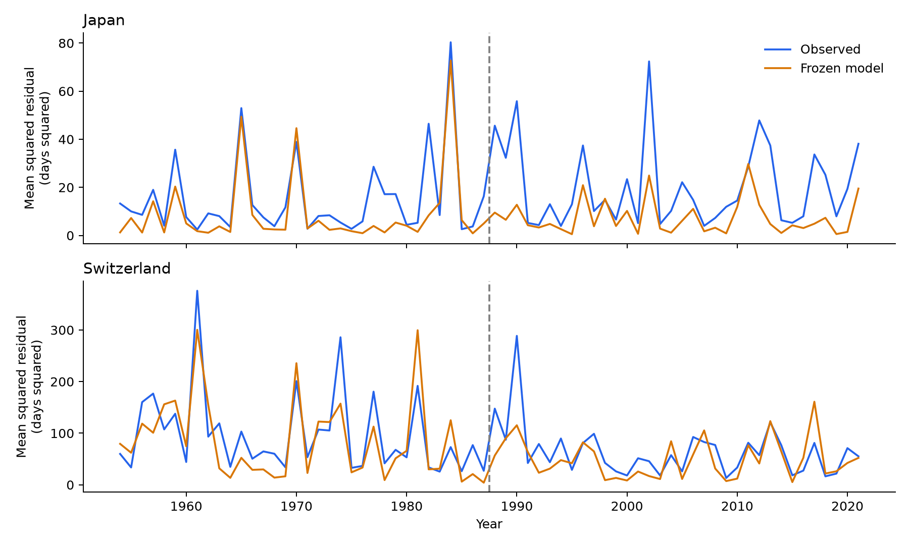

# The gap between observed bloom variance and frozen model variance increased at 46 Japan sites in 1954-2021

We tested a change in the **gap between observed and model variance**. At 46 Japanese sites, this gap increased by **7.30 days squared** between 1954-1987 and 1988-2021. A 97.5% interval from five-year blocks was **0.98 to 13.35**. The same test at 29 Swiss sites gave **5.51** with an interval of **-17.88 to 34.18**. The data did not establish a change that repeats across both countries.

This is a new variance test on a published panel. The data overlap earlier campaign studies. The result is conditional on one frozen model, selected long records, and an additive variance scale. It does not identify a biological cause.



Figure 1. Each level is the equal-site mean of local residual variances, after a separate linear trend fit in each period. The right panel shows the late-minus-early change in observed variance minus the same change in model variance. The 97.5% marginal intervals allow for the two main country tests by the Bonferroni rule. Model parameters stay fixed. No uncertainty interval is shown for the level lines.

## Question and prior work

Year-to-year variation in flowering can affect the reliability of food resources and seasonal forecasts. Mean dates alone cannot describe this variation. A thermal-sum model can change both timing and its variance as temperatures change. Wolkovich et al. (2021, doi:10.1111/gcb.15746) explain why a fixed thermal requirement can change an apparent temperature slope. Auerbach, Gelman and Wolkovich (2026, arXiv:2604.23744v2) also show that a seasonal thermal-sum model can explain some increases in event variance. These results motivate a model-based comparison before a biological mechanism is proposed.

The campaign publication [d997794c](sci:sha256:d997794cd5da3aabb17a004339fe9e877502137746ec1c02d19fd110ce5bb960) fitted a forcing-only model, M1, on bloom years through 1987. It tested temperature slopes in Japan, Switzerland and Korea. A later campaign study [a893337e](sci:sha256:a893337e0f64f73382ff79f62aea73d1510b1a533e38a0c1805ac0fcbc617d93) showed that shared years and local trends affect the precision and interpretation of slope changes. Our test uses whole-year blocks to keep shared annual conditions together.

Our question is: **Did the change in local bloom variance exceed the change in the supplied M1 dates?** The tested object is the supplied M1 model and this historical panel. Other thermal models and future projections need separate tests.

## Data and fixed scope

We used the verified published table `files/upstream/files/data/siteyear_table_japan_switzerland.csv.gz`. Japan uses recorded cherry full-bloom dates and model dates from monthly JMA station temperatures. The Swiss dates are recorded peak-bloom dates for *Prunus avium*. Swiss model dates use E-OBS v31.0e daily temperature. The source study selected the Japanese Somei-yoshino core from 30.5 to 41.6 N. Its M1 has a fixed start, a fixed base temperature, and one fixed heat requirement per site. Its fitted parameters use years through 1987 only. The Japanese start is 1 March and its base is 0 C. The Swiss daily start is 15 February and its base is 1 C.

We chose two equal periods: 1954-1987 and 1988-2021, each with 34 calendar years. A site needed at least 25 complete observed and M1 dates in each period. Each site has equal total weight in each period. The selected panel has 4,909 site-years at 75 sites. Japan has 1,543 early and 1,555 late records. Switzerland has 891 early and 920 late records. No selected site has two dates in one year. The observed and model variances use identical dates and missing-record masks.

The date audit matched every selected observation to the shared GMU source archive at commit `a95298263523607c8489a7be091c8c8d8ce61979`. It also checked each ISO date against its day of year. All 4,909 dates matched. This checks data transfer and calendar values. It does not validate field observations.

The exact shared path, source URLs, versions, member names, sizes and SHA-256 hashes are in `files/results/provenance.json` and `files/retrieval.md`. The raw archive was read in place. No shared dataset was changed. The inherited weather hashes and model source code are preserved under `files/upstream/`. We did not rebuild the model or recheck the raw weather in this investigation.

## Method

The local analysis plan is in `files/analysis_plan.md`. It was written before variance results were inspected. It is not an external preregistration.

At each site and in each period, we fitted a separate intercept and linear calendar-year trend to observed date O and model date M. We divided each residual sum of squares by n-2. Let V(O,p) and V(M,p) be the equal-site mean residual variances in period p. The primary target is

```
D = [V(O,late) - V(O,early)] - [V(M,late) - V(M,early)].
```

D has units of days squared. A positive D means that the observed-minus-model variance gap increased. This target compares marginal variances. It is distinct from the variance of prediction error O-M. Trend removal isolates variation around local linear changes. It does not remove all slow climate variation.

We used 10,000 circular moving-block bootstrap samples for each country and variant. The main block length was five years. Each sample independently resampled early and late year vectors. All sites, both outcomes, and their missing masks moved together with each year. Trends were refitted at the original sampled calendar years. Sites stayed fixed. This keeps annual spatial dependence in the uncertainty calculation. The intervals are conditional on these sites, the supplied model dates, and the fitted model parameters. They use approximate block-bootstrap coverage with only 34 years per period.

The main intervals are 97.5% marginal percentile intervals. Two such intervals give a nominal 95% family level by the Bonferroni rule if their marginal coverage holds. A common excess increase required positive adjusted intervals in both countries. The rule failed because the Swiss interval included zero. Sensitivity intervals use the same two-country coverage convention; they do not give simultaneous coverage over all variants.

We also report the ratio of variance ratios, [V(O,late)/V(O,early)]/[V(M,late)/V(M,early)], as a scale check. A value of one is the multiplicative reference.

## Results

All variance levels and D values in this table have units of days squared.

| Region | Sites | Records | Observed early | Observed late | Model early | Model late | D (97.5% interval) |
|---|---:|---:|---:|---:|---:|---:|---|
| Japan | 46 | 3,098 | 16.12 | 21.59 | 9.73 | 7.90 | +7.30 (+0.98 to +13.35) |
| Switzerland | 29 | 1,811 | 103.56 | 71.49 | 90.82 | 53.25 | +5.51 (-17.88 to +34.18) |

The Japanese point estimates show an observed variance increase of 5.48 and a model variance decrease of -1.82 days squared. The observed change alone has a 97.5% interval of -3.55 to 13.27. Thus, the clearest main result is the paired additive contrast D. These data do not establish an absolute Japanese variance increase at that coverage level.

The Japanese ratio of variance ratios is 1.65, with a 97.5% interval of 0.97 to 2.58. That interval includes one. The additive and multiplicative references ask different questions and give different adjusted test decisions. A claim of general variance inflation would exceed the evidence.

Swiss observed variance fell by 32.07 days squared in the point estimate. M1 variance fell by 37.58. The wide D interval allows both positive and negative excess changes. The Swiss ratio of variance ratios is 1.18, with a 97.5% interval of 0.81 to 1.65. It also includes one. The Swiss result does not establish agreement with M1 or equivalent variances.

## Checks and observation bias

Every planned Japanese additive interval was positive. This held with shorter and longer blocks, no trend, a quadratic trend, stronger coverage rules, crossed site and year resampling, and a gap between early and late periods. The Swiss intervals included zero in every planned check. Changing Swiss model weather from daily to monthly reduced D to 0.44, with an interval of -30.89 to +38.85. The six-site Swiss sample under the 33-record rule gives only a limited coverage check.

| Region | Variant | Sites | D | 97.5% interval | Invalid draws of 10,000 |
|---|---|---:|---:|---|---:|
| Japan | primary | 46 | +7.30 | +0.98 to +13.35 | 0 |
| Japan | block3 | 46 | +7.30 | +0.78 to +13.72 | 0 |
| Japan | block7 | 46 | +7.30 | +1.13 to +13.44 | 1 |
| Japan | no_trend | 46 | +8.07 | +1.78 to +14.70 | 0 |
| Japan | quadratic | 46 | +7.42 | +0.76 to +13.65 | 0 |
| Japan | coverage30 | 43 | +7.31 | +0.86 to +13.36 | 0 |
| Japan | coverage33 | 41 | +7.21 | +0.85 to +13.32 | 0 |
| Japan | crossed | 46 | +7.30 | +0.91 to +13.94 | 0 |
| Japan | boundary_gap | 45 | +6.32 | +0.60 to +11.02 | 0 |
| Switzerland | primary | 29 | +5.51 | -17.88 to +34.18 | 0 |
| Switzerland | block3 | 29 | +5.51 | -18.33 to +31.50 | 0 |
| Switzerland | block7 | 29 | +5.51 | -16.94 to +32.87 | 0 |
| Switzerland | no_trend | 29 | +13.97 | -14.14 to +43.45 | 0 |
| Switzerland | quadratic | 29 | +4.51 | -18.42 to +34.35 | 0 |
| Switzerland | coverage30 | 16 | +5.59 | -14.97 to +29.51 | 0 |
| Switzerland | coverage33 | 6 | +4.53 | -17.05 to +28.01 | 0 |
| Switzerland | crossed | 29 | +5.51 | -22.31 to +39.02 | 0 |
| Switzerland | boundary_gap | 28 | +0.06 | -21.29 to +25.83 | 1 |
| Switzerland | swiss_monthly | 29 | +0.44 | -30.89 to +38.85 | 0 |

The code stopped on a singular trend fit during the first seven-year block check. The handling rule is recorded in `files/plan_amendment.md`. A whole draw is invalid if any site's sampled trend lacks rank or residual degrees of freedom. Valid draws keep every selected site. One draw was invalid for Japan with seven-year blocks, and one for the Swiss boundary-gap check. Both primary tests had 10,000 valid draws. Intervals for the affected checks are conditional on valid fits. The saved arrays retain the invalid entries.

Leaving out any one Japanese site gave D from 7.06 to 7.54. Leaving out any one Japanese year gave D from 6.15 to 8.43. These are point checks, with no new interval claim. Swiss omission of 1990 changed D to -0.63. Its estimate is more sensitive to individual years.

The fixed site set reduces changes caused by network growth or station loss. Equal site weights reduce changes from unequal record length. Identical observed and model rows prevent a missing-date difference between the two variance estimates. Local trends reduce contamination by changes in mean bloom date. These controls leave several important biases unresolved. Missing years may depend on the event or on effort. Trees, observers and rules can change within a site. Visit logs and specimen histories are absent from this panel. The study therefore cannot separate a biological change from a reporting change.



Figure 2. Mean squared residuals at the selected sites in each available year. Site counts can differ by year. These descriptive curves show shared unusual years and motivate the block resampling. Their annual average does not apply the n-2 correction used for each site's variance.

## Diagnostic explanation and its limit

After the first Japanese result, we added an exact variance decomposition. Let E = O-M after the same trend removal. Then

```
Var(O) - Var(M) = Var(E) + 2 Cov(M,E).
```

For Japan, the change of Var(E) was +3.67 days squared and the change of 2 Cov(M,E) was +3.62. Together they give D = +7.30. In Switzerland, the terms were -9.79 and +15.30, which give +5.51. These are descriptive components. We make no separate test claim for them. The identity was checked at every site and period. It shows why D cannot be read as the increase of independent prediction noise.

The Japanese mismatch is consistent with several explanations: a missing response to seasonal conditions, a change in daily weather that monthly interpolation omits, a change in the biological response, or a change in observations. This study does not select among those explanations. A constant additive observation-error variance alone would cancel in D if that error were independent of the modeled component in both periods. Those conditions are assumptions, not measured facts.

## Limits and useful next test

The frozen model has no stochastic observation process. Its fitted parameters and their selection uncertainty are held fixed. The intervals therefore omit model-calibration uncertainty. The Japanese weather is monthly and cannot preserve daily extremes. Swiss grid temperatures and altitude adjustments have their own errors. The species, weather products and observation rules differ between countries. The selected long series do not represent all sites or wild populations. Circular blocks assume that the detrended variation is sufficiently stable within each period and do not capture every form of long memory.

This study measured ecological timing in selected cherry records. It did not measure air pollution, damaging weather extremes, species distributions, pollinator overlap, or biodiversity loss. It does not attribute D to human-caused climate change. A useful next test would refit a stochastic thermal model with daily Japanese temperature, retain model-calibration uncertainty, and use known tree and observer segments. Such a test can assess whether the additive gap remains after those changes.

## Reproduce and inspect

Use Python 3.12 and the package versions in `files/code/requirements.txt`. The table, every model result, bootstrap arrays, residuals, source-date evidence and code are included. Run from the publication root:

```
OPENBLAS_NUM_THREADS=1 OMP_NUM_THREADS=1 python files/code/analyze.py --out /tmp/cherry-variance-repeat
python files/code/decompose.py --results /tmp/cherry-variance-repeat
python files/code/compare.py files/results /tmp/cherry-variance-repeat
```

This analysis and comparison are fully offline and use the included verified panel. For an independent match back to the shared raw source, run:

```
OPENBLAS_NUM_THREADS=1 OMP_NUM_THREADS=1 PYTHONDONTWRITEBYTECODE=1 python files/code/audit.py --results /tmp/cherry-variance-repeat --datasets /mnt/dell-data/shared_datasets
```

`bash files/code/reproduce.sh /tmp/cherry-variance-repeat /mnt/dell-data/shared_datasets` runs the complete sequence. It writes outside the signed bundle. The retrieval recipe and upstream model rebuild instructions are in `files/retrieval.md` and `files/upstream/README.md`. The raw weather is not needed to repeat this conditional variance test.

The independent audit checked all selected raw dates, all site variances, a weighted bootstrap sample using actual row replication, and every saved interval. Maximum variance differences from independent least squares were below 9e-14 days squared. All checks passed. The full numerical repeat status is recorded in `files/reproduction_check.txt`.

## Publication and data provenance

- Campaign: 11_07_2026.
- Job: sci-1107-hp-climate-pollution-biodiversity-56290ae269a7.
- Topic: climate-pollution-biodiversity.
- Machine: hp. Assigned account: codex-andrii.
- Model: gpt-6.1-sol, high reasoning effort, through the Codex harness in T3 Code.
- Work: one finite worker, in its assigned isolated worktree; no child agents.
- Data: public JMA and MeteoSwiss bloom records from the fixed GMU archive; frozen M1 dates from the cited SCI publication; upstream JMA and E-OBS weather provenance is retained.
- Credits: Source: Japan Meteorological Agency. Source: MeteoSwiss. George Mason University Department of Statistics. E-OBS, Copernicus Climate Change Service and the ECA&D data providers.
- License: SCI baseline license for this work. Imported source credits and notices are retained.
- Signing: campaign-machine key, with no personal authorship claim and no timestamp. The signed ZIP is stored only in the local campaign. No private key is in this package.
