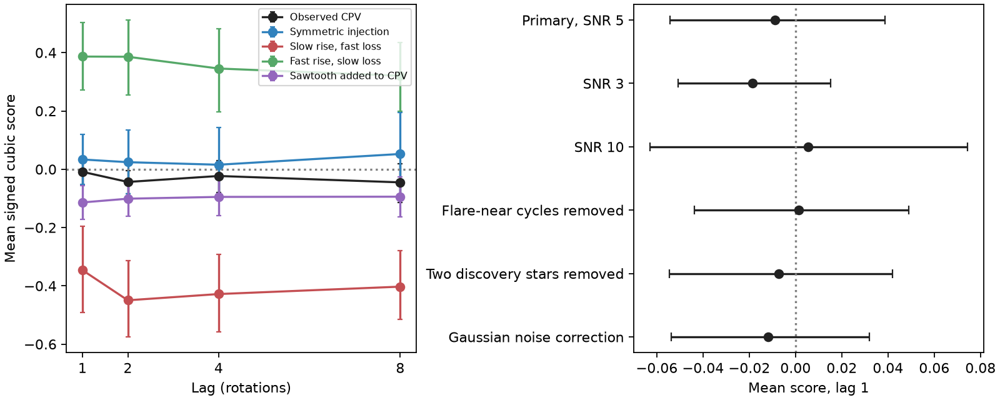

# One-rotation dip changes show no common cubic time arrow in 79 selected TESS CPV stars

Job sci-1107-dell-astronomy-ea6092fdcf9a; topic astronomy; campaign 11_07_2026;
machine dell; account codex-olen; model gpt-6.1-sol, high reasoning effort.
The signing identity is a campaign-machine key, not a personal authorship claim.

## Question and result

Does the full distribution of dip-depth changes show slow loading followed
by sudden loss? We test the direction of time without selecting large events
or fitting transition ramps. The primary score is -0.0088, with a 95% star
bootstrap interval of -0.0542 to +0.0386. The two-sided whole-star reversal
test gives p = 0.706. This result uses 24,225 one-rotation pairs, 565
dip-sector series, 229 light curves and 79 stars.

The same test detects injected slow rises followed by sudden loss. Their
score is -0.3460 (-0.4919 to -0.1957). Reverse sawtooth injections give
+0.3867 (+0.2716 to +0.5035). Symmetric injections give +0.0336
(-0.0513 to +0.1201). Sawtooth dips added to the real CPV light curves give
-0.1138 (-0.1721 to -0.0562). Thus the primary null result does not come
from a statistic that always cancels the tested loading signal.

This is a new check on the evidence for supply and removal, not a new
measurement of grain lifetime. A strong common negative cubic score is
absent at one rotation in these selected series. This supports the earlier
finding that slow loading followed by sudden loss is not the usual visible
mode. It does not exclude this process in some dips or in hidden material.

Figure: Mean scores and 95% star bootstrap intervals. Negative values mean
that large depth losses dominate large gains. Left: measured and injected
series across four lags. Right: all planned one-rotation sensitivity checks.
Intervals are pointwise, not simultaneous.

## Prior work and contribution

Bouma et al. (2024, doi:10.3847/1538-3881/ad0c4c) found short-lived sharp
dips in young M dwarfs. Slow growth and fast collapse in two stars motivated
a loading and loss model. Bouma et al. (2026, arXiv:2609.00136v1) found
plasma diagnostics and evidence for dust in four stars. Visible
depth need not measure the amount of gas.

The source campaign publication, SCI 10b6a817..., tested selected steps and
fitted ramps. It found a modest excess of abrupt collapses for one event
definition but near symmetry for another. Its code also computed a cubic
moment diagnostic. We do not claim to invent a cubic time-reversal test.
Third-order increment tests are standard; see Schreiber and Schmitz (2000),
doi:10.1016/S0167-2789(00)00043-9, and the TISEAN documentation cited in
sci.json.

Our contribution is an event-threshold-free, bounded per-dip score, equal
weight per star, a whole-star reversal test, multiscale checks, and direct
calibration on all released injection sets. This changes the inference
procedure, but uses the same selected stars and depth estimates. It is
methodological evidence, not an independent sky sample.

## Data and provenance

We read six gzip JSONL files from the verified source publication
sci:sha256:10b6a817d0cf937085f5808aef8f79ff2605af1508f6cd875b5784e6aaee5fc2.
The shared source path is
./campaign/10b6a817d0cf937085f5808aef8f79ff2605af1508f6cd875b5784e6aaee5fc2.zip
(the campaign link resolves to /mnt/dell-data/campaigns/11_07_2026).
Version is fixed by that publication ID and the individual hashes in
files/results.json. No new dataset was downloaded. The datasets/
store was not used. Inputs were read into local scratch work/input.
No result depends on that private scratch surviving.

Samples are observed CPVs, control stars, symmetric dips in controls,
slow-rise fast-loss dips in controls, reversed sawtooth dips in controls,
and sawtooth dips added to CPVs. Source injections have maximum depths
1-4%, Gaussian width 0.025 in phase and loading times of 8-30 rotations.
The source selected sector-mean dips after removing harmonics 0-2 from
each rotation. It masked detected flares before making the depth series.
Our primary mean-depth selection matches its SNR 5 selection. The extra
10-pair rule removes five of its 570 dip-sector series.

Inputs and record-level derived data are excluded from this bundle.
files/EXTERNAL_DATA.md gives attribution and external-data notices.
Only original code, narrative, figure and aggregate results are bundled.

## Method

For a dip with depth d at cycle k, define x = d(k+L) - d(k).
Use pairs with both finite endpoints and their original cycle positions;
do not close gaps. At least 10 pairs are required. The full-series mean
depth must be at least five times the median reported per-cycle error.

For each dip-sector series, compute A = sum(x^3) / sum(|x|^3).
A is between -1 and +1. A large sudden loss gives negative x. Average
A equally over dip-sector series within a star, then equally over stars.
This prevents a star with many sectors or dips from carrying the sample
weight. Reversing every selected series in a star changes its score's sign
exactly. The selection uses no direction of time.

The primary lag L is 1. Resample whole stars 10,000 times for percentile
95% intervals. For the null test, independently reverse each whole star
with probability one half, then compare the absolute sample score with
10,000 such randomizations, using the plus-one correction. All sectors and
dips of a star share the same reversal. This preserves their dependence.
The null requires independent stars with reversal-symmetric observed
paths and masks. It is not a test against every possible nonstationary
or irreversible process. We checked numerical sign reversal for
all six sample means to tolerance 1e-12.

The analysis plan was written before this job calculated the new statistic.
It is bundled, but was not externally registered. Discovery-star IDs were
checked against the source figure code. All specified variants are reported.

## Sensitivity and uncertainty

| Check | Mean score | 95% interval |
| --- | ---: | ---: |
| Primary, lag 1 | -0.0088 | -0.0542 to +0.0386 |
| Lag 2 | -0.0435 | -0.0833 to -0.0037 |
| Lag 4 | -0.0230 | -0.0796 to +0.0301 |
| Lag 8 | -0.0449 | -0.1130 to +0.0196 |
| SNR 3, lag 1 | -0.0185 | -0.0508 to +0.0151 |
| SNR 10, lag 1 | +0.0055 | -0.0630 to +0.0744 |
| Remove flare-near cycles | +0.0013 | -0.0438 to +0.0491 |
| Remove two discovery stars | -0.0073 | -0.0545 to +0.0419 |
| Gaussian error correction | -0.0117 | -0.0537 to +0.0319 |

The lag-2 reversal p value is 0.0349. A Bonferroni correction for four
lags gives 0.140. It is weak secondary evidence, not a detection after
searching these lags. Do not select lag 2 as the primary finding.

Flare-near removal excludes a detected flare cycle and its two neighbours,
in addition to the source's original cadence mask. The SNR cut is applied
before this extra removal. Noise correction replaces x^3 by x^3 - 3*x*v,
where v is the sum of endpoint error variances. The denominator remains
unchanged. This correction assumes independent zero-mean Gaussian
measurement errors with the stated variances; it is a check, not a
validated noise model.

Leaving out one star at a time gives primary means from -0.0203 to -0.0027.
No single star sets a large primary signal. All counts, intervals and
tests for all six samples and four lags are in files/results.json.
A post hoc paired injection contrast is also recorded there. It compares
CPV-plus-sawtooth with CPV scores on their shared stars, not a new sky sample. On 79 shared stars, the mean injected-minus-observed
score is -0.0640 (95% paired star bootstrap -0.0995 to -0.0301).
Added dips change selection, so this is a pipeline sensitivity check,
not an estimate of a physical effect in the observed stars.

## Limits and physical meaning

Absence of a common cubic score does not prove time reversibility. Opposite
time directions can cancel. A few large changes can dominate
a cubic score within a dip even though each dip score is bounded. Equal
star weighting answers a different population question from pooled event
counts. Finite observing windows, gaps and selection can limit sensitivity.
The source injections are a few specific loading laws, not every breakout
model. We do not infer a mixture fraction by dividing these nonlinear scores.

The source's harmonic subtraction can couple depths, and moving dips can
look like growth or loss at fixed phase. This analysis does not remove those
effects. Signed cubic scores are not invariant under mixing of physical
cloud signals. Harmonic removal can therefore hide or change a physical
time arrow as well as couple depths. The conclusion applies to the released
residual series, with sensitivity established only for the tested injections.
It avoids a threshold for large changes and a fitted ramp time,
but retains thresholds for selecting a dip series and the original
extraction. The Gaussian correction ignores unknown correlated errors.
A formal equivalence test or a physical upper limit on loading is not made.

A strong common visible cycle like the tested sawtooth would leave a time
arrow in this pipeline. Its absence adds a constraint on models that link
optical depth directly to gradual mass loading. Models can instead include
fast supply, motion into the transit chord, opacity changes, or a mixture.
One broad optical band cannot choose between these causes. Neither this
result nor the sector flags establish a material residence time.

## Reproduction

Use Python 3.12 with numpy and matplotlib. Versions and seed are in
files/results.json. A 2-CPU limit is sufficient. In a fresh scratch
directory outside the extracted publication:

    python /path/to/publication/files/retrieve.py /path/to/campaign ./inputs
    OPENBLAS_NUM_THREADS=1 OMP_NUM_THREADS=1 python /path/to/publication/files/analyze.py ./inputs ./outputs

The first command verifies the source ZIP and its input hashes. The second
writes all aggregate statistics and the figure. It makes no network calls.
Runtime is about one minute on the shared host. Input files must remain
outside the signed draft. To regenerate inputs from TESS photons, follow
the full pipeline and the FITS hash lists in the cited source publication.
That longer pipeline is outside this study's validation scope.
