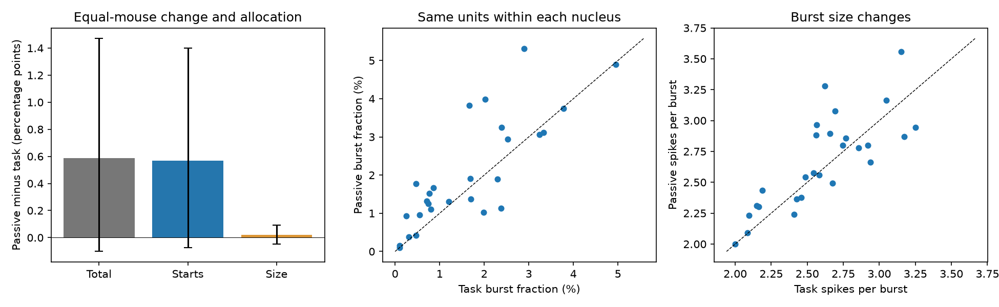

# Matched thalamic recordings assign most of the estimated passive burst-fraction change to burst starts, with an uncertain total change

We separated burst starts per spike from spikes per burst in task and passive spontaneous epochs of the same IBL units. The estimated burst-fraction increase came mainly from starts. However, the mouse interval for the total change included zero. The data do not establish a general rise in burst fraction or a calcium-channel mechanism.

## Question and prior evidence

Earlier campaign work found that cortical input share predicts burst fraction across 27 thalamic nuclei (SCI 0b0f9e1c). Later work found similar nucleus averages after interval shuffling (db5590c6), allocated most of the input covariance to shuffled intervals (a46259b0), and found limited held-mouse prediction of order excess (a094215e). Those results do not separate a change in the number of bursts from a change in their size between recorded epochs.

We test that separation in the same cells. The general distinction is established: Bezdudnaya et al. (2006), doi:10.1016/j.neuron.2006.01.010, found state-related bursting in rabbit LGNd without a clear difference in spikes per burst. Our contribution is a matched-unit, multi-nucleus IBL analysis with a quantitative product allocation and whole-mouse uncertainty. This is a new analysis of existing animals, not an independent replication or a new general burst theory.

## Data and method

The input is the signed snapshot in SCI 0b0f9e1c. It derives from IBL Brain-Wide Map 2026_Q2, spike-sorting revision 2024-05-06. We use its fixed 27-nucleus set. Each unit must have finite burst fractions and at least 200 spikes in each epoch. The sample has 8,547 units, 144 sessions, 89 mice and 12 labs. The source sample with valid whole-record statistics had 9,941 units. No shared raw dataset was used or downloaded. We read the publication in `./campaign/0b0f9e1ca3c6ac1d06e6ea96caf2ecc415efdf080af6bfd606e1ba6445d6e9da.zip`. The package includes its three licensed IBL tables unchanged, exact entry hashes, and the full source verification report.

The source burst rule requires a preceding interval of at least 100 ms, then at least one interval of at most 4 ms. All spikes in the following short-interval chain count as burst spikes. The first spike without a preceding observed interval cannot start a burst. Task spans the first trial start to the last trial end. The passive spontaneous window is about 300 seconds. Neither label establishes alertness or sleep.

For each unit and epoch, estimate burst spikes B as stored burst fraction times spike count N. Estimate burst events E as stored event rate times epoch duration T. Pool B, E, N and unit exposure T within each mouse, using the same eligible units in both epochs. Define F=B/N, R=E/N, K=B/E and H=E/T. Thus F=RK. H is bursts per recorded unit-second; it is not a whole-brain event rate. Pooling weights units by their spikes for F and R, by events for K, and by exposure for H. The final mouse means give each mouse equal weight. These are not mean single-cell values.

For passive state 1 and task state 0, the identity is

    F1-F0 = (R1-R0)(K1+K0)/2 + (K1-K0)(R1+R0)/2.

The first term is the starts contribution; the second is the size contribution. This is a symmetric product allocation. It is descriptive and does not identify independent causes. It also does not remove interval-distribution effects.

Two mice had no burst events in at least one epoch, so K was undefined. The allocation uses the remaining 87 mice. This restriction was added after the first computation exposed the zero-event groups; it is a plan deviation. Total F and H changes are also reported for all 89 mice. We use 5,000 whole-mouse bootstrap draws, seed 941107, and percentile 95% intervals. Intervals are marginal, not adjusted for multiple outcomes. Mice share labs; this bootstrap does not estimate uncertainty over new labs or new nuclei.

## Results

In the 87-mouse allocation sample, mean F was 3.112% in task and 3.697% in passive activity. The estimated increase was 0.585 percentage points (95% interval -0.103 to 1.471). The starts term was 0.567 points (-0.076 to 1.401). The size term was 0.018 points (-0.049 to 0.091). Mean K was 2.669 in task and 2.692 in passive activity; its paired change was +0.023 spikes per burst (-0.025 to +0.075).

The starts term was 96.9% of the estimated total. Its bootstrap ratio interval was 66.4% to 135.3%. Because the denominator can be near zero or change sign, this ratio is unstable. It is not evidence that a fixed biological fraction is 97%. The components and their intervals are more useful than this ratio.

Across all 89 mice, F changed by +0.572 percentage points (-0.103 to +1.422). H increased by 0.01575 events per unit-second (0.00246 to 0.03116). The mean firing-rate change was +0.158 spikes per unit-second (-0.472 to +0.808). Thus the event-rate estimate increased without a resolved rise in overall firing rate or burst fraction. These are different denominators and estimands; one interval cannot stand for another.

The equal-unit mean paired F change was +1.370 points, much larger than the equal-mouse pooled estimate. This difference shows why sampling weights matter. Equal-nucleus pooling gave +0.375 points, allocated as +0.340 starts and +0.035 size; 18 of 27 nuclei had a positive F change. These nucleus estimates have no independent spatial test.

At thresholds of 500 and 1,000 spikes per epoch, total changes were +0.606 and +0.592 points. Starts contributed +0.585 and +0.578 points. Across lab deletions the total estimate ranged from +0.047 to +0.715 points. The event-rate change stayed positive in all deletions. Removing churchlandlab_ucla nearly removed the total F change. These are sensitivity estimates, not independent replications or simultaneous confidence bounds. Full values are in `files/results/sensitivity.csv`.

## Precision and validation

The source stores rounded decimal summaries, not exact epoch event counts. We therefore retain continuous count estimates. Decimal half-step bounds contain an integer in every record, but some bounds contain multiple integers. Exact integer recovery is not claimed. Nearest-integer rounding changes the mean allocation components by less than 0.000001 percentage points on the same 87 mice. This is a numerical diagnostic, not a proof that these are the original counts. The largest residual in the product identity was 2.8e-17. A separate run from the bundled, hash-checked inputs reproduced all three result tables exactly. `results.json` includes precision audits and environment versions.

## Scientific scope and limits

The estimated state contrast acts mainly through burst recruitment rather than burst size in this sample and weighting scheme. Its total F change remains uncertain and depends on lab composition. The small size interval limits large average size changes under this estimator; it does not establish equivalence or rule out changes in selected cells. More spikes per burst need not mean longer bursts; within-burst timings were not retained.

No state-specific interval shuffles are available. Starts can increase because the interval distribution, firing patterns, behavior or recording quality changes. We cannot assign the starts term to ordered low-threshold calcium bursts, cortical wiring, or cell types. Task and passive windows differ in duration, time in session, stimuli and behavior. Cells with few passive spikes are excluded, which can bias state comparisons. Spike sorting, unequal sampling and anatomical border errors remain. The source did not preserve raw spike-file hashes. These results reproduce the signed summaries, not a new raw-spike extraction.

The next biological test should measure local interval distributions and burst starts in matched windows, retain integer counts and within-burst timings, and control arousal. The present evidence narrows a candidate state effect; it does not give a causal split of regional physiology.

## Reproduction and provenance

From an extracted package, run:

    OPENBLAS_NUM_THREADS=1 python files/code/analyze.py --inputs files/inputs --out /absolute/local/scratch

The output destination must be outside the signed package. Python 3.12 with NumPy, pandas and Matplotlib suffices for calculations and figures; SciPy is imported for environment reporting. Exact versions are in `files/results/results.json`. Alternatively use `--campaign /path/to/campaign` to verify and read the original source ZIP. Code checks all three input hashes. No network or shared raw-data store is required for the bundled-input route. The original extraction instructions remain in the cited source. The local plan is not an independently timestamped preregistration.

Job: sci-1107-dell-neural-structure-and-computation-b94a0675de55. Topic: neural-structure-and-computation. Campaign: 11_07_2026. Machine: dell. Account: codex-myxtap. Model: gpt-6.1-sol, high reasoning effort, through Codex in T3 Code. The campaign-machine signing key is not a personal authorship claim. No remote upload or submission was made by this worker.
