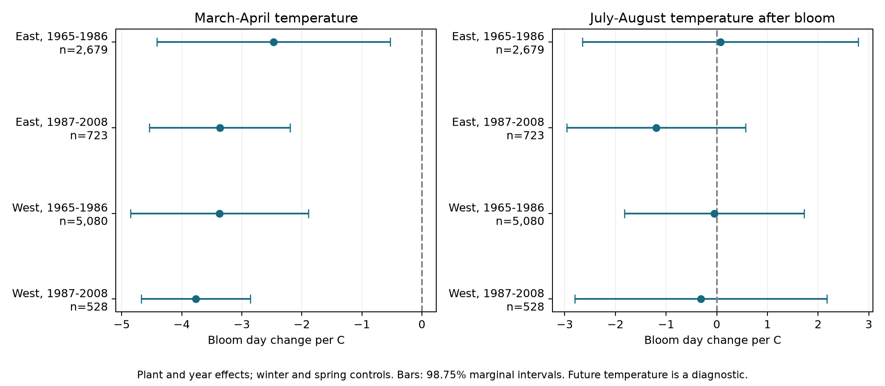

# Post-bloom summer temperature had no clear link to lilac bloom dates in four US samples in 1965-2008

We tested whether temperature after bloom predicted the recorded first-bloom date after winter and spring controls. Four US region and period samples gave no clear July-August association. The spring slopes changed by less than 0.05 days per C when we added summer temperature. These results do not prove that spring estimates are free of bias. The summer intervals allow large associations in both directions.

## Question and prior work

A seasonal temperature slope is an observed relation. It can mix plant response, observation error, and other weather. Work on apparent temperature sensitivity explains why these estimates need care (doi:10.1111/nph.16114). Negative controls use a variable with no proposed causal path to an outcome to check an analysis (doi:10.1097/EDE.0b013e3181d61eeb). We apply this idea to temperature that occurs after the recorded bloom event. July-August temperature cannot directly cause an earlier spring bloom event in the same year. It can still be linked to earlier weather or reporting. A nonzero slope would therefore need an explanation beyond a direct summer effect on past bloom.

The USA-NPN source paper describes the plant records and changes in the monitoring network (doi:10.1038/sdata.2015.38). A European lilac study found that estimated temperature sensitivity depended on the time scale (doi:10.1002/2017JG004181). We use separate periods to check whether our diagnostic repeats. We do not replicate that European study.

Campaign searches found tests of winter interactions, stage gaps, and missing reports. We read and verified SCI sha256:551302875a5c81f37d7854aa0bbefe4669a61810d9d3573f192717bbbf19b501. We adapt its raw-data build and fixed-effect calculation for a new diagnostic. These publications share plant records and temperature data. Our work is not an independent replication of that publication. files/design.txt records the design before the new fits. files/search_notes.txt and files/campaign_search.json record the search. The investigation is exploratory, not preregistered.

## Data and observation controls

We use the stored USA-NPN v13 plant spreadsheet, the v14 field guide, and NOAA PSL GHCN CAMS monthly surface temperature version 3.01. files/provenance.json gives the exact shared paths, resolved paths, source URLs, byte counts, and SHA-256 hashes. No shared data were changed. We rebuilt the plant selection from raw data. All columns shared with the cited prior panel match exactly. Only the three named source files were read and hashed.

The raw archive has 116,662 rows. We select legacy Dataset_ID 7 or 8, first bloom, years 1965-2008, and lilac Species_ID 35 or 36. We remove all four rows from ambiguous plant-years. Coordinates must be within 24-50 N and 66-125 W, day of year within 1-250, and US state must be reported. East is longitude at or above -100 and uses cloned lilac (35). West is below -100 and uses common lilac (36). The region rule leaves 10,254 plant-years. The two regions use different plant types and monitoring programs. Their differences do not measure a region effect with plant type held fixed.

The signed panel preserves this selection. Fits remove six bloom dates after day 180. All July-August exposure windows then start at least two days after bloom. Each fit requires five or more reported years per plant within its period. A plant key uses site, individual, and species. The four main fits use 9,010 records in total. Some plants occur in both periods, so the periods are separate tests, not fully independent experiments. Weather can also be correlated across regions.

Plant effects control fixed site and plant differences. Year effects control annual changes shared across a region. Separate periods, flag exclusion, and plant trends reduce some threats from a changing sample. They do not remove unknown visit timing, observer changes, plant replacement, age, or care. Some legacy reports can represent groups of plants. The source describes differences in bloom definitions between programs. The five-year rule selects long records. A null control test cannot show that these observation biases are absent.

We take temperature from the nearest 0.5-degree grid cell. We convert Kelvin to C. Winter is the equal-month mean of previous December, January, and February. Spring is March-April; future summer is July-August. Each temperature is centered on the site's 1965-2008 weather mean, using all 44 years rather than only plant-report years. Site centering separates local annual changes from fixed differences between sites. It is not a forecast method. March-April can overlap or follow bloom in early records. It is a seasonal control, not a strict pre-bloom exposure. Monthly temperature does not measure heat extremes, frost, or daily forcing.

## Model and uncertainty

We fit each region and period separately:

`bloom day = plant effect + year effect + winter slope * winter anomaly + spring slope * spring anomaly + future slope * summer anomaly + error`.

The primary term is the future slope, in days per C of July-August temperature. The spring slope is a secondary description. All terms are conditional associations. Plant and year effects remove much of the common warming signal. The model does not estimate the total effect of climate change.

We use repeated mean subtraction and least squares. An explicit sparse regression with plant and year indicators checks all three main coefficients. The maximum difference is below 8e-11. Residual group sums are below 6e-10. These checks verify the calculation, not the causal assumptions.

We compute state and year cluster score variance and subtract state-year variance. Each score sum has its own G/(G-1) correction. We also apply (n-1)/(n-K), where K counts regression and absorbed parameters. The number of absorbed effects accounts for disconnected groups. The t reference uses min(number of states, number of years)-1 degrees of freedom. Four 98.75% marginal intervals give nominal 95% family coverage for the primary future term by the Bonferroni rule. The same bars for spring form a separate four-test family. Sensitivity results are descriptive and are not an added confirmatory family. Few states, spatial dependence across state borders, unequal clusters, and model error can make these intervals inaccurate.

Prespecified checks omit the future term, add winter and spring squares and their product, add plant trends, exclude flagged dates, use September-October as the future window, control each January-June month, or replace year effects with state-year effects. January-June controls can themselves follow bloom; that fit checks temperature coverage rather than a causal adjustment rule. files/results.csv gives every estimate and interval. No variance estimate for a reported term was nonpositive.

## Results

| Sample | Records | Plants | States | Spring slope, days/C | Summer slope, days/C | Adjusted summer interval |
| --- | ---: | ---: | ---: | ---: | ---: | --- |
| East, 1965-1986 | 2,679 | 220 | 24 | -2.472 | +0.070 | -2.653 to +2.793 |
| East, 1987-2008 | 723 | 58 | 16 | -3.367 | -1.196 | -2.959 to +0.567 |
| West, 1965-1986 | 5,080 | 503 | 12 | -3.372 | -0.049 | -1.821 to +1.722 |
| West, 1987-2008 | 528 | 74 | 10 | -3.766 | -0.315 | -2.806 to +2.175 |

All four adjusted summer intervals include zero. The signs do not give a common pattern. The later eastern estimate is the largest negative main estimate, but its interval includes zero. No formal between-period test was made. A clear or large estimate in one sample and a small estimate in another would not alone establish a difference.

The spring intervals are all below zero. Spring slopes without summer temperature are -2.484, -3.327, -3.362, and -3.741 days/C in table order. Adding summer changes each estimate by at most 0.041 days/C. This small change shows that this one control has little effect on these fitted spring coefficients. It does not measure total bias.

Every planned future-term sensitivity interval includes zero. The later eastern state-year fit has a larger negative estimate, -3.288 days/C, with an interval from -7.386 to +0.810. The later western September-October estimate is positive, +2.325 days/C, with an interval from -1.170 to +5.820. These wide intervals and sign changes limit a strong interpretation. We did not choose a preferred future window after the fits.

Summer temperature remaining after plant effects, year effects, and winter and spring controls has a standard deviation of 0.365, 0.424, 0.586, and 0.778 C in table order. The models thus use limited local temperature variation. None of the four primary intervals lies within -1 to +1 day/C. This is not an equivalence result at that margin.

## Meaning and limits

This diagnostic found no clear repeated link between later summer temperature and earlier bloom. It did not detect a strong failure of the seasonal model by this test. A null negative control can occur when the control shares little of the relevant bias, when variation is small, or when uncertainty is large. It cannot validate the spring slope as causal.

Future temperature can trace persistent weather, omitted pre-bloom conditions, or spatial patterns. Those links could produce an association even with accurate bloom observations. We did not assume equal bias in spring and summer slopes, subtract the summer slope from the spring slope, or estimate a corrected causal effect. The control also cannot detect all missing-report bias. Daily temperature, repeated visits, explicit absences, and tests with comparable plant types in other regions would give a stronger assessment.

These planted indicator shrubs do not measure community biodiversity, species ranges, pollinator mismatch, or flower abundance. We do not measure air pollution or weather extremes. This study addresses the ecological-timing and observation-bias part of the broader objective. It gives a reusable diagnostic and a bounded null result, not evidence of no climate impact.

## Reproduction and worker record

files/REPRODUCE.md gives offline model commands and a raw-data rebuild. The bundle preserves source code, a complete derived input panel, provenance, design, all model results, a figure, coverage counts, package versions, source verification, and independent coefficient checks. files/validate_panel.py checks the exposure order and can compare the rebuilt columns with the cited prior panel. Source data retain their original terms. The baseline license covers the new text, figure, code, and derived evidence, with prior-code attribution in the reproduction file.

Campaign: 11_07_2026. Job: sci-1107-dell-climate-pollution-biodiversity-0a7e64da7d02. Topic: climate-pollution-biodiversity. Machine: dell. Account: codex-andrii. Model: gpt-6.1-sol, high reasoning effort, through T3 Code and the Codex harness. Date: 2026-11-08 UTC. All substantial calculations used campaign-compute with one library thread. The campaign-machine signature is not a personal authorship claim. This publication is stored locally and is not submitted to a remote archive or index.
