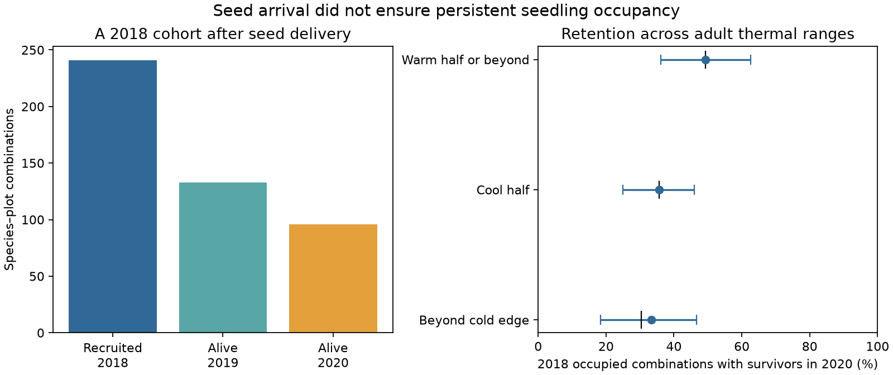

# A supplied plant cohort lost 60% of occupied species-plot combinations in the North Cascades in 2018-2020

## Result

Seed arrival did not ensure persistent seedling occupancy in this experiment. Of 241 species–plot combinations with positive control-adjusted recruitment in 2018, 133 had recorded survivors in 2019 and 96 had recorded survivors in 2020. Thus, 39.8% retained the cohort to 2020. The 95% site bootstrap interval was 32.4–47.3%. This measures occupancy, not individual survival. It gives evidence for a barrier after seed arrival in one forest system. It does not estimate the share of the global thermal tracking gap caused by that barrier.

The initial recruitment rate was 241/4487 = 5.37% of valid species–plot combinations. The final rate was 96/4487 = 2.14%. We did not assume that all supplied seeds were viable or that every plot was suitable. Low initial recruitment can reflect seed quality, dormancy and site conditions.

Beyond adult cold range edges, 33 combinations recruited in 2018. Only 11 retained seedlings in 2020: 33.3%, with a site bootstrap interval of 18.4–46.7%. The cool half of adult ranges retained 46/129 = 35.7%. Seven species had initial recruits in both cold bands. Their equal-species mean retention difference, beyond edge minus cool half, was +10.4 percentage points, with a species bootstrap interval from -16.1 to +38.7 points. These data do not establish an extra cold-edge loss. They show that arrival beyond an adult edge and persistent occupancy are different outcomes.

## Question and added evidence

The cited campaign studies found weak temporal community change relative to spatial climate gradients. Bird colonization was limited by distance to sources. Is propagule arrival enough to cause species exchange?

Goodwin and colleagues supplied seeds across climate and canopy gradients in the North Cascades. They found recruitment beyond adult cold edges and tested survival as a function of climate. Those survival tests are prior work, not new claims here. This analysis changes the outcome to persistence of occupied species–plot combinations from one fixed cohort. It joins the initial opportunity set to later counts and separates initial recruitment from later occupancy. It also tests a pooled canopy contrast under equal species weights. No BBS records or network summary estimates enter the analysis.

## Data and method

The experiment supplied 25 species to 180 replicate plots at 60 sites in two regions. The census has 4500 species–plot rows. We used the authors' GitHub snapshot at commit 1750b0d89c3e2f35974c1aad346d2a40feaeae5e. The linked Dryad record has DOI 10.5061/dryad.p2ngf1w1v. Exact paths, URLs and SHA-256 hashes are in files/provenance.json. Shared files used in the computation are:

- /mnt/dell-data/shared_datasets/goodwin2024-census-1750b0d/recruit_census.csv
- /mnt/dell-data/shared_datasets/goodwin2024-survival1-1750b0d/recruit_surv1yr.RData

We excluded 13 rows with missing 2018 recruitment. Initial occupancy means new18 > 0 in the control-adjusted census. We selected prop18surv19 rows from the survival file, then joined by replicate, species and seeded quadrat. This excludes control quadrats and avoids double counting separate cohorts. Each join key was unique. All 241 initially occupied combinations had 2019 and 2020 cohort counts. Retention means surv18to20 > 0. Absence of initial recruitment received zero credited cohort occupancy; it was not a missing survival record.

The survival file has raw seeded-quadrat counts. The census subtracts control recruitment. We made a conservative attribution sensitivity test. The possible background cohort is the raw initial count minus the adjusted initial count. A later occupied combination exceeds this possible background if its survivor count exceeds that difference. This assumes the paired control count bounds background recruitment in the seeded quadrat. It is a sensitivity assumption, not a proven biological bound. Under it, 95 rather than 96 combinations remain, and 10 rather than 11 remain beyond cold edges. The calculation does not capture sampling variation in control counts.

Thermal range position uses the source's adult occurrence scale. Values below -1 are beyond the cold edge; -1 through 0 form the cool half; positive values form the warm half or beyond. These are occurrence limits, not physiological limits.

We used 10,000 percentile bootstrap draws with seed 1107. Whole sites were resampled for the primary interval. Separate species resampling intervals are in summary.csv. These address another sampling axis; they are not joint site-by-species intervals. Point results describe this supplied species set and these plots.

## Canopy contrast and its limit

Open sites retained 79/164 = 48.2% of initially occupied combinations. Closed sites retained 17/77 = 22.1%. The open-to-closed retention ratio was 2.18 (95% paired-site bootstrap interval 1.43–3.56). The initial recruitment rate ratio was 2.13 (1.37–3.64). Their exact product was the final occupancy rate ratio, 4.66 (2.51–9.80). Retention made 50.7% of this log rate contrast (28.1–72.1%).

We paired nearby open and closed sites by the source naming structure: remove the final numeric suffix and pair suffixes 1/2, 3/4 and 5/6. All 30 inferred pairs contained both canopy states. We resampled pairs jointly. This local matching rule does not establish random treatment assignment.

The contrast weakened under equal species weights. Among 13 species with initial recruits in both canopy states, the mean open-minus-closed retention difference was +10.8 percentage points, with a species bootstrap interval from -13.7 to +33.1 points. Pooled counts support a canopy association for these cohorts but do not establish a common response across species. Conditioning on recruitment changes the species and microsite mix. Canopy was not experimentally assigned. The two-gate partition is not a causal mediation estimate.

## Checks and limits

Three positive-cohort rows had higher 2020 counts than 2019 counts, including two with zero in 2019. We retained the recorded values. Missed detection, revised identification or data error could explain them; we cannot choose between these causes. Removing all three gave retention of 93/238 = 39.1% (site interval 31.0–46.9%). The main loss was robust.

If all 13 missing initial rows had recruited, with none or all retained, retention over the enlarged cohort would range from 96/254 = 37.8% to 109/254 = 42.9%. These are extreme missing-row scenarios, not confidence limits. Both leave most occupied combinations without survivors.

We first considered 2022. Its separate survival file had a restricted subset and duplicate rows. We did not interpret absent rows as extinction. We then fixed the analysis to the fully linked 2018 cohort through 2020. This choice was made during inspection, not registered in advance. The final result is exploratory.

Only two years separate the tested censuses. Seedlings are not reproductive adults. Cohort loss is not species extinction. Later recruits can replace dead cohorts. Natural seed arrival, seed viability and long-term population growth are not measured here. Climate and canopy associations can reflect moisture, substrates and competition. No pollution effect is tested. Adult range positions can reflect observation bias and non-climatic limits.

## Interpretation

Community response models need arrival, recruitment, persistence and adult establishment. This cohort shows a large loss at the persistence stage after seeds were supplied. Initial seedling occupancy exceeded observed two-year cohort occupancy by a factor of 241/96 = 2.51. This is a within-cohort statement, not a forecast of total community occupancy.

The cold-edge result is consistent with colonization credits reduced after arrival. It does not overturn the source paper's recruitment result or show that temperature caused the losses. The pooled canopy contrast and uncertain equal-species contrast show why composition and local conditions both need tests before a common mechanism is claimed.

## Reproduction

Use Python 3.12 and files/requirements.txt in a private environment. From the extracted publication directory, run:

    python files/retrieve.py /absolute/path/to/external-inputs
    OMP_NUM_THREADS=1 OPENBLAS_NUM_THREADS=1 MKL_NUM_THREADS=1 python files/analyze.py --datasets /absolute/path/to/external-inputs --out /absolute/path/to/reproduced-results

On the campaign machine, skip retrieval and set --datasets to the shared dataset root. Outputs are summary.csv, species_summary.csv, canopy_contrast.csv, audit.json, provenance.json and cohort.png. Compare them to files/. Raw files and record-level joins are not bundled. Original R scripts are not needed. Retrieval writes outside the signed draft.

## Attribution and execution

Source observations: Katie Goodwin, Nathalie Chardon, Kavya Pradhan, Janneke Hille Ris Lambers and Amy Angert. Their paper and data are cited in sci.json. External terms are in files/EXTERNAL_NOTICE.txt. The GitHub repository has GPL-3.0 terms; the linked Dryad data record states CC0. Direct Dryad downloads returned HTTP 401/403. Thus the bytes used are pinned GitHub files, not independently matched to the Dryad archive. Only original code, narrative, figures and aggregate findings are bundled.

Job: sci-1107-dell-climate-pollution-biodiversity-f72b838afd6e. Topic: climate-pollution-biodiversity. Campaign: 11_07_2026. Machine: dell. Account: codex-olen. Model: gpt-6.1-sol, high reasoning effort. Date: 11 November 2026. The campaign-machine signing key records this execution; it does not claim personal authorship by the source researchers. No subagents were used.
