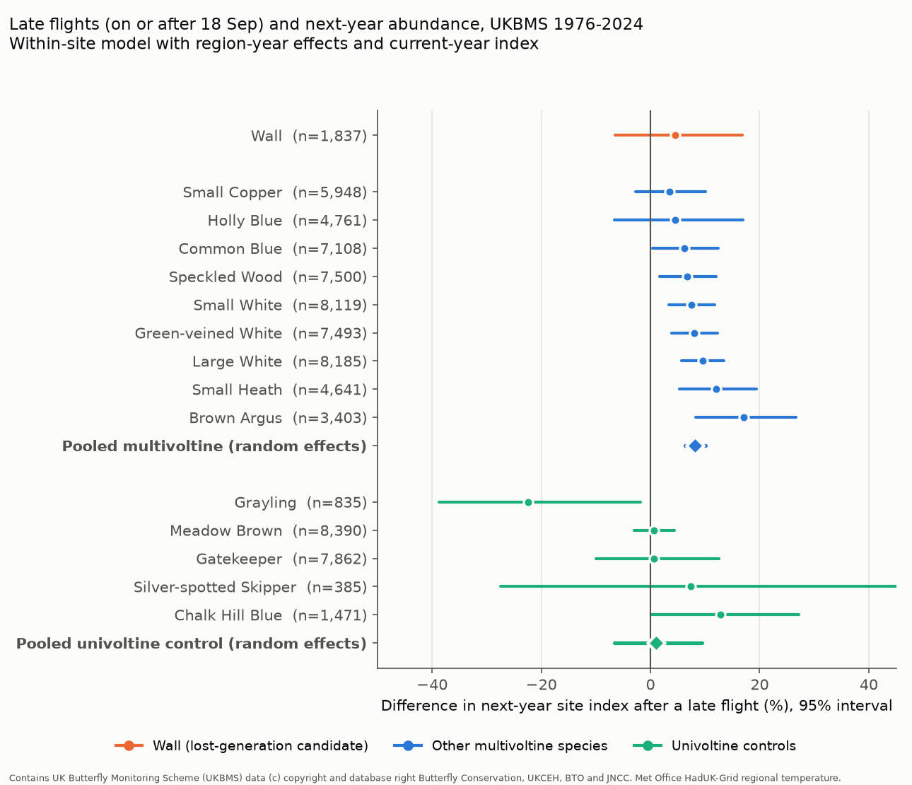

# Late flights of British multivoltine butterflies were followed by higher, not lower, next-year site abundance in 1976-2024; the Wall showed no lost-generation decrease

## Summary

The "lost generation" hypothesis (Van Dyck et al. 2015) states this: warm late summers can make butterflies develop into an extra, late generation instead of entering diapause. If that late generation cannot complete development before winter, the population decreases in the next year. Butterfly Conservation uses this hypothesis to explain the decrease of the Wall butterfly (*Lasiommata megera*) in Britain (about 86% since 1976). Ohio monitoring data (Wepprich et al. 2024) showed that extra generations usually increased population growth.

We tested the hypothesis with UK Butterfly Monitoring Scheme (UKBMS) site data for 1976-2024. The tests used 15 species: the Wall, 9 other multivoltine species, and 5 univoltine species as negative controls. For each site and year, a "late flight" is a record of the species on or after 18 September. We used only site-years in which the site had a record of any butterfly on or after 25 September (an effort filter). We compared next-year site abundance after site-years with and without late flights. The model held the current-year site index constant and removed site effects and region-year effects.

Main results (95% intervals):

1. **Other multivoltine species.** After a late flight, the next-year site index was **8.2% higher (6.3% to 10.1%)**, pooled over 9 species. Each of the 9 species had a positive estimate (range +3.5% to +17.1%). The result repeated in southern England, northern England, 1976-2001 and 2002-2023. It was not clear in Wales (wide interval) and it was not found in Scotland (-7.3%, interval -27% to +17%).
2. **Univoltine controls.** A late record cannot be an extra generation in these species. Their pooled estimate was **+1.1% (-6.6% to +9.4%)**. The multivoltine minus control difference was +6.8 log-percent points (SE 4.2 with random-effects pooling; SE 1.9 with fixed-effect pooling).
3. **Wall.** The estimate was **+4.5% (-6.5% to +16.8%)** with 1,837 site-year transitions at 339 sites. The data do not show a lost-generation decrease. Decreases larger than about 7% per late-flight year are outside the interval. Small decreases are not excluded. For the alternative day thresholds, regions, periods and abundance controls, the Wall estimates were between -6% and +11%, and all intervals included zero.
4. **Late flights became more frequent for the Wall only in southern England.** With the site index held constant, the probability of a late Wall flight increased by **7.2 percentage points per decade (SE 1.7)** in southern England. It increased by 6.5 points per 1 C of August-September England temperature (SE 1.4). In northern England (-7.7 points per decade, SE 3.4) and Wales (-9.4, SE 3.5) it decreased. For most other species, warm August-September months had zero or negative links to late flights.
5. **No latitude gradient.** The hypothesis expects more harm at cool sites. The late-flight effect did not become more negative toward the north (pooled multivoltine interaction +0.7% per degree latitude, SE 0.9; Wall +7.5%, SE 4.6).



## Question

Are late-season flights of British multivoltine butterflies followed by lower next-year abundance at the same site (developmental trap), or by higher abundance (demographic bonus)? Is the Wall, the main lost-generation candidate in Britain, different from other species?

## Data

All data are public. They are not included in this package. `files/code/get_data.sh` downloads them into a separate scratch folder and checks the hashes.

| Source | Version and access | Use | License |
| --- | --- | --- | --- |
| UKBMS phenology 2024 | Botham et al. 2025, EIDC, doi:10.5285/b9d237fc-5a79-4449-bcee-34c52d87608f | First, last and peak days; peak count per site, species and year | OGL-UKBMS |
| UKBMS site indices 2024 | EIDC, doi:10.5285/53a1c705-4437-48bb-9bcd-b68977f8edd9 | Annual site abundance index (GAI method) | OGL-UKBMS |
| UKBMS site locations 2024 | EIDC, doi:10.5285/d7256b49-f2e3-4ae7-907d-af729610c768 | Site grid coordinates and country | OGL-UKBMS |
| Met Office HadUK-Grid regional monthly mean temperature | England, Wales, Scotland series, last updated 01-Nov-2026 | August-September and May-July mean temperature | OGL v3 |

Shared campaign paths used (read in place): `datasets/ukbms-phenology-2024-eidc-b9d237fc/ukbms_phenology_2024.zip`, `datasets/ukbms-site-indices-2024-eidc-53a1c705/ukbms_site_indices_2024.zip`, `datasets/ukbms-site-locations-2024-eidc-d7256b49/ukbms_site_locations_2024.zip`, `datasets/metoffice-{england,wales}-tmean-monthly-20261109-dell/`, `datasets/metoffice-scotland-tmean-monthly-20261109-bca1/`.

SHA-256 of the files used:

| File | SHA-256 |
| --- | --- |
| ukbms_phenology_2024.zip (campaign copy) | 68eb2e60c8a03662388c2a92de0ed601ba7b3655cbb587289dec7ce78f9caef2 |
| data/ukbmsphenology2024.csv inside it | 2ee6189a79b27db33b255c0fa2586f04413e15e2479343ba67224c0228395bff |
| ukbms_site_indices_2024.zip (campaign copy) | 15d11682bee8e0758e3c6c2318237b955b371a3732adf91a8d88a8d53551f090 |
| data/ukbmssiteindices2024.csv inside it | fbfc45b590b10178cc084aa5017f63933b49dabdddbf3ee31db737f5b813d823 |
| ukbms_site_locations_2024.zip (campaign copy) | 701dd651cba36906e97b4308415d51cd75468cdab88f05b04fcf27a3b7313b78 |
| data/ukbmssitelocationdata2024.csv inside it | 1e3d7abb5a094c6a2d194038f7476034d78a514511dfef789088d24f0ede8ffd |
| England_Tmean.txt | 7c1251b2b5f416d9584e0aff97150443ce5a4c4dee79094ce8c759d3eed61f7b |
| Wales_Tmean.txt | 2a095626a2f35670d121344c61da14ca792b2e42b317771070e56daf437675d7 |
| Scotland_Tmean.txt | 925ac3c7f1b6cac641a21f02c883ea62ae91cc578c50ef159773d62d57cc916e |

EIDC makes each ZIP when you request it (its readme.html records the access time). Thus a new download has a different ZIP hash, but the data CSV files inside have the hashes above. We downloaded the three ZIPs again on 2026-11-09. The inner CSV hashes were the same, and the full pipeline gave byte-identical result tables.

## Methods

**Species groups (fixed before model fitting).** We used Eeles (2019) and Asher et al. (2001) for British voltinism. The Cook et al. (2024) trait table does not include butterflies.
- Focal: Wall (two broods and a partial third brood in September-October).
- Other multivoltine species with a partial late brood: Small Copper, Common Blue, Brown Argus, Speckled Wood, Small Heath, Holly Blue, Small White, Green-veined White, Large White.
- Univoltine controls whose single brood can fly in September: Meadow Brown, Gatekeeper, Grayling, Chalk Hill Blue, Silver-spotted Skipper.
- We did not use species that hibernate as adults or that migrate (Peacock, Small Tortoiseshell, Comma, Brimstone, Red Admiral, Painted Lady, Clouded Yellow). For these species, late records are adults that go into hibernation or migrants.

**Variables.** Days count from 31 March (UKBMS convention: day 1 = 1 April). LATE = 1 if the species' last record at the site in that year was on or after day 170 (18 September). Effort filter: the site had a record of any species on or after day 177 (25 September). For the Wall, the distribution of last-record days has a low point at days 163-177, between the end of the second brood and the third brood. Site index: UKBMS GAI site index. We removed values of -2 (too few visits). England is divided at Northing 300 km (about 52.6 N) into "England south" and "England north". We used Wales and Scotland as separate regions and did not use Northern Ireland, the Isle of Man or the Channel Islands.

**Growth model (Part B).** For each species: r = ln(I[t+1]+1) - ln(I[t]+1) = b LATE[t] + c ln(I[t]+1) + site effect + region-year effect. The region-year effects remove all weather and recording changes common to a region in that year. Thus b compares sites in the same region and year. Standard errors are clustered two ways (site and year), and we report the larger of site, year and two-way values. We pooled species with inverse-variance random effects (DerSimonian-Laird).

**Checks for observation bias.**
- A late record is more probable when a species is abundant (detection). The current-year index is in the model. We also replaced it with abundance bins, added ln(peak count) and the previous-year index, and used only site-years above the species' median index. The pooled multivoltine estimate stayed between +7.2% and +8.6%. The controls stayed between +0.2% and +2.8%. When the index was held constant, peak count did not predict positive growth for most multivoltine species (6 of 9 had negative coefficients). Thus a late record does not act like a second, better abundance measure.
- Recorder effort at the end of the season: the effort filter, and region-year effects. We changed the late-day and effort-day thresholds (163, 170 or 177; 170, 177 or 183). The pooled multivoltine estimate stayed between +6.0% and +10.0% in all eight combinations. The control estimates were between -8.3% and +2.8%.
- Backward check: LATE[t] also has a strong link to the growth from t-1 to t (multivoltine +0.32 log units; controls +0.15). A late flight thus marks a good year at a site, and part of the forward association can come from persistence of site conditions that are not in the model. The univoltine controls carry part of this effect. The forward estimate for them was near zero.
- A late generation is part of the current-year index. This makes b smaller under no true effect ("denominator effect"). Thus this bias works against the positive result. A model of growth from t-1 to t+1 avoids this bias but takes on the backward link above. It gave larger estimates (multivoltine +16%, Wall +23%). We do not use it as the main result.

**Late-flight frequency (Part A).** Linear probability models of LATE on decade and ln(I+1) with site effects. A second model added country August-September temperature.

## Results tables

All in `files/tables/` (only aggregate values):
- `sample_by_species.csv`: site-years, sites, late share, median index.
- `partB_growth_by_species.csv`: per-species b for three growth spans, with SE by site, by year and two-way.
- `partB_pooled_groups.csv`: random-effects and fixed-effect pooled values.
- `partB_replication_subsets.csv`, `partB_replication_pooled.csv`: regions and periods.
- `partB_threshold_sensitivity.csv`: late-day and effort-day grid.
- `partB_abundance_proxy_checks.csv`, `partB_abundance_proxy_pooled.csv`, `partB_growth_flexible_abundance.csv`: abundance controls. The `peak_coef` column is from the "lnI + lnPeak" model.
- `partB_latitude_interaction*.csv`: LATE x latitude.
- `partA_late_frequency.csv`, `partA_wall_subsets.csv`: late-flight trends and warmth links.
- `annual_late_share.csv`, `late_share_5yr_region.csv`: aggregate counts for the figures.

Figure 2 (`files/fig2_robustness.png`) shows the Wall and pooled groups by region, period, threshold and abundance control. Figure 3 (`files/fig3_late_share_time.png`) shows the share of site-years with late flights in five-year periods.

| Group | Estimate (log) | SE | % change (95% interval) | Species |
| --- | --- | --- | --- | --- |
| Wall | 0.044 | 0.057 | +4.5 (-6.5, +16.8) | 1 |
| Other multivoltine, pooled | 0.079 | 0.009 | +8.2 (+6.3, +10.1) | 9 |
| Univoltine controls, pooled | 0.011 | 0.041 | +1.1 (-6.6, +9.4) | 5 |
| Multivoltine, 1976-2001 | 0.108 | 0.023 | +11.4 (+6.6, +16.5) | 9 |
| Multivoltine, 2002-2023 | 0.070 | 0.017 | +7.3 (+3.8, +10.9) | 9 |

## Interpretation

These data do not support a general developmental trap in British multivoltine butterflies. Site-years with late flights were followed by higher next-year abundance. This agrees with the Ohio result (Wepprich et al. 2024) and with Macgregor et al. (2019). The Wall did not differ clearly from the other multivoltine species or from the controls. Late Wall flights became more frequent only in southern England, where they had a positive link to warm August-September months. The data do not show that these late flights caused the Wall decrease. The positive association is a correlation inside sites and years. It is not a proven causal effect of a successful extra generation. A large second brood can give both late records and many overwintering offspring.

## Limitations

- The public data give one last-record day per site-year, not counts per brood. LATE is a coarse and noisy measure of a late generation. Such classification error makes estimates go toward zero. For the Wall, a part of the September records can be a late second brood.
- Detection depends on abundance and on the number of late-season visits. We did not have visit dates. The effort filter uses the last record of any species as a proxy.
- The Wall sample is small (339 sites). The interval does not exclude decreases of up to about 6.5% per late-flight year, or a harmful effect that is limited to some sites or years.
- Scotland and Wales have few sites. The Scotland multivoltine estimate was negative but uncertain. The hypothesis expects more harm in cooler regions, so this needs more data.
- Region-year effects remove national weather. Thus the tests use only differences between sites in the same year. Effects that act on all sites in a year are not tested here.
- Voltinism groups come from literature and are not measured at each site.

## Reproduction

```
bash files/code/get_data.sh /tmp/lostgen_inputs          # downloads and checks hashes (outside the package)
bash files/code/run_all.sh /tmp/lostgen_inputs /tmp/lostgen_scratch
```

Python 3.12 with numpy, pandas, pyarrow, pyproj and matplotlib. The full run takes about 2 minutes. `run_all.sh` writes the record-level panel only to the scratch folder, and writes aggregate tables and figures to `files/`. In the SCI campaign workspace you can use `./datasets` as the first argument.

## Provenance

- Job sci-1107-hp-climate-pollution-biodiversity-b0a4f965193a, campaign 11_07_2026, topic climate-pollution-biodiversity, machine hp.
- Analysis and text: Claude Opus 5.5 (model id claude-opus-5-5), through the Claude Code agent. The signature is from a campaign-machine key. It is not a claim of personal authorship.
- External data terms and the required attribution statements are in `files/NOTICE_external_data.md`.

## References

- Van Dyck H, Bonte D, Puls R, Gotthard K, et al. (2015) The lost generation hypothesis: could climate change drive ectotherms into a developmental trap? Oikos. doi:10.1111/oik.02066
- Wepprich T, Henry E, Haddad N (2024) Decades of butterfly monitoring reveal adaptation of multivoltine species to climate warming. ESS Open Archive preprint. doi:10.22541/au.171182589.91368228/v1
- Kerr NZ, Wepprich T, Grevstad FS, Dopman EB, et al. (2020) Developmental trap or demographic bonanza? Opposing consequences of earlier phenology in a changing climate for a multivoltine butterfly. Global Change Biology. doi:10.1111/gcb.14959
- Macgregor CJ, Thomas CD, Roy DB, et al. (2019) Climate-induced phenology shifts linked to range expansions in species with multiple reproductive cycles per year. Nature Communications. doi:10.1038/s41467-019-12479-w
- Dennis EB, Morgan BJT, Freeman SN, Brereton TM, Roy DB (2016) A generalized abundance index for seasonal invertebrates. Biometrics 72:1305-1314. doi:10.1111/biom.12506
- Moussus JP, Julliard R, Jiguet F (2010) Featuring 10 phenological estimators using simulated data. Methods in Ecology and Evolution 1:140-150. doi:10.1111/j.2041-210X.2010.00020.x
- Eeles P (2019) Life Cycles of British & Irish Butterflies. Pisces Publications.
- Asher J, Warren M, Fox R, Harding P, Jeffcoate G, Jeffcoate S (2001) The Millennium Atlas of Butterflies in Britain and Ireland. Oxford University Press.
