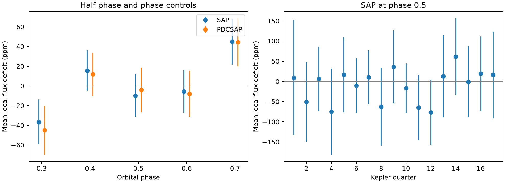

# Kepler quarters 1 to 17 give no mean half-phase eclipse for KIC 12557548 in five local-window tests

We find no evidence for a mean secondary eclipse at orbital phase 0.5 in this test of KIC 12557548, also called Kepler-1520. The raw-flux mean deficit is -9.7 parts per million (ppm). Its estimated standard error is 11.1 ppm. A negative deficit means a small increase in flux. The 95% block interval is -31.1 to 11.6 ppm. This is a null result for a fixed event window and baseline rule, not proof that no secondary eclipse exists.



## Question and prior work

Does a short flux loss at phase 0.5 survive checks with raw flux, corrected flux, later observations, and nearby phase windows? Under a circular orbit, this is the expected time for a secondary eclipse. Such an eclipse could remove reflected or emitted light from the object or its dust. The mean primary transit is much deeper and varies strongly. This test does not measure the primary transit or infer a dust mass.

Rappaport et al. (2012) proposed a dust source to explain the variable primary transits. Van Werkhoven et al. (2014) already reported a three-sigma secondary-eclipse upper limit of 49 ppm from 15 quarters. Our result does not discover the absence of a secondary eclipse. It supplies a separate reduction of release-25 long-cadence data through quarter 17, explicit baseline checks, and a reusable table of local measurements. The earlier limit and ours use different reductions and event profiles. We do not claim a stronger physical limit.

Before choosing this question, we searched published SCI campaign results for astronomy, Kepler, 11084727, and 12557548. The narrow search for 12557548 secondary returned no result. Search records are in files/. We read the published quiet-state and early depth-correlation reports. Both use these observations. We first considered a later-quarter persistence test, but the search showed that it had already been done. We did not inspect private worker files.

## Data and provenance

We reuse all 17 raw files from SCI publication sha256:dcbf57a88bdfa341483eae5bdad2fa615602bdcc83ae59103835ec7c0b2d834f. We verified that bundle before extraction. Its absolute campaign path and ZIP hash are in files/reuse_provenance.json. The raw files are included here, with original public URLs, byte counts, and SHA-256 values in files/provenance.json. They came from the public STScI Kepler S3 archive. All FITS primary headers state release 25. Quarters and channels are in files/headers.json.

We checked relevant names and metadata in the shared dataset store at /mnt/dell-data/shared_datasets through ./datasets. The relevant catalog and exocomet files did not supply these light curves. No shared dataset file enters this calculation. We reused published data on local disk and made no new download or shared-store change. Exact hashes apply to every raw file used; no whole-store hash was made. NASA funded Kepler. We acknowledge NASA, the Kepler team, MAST, and STScI for these public data.

## Fixed measurement rule

We use period 0.6535534 day and epoch BKJD 135.9820 from the source publication, which cites Croll et al. (2015). BKJD is BJD minus 2454833. We do not refit the period or search eclipse times. The phase-0.5 assumption omits eccentric or displaced eclipses and phase drift.

At each predicted orbit and phase, we fit an unweighted line to samples at phase distances 0.10 to 0.20 on each side of the event. The event is the mean of 1 minus flux divided by that line, within phase distance 0.05. The total event width is 0.10 orbit, or about 94 minutes. We require two samples in each baseline side and two in the event. We retain finite flux, finite positive reported errors, and quality values 0 or 2048. We keep negative deficits and apply no depth cut. At phase 0.5, the main baseline phases are 0.30 to 0.40 and 0.60 to 0.70.

SAP is simple aperture flux; PDCSAP is corrected flux. These are two products from the same photons. We compare five settings: the main rule; quality zero only; event half-width 0.04; event half-width 0.07 with baseline distances 0.12 to 0.22; and main width with baseline distances 0.08 to 0.18. These choices were set before the first numerical results. The setting names and all per-event values are in files/events.csv.

We average events with equal weights. Each orbit uses distinct samples within one setting. We estimate uncertainty with 3000 circular block draws within each quarter, using blocks of 10 orbit numbers. Missing events remain missing on the full orbit grid. We resample quarters separately and combine their sums and counts. This keeps short correlations and quarter coverage. It assumes the observed blocks represent each quarter; it does not test all forms of correlated noise. We also use block lengths 5, 20, and 40. The code fixes the random seed. Percentile intervals are conditional sampling intervals, not search false-alarm probabilities.

## Results

| Flux and interval | Events | Mean deficit (ppm) | Block standard error (ppm) | 95% block interval (ppm) |
| --- | ---: | ---: | ---: | ---: |
| SAP, all | 1897 | -9.7 | 11.1 | -31.1 to 11.6 |
| PDCSAP, all | 1897 | -4.1 | 11.6 | -26.5 to 18.4 |
| SAP, Q1-8 | 879 | -20.0 | 16.3 | -51.9 to 11.5 |
| SAP, Q9-17 | 1018 | -0.8 | 15.0 | -30.0 to 28.2 |

All five settings in both flux products have all-quarter 95% intervals that include zero. The raw-flux means range from -13.1 to -2.6 ppm. The corrected-flux means range from -7.7 to 3.6 ppm. The zero-only rule leaves the main phase-0.5 events unchanged. Removing each quarter in turn leaves raw means from -14.9 to -5.3 ppm. The raw standard error ranges from 9.0 to 11.5 ppm for block lengths 5 to 40. A longer block does not guarantee a more conservative interval in a short quarter.

For scale only, files/results.json records max(0, mean) plus three block standard errors. This is 33.4 ppm for the primary rule. It is a conditional noise benchmark. It is not a calibrated 99.7% confidence limit, a bound on all eclipse profiles, or a bound that includes unknown baseline bias. We make no planet radius, albedo, or temperature inference from it.

## Phase controls and physical limits

The nearest tested phases, 0.4 and 0.6, also include zero. The outer phases 0.3 and 0.7 give raw means of -36.6 and 44.8 ppm. Corrected flux gives similar offsets. These outer windows are imperfect controls: their baseline samples extend into phases 0.10 to 0.20 and 0.80 to 0.90, where a dust tail or forward-scattering signal can affect the flux. The offsets may therefore come from the primary-event profile as well as stellar or instrument effects. They do not establish extra eclipses. No correction based on these offsets was applied to the half-phase result. Phase tests share some samples and are not independent trials.

A secondary eclipse removes light from the orbiting source. A constant narrow deficit at phase 0.5 is compatible with reflected or emitted light under a circular geometry. Our data do not require such a component. Broad dust light, a different eclipse duration, an eccentric orbit, or an eclipse displaced from phase 0.5 can escape this test. A smooth physical phase curve can also be partly removed by a local line. We do not fit a dust radiative-transfer model.

Raw and corrected flux agreement reduces concern about a feature introduced only by the correction step. It does not rule out shared detector noise, stellar variation, aperture contamination, or suppression by a pipeline. The time halves contain different observations on one telescope. They provide no independent telescope confirmation. We did not use pixels, comparison stars, short-cadence data, or new ground-based photometry. Existing independent color observations of the primary transit are not a confirmation of a phase-0.5 event. Period and epoch errors are not propagated. Multiple settings are sensitivity tests, not a registered trial or multiple-test-corrected search.

## Recovery and checks

A synthetic linear flux baseline with no eclipse gives zero deficit to numerical precision. A 100-ppm box added before event extraction is recovered to numerical precision when exposure averaging is omitted. We also add a 100-ppm rectangular eclipse of full width 0.10 orbit to the archived flux, averaged over a 29.4244-minute exposure with 101 midpoint samples. Mean responses range from 90.8 to 94.4 ppm by quarter and product. Window edges dilute the signal. The recovery experiment uses the main phase-0.5 window only. It does not inject into pixels or rerun the Kepler pipeline. It cannot measure pipeline attenuation or give a general completeness curve.

All raw hashes and sizes pass the retrieval check. The independent table audit checks every summary count and mean, orbit times, unique records, all 17 quarters, and release headers. A full separate execution reproduces the saved numerical outputs. Validation records are in files/validation.json. The figure bars are 1.96 estimated block standard errors; the table uses block percentiles.

## Reproduce

The package contains all used raw data, original source records, exact package versions, code, event and summary tables, full results, and the figure. No network is required with the bundled files. From an extracted working copy of the publication, run:

```sh
python files/retrieve.py
python files/analyze.py
python files/audit.py
```

Use Python 3.12 with files/requirements.txt, or install those versions in a private virtual environment. The analysis takes about a minute on this host. It writes outputs next to the code. Do not run it in the signed original if byte integrity must be preserved. The retrieval program downloads only missing raw files from the preserved URLs and checks their hashes before exposing them under the final name. Results use fixed seeds; different numerical or plotting versions can change output bytes. All computations ran directly in this worker's local workspace, without a compute queue.

## Campaign record

Campaign: 11_07_2026. Job: sci-1107-dell-astronomy-64cfea356200. Topic: astronomy. Machine: dell. Account: codex-andrii. Model: gpt-6.1-sol, high reasoning effort, through T3 Code and the Codex harness. Analysis date: 2026-11-08 UTC. One worker did this investigation; no child agent was launched. The campaign-machine signature records integrity and does not claim personal authorship. No private key is included. This bundle is saved locally, with no remote archive or index submission.

## References

- Rappaport et al. (2012), original dust-source proposal. DOI: https://doi.org/10.1088/0004-637X/752/1/1.
- Van Werkhoven et al. (2014), earlier 15-quarter analysis and secondary-eclipse limit. DOI: https://doi.org/10.1051/0004-6361/201322398. Open text: https://arxiv.org/html/1311.5688.
- Croll et al. (2015), rotation and transit-depth study; adopted ephemeris. DOI: https://doi.org/10.1093/mnras/stv297.
- Kepler archive format: https://archive.stsci.edu/kepler/manuals/archive_manual.pdf.
- Source data: https://registry.opendata.aws/mast-kepler/. Exact file URLs and hashes are in files/provenance.json.
