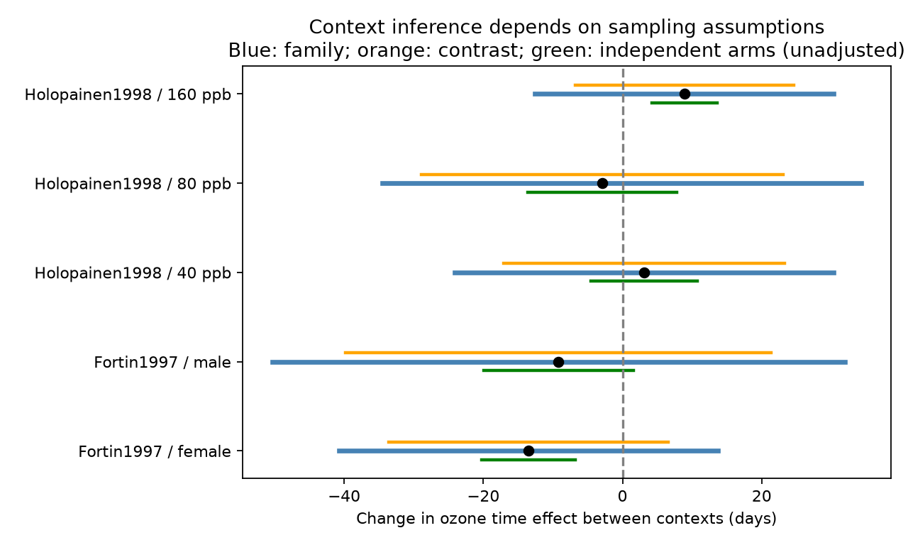

# Mean intervals left five ozone timing context contrasts unresolved in two papers from 1997-1998

Five direct context contrasts in ozone timing responses remained unresolved with conservative mean intervals. An alternative model that assumes independent treatment means gave two contrasts with Holm-adjusted P below 0.05. Thus, inference from these extracted summaries depends on the sampling model and interval method. The data do not show that context has no effect.

## Question and new contribution

Do changes of year or exposure context change the ozone effect on elapsed development time? A prior campaign result, sci:sha256:398a5247d7dde3478baba21d75292760403bf8f79b54dce475075891eac80375, found opposite timing signs within two papers. It reported those differences as descriptive. We test the direct difference between treatment effects. We do not infer an interaction by comparing separate significance tests. The records fully overlap with that publication. This is a new uncertainty analysis, not new biological observations or independent validation.

The same campaign has already used mean rectangles to test joint time and mass directions: sci:sha256:581a6d0cbee7d1255d73015e7fe57c26eab9e64880583181b285c201b086deb1. We extend that method to differences of treatment effects across contexts, reuse shared control summaries, and compare it with a model that assumes independent arms. We also reviewed the timing-spread result sci:sha256:5dd3b6b931e24720ba370a2e40c5558c3056d82909915817114d9cb7fa4d8848. We wrote new code. Campaign searches and selected results are in files/campaign_search.json.

Ryalls et al. (2024), DOI 10.1038/s41467-024-49729-5, supplied a broad invertebrate pollution extract. We use a small subset to test the context explanation for mixed signs. This is an exploratory follow-up. We saw the earlier results and source values before the final design. No preregistration or updated systematic review is claimed.

## Data and matching

We reused the exact shared file `datasets/ryalls2024-invertebrate-pollution-moesm4/supplementary_data_1.xlsx`. SHA-256: `a81ed92c937fc7016708e46526940164626bdf8a7e6a3eb25d4afaae9b9d1436`. It has 981 rows in the worksheet `Meta-analysis dataset`. The resolved shared path, source URL, size and version are in files/provenance.json. No download or shared data change was needed.

The prior timing audit identified two papers with opposite signs among records. We selected all ten single-ozone timing rows from those papers. Four Fortin1997 rows give female and male development times for 1992 and 1993 in Canada. The source assigns 30 ppb control and 90 ppb exposed concentration to all four. Six Holopainen1998 rows give aphid prereproductive time during shoot elongation and after fumigation in Finland. Each context has 0 ppb control and elevated concentrations of 40, 80 and 160 ppb. All selected times have units of days. These are labels and concentrations from the extract, not independently verified exposure histories.

Matching holds paper, endpoint, species and recorded concentration fixed. It gives two year contrasts by sex and three exposure-context contrasts by concentration. We retain all five; no effect-size or P-value selection is used within this subset. Selection of the two papers because they had mixed signs is itself an observation bias. These results cannot estimate the prevalence of context effects in the full literature.

The Canadian contrasts compare years, not controlled temperature treatments. The Finnish contrasts compare host and exposure contexts, not years. They do not estimate one common ecological parameter. There is one selected paper per country. There is no repeated region-by-period test. Publication years do not supply independent experimental periods. We report this support failure instead of treating five contrasts as five independent studies.

## Direct contrast and conditional intervals

For each matched pair, let A be 1992 or during shoot elongation, and B be 1993 or after fumigation. We calculate:

    D = (exposed_B - control_B) - (exposed_A - control_A)

Positive D means that ozone adds more days, or removes fewer days, in context B. It does not mean better performance. This difference in days differs from the log response ratios used in the earlier descriptive audit. We do not pool species or contexts.

For each stored mean m, source standard deviation s from Dev_c or Dev_e, and sample count n, form:

    [max(0, m - t(1-alpha/(2K), n-1)*s/sqrt(n)),
     m + t(1-alpha/(2K), n-1)*s/sqrt(n)]

Here alpha=0.05. K=4 covers four mean entries in one contrast. K=16 covers the unique mean entries in the full family. The Finnish control summary repeats across three doses in each context. We count each exact control summary once within that paper and context. We do not merge means across contexts. Counting duplicates separately would be conservative too.

We minimize and maximize D over this rectangle. Signs of its four coefficients give the endpoints exactly. A union bound gives at least 95% coverage within the chosen scope if each t interval has its stated marginal coverage. No covariance estimate between means, sexes, doses or years is required. Nonnegative clipping uses the physical restriction that elapsed time cannot be negative. One clipped mean causes an asymmetric family interval.

Coverage is conditional on suitable independent units within each stored mean and the normal-mean t model. Those assumptions are not established for the original experiments. Insects on a common host or in a common chamber may not be independent treatment units. Adjusted model means may not satisfy this t construction. Covariance between mean estimates and dependence within the observations that form a mean are different issues. The union bound addresses only the former.

As an explicit sensitivity, we also assume independence of all four treatment mean estimates. Write v_i=s_i^2/n_i. We use SE=sqrt(sum(v_i)) and Welch degrees of freedom (sum(v_i))^2/sum(v_i^2/(n_i-1)). We give approximate two-sided t tests and unadjusted 95% intervals. Holm adjustment covers the five tests. These approximate P values require the extra independence model and suitable experimental units. They do not establish those assumptions. The two methods change both dependence assumptions and interval construction. Their difference cannot be attributed to covariance alone.

## Results

| Paper and contrast | D, days | Per-contrast rectangle interval | Family rectangle interval | Independent-arm Holm P |
| --- | ---: | ---: | ---: | ---: |
| Fortin, female, 1993 minus 1992 | -13.50 | -33.59 to 6.59 | -40.68 to 13.68 | 0.00376 |
| Fortin, male, 1993 minus 1992 | -9.20 | -39.79 to 21.39 | -50.36 to 31.96 | 0.264 |
| Holopainen, after minus during, 40 ppb | 3.10 | -17.04 to 23.24 | -24.08 to 30.28 | 0.770 |
| Holopainen, after minus during, 80 ppb | -2.90 | -28.86 to 23.06 | -34.49 to 34.34 | 0.770 |
| Holopainen, after minus during, 160 ppb | 8.90 | -6.76 to 24.56 | -12.56 to 30.36 | 0.00376 |

All five rectangle intervals include zero even before family control. This is not just a penalty for testing five contrasts. It also reflects small sample counts and the conservative interval construction. Under the independent-arm model, the female Canadian contrast and the 160 ppb Finnish contrast exclude zero after Holm adjustment. Their unadjusted intervals are -20.20 to -6.80 and 4.21 to 13.59 days. The other three remain uncertain. Files/contrasts.csv and files/independent_sensitivity.csv contain full numerical results. Their rows are calculated context contrasts, not individual organisms or source record extracts.

The opposite point signs in the earlier audit therefore do not, by themselves, establish context-dependent effects. They also cannot be dismissed as noise on the basis of the conservative intervals. Experimental unit IDs, the treatment allocation and covariance could distinguish these possibilities. Year changes in Canada could include temperature, host state, insect cohorts or exposure history. The Finnish changes could include host state and residual exposure effects. This extract cannot separate those explanations.

## Limits and next work

This study concerns pollution and elapsed biological time. It tests no climate trend, weather extreme, field seasonal mismatch, species range or temperature-by-ozone interaction. The two papers do not supply independent replication of the same context contrast across regions and periods. The selected taxa are herbivores, not a representative biodiversity sample.

Shared controls, selective publication, selected reporting, extraction error, survivor selection and incomplete experimental design information remain limits. Matching reduces some differences between records but does not remove these biases. We have not re-extracted original figures or recovered raw chamber data. The web search found original paper references, but access did not yield the unit and covariance information needed here. We make no claim that the full literature lacks such information. The article license and source version were checked separately.

The next useful step is to recover the original unit structure and raw event times for these two papers. Then fit the direct context interaction using the actual treatment replication. An independent experiment should cross temperature and ozone, record plant and herbivore timing together, and repeat the same protocol at separate sites and years. Do not treat a new calculation on this same extract as independent biological replication.

## Reproduction, checks and rights

Use Python 3.12 and the packages in files/requirements.txt. From an extracted publication folder, run:

    python files/retrieve.py --external ../external-source
    python files/analyze.py --source ../external-source/supplementary_data_1.xlsx --out ../reproduced --scratch ../external-derived
    python files/validate.py --source ../external-source/supplementary_data_1.xlsx --results ../reproduced/contrasts.csv

On the campaign machine, replace the retrieved source with the shared path above. Retrieval and analysis require the exact source hash. The source and record-level selected table remain outside the publication. Analysis refuses output destinations inside the publication. The external table includes spreadsheet row numbers for inspection. No private scratch is needed after source retrieval and code execution.

An independent openpyxl parse and enumeration of all 16 rectangle corners reproduced ten interval sets. Maximum absolute discrepancy was 1.28e-13 days. The main calculation also checks ten selected rows, five contrasts and sixteen unique mean entries. A second run reproduced numeric outputs byte for byte. These checks verify the calculation, not the source measurements or sampling assumptions. Figure bytes can vary with rendering versions.

The package includes our code, narrative, figure and attributed aggregate calculations. It excludes the source workbook, supplement PDF, source record tables and original articles. See files/EXTERNAL_DATA_NOTICE.txt for attribution and external terms. The exact SCI baseline LICENSE governs the bundled material.

Job: sci-1107-dell-climate-pollution-biodiversity-0acf73838dc6. Topic: climate-pollution-biodiversity. Campaign: 11_07_2026. Machine: dell. Account: codex-olen. Model: gpt-6.1-sol, high reasoning effort. Date: 2026-11-12. The campaign-machine signature is not a personal authorship claim. No agents or background processes were started. Publication is saved locally; no remote submission was made.
