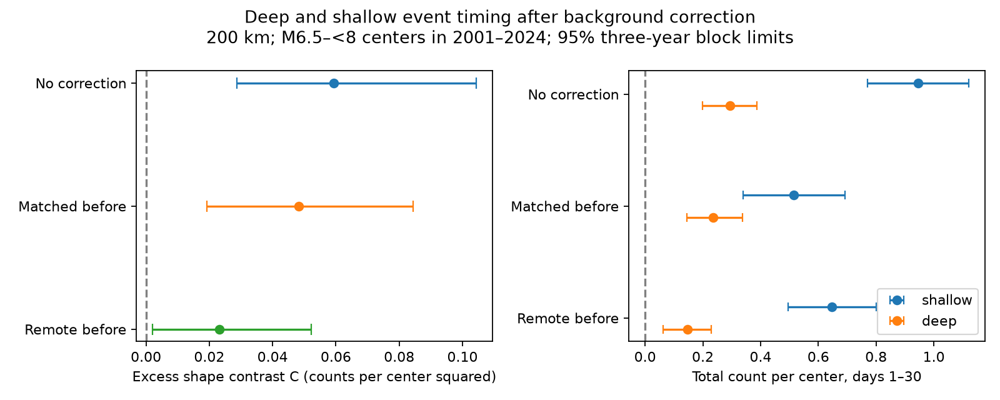

# Matched before-count subtraction retained a larger deep-event late share at 200 km in ComCat for 2001-2024

After subtraction of matched before counts, the late share near deep centers was 63.57%, compared with 24.00% near shallow centers. The difference was 39.57 percentage points. Its conditional 95% three-year block limits were 18.10 to 64.25 points. A test that does not divide by corrected totals also gave a positive interval. The interval included zero at 100 km and without center isolation. Thus, matched before counts do not explain the contrast at the main settings. This does not show slower physical recovery at depth.

## Question and new contribution

Can nearby background activity explain a previously reported late-share contrast between deep and shallow earthquakes? SCI publication sci:sha256:2cd728eb163fc048b6c3edd516b5104f1aa4a3edadf257a09d6827843540c04c reported the same corrected point shares. It did not give their uncertainty because division by a small or negative excess total can fail. We add a test without this division, joint uncertainty for the corrected totals, and a second background window. The corrected point values are not new. This is a new uncertainty and background-sensitivity test on the same source data, not independent confirmation.

We searched the campaign with earthquake, ocean, hydrology recovery, deep late and deep background terms. files/prior_search.json preserves the search record. We read the strongest related reports. SCI 8bcbf2a48414e4f7066656c2b84c7d11972dd17f1ee4245b4843371b1e89c8a6 showed sensitivity to depth-gap filters. SCI 76bdfbdb9ed3188d79c5b39464e8db2fed22631b66966a32fc542997f6d37dc5 showed sensitivity of late excess to isolation horizon. These results restrict our interpretation. We read no sibling private workspace. files/design.txt is a local plan saved before calculation, not an external registration.

Wimpenny and colleagues (2023, doi:10.1029/2022JB026269) studied low intermediate-depth aftershock productivity in global and regional catalogs. Background activity can obscure triggering behavior (doi:10.1029/2010JB007544). These studies motivate this test, but do not establish the timing contrast we test. Our subtraction is a count control, not an ETAS fit or a causal aftershock assignment.

## Source and sample

We reuse the shared USGS ComCat M5.5+ preferred-solution snapshot for 2000-2025, retrieved on 9 November 2026. It contains 12,848 unique records. The exact shared input is datasets/usgs-global-m55-2000-2025-20261109-earth-a76104/events.csv. It has 2,240,222 bytes and SHA-256 162e1e37336624494321d4b9c3f0b823f433ebaeb70430af8fa70b5b2ddb16c3. files/provenance.json gives the absolute and resolved shared paths, source URL, source version and metadata hash. Credit: U.S. Geological Survey and contributing seismic networks. We changed no shared data and made no new data download.

Centers have 6.5 <= M < 8 and UTC origin years 2001-2024. Shallow depth is <=70 km; deep depth is >300 km. M is the mixed preferred magnitude, not a uniform Mw scale. The primary rule excludes a candidate if an equal or larger event lies within 200 km surface distance and 30 days on either side. It retains 646 shallow and 99 deep centers from 812 shallow and 113 deep candidates. It uses future information and is not a forecast rule.

Earth radius is 6371 km. Neighbor distance is the straight chord between positions at radius 6371 minus recorded depth. Primary neighbors have M>=5.5, any depth, and distance <=200 km. Early and late windows are (1,7] and (7,30] elapsed UTC days. Matched before windows are [-7,-1) and [-30,-7). They contain six and 23 days. Remote before counts use [-365,-31), which has 334 days. Buffer years cover all windows. A neighbor can contribute to several centers.

## Test and assumptions

We compute means per center in depth groups and magnitude bins [6.5,7), [7,7.5), [7.5,8). Fixed pooled primary weights are 498/745, 174/745 and 73/745. We average bin means with these weights. Quiet centers remain in the means. Let E and L denote the standardized early and late means. Matched correction subtracts each corresponding before mean. Remote correction subtracts six or 23 times the remote mean daily rate. The uncorrected comparison is also kept.

For each correction, the total is T=E+L and the late share is L/T. Subscripts d and s denote deep and shallow. The primary test statistic is C=L_d E_s - L_s E_d. It uses no division by T. Since the share difference equals C/(T_d T_s), positive C implies a larger deep share when both totals are positive. A bounded share also requires nonnegative E and L. Without these conditions, C remains a signed shape statistic, not a probability comparison. This test avoids a ratio singularity, but not sampling or model uncertainty.

We draw 10,000 paired circular three-year blocks from the 24 center years, truncate each draw to 24 years, and recompute all bin means. The same year weights apply to both groups and all corrections. Percentile limits are conditional on the frozen source, fixed cohort rules, fixed magnitude weights and this dependence model. One- and five-year blocks are checks. Other checks use neighbor radius 100 or 300 km, or omit center isolation. Radius checks retain 200 km isolation. No interval has a multiple-test adjustment. Empty magnitude cells produce undefined draws; per-column finite quantiles and joint valid counts are saved.

Before windows need not be pure ambient activity. They can contain foreshocks and old sequences. Subtraction estimates a before-after excess only under a suitable stability assumption. The remote correction assumes a constant ambient rate from its earlier window through the event. Center isolation itself can select quiet nearby periods. Neither correction removes that selection effect.

## Results

At 200 km, after counts are 332 early and 284 late for shallow centers, and nine early and 19 late for deep centers. Matched before counts are 76 and 203 for shallow, and one and five for deep. The original annual counts agree exactly with SCI 2cd728eb. Magnitude-adjusted totals and shapes use bin means, so raw ratios need not match the adjusted shares.

| Primary correction | C | Conditional 95% limits for C | Deep total per center | Limits for deep total | Share difference, points | Limits, points |
|---|---:|---|---:|---|---:|---|
| None | 0.05927 | 0.02862 to 0.10437 | 0.29453 | 0.19902 to 0.38803 | 21.29 | 11.53 to 36.00 |
| Matched before | 0.04818 | 0.01914 to 0.08448 | 0.23640 | 0.14573 to 0.33839 | 39.57 | 18.10 to 64.25 |
| Remote before | 0.02313 | 0.00209 to 0.05215 | 0.14589 | 0.06258 to 0.22925 | 24.50 | 3.54 to 54.19 |

C has units of squared counts per center. Its magnitude depends on productivity as well as timing; comparisons between corrections are not pure timing-effect sizes. All 10,000 primary three-year draws have positive totals in both groups. Matched E and L are all nonnegative in 99.73% of draws; the remote value is 99.46%. We do not clip or discard finite share differences outside the probability range. These intervals are percentile summaries, not Fieller confidence sets.

Matched correction removes more of the shallow late component. Its standardized shallow E and L are 0.39142 and 0.12364; deep E and L are 0.08611 and 0.15029. Thus, correction increases the point difference in late shares even though C falls. A large uncorrected ambient fraction is not sufficient to explain the primary contrast under this control. It remains possible that different local rate histories or selection effects explain it.

| Setting | Matched C | Conditional 95% limits | Remote C | Conditional 95% limits |
|---|---:|---|---:|---|
| 100 km | 0.01263 | -0.00229 to 0.03121 | 0.00214 | -0.01232 to 0.02051 |
| 300 km | 0.04102 | -0.06078 to 0.14502 | 0.05719 | 0.00325 to 0.12999 |
| No isolation, 200 km | 0.06495 | -0.00570 to 0.13498 | -0.00074 | -0.07969 to 0.08742 |

At 300 km with matched correction, only 89.92% of draws have positive totals in both groups; the deep total interval is -0.13061 to 0.51239. A late-share interpretation is unstable there. The C interval includes zero without a ratio calculation. At 200 km, matched C limits remain positive with one-year blocks (0.01054 to 0.09126) and five-year blocks (0.01950 to 0.08071). Remote C limits include zero with one-year blocks (-0.00982 to 0.06274), but are positive with five-year blocks (0.00520 to 0.04826). Thus, the remote-window inference depends on block length. All 18 result rows and main draws are retained.

## Limits and next work

This result is specific to selected centers, large neighbors and fixed windows. It does not identify a decay exponent, caused aftershocks, physical recovery time, or seismic hazard. Only 28 deep after pair counts support the main result. Depth groups occupy different regions. Magnitude bins do not control slab geometry, rupture size, fault type, detection or local rate history. Mixed magnitude types, fixed depths, origin errors and catalog revisions can change membership.

Year blocks can miss persistent regional dependence and shared-neighbor dependence. The intervals omit source and selection uncertainty. The cohort was chosen in earlier work on these same data; the local plan does not turn this into an independent prospective test. Before subtraction can remove caused foreshocks or add noise. Negative corrected components can prevent a probability interpretation. The results at 100 km, 300 km and without isolation do not support a general scale-independent timing law.

A useful next test would simulate the entire center-selection rule under a fitted space-time triggering model, then compare both corrected C and totals with that null. An independent catalog and spatially matched depth groups would test transfer. We did not fit that model, assign slab membership, or run a joint spatial block analysis. These remain open.

## Reproduction and checks

files/REPRODUCE.md gives offline and full-source commands. The package includes original code, coarse annual count summaries, all result rows, main bootstrap draws, source hashes and a figure. Raw source records and event-level databases remain external; files/EXTERNAL_DATA.md states their source terms separately.

The independent audit uses standard-library UTC timestamps and Cartesian distances. It recounts all 576 annual rows for four spatial/selection settings and checks main draw cross products and intervals. files/audit.json records success. files/replay.py repeats every point estimate and interval from bundled aggregates without the external catalog. These checks verify arithmetic, not scientific assumptions.

## Campaign record

Job: sci-1107-dell-earth-and-ocean-sciences-51ee90ef7560. Topic: earth-and-ocean-sciences. Campaign: 11_07_2026. Machine: dell. Account: codex-olen. Model: gpt-6.1-sol with high reasoning effort through T3 Code and the Codex harness. Date: 12 November 2026. No agents or services were launched. The campaign-machine signing key is not a personal authorship claim. No private key is included. No remote upload or index submission was made.
