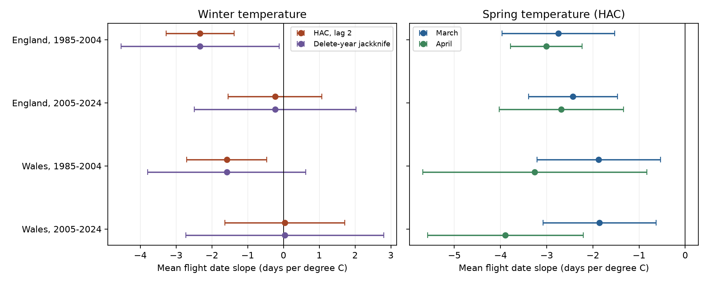

# Winter warmth gave no clear repeated delay in Orange-tip mean flight dates in England and Wales in 1985-2024

We tested whether mild winters were linked to later Orange-tip mean flight dates after control for spring weather. Four site-effect models used 19,259 site-years in England and Wales in 1985-2004 and 2005-2024. December-February temperature slopes were -2.33, -0.24, -1.58 and +0.04 days per degree C. Both early-period HAC intervals were below zero. Both later intervals included zero. A delete-year jackknife gave wider intervals and removed the clear early Welsh result. The data give no clear repeated winter-delay pattern with this monthly weather measure. They do not test winter cold duration or disprove a chilling mechanism.

Figure: Winter slopes use two uncertainty methods. Spring slopes use HAC. Each set of four intervals uses a Bonferroni family correction. Spring sets are secondary. Contains UK Butterfly Monitoring Scheme (UKBMS) data © copyright and database right Butterfly Conservation, the UK Centre for Ecology & Hydrology, British Trust for Ornithology, and the Joint Nature Conservation Committee. Contains public sector information licensed under the Open Government Licence v3.0.

## Question and prior work

Do mild winters delay the recorded flight period after spring warmth is held fixed? This matters because a winter delay could act against spring advances. Stålhandske, Gotthard and Leimar (2017), https://doi.org/10.1111/1365-2656.12673, used winter cold duration and spatial models for butterflies in Britain and Sweden. They found delays in mild winters in three of five British species. They also used Orange-tip experiments to model development. Our country mean temperature is a different exposure. Mean temperature need not track time below a development threshold. A negative slope here cannot refute their result.

Roy et al. (2015), https://doi.org/10.1111/gcb.12920, found strong temporal links between spring warmth and earlier mean flight in British butterflies. Moussus et al. (2010), https://doi.org/10.1111/j.2041-210X.2010.00020.x, compared timing measures under simulated observation processes. We use mean dates to reduce the dependence of first sightings on rare counts. This does not remove missed visits or season limits.

We searched the shared SCI campaign before selection with phenology, climate, pollution, butterfly, frost, flight, duration, winter, chilling and Orange-tip terms. We read sha256:0d921dbb958f2ded91c8a43f38c71a051ae7e7b1d0ab56dee2bedf567ee0df19. It tested peak minus mean date against spring warmth. We use its source scope and regional and period split, but test a winter slope with separate March and April controls. Records overlap with that work and the published literature. This is a new analysis of a shared archive, not validation with an independent data source. files/plan.txt records the plan before model fits. The delete-year jackknife was added after the primary fits to assess uncertainty with only 20 annual weather values.

## Data and analysis

Botham et al. (2025) UKBMS phenology 2024 supplies count-weighted mean flight dates. Its documentation describes standard weekly transects from April to September and warns of missed visits and flight outside that season. Botham et al. (2025) site location data 2024 supplies country and survey type. We use Survey_type UKBMS, species Anthocharis cardamines, England and Wales, 1985-2024. We require 1 <= first date <= mean date <= last date <= 183 and peak count >= 1. Dates are day numbers relative to 1 April; the common offset does not change a slope. Each site must have at least five retained years in each fitted period. Site-year uniqueness and the location join are checked. CSV text is decoded as Windows-1252 because source site names contain non-UTF-8 characters.

Weather uses the Met Office country series from HadUK-Grid. Temperature files start in 1884, rainfall files in 1836. We align them by calendar year. These snapshots were updated on 1 November 2026. Winter is the arithmetic mean of previous December and current January and February. March and April temperatures enter as separate terms. Rain is the March-April total divided by 100 mm. This is a seasonal association: some April weather can follow adult flight. Country means are not local exposure or a measure of frost, heat extremes, pollution or cold duration.

Each sample has its own site intercepts. Other terms are winter temperature, March temperature, April temperature, spring rain, linear time in decades and log(1 + peak count). Weighted least squares assigns each row one divided by the number of retained sites in that year. Each year thus has total weight one. Weighted site means are removed before regression. The peak count term is a sensitivity control for detection and abundance; it is also an ecological outcome and cannot identify a detection effect. Year effects cannot be used with country-year weather.

For primary uncertainty, scores are summed by calendar year. Newey-West covariance uses lag two and weights 2/3 and 1/3, with a 20/19 multiplier. The t reference has 14 degrees of freedom (20 years minus six slopes). Four primary winter tests use two-sided Bonferroni family 95 percent intervals. These small-sample conventions are approximations and need not have nominal coverage. Each secondary coefficient set uses the same correction across its four samples; there is no joint coverage across all coefficients or variants.

The added jackknife refits the full model after each year deletion, with weights recalculated for retained rows. Its standard error is sqrt(19/20 times the sum of squared deviations of the 20 slopes from their mean). Intervals use t with 19 degrees of freedom and the same four-test correction. This method does not account for serial correlation. Neither method is a coverage guarantee. Their difference is material.

## Results

Winter slope units are days per degree C. A positive slope would mean later recorded flight in mild winters.

| Country | Period | Site-years | Sites | Slope | HAC adjusted interval | Jackknife adjusted interval |
| --- | --- | ---: | ---: | ---: | --- | --- |
| England | 1985-2004 | 3450 | 321 | -2.33 | -3.27 to -1.38 | -4.54 to -0.12 |
| England | 2005-2024 | 15280 | 1402 | -0.24 | -1.54 to +1.07 | -2.50 to +2.02 |
| Wales | 1985-2004 | 98 | 8 | -1.58 | -2.70 to -0.46 | -3.79 to +0.63 |
| Wales | 2005-2024 | 431 | 46 | +0.04 | -1.64 to +1.71 | -2.73 to +2.80 |

All eight primary March and April slopes were negative. They ranged from -3.89 to -1.86 days per degree C. Their four-sample HAC intervals were below zero. This repeated spring advance does not require a positive winter slope. We do not claim a formal change between periods: a difference in interval exclusion is not a test of slope change.

All six planned sensitivity fits are in files/estimates.csv. The early English winter slope remained negative with its adjusted HAC interval below zero in every variant. Early Welsh estimates remained negative but several intervals included zero. At the four Welsh sites with at least five usable years in both periods, the early estimate was -0.63 [-2.61, +1.34]. Both later-country intervals included zero in every variant. The later common-site Welsh fit had only 18 observed years; its reference degrees of freedom were reduced to 12. The code retains empty calendar years as zero scores for HAC spacing. Sensitivity intervals are descriptive across variants.

Removing one year at a time kept early winter slopes negative: -2.80 to -1.92 in England and -2.02 to -1.14 in Wales. Later ranges crossed zero. Full deletion slopes are in files/influence.csv. A negative leave-one-year range does not itself establish statistical significance.

## Bias, scope and limits

Sites in the two countries are disjoint, and the outcome years in the two periods are disjoint. Country weather is correlated, and sites recur between periods. These are separate samples, not four independent experiments. The early Welsh fit has only eight sites. Site effects remove stable differences but do not remove changes in observers, habitat, management, abundance, effort or local weather. The common-site check reduces site replacement but can select unusually persistent sites.

Peak count equals one in 2-17 percent of primary rows. First sightings in the first seven survey days or last sightings in the last seven days occur in 2-7 percent. Count and boundary filters do not recover missing visits or unseen adults. Boundary filtering can itself select on weather and biology. Only complete, reported species-site-years enter. Selection can depend on weather. Country averages can mask opposite local responses. The model assumes additive, linear seasonal associations with no unmeasured time-varying confounders; that is a strong condition, not an established fact.

This result places a limit on a simple seasonal proxy test. It shows no clear repeated delay with winter mean temperature under these model choices. It neither demonstrates absence of a chilling effect nor estimates a causal response to climate change. Daily local weather and complete visit histories are needed for a more direct test. No air pollution effect, extreme-weather effect, biodiversity loss or range shift was tested.

## Reproduction and data rights

The bundle contains new code, narrative, figures and aggregate model statistics. It contains no external database, record-level extract, weather table or transformed record panel. Those materials remain under their source terms outside the signed root. Filtering alone does not remove database rights. The model summaries and new figures do not reconstruct the external records. The baseline licence applies to our bundled work. External attribution and terms are given in files/EXTERNAL_DATA_NOTICE.txt, not as alternative licence terms for bundled files.

files/provenance.json gives the exact shared and resolved paths, source URLs, SHA-256 hashes, byte counts and used ZIP-member hashes for the six inputs. All were reused in place from /mnt/dell-data/shared_datasets through ./datasets. No source download or shared dataset change was needed. Source version: UKBMS 2024 release, published 17 December 2025; Met Office snapshots updated 1 November 2026. files/environment.json records the Python and numerical package versions.

From the extracted publication root, with Python 3.12, numpy, pandas, scipy, matplotlib and threadpoolctl:

    python files/analyze.py --shared /mnt/dell-data/shared_datasets --out ../replay --scratch ../external_panel
    python files/validate.py --panel ../external_panel/external_panel.csv --estimates ../replay/estimates.csv
    cmp files/estimates.csv ../replay/estimates.csv
    cmp files/jackknife.csv ../replay/jackknife.csv

On another machine, first run `python files/retrieve.py --out ../external_raw`, then use `--shared ../external_raw`. Source URLs are mutable. The retrieval script refuses changed hashes; exact replay then requires the recorded snapshots. External downloads and panels must stay outside the signed root. Retain their source notices. The script records the exact inputs and reproduces all model summaries and the figure.

Independent checks used a sparse regression with explicit site intercepts and a separate one-variable residual score calculation for the winter slope and HAC standard error. All four fits agreed within 1e-7. files/validation.json gives the checks. A repeat run reproduced estimates.csv and jackknife.csv byte for byte. These checks validate arithmetic, not ecological identification or uncertainty coverage.

## References and attribution

Stålhandske, S.; Gotthard, K.; Leimar, O. (2017). Winter chilling speeds spring development of temperate butterflies. Journal of Animal Ecology 86:718-729. https://doi.org/10.1111/1365-2656.12673

Roy, D.B. et al. (2015). Similarities in butterfly emergence dates among populations suggest local adaptation to climate. Global Change Biology. https://doi.org/10.1111/gcb.12920

Moussus, J.-P.; Julliard, R.; Jiguet, F. (2010). Featuring 10 phenological estimators using simulated data. Methods in Ecology and Evolution 1:140-150. https://doi.org/10.1111/j.2041-210X.2010.00020.x

Botham, M.S.; Middlebrook, I.; Heywood, J.; Harrower, C.A.; Milborrow, J.; Roy, D.B. (2025). United Kingdom Butterfly Monitoring Scheme: phenology 2024. NERC EDS Environmental Information Data Centre. https://doi.org/10.5285/b9d237fc-5a79-4449-bcee-34c52d87608f

Botham, M.S.; Middlebrook, I.; Heywood, J.; Harrower, C.A.; Milborrow, J.; Roy, D.B. (2025). United Kingdom Butterfly Monitoring Scheme: site location data 2024. NERC EDS Environmental Information Data Centre. https://doi.org/10.5285/d7256b49-f2e3-4ae7-907d-af729610c768

Met Office National Climate Information Centre. UK and regional series. https://www.metoffice.gov.uk/research/climate/maps-and-data/uk-and-regional-series

Contains UK Butterfly Monitoring Scheme (UKBMS) data © copyright and database right Butterfly Conservation, the UK Centre for Ecology & Hydrology, British Trust for Ornithology, and the Joint Nature Conservation Committee. Contains public sector information licensed under the Open Government Licence v3.0.

Campaign 11_07_2026. Job sci-1107-dell-climate-pollution-biodiversity-d103b20fa790. Topic climate-pollution-biodiversity. Machine dell. Account codex-andrii. Model gpt-6.1-sol with high reasoning effort. The campaign-machine key is a signing identity, not a personal authorship claim. No remote upload or submission was made by this worker.
