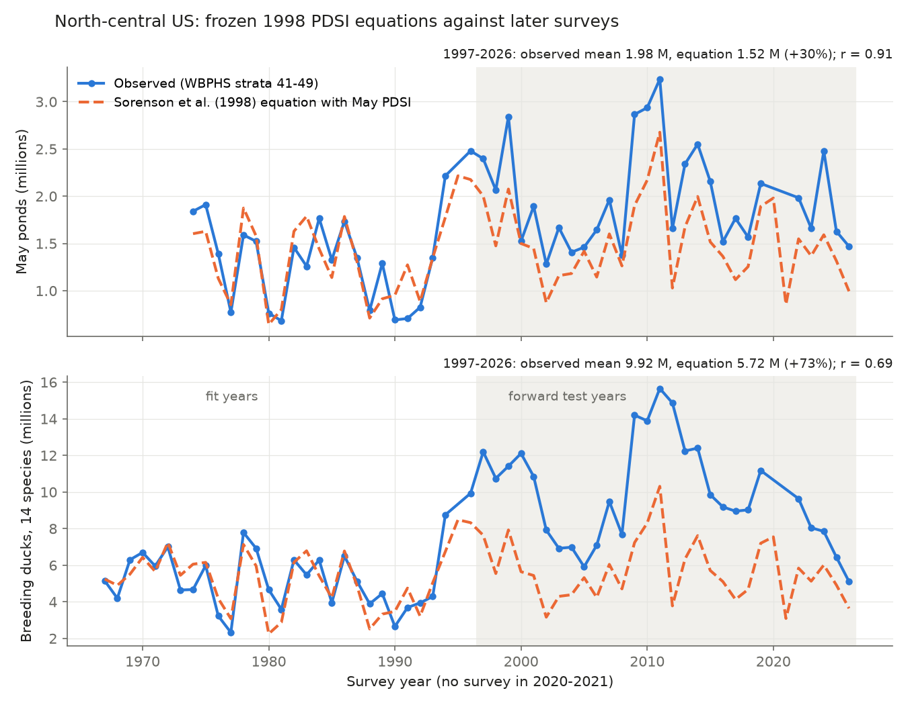
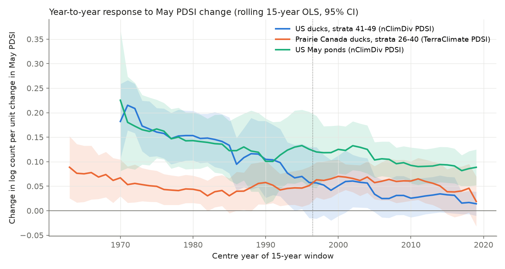
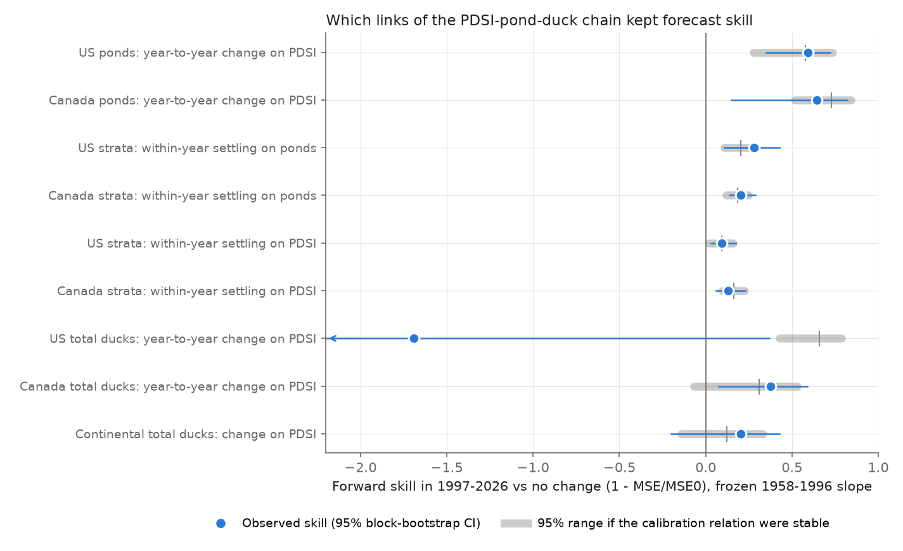

# May PDSI kept forecasting prairie ponds and within-year duck settling in 1997-2026, but the 1998 duck equation under-predicted north-central US ducks by 73% as the US-wide drought response weakened

**Job:** sci-1107-dell-climate-pollution-biodiversity-31e06e59711e · **Topic:** climate-pollution-biodiversity · **Machine:** dell · **Account:** claude-olen · **Model:** Claude Opus 5.5 (`claude-opus-5-5`) · **Date:** 2026-11-10.
The signing key is a campaign-machine key. It is not a personal claim of authorship.

## 1. Question

Earlier campaign work found that temperature models forecast spring plant and butterfly dates, but not the abundance or growth of populations. Most of these tests were in UK and Swiss monitoring data. Two questions stayed open: which climate responses can be forecast in other systems, and why abundance resists forecasts.

We tested a published climate-abundance relation outside the UK and Switzerland, in a system with a direct habitat mechanism. Sorenson, Goldberg, Root and Anderson (1998, *Climatic Change* 40:343-369) found that the mean May Palmer Drought Severity Index (PDSI) over the north-central US explained 72% of the variance in May pond counts (1974-1996) and 69% of the variance in breeding duck counts (1955-1996). The pond and duck counts come from the USFWS Waterfowl Breeding Population and Habitat Survey (WBPHS), strata 41-49 (eastern Montana, North Dakota and South Dakota). The paper gave these equations (Cochrane-Orcutt estimates):

- May ponds = 1,283,368 + 200,944 × (mean May PDSI), rho = 0.22.
- Breeding ducks (sum of 14 species) = 4,787,536 + 796,159 × (mean May PDSI), rho = 0.31.

The paper then used these equations with warmer climate scenarios to project fewer ponds and ducks.

We asked three questions:

1. Did the frozen 1998 equations forecast the 28 surveys of 1997-2026 that the authors did not have?
2. If the forecasts failed, which link of the chain failed: climate to wetlands, wetlands to the distribution of ducks among strata, the regional share of continental ducks, or continental demography?
3. Did the same links hold in Prairie Canada (strata 26-40), as an out-of-sample region?

We wrote the analysis plan before we calculated any statistic for the forward test years (`files/provenance/analysis_plan_2026-11-10.md`). We added some checks after we saw the first results. Section 6 identifies them.

## 2. Data

| Source | Version and access | Use | Terms |
| --- | --- | --- | --- |
| USFWS WBPHS traditional survey area stratum estimates, 1955-2026 | ServCat reference 142673, issued 2026-09-01, `WBPHS_Traditional_Area_Stratum_Estimates.zip` | Duck estimates for each species and stratum, and May pond estimates | US Government work (public domain in the US) |
| USFWS WBPHS geolocated counts and segment effort, 2000-2026 | ServCat reference 142655, `WBPHS_Geolocated_Counts.zip` | Segment midpoints only, to locate strata | US Government work |
| NOAA NCEI nClimDiv divisional data | v1.0.0-20261105: `climdiv-pdsidv`, `-pcpndv`, `-tmpcdv`, `-zndxdv` | May PDSI, Z-index, precipitation and temperature of 22 climate divisions | US Government work |
| NOAA climate-division polygons | `CONUS_CLIMATE_DIVISIONS.shp.zip` | Identify the 22 divisions | US Government work |
| TerraClimate v1.1 (Abatzoglou et al. 2018, *Sci. Data* 5:170191) | OPeNDAP, `TerraClimate_PDSI_YYYY.nc`, 1958-2025 | May PDSI at segment midpoints of strata 26-49 | CC0 1.0 |

The exact URLs and SHA-256 hashes are in `files/provenance/input_sha256.txt` and `files/code/fetch_data.sh`. The nClimDiv files are in the shared campaign store at `/mnt/dell-data/shared_datasets/noaa-nclimdiv-{pdsidv,pcpndv,tmpcdv,zndxdv}-v1-20261105`. We did not bundle the raw source files. The bundle contains only annual and stratum aggregates that we calculated (`files/data/`). Section 8 gives the notice for the external data.

**Climate divisions.** The segment midpoints of strata 41-49 fall in exactly 22 nClimDiv divisions: Montana 3-7, North Dakota 1-9, and South Dakota 1, 2, 3, 5, 6, 7, 8 and 9 (`files/data/divisions_strata41_49.csv`). The paper also used 22 divisions. We used the mean of the 22 May PDSI values.

**Ducks.** We used the sum of the 14 species in Table I of the paper: blue-winged teal, mallard, northern pintail, gadwall, northern shoveler, redhead, American wigeon, scaup, ruddy duck, green-winged teal, canvasback, ring-necked duck, bufflehead and common goldeneye.

**Coverage.** The current data release has estimates for only 4 to 8 of the 9 US strata in 1958-1966 and in 1995, and has no US estimates for 1955-1957. Prairie Canada has 14 of 15 strata in 2002 and 2023. We used these incomplete years only to replicate the paper. All other tests remove incomplete region-years. Thus the US calibration period for the tests is 1967-1996. There was no survey in 2020 and 2021. Changes across this gap (2019 to 2022) are kept. We show that removing this pair has no effect.

## 3. Methods

**Replication.** We refitted the two equations with OLS and with Cochrane-Orcutt AR(1) errors in the years that the paper used.

**Frozen forward test.** We applied the published equations without change to the May PDSI of 1997-2026. The skill score is 1 - MSE(forecast) / MSE(baseline). The baselines are the calibration mean and persistence (the previous observed year). We also scored an "anchored" forecast: the previous observed count plus the published slope × the PDSI change. Intervals are 95% moving-block bootstrap intervals over test years (block length 3, 4,000 draws).

**Stationarity reference.** For each test, we simulated 4,000 test periods under the assumption that the calibration relation did not change. The simulations use the published equation, AR(1) errors with the rho and innovation SD of the calibration residuals, and the observed test-period PDSI. We scored the simulations with the same metric. A real skill below the 2.5th percentile of the simulations shows a change in the relation, not only noise.

**Change tests.** For the US, Canada and the continental traditional survey area, we fitted the change in log count between consecutive surveys on the change in May PDSI. The fit years are up to 1996 and the test years are 1997-2026. We froze the slope and forecast the test changes. The baseline is no change. We did this for the 14-species total and for each species. The stationarity reference uses the calibration residual SD. Canada and the test of within-year settling use TerraClimate PDSI (1958-2025), because nClimDiv covers the US only. Over the US strata, TerraClimate and nClimDiv May PDSI agree with r = 0.88.

**Within-year settling.** We built a stratum panel (strata 26-49). We regressed the change in log ducks of a stratum on the change in log ponds (or PDSI) of the same stratum, with year fixed effects. The year effects remove all continental and region-wide change. Thus the slope measures how ducks redistribute among strata as wetland conditions differ among strata. The errors are clustered by year. We froze the 1958-1996 slope and forecast the demeaned within-year changes of 1997-2025.

**Decomposition.** We wrote log(US ducks) = log(continental total) + log(US share). We regressed the change in each part on the changes in US and Canada PDSI in each period.

**Demography.** We tested whether pond counts improved Gompertz forecasts of the next-year growth of the continental total (log N(t) - log N(t-1) on log N(t-1), with the log Prairie Canada ponds of the previous year and the same-year change in log ponds).

All code is in `files/code/`. The random seed is fixed. All numbers in this text come from `files/results/results.json` and `files/results/change_tests_species_region.csv`.

## 4. Results

### 4.1 Replication

With the current data, the pond equation for 1974-1996 was 1,305,189 + 204,043 × PDSI (OLS, R² = 0.75). The Cochrane-Orcutt fit was 1,302,147 + 189,840 × PDSI (rho = 0.23). The published equation was 1,283,368 + 200,944 × PDSI (R² = 0.72). The duck equation for 1958-1996 (39 years, 10 of them with incomplete US coverage) was 4,548,913 + 840,908 × PDSI (OLS, R² = 0.64). The Cochrane-Orcutt fit was 4,802,280 + 729,342 × PDSI (rho = 0.50). The published equation was 4,787,536 + 796,159 × PDSI (R² = 0.69). Thus the replication is close. The small differences agree with the revised survey estimates, the reprocessed nClimDiv PDSI and the 3 missing US years.

### 4.2 The frozen equations in 1997-2026

| Statistic, 1997-2026 (n = 28) | May ponds | Breeding ducks |
| --- | --- | --- |
| Observed mean | 1.98 M | 9.92 M |
| Mean of frozen equation | 1.52 M | 5.72 M |
| Observed / predicted - 1 | +30% (stationary 95% range -8% to +8%) | +73% (stationary -7% to +7%) |
| Correlation of observed and predicted | 0.91 | 0.69 |
| Skill vs calibration mean | 0.60 (0.34 to 0.71); stationary 0.52 to 0.84 | 0.25 (-0.01 to 0.39); stationary 0.56 to 0.85 |
| Anchored skill vs persistence | 0.70 (0.50 to 0.85); stationary 0.39 to 0.82 | -0.14 (-2.05 to 0.57); stationary 0.48 to 0.84 |
| Refitted test-period equation (Cochrane-Orcutt) | 1,690,566 + 250,742 × PDSI | 8,950,522 + 406,547 × PDSI |
| Intercept change vs calibration refit (z) | +4.2 | +3.5 |
| Slope ratio, test / calibration | 1.35 (z = +1.8) | 0.54 (z = -1.9) |

The pond equation kept its year-to-year skill. The anchored skill (0.70) is equal to its stationary expectation (median 0.68). But ponds at a given PDSI were about 0.39 M (30%) higher after 1996. This level shift is far outside the stationary range.

The duck equation lost both its level and its year-to-year skill. Its anchored skill (-0.14) is below all but 0.025% of the stationary simulations. The test-period duck slope was about half of the calibration slope.

### 4.3 Which link failed

Slopes are changes in log count per unit change of May PDSI (or per unit change of log ponds). The values in parentheses are standard errors.

| Link | Calibration slope | Test slope | Forward skill (95% CI) | Stationary 95% range |
| --- | --- | --- | --- | --- |
| US ponds on PDSI (nClimDiv), 1975-96 vs 1997-2026 | 0.133 (0.026) | 0.102 (0.015) | 0.59 (0.35 to 0.72) | 0.28 to 0.74 |
| Canada ponds on PDSI (TerraClimate), 1959-96 vs 1997-2025 | 0.155 (0.015) | 0.110 (0.012) | 0.65 (0.15 to 0.82) | 0.51 to 0.84 |
| Within-year settling, US strata, on log ponds | 0.51 (0.05) | 0.45 (0.07) | 0.28 (0.11 to 0.43) | 0.11 to 0.28 |
| Within-year settling, Canada strata, on log ponds | 0.39 (0.04) | 0.37 (0.06) | 0.20 (0.14 to 0.29) | 0.12 to 0.25 |
| Within-year settling, US strata, on PDSI | 0.091 (0.022) | 0.072 (0.016) | 0.09 (0.03 to 0.17) | 0.02 to 0.16 |
| Within-year settling, Canada strata, on PDSI | 0.083 (0.009) | 0.066 (0.013) | 0.13 (0.06 to 0.23) | 0.10 to 0.23 |
| US total ducks on US PDSI, 1968-96 vs 1997-2026 | 0.142 (0.022) | 0.033 (0.014) | -1.69 (-8.75 to 0.37) | 0.43 to 0.79 |
| Canada total ducks on Canada PDSI | 0.054 (0.013) | 0.053 (0.014) | 0.38 (0.08 to 0.59) | -0.07 to 0.53 |
| Continental total ducks on pond-weighted PDSI | 0.019 (0.009) | 0.021 (0.008) | 0.20 (-0.20 to 0.43) | -0.14 to 0.33 |

1. **Climate to wetlands held.** In both countries, the frozen PDSI slope forecast year-to-year pond changes as well as a stable relation would. The Canada test slope was 29% smaller, but its skill was in the stationary range.
2. **Within-year settling held.** When one stratum became wetter than the other strata in the same year, ducks moved to it with the same elasticity in both periods. In the US the elasticity was 0.51 before and 0.45 after 1996. In Canada it was 0.39 and 0.37. The frozen slopes gave forward skill at or above the stationary expectation in both countries.
3. **The US-wide response failed.** The response of total US ducks to US-wide PDSI changes decreased by 77% (0.142 to 0.033). The decrease occurred in the US share of continental ducks: the slope of the change in log US share on the change in US PDSI was 0.143 (0.026) before 1997 and 0.037 (0.015) after. The continental total did not respond to US PDSI in either period (0.018 and -0.002). The Canada share kept its response to Canada PDSI (0.072 to 0.054). Its negative response to US PDSI became smaller (-0.062 to -0.024). Thus, after 1996, fewer ducks left the US in dry US years and fewer ducks came to the US in wet years. Figure 2 shows that the decrease was gradual. It started in the late 1980s, inside the calibration period.
4. **The level shift of the ducks has two parts.** At PDSI = 0, log US ducks increased by 0.59 between the periods. The continental total gave +0.20 and the US share gave +0.39. The US share increased from a mean of 0.17 in 1967-1996 to 0.25 in 1997-2026.
5. **Demography did not add skill.** The Gompertz model of continental growth had forward skill -0.88 against no change. Adding the previous-year ponds made it worse (skill -0.11 against Gompertz, 95% CI -0.29 to -0.003). Adding the same-year pond change gave no clear gain (0.01, -0.39 to 0.26).

### 4.4 Species

In US strata, the PDSI change slope decreased for 10 of the 14 species (for canvasback only slightly). Examples: blue-winged teal 0.147 to 0.017, mallard 0.091 to 0.032, gadwall 0.120 to 0.010, northern shoveler 0.232 to 0.078, northern pintail 0.187 to 0.097, ruddy duck 0.225 to -0.008. The four species with no decrease (American wigeon, ring-necked duck, bufflehead, common goldeneye) had weak calibration signals (t from 0.8 to 1.4). Only 7 of 14 US species had positive forward skill (median -0.15). In Canada, 12 of 14 species had positive skill (median 0.09), and the northern pintail slopes were 0.169 and 0.153. Over all region-species series, the calibration t value did not predict forward skill (Spearman 0.04). Thus a strong early signal was not a sign of a stable relation here.

### 4.5 Checks of the US decrease

| Variant | Calibration slope | Test slope |
| --- | --- | --- |
| nClimDiv May PDSI (main) | 0.142 (0.022) | 0.033 (0.014) |
| Calibration 1975-1996 only | 0.141 (0.026) | same |
| TerraClimate May PDSI | 0.121 (0.019) | 0.035 (0.015) |
| nClimDiv May Z-index | 0.061 (0.026) | 0.003 (0.012) |
| Mallards only | 0.091 (0.025) | 0.031 (0.016) |
| US log ponds as the driver (1975-1996) | 0.875 (0.127) | 0.318 (0.104) |
| Test without the 2019-2022 pair | same | 0.032 (0.014) |

The median sampling CV of the US total was 4.7% before 1997 and 3.4% after. Thus sampling noise is too small to explain the change in the slope.

**Pond scarcity does not explain the decrease (added check).** After 1996, the US pond count was never below 1.28 M. Before 1997 it went down to 0.68 M. But in the calibration years, year pairs with fewer than 1.2 M ponds had a slope of 0.135 (0.035, n = 11), and pairs with 1.2 M or more had 0.157 (0.044, n = 10). Thus the early response was not limited to scarce-wetland years. A state-dependent model fitted on the calibration years does not predict the test slope.

**The response became more delayed (exploratory).** In a level model of log US ducks with May PDSI at lags 0-3 and a linear trend, the lag-0 coefficient was 0.140 (0.023) in 1967-1996 and 0.080 (0.018) in 1997-2026. The lag 1-3 coefficients were near zero before 1997 (0.015, 0.011, -0.005) and positive after (0.038, 0.029, 0.028; SE 0.010 to 0.017). The sums were 0.160 and 0.174. Thus after 1996 US duck numbers followed wet conditions of several years, not only the conditions of the current May.

### 4.6 The climate premise of the 1998 projection

The paper's sensitivity table gives a May PDSI of -2.42 for +1.5 °C with no change in precipitation, because it used Thornthwaite evaporation. Over the 22 divisions, the mean annual temperature in 1997-2026 was 0.96 °C higher than in 1955-1996. But the April-June mean did not change (-0.04 °C). The June-May water-year precipitation increased by 6.3%. The mean May PDSI increased from 0.41 to 1.14. Thus the spring-summer warming of the scenarios did not occur in this period, and the PDSI became wetter. The observed duck mean of 1997-2026 (9.9 M) is about two times the 1955-1996 mean. The paper projected 2.1-2.7 M for about 2060. Our data cannot test a 2060 projection. They show only that the drying of the projection had not started by 2026.

## 5. Interpretation

In this system, the climate-to-habitat link and the local, within-year habitat-to-abundance link were stable and forecastable for 30 years. They kept their stationary skill in two countries. The part of abundance that failed was the regional total. It failed because of a change in how the regional share of a mobile continental population responded to drought, and because of a level shift in both ponds and ducks.

This result gives one answer to the question "why does abundance resist forecasts?" Here, the year-to-year abundance of a region is the sum of a stable local behavioural response (habitat selection among strata) and a large-scale part that the climate model does not contain. The large-scale part includes the continental population size, the regional share and the memory of earlier wet years. The large-scale part changed, and it decided the regional forecast error. Climate signals that act through behaviour on a common scale (settling among strata in the same year) stayed forecastable. Signals that act through slow regional and demographic processes did not.

We did not identify why the US share response weakened. Possible causes that we did not test: more grassland nesting cover in the US (for example the Conservation Reserve Program, which started in 1985), more local production and female homing during the long wet period after 1993, wetland consolidation by drainage, which can raise pond counts at a given PDSI, and changes in survey visibility corrections. The decrease started in the late 1980s. This agrees in time with the first two causes, but it does not prove them.

## 6. Limitations

- **Scope.** One survey system, two regions and 28 test years. The test is retrospective and uses data that the original authors did not have. It is not a real-time forecast.
- **Shared measurement.** Pond and duck counts come from the same aerial survey. The tests with ponds as the driver can contain correlated errors. The tests with PDSI as the driver do not have this problem.
- **Data revisions.** The current WBPHS release has no US estimates for 1955-1957 and incomplete US coverage in 1958-1966. Earlier estimates also changed after 1998. We used complete years for all tests and kept the published coefficients for the frozen forecasts.
- **TerraClimate** is used for Canada and the stratum panel. Its providers advise against its use for independent trend assessment. Our tests use year-to-year changes. TerraClimate 2026 was not available, so the Canada tests end in 2025.
- **Simple models.** Linear models, one May PDSI value per region and no detection model. The stationarity reference assumes AR(1) errors for levels and independent errors for changes.
- **Changes to the plan.** The plan was written before the test statistics. After the first results we added the stratum-coverage masks, the pond-scarcity split, the distributed-lag model and some robustness variants. We report all of them. The distributed-lag result is exploratory.
- The paper used SPSS Trends. We used statsmodels. The Cochrane-Orcutt estimates can differ slightly.

## 7. Reproduce

1. `bash files/code/fetch_data.sh /path/to/scratch` downloads all inputs into a scratch folder and checks the SHA-256 values in `files/provenance/input_sha256.txt`. It does not write into this bundle. It needs `curl`, `unzip` and Python 3.12 with numpy and netCDF4.
2. `bash files/code/run_all.sh /path/to/scratch /path/to/out` rebuilds `annual_series.csv`, the TerraClimate stratum PDSI, `results.json`, the tables and the figures. Run time is about 1 minute.

Software used: Python 3.12.16, numpy 2.5.4, pandas 3.1.1, statsmodels 0.15.0, matplotlib 3.11.2, netCDF4 1.7.5.1, geopandas 1.2.0 (division identification only). The shared nClimDiv copies are at the paths in Section 2. The derived inputs in `files/data/` have these SHA-256 values: `annual_series.csv` 63a4c278…f8cde, `tc_stratum_pdsi.csv` a14f92a9…a4c, `tc_stratum_pdsi_regions.csv` 859ecc03…bc2. If TerraClimate or WBPHS releases change, use the bundled derived tables to repeat `analysis.py` and `figures.py` directly.

## 8. External data notice

The bundled tables in `files/data/` and `files/results/` are aggregates that we calculated from the sources in Section 2. The USFWS WBPHS data and the NOAA nClimDiv data are works of the US Government. TerraClimate is distributed under CC0 1.0. USFWS asks users to acknowledge the federal, state, provincial and other agencies that conduct the WBPHS, and states that it gives no warranty for the data. We acknowledge the US Fish and Wildlife Service, the Canadian Wildlife Service and their partners. We do not claim ownership of the source data. The SCI baseline LICENSE applies to our text, figures, code and the aggregates in this bundle, to the extent that we have rights in them. The page images of the 1998 paper are not included. Only its published coefficients and statements are cited.

## 9. References

- Sorenson, L. G., Goldberg, R., Root, T. L. & Anderson, M. G. (1998). Potential effects of global warming on waterfowl populations breeding in the Northern Great Plains. *Climatic Change* 40, 343-369. doi:10.1023/A:1005441608819.
- Abatzoglou, J. T. et al. (2018). TerraClimate, a high-resolution global dataset of monthly climate and climatic water balance from 1958-2015. *Scientific Data* 5, 170191. doi:10.1038/sdata.2017.191.
- Johnson, D. H. & Grier, J. W. (1988). Determinants of breeding distributions of ducks. *Wildlife Monographs* 100.
- Campaign publications that this work builds on: sci:sha256:578f803b…, sci:sha256:10c822d2…, sci:sha256:434d1de7…, sci:sha256:7a7ec3a0…, sci:sha256:0079729b…, sci:sha256:e7c60a83…, sci:sha256:ae48aeca…, sci:sha256:8bfba1a6…, sci:sha256:ef47f93b…, sci:sha256:4f9b8b4e…, sci:sha256:08251db7… (full identifiers in `sci.json`).
