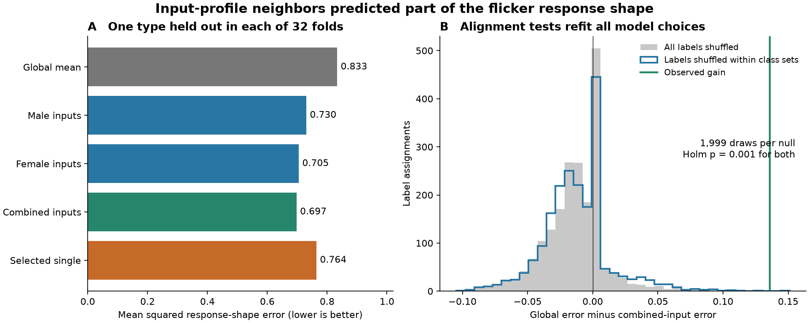
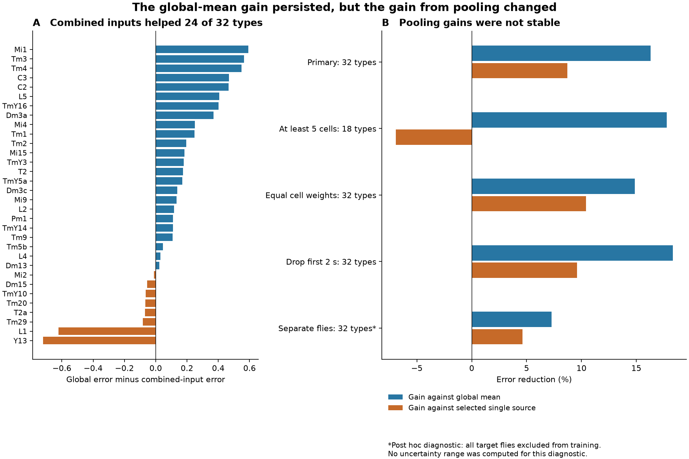
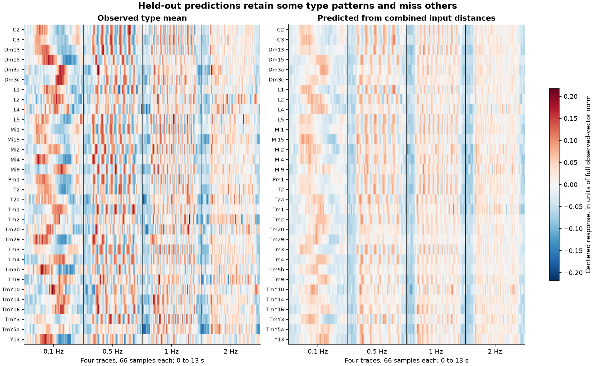

# Similar input profiles reduced flicker response prediction error in 32 selected fly visual cell types

Job: sci-1107-hp-neural-structure-and-computation-8da6be5c5890  
Topic: neural-structure-and-computation  
Campaign: 11_07_2026. Machine: hp. Account: codex-andrii.  
Model: gpt-6.1-sol, high reasoning effort, through Codex in T3 Code. Date: 2026-11-08.  
The signing identity is a campaign-machine key. It makes no personal authorship claim.

## Result

A simple model used similarity of anatomical input profiles to predict the mean flicker response of a cell type whose activity was held out. In 32 selected fly visual cell types, a model based on two combined input-distance tables had mean squared shape error of 0.6974. The mean response of the other types had error of 0.8333. The error reduction was 16.3%. Both label alignment tests had Holm-adjusted p = 0.001.

The added benefit from combining the two connectomes was uncertain. The female-only model already had error of 0.7048. The combined model had only 1.05% less error than this fixed source. Its advantage over a source chosen from the training data changed sign in a sample with more cells per type. A fly resampling range for that advantage included zero.

A post hoc check excluded every target fly from training. It retained a smaller 7.3% error reduction against the global mean. This check supports limited transfer between imaging animals. It also shows that shared flies can affect the reported gain. No general rule across species, brain regions, or behavior was tested.



Figure 1. Left: mean error from outer folds. Right: null gains after complete refitting under 1,999 label assignments for each null. Positive gain favors the combined distances. The tested response is a centered and normalized four-frequency calcium response.

## Question and prior work

Do types with similar mixtures of anatomical inputs have similar temporal response shapes? Can an average of input-profile distances from two connectome specimens improve prediction?

Currier and Clandinin studied visual activity and connectivity in the fly optic lobe. They found limits on connectome-based predictions and a large role for strong inputs [1]. Their public data include the two input-only distance tables used here [2]. Their released analysis code uses mean temporal responses and weighted input sums [3]. Lappalainen and colleagues showed that connectome constraints and task training can support more detailed response predictions [4].

This study adds a small, auditable prediction baseline. It uses other types with similar input profiles as neighbors. These neighbors are not necessarily the target's direct presynaptic cells. Model choices are made without the target type's response. The work also tests two source tables, cleans ambiguous cell labels, and checks dependence on shared imaging flies. It is a reanalysis of existing data. It is not an independent replication of the original activity measurements.

Before choosing this test, we searched the local campaign for connectivity, synphys, morphology, olfactory, retina, cerebellar, Currier, and flicker work. We also read a regional fly structure–function study [5] and a cross-species communication study [6]. Those studies use different activity data and spatial units. No data or code from those bundles were reused.

## Data and selection

All numerical source data came from Currier and Clandinin's Dryad deposition, part 1 of 3, version 7, version ID 369181, published 2025-06-10 [2]. Data are linked by published cell-type names. Anatomy and activity were measured in different flies.

The anatomical inputs are released weighted Jaccard distances. Lower distance means more similar input profiles. One table comes from the male optic lobe connectome of Nern and colleagues [7]. The other comes from the female FlyWire optic lobe analysis of Matsliah and colleagues [8]. We use the deposited summaries without rebuilding synapse tables. Different annotation and processing methods can affect the two sources.

The source compendium has 571 ROIs from 510 unique cell IDs. The flicker array has shape 4 by 66 by 571. The four frequencies are 0.1, 0.5, 1, and 2 Hz. The saved time vector is 0 to 13 s, in 0.2 s steps. Each trace is an existing trial mean. Raw trials were not analyzed.

Selection was conservative:

- All four traces had to be finite. This retained 545 ROIs from 492 cell IDs before label checks.
- Thirteen cell IDs had more than one type label across their ROIs. This includes mixtures of named and unnamed ROIs. All 32 ROIs from these cells were excluded. We did not fill unnamed labels.
- The female distance table has two row/column name conflicts: T4 versus T4a, and TmY13 versus TmY11. We excluded both axes at those positions.
- We required exact type-name matches in both remaining distance tables. Each type also needed at least three retained neurons from at least three flies.
- The final sample has 280 ROIs, 271 neurons, 57 flies, and 32 types.

The response type labels agree with all corresponding marked rows of the source ROI log. Some broad class labels vary within a fixed type. For a restricted permutation, we used the exact set of retained class labels for that type. The group sizes were 12, 5, 4, 3, 2, and six singleton groups. The singletons cannot change under this null.

All exclusions and type counts are in the data and result tables. The selection plan and two data-format amendments were written before the first prediction fit. The fly-separation diagnostic was added after the primary results.

## Method

We averaged complete duplicate ROIs within each retained neuron. We subtracted each frequency trace's own temporal mean. We joined the four traces into one 264-element vector and divided it by its Euclidean norm. We averaged neurons within a fly and type, then averaged flies within a type. We normalized the final type mean to unit norm. This removes overall response gain and preserves relative temporal shape across the four frequencies. It does not estimate firing rate or trial reliability.

We compared five predictive rules. The global rule predicts the uniform mean of all training types. The male and female rules use their own distance tables. The combined rule uses their arithmetic mean. The selected-single rule chooses either the male or female table using training data. A broad class mean was an additional descriptive baseline.

For each anatomical rule, the prediction is a mixture of the global training mean and the mean of the k nearest training types. The neighbor weight is 0, 0.25, 0.5, 0.75, or 1. The tested k values are 1, 2, 3, 5, 10, and all available types. A zero neighbor weight has one canonical candidate. Neighbor ties use sorted type names. Scores within 1e-12 are treated as equal. Candidate ties favor the first entry in the recorded list, with the zero-weight rule first.

One cell type is held out in each outer fold. Inner folds hold out each remaining type to choose the neighbor count, mixture weight, and, for the selected-single rule, the source. Both inner and outer predictions exclude their own validation response. The response of the outer target is excluded from all inner fits. Predictions are not normalized again. Loss is the squared Euclidean distance between the prediction and the observed unit type vector. All types have equal evaluation weight.

Primary gains are global error minus combined error, and selected-single error minus combined error. Positive gains favor the combined distances. We report the full set of models to show the effect of source selection.

For the alignment test, we assigned response type vectors to different anatomical labels and repeated all inner choices and outer predictions. One null shuffled all labels. The other shuffled labels only within the exact class sets above. Each null used 1,999 draws. The one-sided p value is (1 + null gains at least as large as observed) / 2,000. The two p values use Holm correction. Label exchangeability is an assumption of these tests.

We drew 10,000 type bootstrap samples with fitted predictions fixed. We also drew 1,000 global fly bootstrap samples, rebuilt the type means, and refit all model choices. A fly draw had to retain every selected type. There were 1,692 attempts for 1,000 accepted draws. We use central 97.5% ranges for the two primary contrasts.

These ranges have limited meanings. The type ranges omit shared training uncertainty. The fly ranges condition on the chosen types, the fixed anatomy, and retention of all types. The fly distribution is shifted from the original estimate, so its percentile range is not a calibrated confidence interval. These ranges are sensitivity summaries, not population guarantees.

## Results and uncertainty

| Rule | Mean shape error | Reduction against global mean |
| --- | ---: | ---: |
| Global mean | 0.833278 | 0% |
| Male input distance | 0.730183 | 12.37% |
| Female input distance | 0.704771 | 15.42% |
| Combined input distance | 0.697403 | 16.31% |
| Training-selected single source | 0.763913 | 8.32% |
| Broad class mean, descriptive | 0.960853 | -15.31% |

The combined model improved error for 24 of 32 types. It made the same prediction as the female model for 25 types. Thus the table does not establish a large benefit from access to both specimens. Selecting a source from a small training set was less effective than using the female source throughout.

| Contrast | Observed absolute gain | Fixed-prediction type range, 97.5% | Refit fly range, 97.5% |
| --- | ---: | ---: | ---: |
| Global minus combined | 0.135874 | 0.016489 to 0.244230 | 0.010073 to 0.127537 |
| Selected single minus combined | 0.066510 | 0.004159 to 0.167556 | -0.033271 to 0.088098 |

The unrestricted null had mean gain -0.013139 and raw p = 0.0005. The class-restricted null had mean gain -0.012000 and raw p = 0.0010. Both Holm-adjusted p values were 0.001. The restricted result gives evidence for alignment beyond the recorded broad class sets under that null. It does not remove all differences in morphology, transmitter, cell identity, or stimulus response.



Figure 2. Left: every type's global-minus-combined error difference. Right: relative gains in the main analysis and sensitivity checks. Negative values mean more error. The fly-separation row is a post hoc diagnostic with no fitted uncertainty range.

The three planned sensitivity analyses retained the gain against the global mean. Gains were 17.8% with at least five neurons per type, 14.9% with equal neuron rather than equal fly weight, and 18.3% after the first 2 s of each saved trace were removed. The stricter count rule retained 18 types. Its combined model had 6.9% more error than the training-selected single source. The pooling result therefore changed sign.

For the post hoc fly-separation check, each outer fit excluded all flies that contributed to the target type. Each inner fit also excluded all flies that contributed to its own validation type. Types with no remaining training fly were removed within that fit. Outer folds retained 29 to 31 training types. Combined error was 0.784870, global error was 0.846408, and female-only error was 0.770753. The combined rule retained a 7.27% gain against the global mean, but it had more error than the female-only rule.



Figure 3. Every included type, in name order. Each block contains the 66 saved samples for one frequency. All observed vectors have unit norm. Predicted vectors retain the norm supplied by the model. The common color scale shows both captured and missed structure.

## Interpretation and limits

Input-profile similarity carries useful information about mean temporal response shape in this selected optic lobe sample. A simple neighbor rule is a useful baseline for a more complex predictive model. The evidence is consistent with common input composition marking a common temporal role.

The test cannot identify the circuit mechanism. Common inputs, shared cell properties, anatomy used in type assignment, and recording effects can all produce alignment. The method uses unsigned profile distances and has no synaptic dynamics. It is not a simulation of neural signal flow.

The two connectomes each provide one specimen. Their sex and processing differences cannot be separated. The many activity flies are not many independent anatomical maps. We did not test a sex effect. The activity sample has small type counts, source trial means, calcium filtering, incomplete type coverage, and known label conflicts. Overall gain is removed, so this result cannot establish prediction of response amplitude. The four-frequency test is one aggregate shape task. It does not establish transfer to a new stimulus class or behavior. No Allen data, other species, or other brain region were used in this investigation.

The smaller fly-separated gain and the unstable pooling gain are material limits. The primary 16.3% reduction should not be presented as a general estimate for a new animal. A new activity cohort with fixed type labels would be a useful next test.

## Files and reproduction

The bundle contains all flicker samples and metadata needed to repeat the analysis. It also contains the small source distance tables, cleaned evidence, all predictions, uncertainty draws, null scores, figures, and code. The 3.51 GB source response compendium is reused in place and is not duplicated.

Shared dataset path:

`/mnt/dell-data/shared_datasets/currier_clandinin_2025/dryad_pg4f4qs1j_v7`

Exact file paths, byte counts, source version, and SHA-256 hashes are in `files/data/provenance.json`. The three numerical source files have these hashes:

| File | SHA-256 |
| --- | --- |
| ALL_RESPONSES.npy | dda0788b5159a4141ae1596615fb68bc372cefe588cd977183dd5b0b37f0707f |
| ConnectomeData.zip | 3b1f20ed8b702cb32169a1d59a7bbc4cf810c12926d03ac04e7cfff67a19aa9a |
| ME0708_full_log_snap.xls | bf1f9440551c6ae9e6d3e33d75b9c0e94318fd1fdbf52c78d293d969a7ffc64f |

To retrieve the source again, use Dryad version 7 [2] and download those named files. File IDs are 4108395, 4108396, and 4108399, respectively. Use the recorded hashes to check the downloaded bytes. The README and table-description IDs and hashes are also recorded. If adding a shared copy, use the campaign-dataset helper with the download URL and expected hash. Do not replace the existing dataset.

After verifying and extracting the SCI bundle, run from its root:

```bash
uv venv --python 3.12 .venv
uv pip install --python .venv/bin/python -r files/code/requirements.txt
OPENBLAS_NUM_THREADS=4 .venv/bin/python files/code/analyze.py --out replay
OPENBLAS_NUM_THREADS=4 .venv/bin/python files/code/fly_disjoint.py
OPENBLAS_NUM_THREADS=4 .venv/bin/python files/code/check_results.py
OPENBLAS_NUM_THREADS=4 .venv/bin/python files/code/figures.py
```

The primary replay uses the bundled small source evidence and writes fresh results to `replay/`. The other scripts read or regenerate the supplied `files/results/` and figures. Run them on a working copy. The seed is 11072026. The original main analysis took about 24 s on this host; package installation and source retrieval are separate. Python and package versions are in `files/environment.json` and `files/code/requirements.txt`.

To repeat extraction from the original large compendium:

```bash
.venv/bin/python files/code/extract.py \
  --source /mnt/dell-data/shared_datasets/currier_clandinin_2025/dryad_pg4f4qs1j_v7 \
  --out extracted_source
```

This step needs about 3.5 GB of memory for the NumPy object. In this run, the response arrays were first loaded from the original file into a local small cache; the extraction code then used that cache. The default command above reads the original file directly.

An independent response-space calculation checked all 32 nested fits and all 271 neuron vectors. Its maximum prediction difference was 4.2e-17. Its maximum loss difference was 1.5e-15. A held-out response perturbation check passed. The check also recalculated reported p values and fly ranges. Numerical agreement supports the implementation; it does not validate the scientific assumptions.

## Sources

1. Currier TA, Clandinin TR. Infrequent strong connections constrain connectomic predictions of neuronal function. Cell (2025). [doi:10.1016/j.cell.2025.05.007](https://doi.org/10.1016/j.cell.2025.05.007).
2. Currier TA, Clandinin TR. Dryad part 1 of 3, version 7. [doi:10.5061/dryad.pg4f4qs1j](https://doi.org/10.5061/dryad.pg4f4qs1j). Source data are CC0 1.0. We include selected arrays and derived tables with attribution.
3. CurrierClandinin source code, commit afa594507be380c09669c36282f3b224e9e58ae4. [Repository](https://github.com/tacbox3/CurrierClandinin/tree/afa594507be380c09669c36282f3b224e9e58ae4). We inspected import and temporal-analysis definitions. No GPL source code is redistributed or reused in our implementation.
4. Lappalainen JK and colleagues. Connectome-constrained networks predict neural activity across the fly visual system. Nature (2024). [doi:10.1038/s41586-024-07939-3](https://doi.org/10.1038/s41586-024-07939-3).
5. Campaign regional fly analysis. sci:sha256:dcf79d60c2a2b5c231b8c34e4f8b29192c38e406e6c6946bf4a8e913edcf8811. The SCI citation in sci.json is the persistent identifier; this item refers to a local signed bundle.
6. Campaign communication analysis. sci:sha256:29db0c64a2f69e86b51f20c0fe84ad9ea755316c5301ed23d308b847421db6d1. This is a local signed bundle.
7. Nern A and colleagues. Connectome-driven neural inventory of a complete visual system. Nature (2025). [doi:10.1038/s41586-025-08746-0](https://doi.org/10.1038/s41586-025-08746-0).
8. Matsliah A and colleagues. Neuronal parts list and wiring diagram for a visual system. Nature (2024). [doi:10.1038/s41586-024-07981-1](https://doi.org/10.1038/s41586-024-07981-1).

The included baseline license covers this publication's new text, figures, derived tables, and code. It does not change the source data's CC0 status or the upstream code's license.
