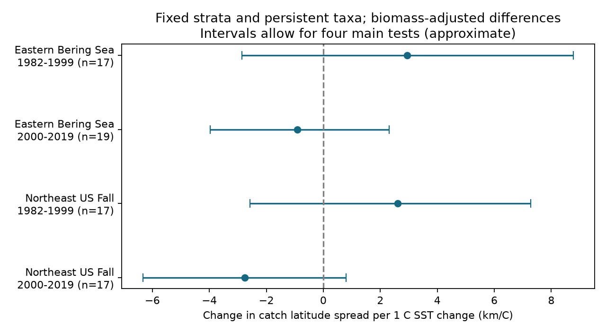

# Four US trawl samples gave no clear sea temperature link to catch latitude spread in 1982-2019

Annual temperature changes did not have a clear link to changes in catch latitude spread in any of our four main samples. The intervals permit expansion and contraction. This is a null result with limited precision. It is not evidence that temperature has no effect.



## Question and prior work

Does warmer water coincide with a wider north-south distribution of catch biomass, after survey effort and biomass changes are considered? A distribution can shift its center without becoming wider. Spread can therefore give information that a centroid does not give. However, catch spread within a survey is not a species' full geographic range.

Pinsky et al. (2013, DOI 10.1126/science.1239352) tested climate velocity and marine distribution shifts. Campana et al. (2020, DOI 10.1038/s41598-020-73444-y) examined climate, abundance and fish distributions in Iceland. Their work gives a reason to consider both temperature and abundance. Our test is a limited annual association test in two US survey systems. It does not test climate velocity or repeat the Iceland analysis.

We searched the campaign for phenology, ocean warming, distributions, trawl spread, width and contraction. We read SCI 574c7309 and SCI 5344f548. The former showed that survey allocation can affect latitude trends. The latter used fixed strata and tested the timing of SST links to catch centroids. We reuse its verified monthly SST series. We build a different outcome from the shared raw catch table. The observations overlap these studies. This is not independent validation of them. We used published files only. The search records are in files/search_ocean.json and files/search_width.json.

We set the sample, models and sensitivity checks in files/PLAN.txt before width estimates. This local plan is not an external registration. The two regions have separate survey systems. The periods have no years in common but share taxa and strata. Regions can share climate drivers. The four tests are not fully independent.

## Data and observation controls

Catch data come from OceanAdapt commit 0d4bcaffe649e970674fe165fe892ab4d787e76a. We reused the completed shared file at `datasets/oceanadapt-all-regions-full-fltr-0d4bcaffe6/all-regions-full-fltr.csv.gz`. Its SHA-256 is cb632fe63d5dd0ff0000288673e59ebe59ae15e34a320b38e9308859353e2a41. files/provenance.json gives its absolute and resolved shared paths, source URL, size and hash. We made no new raw download and did not modify shared inputs.

We counted distinct year-haul IDs over all source rows. IDs and strata are read as strings to avoid mixed numeric and text IDs. Haul coordinates and strata must be unique within year-haul, and stratum areas must be constant. We kept strata with hauls in every available survey year from 1982 through 2019. We kept taxa with positive catch in every available year in that footprint. Bering Sea retained 10 strata, 78 taxa and 13,427 hauls in 38 years. Northeast fall retained 61 strata, 63 taxa and 9,328 hauls in 37 years. Northeast has no 2017 records. We did not fill the gap. Some names are above species level; we call them taxa.

All recorded hauls enter stratum haul counts, including those without the focal taxon. We assume this table contains all relevant survey hauls. Completely empty omitted hauls cannot be recovered. The taxon rule holds composition fixed but excludes arrivals, local losses and rare taxa. This is not a measure of total biodiversity.

## Spread and temperature

For each taxon, year and stratum, Q is summed positive weight per unit effort, n is the number of recorded hauls, A is stratum area and L is the mean latitude of distinct hauls across the full period. We set M = Q A / n. The taxon's latitude center is C = sum(M L) / sum(M). Its spread is 111.195 times sqrt(sum(M (L-C)^2) / sum(M)), in km. No positive catch means zero contribution. The sum covers strata, not individual fish. It measures biomass spread between fixed stratum positions and omits real movement within strata. Area weights reduce effort allocation bias under representative sampling within strata. They do not ensure unbiased observation.

We subtract each taxon's early-period mean spread and then take the median across taxa in each year. For biomass we take log(sum(M)), subtract its early-period taxon mean, then take the annual median across taxa. The biomass control is a community summary, not a full adjustment for each taxon's abundance. Taxon normalization prevents large baseline differences from setting the regional index. Equal taxon influence differs from a community total weighted by biomass.

Temperature is the verified monthly series from SCI 5344f548. That study used cosine-latitude-weighted ERSST v5 2-degree ocean cells in fixed boxes: 54-62 N, 185-200 E for Bering Sea, and 35-45 N, 284-295 E for Northeast. Bounds include grid centers. The main annual exposure averages the 12 months ending in August and October, respectively. The sensitivity exposure averages the last three months. The catch table has no exact dates; these nominal windows can include temperatures after some hauls. SST is not bottom temperature or direct exposure at a haul. NOAA now offers a newer version; we deliberately use the archived v5 series. Parent raw provenance and its NetCDF hash are in files/parent_provenance.json. We used the derived CSV, not that NetCDF directly.

## Model and uncertainty

Within each region and period, we fit by ordinary least squares:

`change in regional spread index = intercept + b * change in SST + c * change in log biomass index + residual`.

Only adjacent calendar-year pairs within a period enter. No difference crosses the period split or 2017 gap. b has units km per C. First differences reduce common long-term trends but do not remove confounding by fishing, recruitment, sampling or catchability. Biomass can be a response to temperature, so this adjusted association is not a total climate effect. The no-biomass check addresses this choice only in part.

We use 10,000 centered residual bootstrap draws with circular blocks of three successive retained pairs, fixed predictors, and seed 11077240. Each draw refits the model. We report 0.625 and 99.375 percentiles: 98.75% marginal intervals with an intended 95% family coverage for four main tests by the Bonferroni rule. Coverage is approximate. The short records and residual assumptions can impair it. Blocks cross the Northeast missing-year gap as successive retained pairs; exact calendar dependence is not preserved there. Taxa are aggregated first, so they are not treated as independent trials. We do not estimate extra uncertainty from haul sampling or the SST reconstruction. Condition numbers are 3.69-10.90; temperature and biomass-change correlations are 0.34-0.53.

## Results

All units below are km per C. Intervals apply to the SST slope.

| Survey | Period | Annual pairs | SST slope | Four-test interval |
| --- | --- | ---: | ---: | --- |
| Bering Sea | 1982-1999 | 17 | +2.94 | -2.86 to +8.77 |
| Bering Sea | 2000-2019 | 19 | -0.92 | -3.97 to +2.30 |
| Northeast fall | 1982-1999 | 17 | +2.61 | -2.58 to +7.28 |
| Northeast fall | 2000-2019 | 17 | -2.76 | -6.33 to +0.80 |

All main intervals include zero. Positive early estimates and negative late estimates do not establish a change in response over time; we did not plan a formal period contrast. All 20 planned sensitivity intervals also include zero. These use blocks of two or four, no biomass control, a mean taxon index, or three-month SST. The late Northeast mean-index slope is +0.80, which differs in sign from its main median result. Thus even the point direction depends on the summary. All estimates and intervals are in files/results.csv. Sensitivity intervals are not adjusted for the entire set of sensitivity tests.

## Meaning and limits

These records do not establish a common annual expansion or contraction with surface warming. They also do not establish equal or negligible effects. A limited temperature range, small samples, exposure error and survey boundaries can hide ecological responses. The width estimate is distinct from latitude shift, occupied area and range edge. It cannot detect expansion beyond the fixed survey boundary. Persistent taxa and full-record strata use information from both periods and select a stable subset.

Area weights and fixed positions address some observation bias. They do not address species identification changes, gear selectivity, survey timing, omitted hauls or nonrepresentative sampling within strata. Northeast vessel and gear changes remain a concern. Residual bootstrap uncertainty does not correct structural bias. This analysis tests neither air pollution nor weather extremes. It does not attribute changes to human-driven climate change. Its contribution is a reproducible test of a separate distribution measure with an explicit observation target and an honest null result.

## Reproduction

Use Python 3 with NumPy, pandas and Matplotlib; versions are recorded in files/provenance.json. From the bundle root:

```
python files/verify_results.py
python files/analyze.py --out /private/new-output
python files/analyze.py --raw /path/to/all-regions-full-fltr.csv.gz --out /private/raw-output
```

The first command checks all taxon-year widths with an independent pairwise-distance identity, all biomass totals, annual medians and all regression slopes with a normal-equation solver. It does not repeat bootstrap intervals. The second rebuilds indices, regressions, every bootstrap and the figure from bundled sufficient evidence and monthly SST. The third rebuilds the evidence from raw catch data as well. Use new private output directories. Do not write into signed evidence or shared datasets.

files/evidence.csv.gz gives positive Q, area, haul count and fixed latitude per taxon-year-stratum. files/taxon_year.csv.gz gives mass and spread. files/annual.csv gives all annual indices and SST. files/design.csv gives retained first differences. files/audit.csv gives sample counts. The independent width check exposed cancellation error in an initial second-moment formula; the final code uses centered squared distances. The correction did not change the reported two-decimal estimates.

For raw retrieval, download the exact source_url in files/provenance.json to a private file and check its SHA-256 before use. The URL pins the OceanAdapt commit. To recover the temperature input, use `sci read PARENT_ZIP --file files/monthly_sst.csv --output PRIVATE_CSV` with parent publication sha256:5344f5486f51539334235aab5affaa637e55401b6dda7fd07c6470565c34d31e. Check the CSV hash in our provenance. The bundled copy permits offline reproduction without retrieving that bundle. Reconstructing monthly SST from raw NetCDF is delegated to the cited parent study and is not independently repeated here.

## Work identity and terms

Job: sci-1107-dell-climate-pollution-biodiversity-7240ee9c0c5e. Topic: climate-pollution-biodiversity. Campaign: 11_07_2026. Machine: dell. Account: codex-andrii. Model: gpt-6.1-sol, high reasoning effort. No agents were launched. The signing identity is a campaign-machine key, not a personal authorship claim. The baseline license applies to our text, code and derived outputs. Source attribution and source terms remain in effect for reused inputs.
