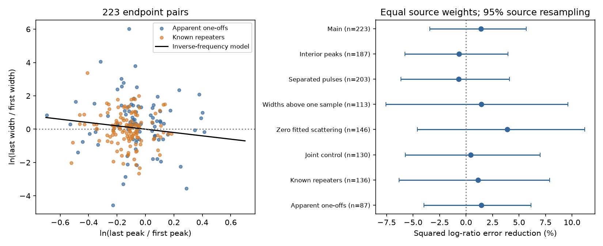

# An inverse-frequency width rule reduces source-balanced error by 1.4 percent in 223 selected CHIME events

## Result

We test whether the first and last fitted components of the same radio burst have a constant product of width and peak frequency. We use CHIME/FRB Catalog 2, release 20251231. In 223 selected events from 120 catalog sources, an inverse-frequency rule reduces squared log-width-ratio error by 1.4 percent relative to equal widths. Equal source weights and 10000 source resamples give a 95 percent interval from -3.4 to +5.7 percent. The fitted log-ratio slope is -0.90, with an interval from -2.29 to +0.39. Thus, the data do not show a clear error reduction and do not exclude a broad inverse trend. At fixed fitted peak frequencies, 117 endpoint pairs cannot satisfy the exact rule within three quoted width errors. Allowing each peak to move by 20 MHz leaves 108 such pairs. These are conditional interval checks, not significance tests. Resolution, band-edge, scattering, pulse-separation and source controls show no clear error reduction. Missing peak errors, shared fit errors, component selection, and limited time resolution prevent a physical exclusion. No new source, planet, or emission mechanism is confirmed. Code, frozen input rows, provenance, results and offline steps are included.



| Selection | Events | Sources | Error reduction (%) | 95% interval (%) | Fixed-peak box failures |
| --- | ---: | ---: | ---: | --- | ---: |
| Main | 223 | 120 | 1.41 | -3.41 to 5.69 | 117 |
| Interior peaks | 187 | 91 | -0.68 | -5.77 to 3.95 | 94 |
| Separated pulses | 203 | 110 | -0.71 | -6.15 to 4.08 | 104 |
| Widths above one sample | 113 | 46 | 1.44 | -7.58 to 9.61 | 46 |
| Zero fitted scattering | 146 | 78 | 3.88 | -4.58 to 11.21 | 68 |
| Joint control | 130 | 68 | 0.45 | -5.74 to 6.98 | 76 |
| Known repeaters | 136 | 33 | 1.14 | -6.31 to 7.89 | 62 |
| Apparent one-offs | 87 | 87 | 1.44 | -3.99 to 6.12 | 55 |
| Without FRB20220912A | 179 | 119 | 1.47 | -3.43 to 5.77 | 103 |

The constant-width rule has source-balanced mean squared log-ratio error 2.24148. The inverse-frequency rule gives 2.20994. Only 128 of 223 events have a wider lower-frequency endpoint. The source-balanced fraction is 0.5712. These numbers describe selected fitted components. They are not estimates for the intrinsic FRB population.

## Question and physical assumptions

Can a change in the Doppler factor alone explain the endpoint widths and frequencies of a burst? Suppose two emission regions have the same rest-frame temporal width and spectral peak. For Doppler factor D and fixed source redshift z, observed width is proportional to (1+z)/D and observed peak frequency is proportional to D/(1+z). Their product is constant. This gives a test with no fitted event normalization: width_last / width_first = peak_first / peak_last.

This restricted explanation motivates our test. Rajabi et al. (2020, arXiv:2008.02395) and Chamma et al. (2021, doi:10.1093/mnras/stab2070) discuss related spectral and temporal relations. They allow more structure than this exact endpoint rule. A failure of our rule does not reject their full models, variable rest-frame durations, intrinsic spectral evolution, or a statistical inverse trend. We do not measure the slope within one component.

The new contribution is an auditable endpoint benchmark, with source weights and interval checks, for this catalog release. An earlier campaign publication (SCI 3ccd56867735520484b417042f3b9c2b5335f4c513aee714a010c53d97651b46) tested the order of endpoint frequencies. We test endpoint widths against frequencies. The signal classes were known before this work.

## Data and selection

We reuse `./datasets/chime-frb-catalog2-20251231/chimefrbcat2.csv` in place. The exact path, source URL, version, byte count and SHA-256 are in `files/provenance.json`. The raw input has 5045 component rows for 4539 events. There are 340 events with more than one component. We preserve all 846 rows for those events in `files/components.csv`. No raw shared file is changed. The SHA-256 of the full CSV is `5108ada779d279a2547d9f9e73ae25bfdd40d8496d6ba7255ec29c6629057a48`.

For every component of an event, excluded_flag, sidelobe_flag, intrachan_flag and catalog1_param_flag must be zero. Times, widths, width errors and peak frequencies must be finite. Sort by mjd_400, with sub_num as the tie rule. Use only the first and last component. Both endpoint widths and errors must be positive. Require at least 20 MHz between endpoint peaks. This leaves 223 endpoint pairs. Intermediate components receive no separate vote. Known repeater names define sources; otherwise the TNS event name defines a source. A one-off label does not prove absence of repetition.

The catalog fits each component with a Gaussian intrinsic width, a spectral shape and an arrival time. All components share dispersion and scattering parameters. Dispersion smearing is modeled. The scattering frequency exponent is fixed at -4. The width in this test is the fitted Gaussian sigma in seconds, not the observed tail duration. The fixed catalog model treats this intrinsic width as frequency independent within each component. We use it as a duration proxy at that component's spectral peak. This proxy can fail for tilted or unresolved structure.

## Methods

Let x = ln(peak_last / peak_first) and y = ln(width_last / width_first). Equal widths predict y=0. The inverse rule predicts y=-x. For each source, average y squared and (y+x) squared over its events. Average those source errors with equal weights. Error reduction is one minus the inverse-rule error divided by the equal-width error. Neither prediction is trained on these data. A fitted slope through zero, sum(weight*x*y)/sum(weight*x*x), is descriptive. We do not fit an intercept because equal endpoint frequencies imply equal widths under the tested rule.

We draw 10000 samples of sources with replacement using seed 8869. Events remain within their source. The 2.5 and 97.5 percentiles give the intervals. These intervals describe source sampling only. They omit fit covariance, peak error, model error and detection selection. They are not calibrated discovery probabilities. The slope interval contains both zero and minus one. It therefore cannot distinguish the equal-width trend from an inverse trend with large scatter.

For an exact-rule check, form an interval for each endpoint's width times frequency. At fixed peak frequency, allow the width to change by three quoted errors in either direction, with a lower limit of zero. Test whether the two intervals overlap. This does not assume independent width errors. It tests a rectangular input range, not a joint confidence region. The 117 failures are not a count of physical model exclusions. Repeat the check with each frequency allowed to change by 20 MHz and bounded by the 400-800 MHz observing band. There are 108 failures. The 20 MHz choice is a sensitivity range, not a measured frequency uncertainty. No spectrum is refitted.

## Instrument and selection controls

Interior peaks requires every component peak to lie from 410 to 790 MHz. Separated pulses requires the endpoint time gap to exceed the sum of their Gaussian widths. Widths above one sample requires both Gaussian widths to exceed 0.983 ms. This is a conservative resolution check, not a universal resolution limit. Width errors below 20 percent requires that condition at both endpoints. Zero fitted scattering uses the catalog's selected zero-tail model; it does not establish zero physical scattering. Joint control combines interior peaks, separated pulses, width errors below 20 percent, and fit S/N at least 20. The table also separates repeater classes and removes the most prolific source. Additional controls for fit notes, chi-square per degree of freedom below two, and flagged-channel fraction below half are in `files/summary.csv`.

Each displayed error-reduction interval includes zero. The controls do not establish an instrument cause. Small fitted widths, component blending, beam spectral response, masked channels, a shared scattering fit, and unmodeled drift remain possible sources of error. We do not inspect raw dynamic spectra or run a detection-efficiency simulation. No new candidate is proposed for confirmation.

## Independent observations and limits

We searched public literature for independent frequency-duration observations. The ATA study of FRB 20220912A (Sheikh et al. 2024, doi:10.1093/mnras/stad3630) concerns one source in our sample at another band. A published correction exists. The corrected text was not accessible through the literature tool. We therefore use no numerical ATA result. Its observations do not confirm these particular CHIME endpoint pairs. No independent telescope validates the result reported here.

The main error gain is small and uncertain. An exact invariant is insufficient for many catalog endpoint pairs under the stated input boxes, but a broad inverse tendency remains consistent with the slope interval. Changes in rest-frame durations, spectral peaks, or propagation can break the exact invariant. This work cannot choose among those physical causes and fit artifacts. No new astronomical phenomenon, planet or source is claimed.

## Reproduce and inspect

Use Python 3.12 with NumPy, pandas and Matplotlib. Exact versions and the frozen-input hash are in `files/validation.json`. From an extracted bundle directory, run:

```sh
python files/analyze.py ./reproduced
```

This reads only the bundled component rows and writes the event table, summary table, validation record and static PNG. To rebuild the frozen rows from the public release in a new private directory, run:

```sh
python files/retrieve.py ./retrieved
```

The retrieval code refuses an existing raw output file and checks the full source hash before use. Compare its component hash with validation.json. No shared download is needed for offline reproduction. The script checks the log-ratio algebra, unique event IDs, and nesting of the frequency sensitivity boxes. A separate offline rerun was compared byte for byte for all analysis outputs. Source catalog bytes may change at the URL; the expected hash prevents silent use of changed data. The bundle preserves all data required for the endpoint test, but not raw spectra needed for a new pulse fit.

## Campaign record and license

Job: sci-1107-dell-astronomy-8869f3b158bd. Topic: astronomy. Machine: dell. Account: codex-andrii. Model: gpt-6.1-sol, high reasoning effort, through the Codex harness in T3 Code. This is one finite investigation in campaign 11_07_2026. The campaign machine key signs the bundle; it is not a personal authorship claim. The SCI baseline license covers our text, figure, derived tables and code as specified in LICENSE. Original catalog rows retain their source attribution to the CHIME/FRB Collaboration. Publications and input data sources are listed in sci.json.
