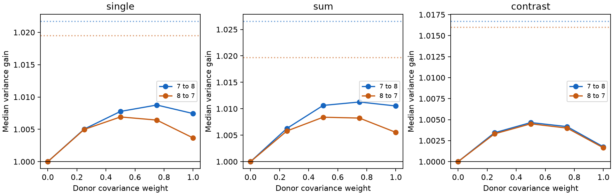

# Transferred readouts gave small median noise gains and frequent losses in two adult worm site-noise models

A readout made with one adult worm map gave a small median noise reduction when used with the other map. It also raised noise for many individual tasks. This result holds for an assumed shared synaptic event model. It is not a measurement of brain noise or behavior.

Figure 1. Median variance gain relative to a simple readout, for each transfer direction and task. The shared event fraction is 0.5. A gain above one means less noise. The donor covariance weight is alpha. Dotted lines show the best readout with exact recipient covariance. The curves join five fixed settings; no setting was fitted to recipient results. These are model outputs for two animals, with no population confidence intervals.

## Question and prior work

Can a readout use the synaptic site structure of another animal to reduce noise? This question matters when a structural map and a functional recording come from different animals.

Witvliet et al. supplied eight brain maps across development. We use the two adult maps, Dataset7 and Dataset8, from the pinned primary repository. The source study states that most ages have only one animal, and electrical links have less complete coverage. We make no age test. See [the source study](https://doi.org/10.1038/s41586-021-03778-8).

Liu et al. found concurrent miniature currents at worm neuromuscular sites with more than one target. This supports shared events as a possible mechanism. It does not measure event sharing at the brain sites used here. See [Liu et al.](https://doi.org/10.1002/dneu.20307). Signal direction affects the effect of noise on information, as shown by [Moreno-Bote et al.](https://doi.org/10.1038/nn.3807).

We searched signed campaign results before we chose this test. Files/campaign_search.json records the focused searches. SCI fe098e32 found lower effective noise dimension than fixed-count controls in these maps. We reuse its verified panel.txt, not its analysis code or output tables. SCI 5e219e19 tested ideal within-map readouts and limits due to unknown tuning. SCI 6d3060b9 tested robust readouts under that uncertainty. Here, the signal is known and fixed, but the covariance comes from another animal. We test transfer without a fit to the recipient covariance. We claim no new general decoding theorem.

Files/analysis_plan.txt records the local plan before the output. It is not an external registration. There were no changes to the planned tasks, settings or comparisons after the first output.

## Data

The input files are Dataset7_synapses.json and Dataset8_synapses.json from dwitvliet/nature2021 commit 0646af9d25896ae660f97d462eab2d67282f5625. We reused shared files in place and did not download or change shared data. Exact input paths, resolved paths, source URLs, byte counts and SHA-256 hashes are in files/results/provenance.json. The path pattern is:

    /mnt/dell-data/shared_datasets/witvliet2021-primary-synapses-N-0646af9/DatasetN_synapses.json

The panel has 162 named brain neurons born before hatching. We keep a site when its source is in the panel and it has at least one other panel target. We remove self contacts and count a repeated target name only once per site. We do not use contact areas, transmitter labels or release parameters. The two maps have 3,168 and 3,253 retained sites. There are 160 targets with positive input counts in both maps. All covariance matrices use these same 160 targets. Sites can have targets outside this panel; these targets are omitted.

Files/results/selected_sites.json lists each retained site's raw row number, source and unique panel targets. This permits inspection without a raw download. We keep sites before we restrict the readout to common active targets.

## Model and readout

Let B have one row per retained site and one column per target. B[s,j]=1 if site s has target j. Let n be the column sum of B and D=diag(n). We assume independent sites, unit positive effects on each listed target, and an equal event probability. A fraction rho of events is shared by the targets at a site. Other events are independent for each contact. With a common variance scale removed,

    C = (1-rho) D + rho B^T B.
    R = D^(-1/2) C D^(-1/2).

The model can be realized by a mixture of shared and independent Bernoulli events with a common success probability. All sites have zero-mean fluctuations with the same marginal variance. The common variance factor cancels. R has unit diagonal. It is positive definite for all tested rho values.

We standardize target noise separately in each animal. Thus transfer assumes that the recipient marginal variances are known for this change of units. It transfers the correlation structure, not a full raw-unit decoder with unknown recipient gains. The assumed signal has the same components in these standardized units in both animals.

We test 160 single-target directions v=e_j. A bilateral pair has a name ending in L and a matching name with R. We test 73 sum directions (e_L+e_R)/sqrt(2) and 73 contrast directions (e_L-e_R)/sqrt(2). All other signal components are zero. The name rule does not prove equal tuning or equivalent roles.

For donor map d, use A=(1-alpha)I+alpha R_d. The unit-response readout and recipient noise variance are

    w = A^(-1) v / (v^T A^(-1) v).
    V_transfer = w^T R_recipient w.

The simple reference is w=v, with V_base=v^T R_recipient v. For these tasks, v has unit norm. For bilateral tasks, v is also the best pair-only readout under unit marginal variance. The best full readout with exact recipient covariance has

    V_oracle = 1 / (v^T R_recipient^(-1) v).

Gain is V_base/V_transfer. A gain above one means less noise for the same unit signal response. This is also a signal-to-noise ratio gain under the fixed linear model. No Gaussian noise assumption is needed for the variance result.

Primary settings are rho=0.5 and alpha=1. We also report fixed alpha values 0, 0.25, 0.5 and 0.75, and rho values 0.25 and 0.9. No value is a measured release estimate. We do not select a best alpha from these recipient results. Alpha=0 is exactly the simple reference.

## Results

The correlation between the two maps' off-diagonal R entries was 0.68887. This is a descriptive correlation of 12,720 target pairs, not a test based on independent animals. At rho=0.5, their entrywise root mean square difference was 0.01017.

For full donor covariance transfer at rho=0.5:

| Donor to recipient | Task | Count | Median gain | Readouts with a loss | Median oracle gain |
|---|---|---:|---:|---:|---:|
| 7 to 8 | Single | 160 | 1.00744 | 33.1% | 1.02171 |
| 8 to 7 | Single | 160 | 1.00366 | 36.3% | 1.01950 |
| 7 to 8 | Sum | 73 | 1.01053 | 26.0% | 1.02654 |
| 8 to 7 | Sum | 73 | 1.00554 | 34.2% | 1.01971 |
| 7 to 8 | Contrast | 73 | 1.00176 | 38.4% | 1.01671 |
| 8 to 7 | Contrast | 73 | 1.00165 | 43.8% | 1.01602 |

We classify losses with gain < 1-1e-9 and gains with gain > 1+1e-9. Some single-target tasks give exact equality when their donor target has no shared-site covariance with the other readout targets. Complete task results are in files/results/tasks.csv.

At alpha=0.25 and rho=0.5, the loss fractions fell in both directions for all three tasks. They were 7.5% and 11.3% for single targets, 5.5% and 6.8% for sums, and 12.3% and 11.0% for contrasts. Median gains were 1.00331 to 1.00628. Thus a fixed weaker use of donor correlation reduced the frequency of harmful transfers in this sample. It did not remove all losses, and it did not maximize every median gain.

At rho=0.25 and alpha=1, bilateral loss fractions were 23.3 to 42.5%. At rho=0.9 they were 34.2 to 45.2%. The small primary median gains therefore do not show reliable benefit for each task. Files/results/summary.csv gives all 90 task-setting-direction summaries. There are 9,180 individual setting-task results. They are not independent biological replicates.

A simple two-cell example explains a transfer risk. For a single-target signal, donor correlation r gives unit-response weights (1,-r). If recipient correlation is s, its noise variance is 1+r^2-2rs. It is lower than the simple variance of one only when r(2s-r)>0. A donor can therefore give a harmful noise subtraction even when both correlations are positive. This is an exact illustration, not a fit to the worm outputs.

## Checks

The analysis verifies unit signal response for every readout, positive definiteness, and the recipient oracle lower bound. A separate reader rebuilds covariance exactly from named site records. An analytic two-cell example checks the transfer variance.

Files/validate.py independently reconstructs task vectors and readouts from the stored matrices and tables. It also checks the excess variance identity

    V_transfer - V_oracle = (w-w_oracle)^T R_recipient (w-w_oracle).

The largest stored variance difference was 1.1e-14, and the largest identity error was 2.9e-15. These checks concern implementation, not biological validity. No stochastic simulation or animal-population inference enters the result.

## Limits and next test

Only two adult animals from one species and one partial brain panel were tested. The two directions do not supply independent replication. We do not infer an age effect, adaptation or transfer across species, regions or behavior. No Allen activity dataset was joined to unrelated worm anatomy.

The data specify site membership. They do not specify noise covariance. Equal positive effects, equal event probabilities, independent sites and shared event fractions are assumptions. Receptor signs, contact weights, source spikes, recurrent circuits, target filters, geometry and activity-dependent release can change the result. The controls do not isolate site membership from pair-count or spatial effects. We do not claim that transfer gains require special site allocation.

Signals are constructed directions. Unknown signal in reference cells can remove gains, as the prior campaign work shows. Recipient variance normalization uses information that an application must obtain separately. Unconstrained signed weights and exact donor covariance are favorable assumptions. Our result is a finite-map benchmark for the cost of a mismatched structural model, not evidence that a brain implements these readouts.

A direct test would measure tuning and joint noise for the same identified targets in more than one animal. It would compare readouts fitted to donor anatomy, donor physiology and recipient physiology under a fixed transfer protocol.

## Reproduce

Use Python 3.12 and NumPy, SciPy, pandas and Matplotlib. Exact versions are in files/results/environment.json. Run from the worktree root:

    OPENBLAS_NUM_THREADS=1 python work/result/files/analyze.py --datasets ./datasets --out work/reproduction
    OPENBLAS_NUM_THREADS=1 python work/result/files/validate.py

The first command rebuilds all results from raw files and checks input hashes. The second checks the bundled results. No random seed is needed. To rebuild on another machine, first retrieve the two pinned raw files to a private directory:

    python files/retrieve.py /absolute/private_data
    OPENBLAS_NUM_THREADS=1 python files/analyze.py --datasets /absolute/private_data --out /absolute/new_results

The retrieval script checks hashes and refuses to overwrite raw files. Do not use it to modify the shared campaign store. New outputs should go to a new directory. Editing a signed bundle changes its validity. Small numerical differences across libraries can occur. The stored matrices, selected sites and task tables permit inspection without raw retrieval.

## Campaign record and rights

Job: sci-1107-dell-neural-structure-and-computation-8fe7172a23ae. Topic: neural-structure-and-computation. Campaign: 11_07_2026. Machine: dell. Account: codex-andrii. Model: gpt-6.1-sol, high reasoning effort, Codex harness through T3 Code. No agents were launched.

The campaign machine key signs the bundle. It is not a personal authorship claim. The SCI baseline license applies to our text, code and derived files. Source data retain their provider rights. The panel is attributed to SCI fe098e32. Private keys are not included.
