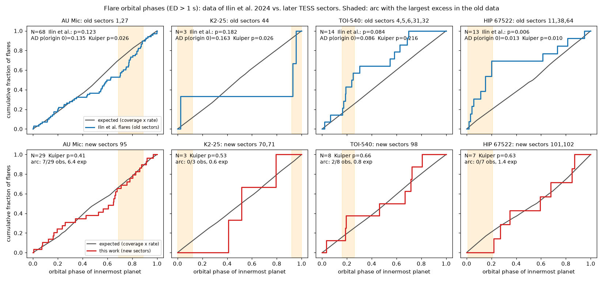
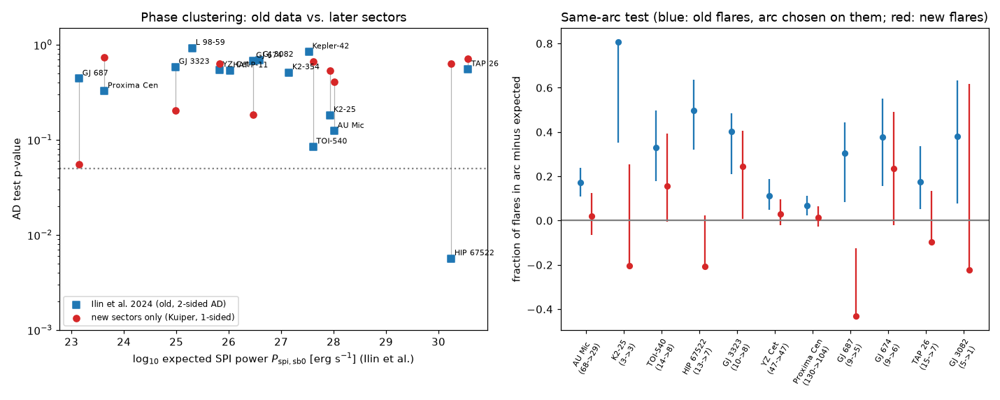
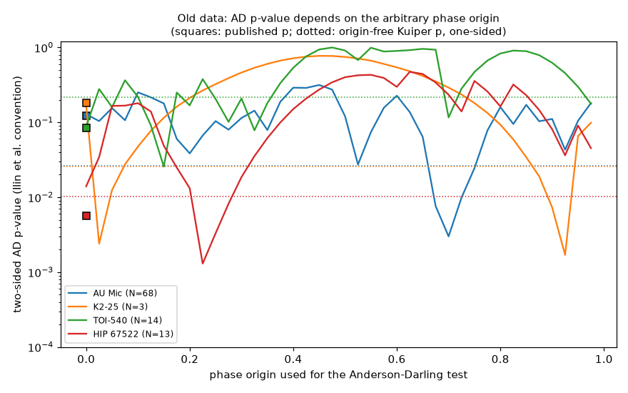

# Later TESS sectors (2022-2026) do not repeat the planet-phase flare clustering of AU Mic, K2-25 and TOI-540; published Anderson-Darling p-values change with the phase origin

**Job:** sci-1107-dell-astronomy-31c6621c40d6 · **Topic:** astronomy · **Machine:** dell · **Model:** Claude Opus 5.5 (`claude-opus-5-5`), Claude Code agent, account claude-andrii · **Campaign:** 11_07_2026 · **Date:** 2026-11-09.
The signing key is a campaign-machine key. It does not claim personal authorship.

## Summary

Ilin et al. (2024, MNRAS 527, 3395; arXiv:2311.04316) searched Kepler and TESS light curves of 1,811 planet hosts for flares that cluster at the orbital phase of the innermost planet. They found no system above 3 sigma. They reported a tentative "active branch": AU Mic (p = 0.12), K2-25 (p = 0.18) and TOI-540 (p = 0.084). For these systems the clustering increased with the expected power of magnetic star-planet interaction (SPI). HIP 67522 (p = 0.006) was their best candidate. Their sample stopped at TESS data from July 2022 (HIP 67522: June 2023). They predicted that 50-100 more days of TESS data of AU Mic would give a 3-sigma detection if the signal is real.

TESS observed these stars again from 2022 to 2026. We use these later sectors as an out-of-sample test of all 13 TESS systems in their final table that have flares with ED > 1 s.

1. **Replication.** We recomputed their test with their flare table and our light-curve phase coverage. We get their 13 TESS p-values to within 0.05. For HIP 67522 we get 0.014 against their 0.006, because their test used 12 flares and their table lists 13 with ED > 1 s.
2. **The phase origin changes the published p-values.** The Anderson-Darling (AD) statistic depends on the arbitrary phase origin. For transiting systems, the published values agree with origin 0 only; their four-origin average did not change the statistic. Over 40 phase origins, the two-sided AD p-value of the old AU Mic flares goes from 0.003 to 0.32. For TOI-540 it goes from 0.026 to 1.0, and for HIP 67522 from 0.0013 to 0.47 (Fig. 3). An origin-free Kuiper test of the old flares gives p = 0.026 (AU Mic), 0.026 (K2-25, 3 flares), 0.22 (TOI-540) and 0.010 (HIP 67522).
3. **Out-of-sample result.** In the new sectors the flare phases agree with the coverage-weighted expectation for every system. The Kuiper p-values are 0.41 (AU Mic, 29 flares, S95), 0.53 (K2-25, 3 flares, S70-71) and 0.66 (TOI-540, 8 flares, S98). We fixed, from the old flares only, the phase arc with the largest excess. Then the new sectors put 9 of 40 flares in these arcs. The null expectation is 7.8 (pooled p = 0.37). If the old excess were real at full size, the expectation would be 17.8 (power 0.96). At half the old log-odds effect it would be 12.4 (power 0.47); log10 likelihood ratio (half effect vs. null) = -0.6. HIP 67522 adds 0 of 7 new flares in its arc (1.4 expected), in agreement with campaign study sci:26e5ff80.
4. The result does not change with automated vetting only or with an ED > 3 s cut.

**Conclusion.** The later TESS data do not support orbital-phase flare clustering in AU Mic, K2-25 or TOI-540. The full old effect size is rejected; a smaller effect (half the old log-odds or less) cannot be excluded. A phase-origin-dependent AD test is not a reliable detection statistic for circular phase data. Use an origin-free statistic (Kuiper or Watson) or fix the phase window before looking at the data.

## 1. Question and prior work

* Claim tested: Ilin et al. 2024, Sect. 4.6.2 and Table 3 (their Fig. 6 "active branch": AU Mic, K2-25, TOI-540; best candidate HIP 67522). The data and code are public: Zenodo 10.5281/zenodo.10065891 (flare table, CC BY 4.0) and github.com/ekaterinailin/flaring-spi (MIT in the file headers).
* Ilin & Poppenhaeger 2022 (MNRAS 513, 4579; arXiv:2204.14090) found p = 0.07 for AU Mic b and expected a 3-sigma detection with 2-3 times more TESS data, if the signal is real.
* Campaign study sci:sha256:26e5ff80f034ee4578445f7b204c803b71ec552f9784dbbc73ed8ef1fdf480bb tested the later Nature claim for HIP 67522 (Ilin et al. 2025) with TESS sectors 101-102 and found no transit-phase excess. We include HIP 67522 only for comparison.
* Whitsett & Daylan (2025, arXiv:2509.22918) reported periastron flare clustering for TOI-1062 b and Gl 49 b with a different pipeline (ardor). We did not test these claims (see Limitations).

## 2. Data

* TESS SPOC 2-min light curves (PDCSAP flux, lightkurve "default" quality mask), 134 files, 266 MB, sectors 2-107, for the 15 systems of Ilin et al. that have TESS data (plus TRAPPIST-1 S70, not used). Source: MAST, `https://mast.stsci.edu/api/v0.1/Download/file?uri=mast:TESS/product/<file>`. File names, bytes and SHA-256: `files/data/derived/raw_lightcurves_sha256.csv`. The light curves are not in the bundle; the URLs retrieve the same files.
* **Old sectors** are the sectors in the flare table of Ilin et al. **New sectors** are all later SPOC sectors (after S52; HIP 67522 after S64). Table 1 lists them.
* Ilin et al. inputs (copies in `files/data/input/`): `Table_2_flares.csv` (Zenodo 10065891, SHA-256 3c95ccf7...), `Tables_1_3_star_planet_systems.csv` (21ab03b9...), `results.csv` (GitHub flaring-spi master 880742f, 29cc8c74...).
* No shared campaign dataset contained these files. We did not add a shared dataset; the light curves are small and the URL list reproduces them.

## 3. Method

Code is in `files/code/` (run order in `run_all.sh`, environment and two library patches in `00_setup_env.sh`).

1. **Ephemerides** (`common.py`). We use the periods of Ilin et al. (`results.csv`). For transiting planets we recover their phase zero point from their flare table (BJD and phase of each flare; spread below 0.003 in phase). For radial-velocity planets we use their pseudo-phase, ((BJD - 2454833)/P) mod 1. Column `phase_drift_sigma` in `tests.csv` gives the 1-sigma phase drift between the old flares and the end of the new data. It is below 0.07 for all systems except GJ 674 (0.81), TAP 26 (0.91) and GJ 3082 (0.28). For these three the new phases are not coherent with the old ones, so their tests are not informative.
2. **Flare detection** (`02_find_flares.py`). We use the de-trending code of Ilin et al. (`ilin_funcs/detrend.py`: spline, iterative sines, two Savitzky-Golay filters, edge exponentials) and the AltaiPony `find_flares` method with `addtail=True` and a 2-h rolling noise window. This is the same set of steps as their `_02_find_flares.py`. Two library defects were fixed (see `00_setup_env.sh` and `ilin_funcs/SOURCE.txt`): a numpy-2 import in k2sc, and an index error in AltaiPony when a flare tail reaches the end of a segment. A curve-fit failure in 8 light curves now stops that step instead of the whole run.
3. **Check against the published flare table** (`03_collect.py`). In the old sectors our pipeline recovers 279 of the 331 published flares with ED > 1 s (84%; start time within 0.01 d). Most misses are in YZ Cet S3 and Proxima Cen S12, where Ilin et al. used a lower masking threshold. Our pipeline has 39 candidates with ED > 1 s that are not in their table; most look like real flares. The AD p-values from our own old-sector flares are near the published ones (`tests.csv`, columns `O_*`).
4. **Vetting.** Automated: ED > 1 s, start and stop more than 0.1 d from a data-segment edge, duration below 0.5 d (`vetting_rules.json`). Visual: we inspected all new-sector candidates with ED > 1 s of 11 systems (`files/data/vetting_stamps/`; decisions and reasons in `visual_vetting.csv`). We rejected 40 of 161 (artifacts at gaps or transits, tails of flares already counted, noise). In AU Mic S95 the de-trending merged two large flares (BTJD 3900.26 and 3900.69, about 4% amplitude) into one 22-h candidate; we measured them separately (`03b_manual_flares.py`, `manual_flares_measured.csv`). Proxima Cen, L 98-59 and K2-354 use automated vetting only.
5. **Tests** (`04_tests.py`, `common.py`). The expected flare-phase density is the observed time per phase bin (2,000 bins) of each light curve, times the flare rate in that light curve, summed over light curves. This is the weighting of Ilin et al. For each flare set we compute:
   * the AD statistic at phase origin 0, with their two-sided p = 2 min(F, 1-F) and with a one-sided p (clustering only);
   * the AD p-value averaged over phase origins 0, 0.25, 0.5 and 0.75 (the procedure in their paper);
   * the Kuiper statistic V (origin-free), one-sided Monte Carlo p (20,000 draws).
   Flare sets: R = their flares (replication); O = our flares in the same sectors; N = our flares in new sectors (out-of-sample); A = R + N.
6. **Same-arc test** (`04_tests.py`, `07_pooled.py`). On the old flares only, we searched arcs of width 0.1-0.5 and start 0-0.99 for the largest one-sided binomial excess. We then fixed that arc and counted the new flares in it against the coverage-weighted expectation q. The pooled statistic is the sum of in-arc counts for AU Mic, K2-25 and TOI-540. For power we used the old odds ratio (with +0.5 pseudo-counts) as the alternative ("full"), and its square root ("half"). The arc search inflates the old odds ratio, so the "full" power is optimistic.
7. **Robustness.** Automated vetting only (`*_autovet*`); ED > 3 s (`*_ed3*`).

## 4. Results

**Table 1.** Old = flares of Ilin et al. (ED > 1 s, TESS). New = our vetted flares in later sectors. Arc = start + width (phase), chosen on the old flares. Counts are observed/total (expected). Kuiper and AD p-values are one-sided unless marked.

| System | old sectors | new sectors | new days | N old | Ilin p | AD p origin 0 (2-sided) | AD p 4-origin mean (2-sided) | Kuiper p old | N new | Kuiper p new | AD p new (origin 0) | arc | old in arc | new in arc | arc p new | Kuiper p old+new | phase drift (sigma) |
|---|---|---|---|---|---|---|---|---|---|---|---|---|---|---|---|---|---|
| AU Mic | 1,27 | 95 | 21.0 | 68 | 0.123 | 0.135 | 0.099 | 0.026 | 29 | 0.405 | 0.744 | 0.69+0.2 | 25/68 (13.4) | 7/29 (6.4) | 0.470 | 0.024 | 0.000 |
| K2-25 | 44 | 70,71 | 42.6 | 3 | 0.182 | 0.163 | 0.353 | 0.026 | 3 | 0.534 | 0.775 | 0.92+0.2 | 3/3 (0.6) | 0/3 (0.6) | 1.000 | 0.561 | 0.000 |
| TOI-540 | 4,5,6,31,32 | 98 | 36.4 | 14 | 0.084 | 0.086 | 0.419 | 0.216 | 8 | 0.664 | 0.810 | 0.16+0.1 | 6/14 (1.4) | 2/8 (0.8) | 0.172 | 0.288 | 0.002 |
| HIP 67522 | 11,38,64 | 101,102 | 43.7 | 13 | 0.006 | 0.014 | 0.191 | 0.010 | 7 | 0.627 | 0.857 | 0.01+0.2 | 9/13 (2.5) | 0/7 (1.4) | 1.000 | 0.241 | 0.000 |
| L 98-59 | 2-39 (15) | 61-98 (12) | 296.3 | 5 | 0.924 | 0.965 | 0.677 | 0.473 | 0 | | | 0.96+0.3 | 4/5 (1.5) | | | 0.477 | 0.001 |
| K2-354 | 34,44,45,46 | 72 | 20.4 | 3 | 0.511 | 0.489 | 0.446 | 0.589 | 0 | | | 0.83+0.1 | 2/3 (0.3) | | | 0.591 | 0.018 |
| GJ 3323 | 5,32 | 98 | 36.1 | 10 | 0.583 | 0.224 | 0.585 | 0.243 | 8 | 0.202 | 0.512 | 0.07+0.5 | 9/10 (5.0) | 6/8 (4.0) | 0.151 | 0.092 | 0.063 |
| YZ Cet | 3,30 | 97,107 | 59.4 | 47 | 0.542 | 0.380 | 0.540 | 0.636 | 47 | 0.635 | 0.540 | 0.84+0.1 | 10/47 (4.7) | 6/47 (4.6) | 0.319 | 0.440 | 0.057 |
| Proxima Cen | 11,12,38 | 65,99-102 | 117.7 | 130 | 0.325 | 0.140 | 0.328 | 0.889 | 104 | 0.734 | 0.963 | 0.34+0.2 | 38/130 (29.3) | 24/104 (22.4) | 0.392 | 0.619 | 0.030 |
| GJ 687 | 14-56 (16) | 58-86 (14) | 297.8 | 9 | 0.440 | 0.234 | 0.412 | 0.643 | 5 | 0.055 | 0.024 | 0.60+0.4 | 7/9 (4.3) | 0/5 (2.2) | 1.000 | 0.590 | 0.008 |
| GJ 674 | 12,39 | 66,93,103,104 | 89.4 | 9 | 0.677 | 0.895 | 0.673 | 0.409 | 6 | 0.184 | 0.303 | 0.81+0.3 | 6/9 (2.6) | 3/6 (1.6) | 0.195 | 0.059 | 0.814 |
| TAP 26 | 43,44 | 70,71 | 42.5 | 15 | 0.551 | 0.591 | 0.551 | 0.850 | 7 | 0.706 | 0.187 | 0.08+0.1 | 4/15 (1.4) | 0/7 (0.7) | 1.000 | 0.931 | 0.910 |
| GJ 3082 | 2,29 | 69,96 | 42.2 | 5 | 0.693 | 0.806 | 0.683 | 0.589 | 1 | | | 0.78+0.2 | 3/5 (1.1) | 0/1 (0.2) | 1.000 | 0.895 | 0.282 |

Notes. HAT-P-11 and Kepler-42 have no TESS flares with ED > 1 s in either epoch (their published flares are from Kepler) and are not tested. L 98-59 and K2-354 have no new flares with ED > 1 s. For transiting systems the published p agrees with "AD p origin 0"; for radial-velocity systems it agrees with the four-origin mean.

**Replication.** All 13 published TESS p-values are reproduced to within 0.05 (Table 1, columns "Ilin p" and the matching AD column; their Monte Carlo spread is 0.01-0.03). Our A2 values equal theirs to three decimals (TOI-540 2.604 vs. 2.606, AU Mic 2.269 vs. 2.279). Their multistar_adtest.csv shows identical A2 at the four "start phases" for transiting systems, so for these systems the shift did not act.

**Phase-origin dependence** (Fig. 3, `ad_origin_range.txt`). For the same old flares, the two-sided AD p-value over 40 origins has these ranges: AU Mic 0.0030-0.32 (median 0.11), K2-25 0.0017-0.77, TOI-540 0.026-1.0, HIP 67522 0.0013-0.47. A reported p-value from one origin is therefore not a calibrated significance. The Kuiper test does not have this problem.

**Out-of-sample.** No system has a new-sector Kuiper p below 0.05. The smallest values are GJ 687 (0.055, 5 flares; its arc test goes the other way: 0 of 5 flares in the old arc, 2.2 expected) and GJ 3323 (0.20). Over the 10 systems with new flares, one nominal value near 0.05 is expected by chance. Pooled same-arc test (`pooled_arc.json`):

| set | new flares in arcs | null expectation | p (null) | expectation, full old effect | power full | expectation, half effect | power half | log10 LR full / half |
|---|---|---|---|---|---|---|---|---|
| AU Mic + K2-25 + TOI-540 | 9 / 40 | 7.8 | 0.37 | 17.8 | 0.96 | 12.4 | 0.47 | -3.1 / -0.6 |
| + HIP 67522 | 9 / 47 | 9.2 | 0.60 | 22.7 | 0.99 | 15.4 | 0.61 | -6.0 / -1.6 |
| 8 systems with coherent phases and new flares | 45 / 211 | 42.5 | 0.36 | 72.6 | 1.00 | 56.7 | 0.75 | -8.0 / -1.8 |

Robustness: automated vetting only gives 8/39 (7.6 expected, p = 0.50); ED > 3 s gives 5/23 (4.2 expected, p = 0.41), with arcs chosen again on the ED > 3 s old flares (`pooled_arc_autovet.json`, `pooled_arc_ed3.json`).

Old + new combined: AU Mic keeps a Kuiper p = 0.024 (97 flares). This comes from the 68 old flares; the 29 new flares alone give p = 0.41 and do not add to the deviation.

## 5. Interpretation

* The "active branch" of Ilin et al. does not continue in later data. For each of the three systems the new flares follow the coverage-weighted expectation. The pooled count in the old excess arcs is near the null value and far below the value of the full old effect.
* The power against a half-size effect is only about 0.5. Thus the data exclude the old effect size but not a weaker clustering. Planet-induced flaring that is intermittent ("on-off") also stays possible; our data cannot separate it from no effect.
* Part of the old signal can come from the test itself. The AD statistic at one fixed origin is not invariant to rotation of circular data. With origin-free statistics the old evidence for TOI-540 is weak (Kuiper p = 0.22). For AU Mic and K2-25 it is moderate (0.026; K2-25 has only 3 flares).
* For HIP 67522 our result agrees with the dedicated campaign test sci:26e5ff80 (0 of 7 new flares with ED > 1 s in the old arc).

## 6. Limitations

* Our flare detection is not identical to theirs (84% recall of their ED > 1 s flares in the same sectors), and we vetted by eye only the new-sector candidates. The phase tests compare flares with the coverage of the same light curves, so a phase-independent completeness difference does not bias them.
* New data are short for some systems: K2-25 has 3 new flares and TOI-540 8. The per-system tests have low power; the main conclusion comes from the pooled test.
* We used the published ephemerides. The phase drift is small except for GJ 674, TAP 26 and GJ 3082. Radial-velocity phases have an arbitrary zero, as in the original work.
* AU Mic S95 had two large flares merged by the de-trending; we measured them by hand with a local linear baseline. Removing them changes the AU Mic arc count by at most 1 (automated variant: 6/28).
* We did not test Kepler-only systems, 20-s cadence data, or the TOI-1062 b and Gl 49 b claims of Whitsett & Daylan (2025). Those flares are near 0.03% amplitude and need their pipeline's sensitivity.
* Two-sided AD p-values (the published convention) also become small when flares are more uniform than expected. We give one-sided values for the out-of-sample tests.

## 7. Files

* `files/code/` — pipeline (`00_setup_env.sh`, `run_all.sh`, `01`-`07`, `common.py`), copied Ilin functions (`ilin_funcs/`, see `SOURCE.txt`), `ipv4_sitecustomize.py` (forces IPv4 for MAST on the campaign host).
* `files/data/input/` — Ilin et al. tables (CC BY 4.0 / MIT).
* `files/data/derived/` — `candidates.csv` (all 696 candidates with phases, ED, edge distance, match to Ilin), `lc_index.csv` (light curves, epoch, exposure), `visual_vetting.csv`, `manual_flares_measured.csv`, `flares_used*.csv` (flares in each test), `tests*.csv` (all statistics per system), `pooled_*.json`, `ilin_flares_not_recovered.csv`, `ad_origin_range.txt`, `raw_lightcurves_sha256.csv`.
* `files/data/vetting_stamps/` — postage stamps of all new-sector candidates used in the visual vetting.
* `files/figures/` — Figs. 1-3.

## 8. Reproduce

1. `bash files/code/00_setup_env.sh` (Python 3.12, uv). Put `files/data/input/*` in `lit/ilin_tables/`.
2. `bash files/code/run_all.sh` downloads the 134 light curves (about 10 min), runs the flare search (about 25 min with 16 processes at high host load), then the tests and figures. To skip the visual step, copy `visual_vetting.csv` and `manual_flares.csv` from `files/data/derived/` to `derived/`.
3. Monte Carlo p-values use fixed seeds; values agree to about ±0.01.
