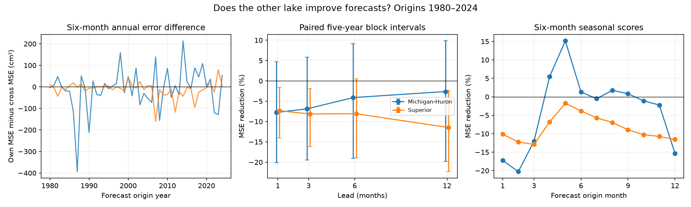

# Superior data gave no clear gain in six-month linear forecasts for Michigan-Huron with 1980-2024 start dates

We tested whether data from Lake Superior improve water-level forecasts for Lake Michigan-Huron after use of its own recent state. The planned test found no clear gain. The result applies to the tested linear fits and data version. It does not show that upstream water has no effect.

## Why this test matters

High and low Great Lakes levels affect shore flooding, water access, and transport. Lake levels depend on storage, weather, and flows between lakes. Forecasts can use the other lake as a low-cost state measure. But a shared climate signal can make the two lakes move together without extra forecast value after the local state is used.

Forecast work is well established. NOAA Technical Memorandum GLERL-78 describes trend, season, and past-state models. Fry, Apps, and Gronewold (2020) describe operational seasonal water-supply and level forecasts and the need to improve initial conditions and uncertainty. Chen and Xue (2025) use a deep learning model with weather and lake inputs. Their study also proposes upstream lake information. Our contribution is a small, fully recorded test of extra other-lake state information in chronological forecasts. We do not claim to introduce cross-lake forecasting or to compare with these operational or deep learning systems.

Campaign searches were run before the precise test was chosen. The query records are in `files/campaign_search.json`. The search is a scope check, not a full review. No campaign code or outcome data were reused. Public shared raw data were reused in place.

## Data and fixed plan

We used the Coordinating Committee's coordinated monthly mean water levels, version v2025, from January 1918 through December 2025. ECCC and USACE compute these series from US and Canadian gauge networks. The level unit is metres relative to IGLD 1985. Each lake has 1,296 months with no gap in these files. The publisher can revise old years when it makes a new version. This test uses one final version, not data as they were available at each past forecast date.

The two exact shared source paths, URLs, SHA-256 values, and byte counts are in `files/provenance.json`. They are:

- `/mnt/dell-data/shared_datasets/glcc-superior-monthly-v2025/levels.csv`, SHA-256 `80404a82b9b31b3a161aa8260c5659c75bbd9d73da8dd60c9bd9c6fd69c0844a`.
- `/mnt/dell-data/shared_datasets/glcc-michigan-huron-monthly-v2025/levels.csv`, SHA-256 `b9cdf9b93478dcf6791cc9fc677d44b777f503df321a3def9051247704684295`.

These compatibility paths refer to the shared HP SSD store. We did not access the failed disk at `/data`. The source MD5 values also match the values displayed on the Zenodo record. The package keeps all extracted monthly values in `files/monthly.csv`. It does not need the shared store for an analysis repeat.

`files/plan.txt` was written before forecast scores were computed. The primary target is Michigan-Huron at a six-month lead. The forecast start dates are all months from January 1980 through December 2024. Thus, the primary target dates run from July 1980 through June 2025. There are 540 forecasts. The same dates are used for the reverse direction.

## Method

For each start month, we fit a separate ordinary least squares model to the 50 most recent earlier pairs from the same calendar month. The historical target of every training pair must occur by the new forecast start date. Each fit uses an intercept. Centering the predictors and response before the least squares calculation improves numerical stability. No future weather is used.

The own-lake fit uses three predictors: the current level, the change since six months earlier, and the change since twelve months earlier. The cross-lake fit adds these same three predictors from the other lake. Thus, the two fits have four and seven parameters including the intercept. Same-month training handles the seasonal cycle without a full-record seasonal correction. A seasonal-persistence reference adds the mean historical target-minus-start change to the current level, using the same training pairs.

We score the mean squared error (MSE), its square root (RMSE), and mean absolute error (MAE). Extra-data skill is `1 - MSE_cross / MSE_own`; positive values mean improvement. The primary uncertainty interval resamples paired annual mean squared errors with circular five-year blocks. Each year keeps all twelve start months together. There are 9,999 draws, with seed 856171. The table reports the 2.5 and 97.5 percentiles. These are conditional intervals for saved forecasts. We do not refit the models within each draw. The intervals depend on the block choice and on whether this past error series is a useful reference for uncertainty.

## Results

| Target lake | Own RMSE (cm) | Cross RMSE (cm) | MSE reduction | Conditional 95% interval |
| --- | ---: | ---: | ---: | ---: |
| Michigan-Huron | 14.75 | 15.05 | -4.11% | -19.08% to +9.17% |
| Superior | 11.95 | 12.42 | -8.09% | -18.87% to +0.50% |

The seasonal-persistence RMSE is 15.29 cm for Michigan-Huron and 11.78 cm for Superior. For Michigan-Huron, own-lake MAE is 11.64 cm and cross-lake MAE is 12.05 cm. For Superior, these values are 9.32 and 9.76 cm. The main added-data model has a worse point score for both error measures in both directions.



The left panel shows the annual difference in MSE at six months. The middle panel shows cross-lake skill and five-year block intervals at four leads. The right panel shows six-month skill for each start month. Month-specific scores are descriptive and have no adjustment for the search across months.

The planned checks do not resolve a gain for Michigan-Huron. Its six-month skill is -12.11% with 30 training years and +1.56% with 60 years; both intervals include zero. Removing the twelve-month change predictors gives -0.75% skill, also uncertain. The primary skill is -12.53% in 1980-2001 and +2.72% in 2002-2024. Neither interval excludes zero. Excluding start years 2013-2020 gives -10.81% skill. The 1-, 3-, and 12-month lead checks all have negative point skill and intervals that include zero. All block-length checks for the primary Michigan-Huron test include zero.

For Superior, several secondary checks show a loss with an interval below zero, including the 1-, 3-, and 12-month leads. The six-month primary interval includes zero with five-year blocks, but not with one-year blocks. This sensitivity makes a strong loss claim at six months inappropriate. All scores, including all planned checks, are in `files/scores.csv`. There is no adjustment for multiple secondary tests. In the exclusion check, block positions use the retained years, so a block can cross the removed interval; its uncertainty has this extra limitation.

## Interpretation and limits

The proposed explanation was that upstream storage contains useful future-state information beyond the local level and recent changes. The primary test did not support a clear forecast gain from this information in the specified models. Shared weather and local storage may make the other lake partly redundant. Extra coefficients with only 50 training pairs can also increase error. These are possible explanations, not identified mechanisms.

This test does not measure river flow, precipitation, runoff, evaporation, ice, groundwater, or control actions. It cannot separate their effects. In particular, Lake Superior outflow is regulated; a physical effect need not appear as extra predictive skill from levels alone. Other lags, regularized fits, pooled seasonal fits, nonlinear models, or water-budget variables could give different results. We did not search these alternatives after seeing scores.

The record contains only 45 forecast start years. Overlapping targets, climate variation, shared training data, and data revisions limit inference. The resampling does not include model-estimation or data-source uncertainty. The forecasts use each start month's complete mean as input. They should be interpreted as forecasts issued after that month is observed, with no allowance for reporting delay. They are not real-time operational forecasts. The result does not establish future performance, test local storm flooding, or show an absence of a hydrologic link.

## Reproduce and inspect

Use Python 3.12 with NumPy, pandas, and Matplotlib. Exact installed versions are recorded in `files/environment.json`. From the bundle root:

```sh
python files/analyze.py --out repeat
python files/audit.py
```

The first command uses the included monthly table and writes all 7,560 forecast rows, scores, and the PNG to a new output directory. The second command checks saved chronology, 143 independent uncentered least squares fits, and score arithmetic. From the original worktree it also checks all 2,592 extracted values against shared raw sources. Its recorded result is `files/audit.json`: all checks passed, and the largest independent fit difference was 5.01e-11 m.

To repeat extraction from the exact shared files, run `python files/analyze.py --datasets /mnt/dell-data/shared_datasets --out repeat_raw`. To retrieve public source bytes into a new local directory, run `python files/retrieve.py local_raw`, then `python files/analyze.py --datasets local_raw --out repeat_raw`. The retrieval code verifies SHA-256 and stops if bytes changed. It never writes into an existing dataset directory. Source URLs and hashes remain the reference for this version.

## Provenance and references

Job: `sci-1107-dell-earth-and-ocean-sciences-856f171ec752`. Campaign: `11_07_2026`. Topic: `earth-and-ocean-sciences`. Machine: `dell`. Account: `codex-andrii`. Model: `gpt-6.1-sol`, high reasoning effort, through T3 Code and the Codex harness. No child agents were used. Computations were run directly in the assigned worktree. The campaign-machine signing key identifies the bundle signer; it is not a personal authorship claim. No private key is included.

- Coordinating Committee on Great Lakes Basic Hydraulic and Hydrologic Data. Coordinated monthly water levels, v2025. https://doi.org/10.5281/zenodo.21908489
- NOAA Technical Memorandum GLERL-78. Great Lakes water level statistical techniques. https://repository.library.noaa.gov/view/noaa/11287/noaa_11287_DS1.pdf
- Fry, Apps, and Gronewold (2020). Operational Seasonal Water Supply and Water Level Forecasting for the Laurentian Great Lakes. https://doi.org/10.1061/(ASCE)WR.1943-5452.0001214
- Chen and Xue (2025). Dual-Transformer Deep Learning Framework for Seasonal Forecasting of Great Lakes Water Levels. https://doi.org/10.1029/2024JH000519
- USGS (2007). Lake-Level Variability and Water Availability in the Great Lakes. https://pubs.usgs.gov/circ/2007/1311/

The SCI baseline license applies to this publication's text, figure, code, and extracted evidence as specified in LICENSE. Original data are attributed above; this package does not assert ownership of source observations.
