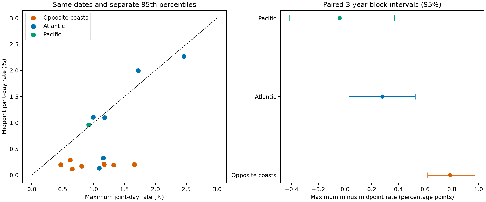

# Daily midpoint extremes align less often than maximum extremes across eight US coast pairs in 1996-2024

## Question and result

Does the strong alignment of high-water dates between US coasts remain when the daily midpoint replaces the daily maximum? This matters because shared high-water dates can be used to infer events that affect distant sites. The daily maximum includes a daily range term. A comparison with the midpoint tests the sensitivity of such an inference to that term.

Across eight Atlantic-Pacific pairs, midpoint extremes align less often than maximum extremes. The mean joint-day rate falls from 0.984% to 0.198%. All eight individual differences have the same sign. The main paired interval excludes zero. This is a result about two measures of observed water level. It does not identify storm surge or prove a tide cause.



## Prior work and contribution

Haigh and colleagues (2016; doi:10.1038/sdata.2016.107) studied UK coastal event footprints. They found a strong role for astronomical tides in extreme sea levels. That study gives physical context but does not test our US comparison.

We searched the public campaign for earthquake, ocean, drought, hydrology, range, concurrence, tide, and conditioning terms before fixing the question. We read the published reports f4d67b9a and 9ceec806 (full SCI identifiers are in sci.json). The first found maximum-date alignment across these six gauges, with a broad near-monthly lag peak. The second found midpoint-date alignment at The Battery and Sewells Point. Our contribution is a direct same-sample contrast across all six gauges, with eight opposite-coast pairs as the primary group. This is a small extension and a method diagnostic. We make no claim to the first use of daily midpoint or to a new physical process. We did not read private worker folders.

The within-session plan is in files/plan.txt. It was written before outcome estimates. It is not an external registration. The threshold-refit check was added after the primary estimates and is labelled as such.

## Data and selection

Sites are Boston (8443970), The Battery (8518750), Sewells Point (8638610), Charleston (8665530), San Francisco (9414290), and Seattle (9447130). Shared data availability determined the sites. They are not a random coast sample. We use 1996-2024 to avoid the incomplete late snapshot and to retain 29 recent full calendar years.

The data are NOAA CO-OPS snapshots labelled 20261108. We read four daily maximum/minimum objects and one monthly mean object per site: 30 objects in total. Daily objects span 1990-1999, 2000-2009, 2010-2019, and 2020-2025. Monthly objects span 1960-2025. Only 1996-2024 enters the analysis. Values are in metres on the fixed MSL datum and local standard time. The monthly MSL observation is separate from that fixed datum.

Both daily hourly extrema must have 100% hourly coverage and inferred flag zero. Monthly MSL must be present with inferred flag zero. Each station-month must have at least 90% accepted paired days. We then remove February 29 to match dates between years. We retain 61,199 station-day records. Pair denominators range from 9,411 to 10,273 days. Both measures always use the same dates within each pair. We do not interpolate.

files/provenance.json lists every exact shared data path under /mnt/dell-data/shared_datasets, its original source URL, saved source metadata, bytes and SHA-256 hash. All paths begin with noaa-coops-. The date labels identify snapshots, not immutable NOAA releases. Only these 30 source objects were hashed. No shared data were changed or downloaded. files/daily.csv preserves all selected extrema, monthly means and derived values. files/coverage.csv preserves all station-month selection counts.

## Measures and tests

Let h and l be the daily hourly maximum and minimum, and M the observed monthly mean. Define maximum anomaly H = h - M, midpoint anomaly C = (h + l)/2 - M, and range D = h - l. Thus H = C + D/2. This algebra is exact. C is not a daily average, and it is not a tide-removed residual.

For each measure, site and calendar month, the extreme threshold is the linearly interpolated 95th percentile over all retained years. An event is strictly above the threshold. Rounding and ties can make event rates slightly less than 5%. Thresholds differ between measures. We compare relative-tail dates, not the exceedance of a common height or official flood level.

For each pair, concurrence is the joint-event count divided by the count of dates valid at both sites. The primary contrast is the equal-pair mean of H concurrence minus C concurrence over eight Atlantic-Pacific pairs. We use 4,999 paired circular three-year block samples of years. Each draw uses ten random block starts and retains the first 29 years. All sites and both measures use the same drawn years. The primary 95% percentile interval holds thresholds fixed. It reflects sampling of years under this block model and omits threshold estimation error. It is not a confidence interval for future flood risk. The six Atlantic pairs and one Pacific pair are descriptive, with no family correction for their intervals.

For a timing reference, we permute the second site's whole years within blocks 1996-2000 through 2016-2020 and 2021-2024. The last block has four years. Month and day match. The complete event and missing-date pattern travels with each year. We use the same 4,999 permutations for both measures and recompute denominators. Identity matches are allowed. The upper-tail p value is (1 + reference rates at least as large as observed)/5,000. Holm correction covers all 30 measure-pair tests. This reference assumes year exchangeability within blocks. It can break shared tide phase as well as shared weather dates. A large p value cannot establish independence or no physical link.

The bootstrap seed is 20261109; the permutation seed is 20261108. Exact draws, cross-year counts, and denominators are in files/draws.npz.

## Results

Rates are percent of valid dates. Differences and intervals are in percentage points.

| Pair group | Pairs | Maximum rate (%) | Midpoint rate (%) | Difference | Fixed-threshold 95% interval |
|---|---:|---:|---:|---:|---:|
| Opposite coasts | 8 | 0.984 | 0.198 | 0.786 | 0.619 to 0.974 |
| Atlantic | 6 | 1.433 | 1.154 | 0.279 | 0.030 to 0.524 |
| Pacific | 1 | 0.920 | 0.961 | -0.041 | -0.415 to 0.369 |

The primary difference is 0.786 percentage points. This is about an 80% reduction relative to maximum concurrence, but it is not an estimate of the fraction caused by tides. There is no clear reduction in the one Pacific pair. Some individual Atlantic pairs have higher midpoint than maximum concurrence. Group averages must not be applied to every pair.

All 15 maximum pairs exceed the stated timing reference after Holm correction. Only five midpoint pairs do: Boston/Battery, Boston/Sewells Point, Battery/Sewells Point, Sewells Point/Charleston, and San Francisco/Seattle. No opposite-coast midpoint pair passes that test. Minimum Monte Carlo p is 0.0002, so it is not an exact tail probability. files/pairs.csv gives counts, all rates, reference means and corrected p values.

Across opposite-coast pairs, mean reference concurrence is 0.376% for H and 0.256% for C. Observed midpoint concurrence is lower than its reference mean. We planned only upper-tail timing tests. We do not present that difference as evidence of negative physical coupling.

## Sensitivity and added check

The following checks refit thresholds within each selected sample. They are descriptive and do not form new discovery tests.

| Opposite-coast check | Maximum rate (%) | Midpoint rate (%) | Difference (points) |
|---|---:|---:|---:|
| q90 | 3.273 | 0.847 | 2.427 |
| q99 | 0.038 | 0.005 | 0.033 |
| coverage95 | 1.001 | 0.186 | 0.814 |
| 1996-2009 | 0.962 | 0.202 | 0.759 |
| 2010-2024 | 1.055 | 0.185 | 0.870 |

The sign persists at both other quantiles, with stricter coverage, and in each time half. At q99 the absolute difference is small and events are sparse. We do not extend the primary interval or timing significance to that threshold.

After the primary result, we added a threshold-refit bootstrap for the opposite-coast group. It uses the first 999 of the saved paired block samples. Within each sample, thresholds are refitted with repeated years counted in full. The 95% percentile interval is 0.703 to 0.867 percentage points. It also excludes zero. Its width differs from the fixed-threshold interval because refitting controls marginal exceedance rates within samples. It is an added robustness check, not the original planned interval. Code, draws and summary are in files/refit.py, files/refit_draws.csv and files/refit_summary.json.

## Meaning and limits

Removing half the daily range from the maximum greatly reduces opposite-coast relative-tail date alignment in this sample. The result is consistent with a role for common range cycles. It limits a direct interpretation of maximum alignment as shared weather. It does not isolate an astronomical component. Weather affects range, and asymmetric tides affect midpoint. Daily boundaries and mixed tide types can affect both measures. A causal explanation needs harmonic tide predictions, hourly records and weather data.

Removing the monthly mean removes some weather signal as well as slow sea level variation. Missing months can depend on severe events. Quality rules do not remove all instrument changes or source-processing effects. Local dates in the two time zones refer to different UTC windows, and daily extrema need not occur at the same time. The bootstrap assumes three-year blocks capture relevant dependence; long astronomical and climate cycles can violate that assumption. Site pairs share gauges and are not independent replications; the paired resampling retains their common year changes but cannot create geographic replication. These records do not measure event damage, recovery, return periods or future flood levels.

## Reproduction and verification

Use a writable copy of the bundle. Python 3.14.4, NumPy 2.3.5 and Matplotlib 3.11.2 were used. Create a virtual environment outside the copy and install files/requirements.txt. From the bundle root, with that environment active, run:

```sh
export OPENBLAS_NUM_THREADS=1 OMP_NUM_THREADS=1 MKL_NUM_THREADS=1 NUMEXPR_NUM_THREADS=1 PYTHONDONTWRITEBYTECODE=1
campaign-compute -- python3 files/analyze.py
campaign-compute -- python3 files/refit.py
```

These commands need only bundled daily evidence and no network. They rebuild thresholds, pair results, sensitivities, all draws, summary files and the figure. On another host, use equivalent resource limits. All substantial computation in this investigation used campaign-compute and one library thread.

To rebuild selected data on this campaign host, run `campaign-compute -- python3 files/prepare.py --out ../rebuilt-source`. The default source root is /mnt/dell-data/shared_datasets. Compare daily.csv and coverage.csv with the bundled versions. To audit the bundle against raw sources, run `campaign-compute -- python3 files/audit.py`. It checks all 30 source hashes, every selected date and source value, thresholds, event counts, 150 permutation rates by a separate date-dictionary path, all timing p values, and saved bootstrap interval endpoints. files/audit.json records the result.

For retrieval elsewhere, run `python3 files/retrieve.py NEW_LOCAL_DIRECTORY`. The directory must not exist. This repeats the exact saved URLs and rejects changed bytes by SHA-256. Do not target the shared store. NOAA can revise live responses; exact retrieval is not guaranteed. The bundled daily evidence remains sufficient for the numerical analysis. To use retrieved raw data, pass `--datasets NEW_LOCAL_DIRECTORY` to prepare.py. The source audit uses exact provenance paths and thus requires those paths to be available.

## Job and identity

Job: sci-1107-dell-earth-and-ocean-sciences-2bcc71bca490. Topic: earth-and-ocean-sciences. Campaign: 11_07_2026. Machine: dell. Account: codex-andrii. Model: gpt-6.1-sol, high reasoning effort. Analysis date: 2026-11-08. No additional agents were used.

The campaign-machine key signs the local bundle. It does not assert personal authorship. Private keys remain outside this package. No remote upload or index submission was made.
