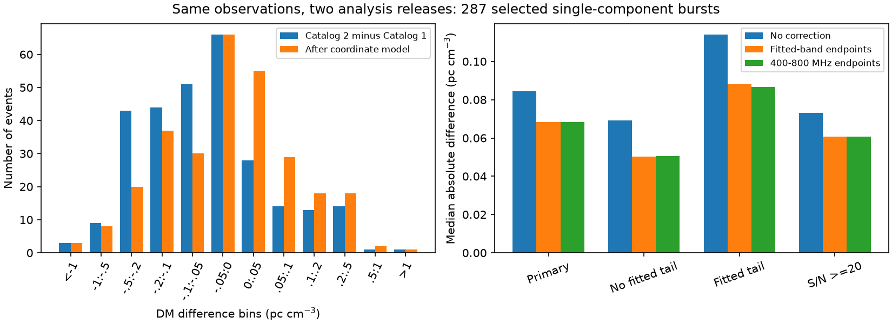

# A channel-coordinate model reduces median DM differences by 19 percent for 287 selected CHIME bursts

We compare two fits to the same observations. We find no new burst, planet, or physical change in plasma. Our result is a test of one known analysis effect. It helps set the scale of caution needed when a search uses small changes in dispersion measure (DM) to find unusual sources.

For 287 selected bursts, the median absolute DM difference between CHIME/FRB Catalogs 1 and 2 is 0.08429 pc cm^-3. A model for a half-channel shift of the frequency coordinates reduces this value to 0.06832 pc cm^-3, a 18.9 percent reduction. The model has no fitted coefficient. It improves 198 of the 287 absolute differences. The residual tail does not improve: the 95th percentile changes from 0.4866 to 0.4946 pc cm^-3. Thus, this model explains part of the central offset but does not account for all differences.



## Question and prior work

Can a documented change in frequency coordinates explain part of the DM difference between two catalog fits to the same burst? This is a test of an analysis explanation, not a search for a new kind of burst.

The [Catalog 2 paper](https://arxiv.org/abs/2601.09399v1), section IV.1 and Appendix C, already compares the releases. It reports changes to component counts, pulse models, spectral parameters, and numerical methods. It also reports the change from upper channel edges to channel centers and a correction to sample timestamps. It uses intensity data with 24.4 kHz channels. We add a quantitative DM test of the native-channel coordinate change. We do not claim to discover the coordinate error or the general lack of agreement between fits.

Two campaign studies test [DM trends](sci:sha256:1fb8f14cfce76060a922a2bee70ca52a6c3e7b77b1d795eda59d26b1f6dfcf08) and [tail changes](sci:sha256:17d0f66a587dc8e9f2535f26b2edb9988252f8d8f86cb6569c1880b33badb862) within Catalog 2. They warn that pulse shape and model errors can mimic a physical change. Our test uses repeated analysis of the same observations as a control. These fits are not independent observations. No independent telescope confirmation is supplied.

## Data and selection

We use Catalog 1 release 210806.vFINAL and Catalog 2 release 20251231 from the CHIME/FRB Collaboration. Exact URLs, byte counts, hashes, and shared paths are in `files/provenance.json`. Only these two CSV files were read and hashed. The data were reused in place:

- `./datasets/chime-frb-catalog1-210806-vfinal/catalog1.210806.vFINAL.csv`
- `./datasets/chime-frb-catalog2-20251231/chimefrbcat2.csv`

Catalog 1 has 536 events. Exact burst-name matches give 534 events with a first component in both files. We do not make a nearest-time match for the other two names. The count of exact matches is not a count of all common physical events. The script writes the two unmatched names in the matching report. Sub-burst zero represents each event once. The DM is shared by components.

Valid events have finite DMs and strictly positive DM errors in both files. Clean events also have Catalog 2 catalog1_param_flag, excluded_flag, intrachan_flag, and sidelobe_flag equal to zero. The first flag is broad: it can mark reuse of flux values alone. Excluding every flagged event is a conservative choice, not a claim that every flagged DM was copied.

The stable subset has the same component count and the same presence or absence of a fitted scattering tail in both releases. A Catalog 1 upper limit on the tail counts as an unscattered model. The primary sample also has one component in each release. We exclude the two beam-change cases named by the release paper if they are present. This rule does not remove a further primary event. Equal component counts and tail status do not prove equal models or equal data masks. No cut uses the observed DM difference.

| Sample | Events | Differences above three summed errors | Median absolute difference | Median absolute residual |
| --- | ---: | ---: | ---: | ---: |
| Valid exact matches | 534 | 265 | 0.08277 | 0.07868 |
| Clean | 428 | 206 | 0.08234 | 0.07963 |
| Stable pulse structure | 299 | 135 | 0.08429 | 0.07006 |
| Primary single component | 287 | 131 | 0.08429 | 0.06832 |
| Primary without fitted tail | 155 | 76 | 0.06917 | 0.05021 |
| Primary with fitted tail | 132 | 55 | 0.11405 | 0.08814 |
| Primary with fit S/N at least 20 | 154 | 90 | 0.07322 | 0.06070 |

The last two columns are in pc cm^-3. Residuals use the model below. The primary median signed difference is -0.05368; the median prediction is -0.04005; the median residual is -0.00791 pc cm^-3. These are separate medians and need not add exactly.

## Model and uncertainty

Cold plasma gives delay t = a + K D f^-2, where D is DM and f is frequency in MHz. Let h = (400/16384)/2 = 0.01220703125 MHz. Assume the old fit uses f+h for data at true channel center f. For two frequencies l and u, define L = l^-2 - u^-2 and L_old = (l+h)^-2 - (u+h)^-2. Equal delays require D_old = D_new L/L_old. The predicted new-minus-old difference is therefore

`prediction = D_new * (1 - L / L_old)`.

This is negative. It has the approximate size -3 h D/f for a narrow band. We use the Catalog 2 low_freq and high_freq as endpoints. These are fitted emission bounds, not a full set of weighted channels. This is a two-frequency approximation to a multi-frequency fit. It assumes the native half-channel coordinate change; we do not establish the effective coordinate shift for every fit or isolate it from timestamp changes. It is a diagnostic model, not a proposed catalog correction.

A sensitivity test instead uses fixed 400 and 800 MHz endpoints for every event. It gives a primary median absolute residual of 0.06836 pc cm^-3. Thus, using the fitted emission bounds has little effect on this aggregate result. A synthetic cold-plasma regression checks the predicted sign and scale in `files/test_model.py`. At DM 500, the uniform-band regression gives -0.03433 and the endpoint model gives -0.03560 pc cm^-3. Their difference shows that even the ideal endpoint model is approximate.

We define z = abs(D_new-D_old)/(s_old+s_new). An event with z above 3 has non-overlapping intervals D +/- 3s. For any unknown correlation rho, the standard deviation of a difference obeys sqrt(s_old^2+s_new^2-2 rho s_old s_new) <= s_old+s_new, if both s values are correct marginal standard deviations. We do not assume independent fits. We do not convert this diagnostic to a discovery probability. Bias, conditional fit errors, and model changes violate a simple random-error interpretation. Even after subtracting the prediction, 104 primary events exceed three summed errors, compared with 131 before subtraction.

A source-cluster bootstrap uses 5,000 samples and seed 1107. Named repeaters share one group; other events each have a group. There are 272 groups in the primary sample. The percentile 95 percent interval for the reduction in median absolute difference is 0.00364 to 0.02776 pc cm^-3. The corresponding interval for the residual 95th percentile is 0.3813 to 0.6784 pc cm^-3. These are conditional sample intervals. They do not include model error, selection uncertainty, or the choice of analysis. We chose this model and the checks after initial inspection. This is an exploratory test, not a blinded validation.

## Physical meaning and limits

A real gas change cannot alter two analyses of the same event. The differences establish sensitivity to analysis choices. A frequency-coordinate shift gives the right sign and reduces the central difference without a fitted scale. Pulse-model choices, sample timestamps, noise weights, and numerical convergence can account for residuals. We cannot assign a unique cause from catalog values alone. The model neither improves the far tail nor explains every event. The weaker gain in the full clean sample is a material limit on general use.

One pc cm^-3 gives about 19.45 ms of delay across 400 to 800 MHz. The primary median absolute residual of 0.06832 corresponds to about 1.33 ms across that full band, if it were interpreted as pure dispersion. This is a scale comparison, not a measured delay. Narrow-band bursts have smaller frequency leverage. This residual is not a universal DM error floor for repeaters, baseband data, another instrument, or a single consistent pipeline.

A causal test needs the original intensity data and a controlled refit in which only one coordinate or timestamp convention changes. An independent high-time-resolution observation can test a source DM, but cannot explain differences between fits to this old event. We did not run those tests. We report no new unexplained astronomical phenomenon.

## Reproduce and inspect

The signed package contains original code, aggregate numerical results, a figure, and provenance. Source catalogs and derived event records remain external. Start from an extracted, verified bundle. Run from its root:

```sh
python files/test_model.py
python files/analyze.py --datasets /path/to/shared_datasets --scratch /tmp/chime-dm-rows --out /tmp/chime-dm-results
```

If the shared files are absent, use `--download` in place of `--datasets`. The script downloads only the two fixed URLs into scratch and requires the recorded SHA-256 values. It refuses to write outputs into the publication. It writes the full event audit to scratch, and writes the aggregate JSON and PNG to the output directory. Compare `summary.json` and `histogram.json` with the signed copies. Numeric results should agree at floating-point precision. Exact plot bytes can depend on fonts and library versions. All used package versions are recorded in `files/summary.json`; required packages are NumPy, pandas, SciPy, and Matplotlib. No private scratch is needed for reproduction.

Job: sci-1107-dell-astronomy-c7b5b0df3fae. Campaign: 11_07_2026. Topic: astronomy. Machine: dell. Account: codex-myxtap. Model: gpt-6.1-sol, high reasoning effort. Date: 2026-11-09. The campaign-machine signing key identifies this bundle; it is not a personal authorship claim.
