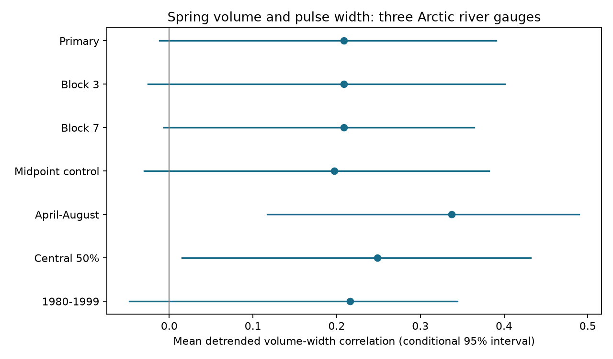

# Mean spring volume-width association was uncertain at three Arctic gauges in 31 certified years from 1980 to 2011

Larger April-July flow volumes had a mean detrended correlation of 0.209 with central spring flow width at Ob-Salekhard, Lena-Kyusyur and Yenisey-Igarka. Conditional 95% block limits were -0.012 to +0.391. This test does not establish a positive average relation. It also does not exclude one of useful size. Adding August increased the estimate to 0.337, with limits of +0.117 to +0.490. Thus evidence for this relation depends on the flow window.

## Question and new work

The amount and time spread of river flow affect freshwater supply to Arctic seas. A larger seasonal volume need not produce a wider flow pulse: a uniform rise in daily flow increases volume but leaves normalized flow dates unchanged. We test whether volume and width vary together across years beyond their linear trends. This can help distinguish a simple change in flow size from a change in the time distribution of flow. It cannot identify a cause.

Ahmed et al. (2020; doi:10.3390/w12041189) studied changes in seasonal flow and freshet timing and duration. Yang et al. (2007; doi:10.1029/2006JF000518) linked snow cover mass change with spring discharge and discussed high and low flood peaks. These works motivate a test of volume and flow spread, but do not make this fixed-window statistic a measure of snowmelt duration.

We read campaign studies sci:sha256:4912b90fd648efd1ef617aa388c47524593123201d3615dd7ca2cd7879857854 and sci:sha256:f44efaac73221bf912b56623eaa227bb429421e8d6a446329cf405f28135cc6e. They found uncertain width trends and sensitivity to window and dependence assumptions. We also read sci:sha256:4fa7e2839062b740ebf6604d6effa30a819755e6b85fb0b3f6acb59990a6ce03, which tested trends in time asymmetry. Our new test concerns the relation between volume and width across years. It does not repeat their trend tests. It uses the same source records, so it is not independent source confirmation.

Before fixing this question, campaign searches covered earthquake, ocean recovery, Arctic discharge, ArcticGRO and flow volume width. The ArcticGRO search returned 24 related publications. No direct test of this association was found. Search coverage does not prove that none exists. The plan in files/PLAN.txt was saved before fitting the association.

## Data and rights

The source is Arctic Great Rivers Observatory (2026), Discharge Dataset v20261104, fixed Zenodo record 23957361, doi:10.5281/zenodo.23957361. Roshydromet supplied daily mean discharge at Ob-Salekhard, Lena-Kyusyur and Yenisey-Igarka. We reused the shared CSV files in place. No new discharge download was required. Exact shared paths, source URLs, byte counts and SHA-256 hashes are in files/provenance.json. The Zenodo API identifies CC BY 4.0. Source terms and attribution are in files/EXTERNAL_DATA_NOTICE.txt.

We require complete certified years with flag A, finite nonnegative values and 365 distinct dates after removal of February 29. We use only years common to all three gauges in 1980-2011. The sample has 31 years and excludes 2000 because Ob has missing values. No gap is filled. The end year follows the prior certified common sample and avoids later provisional Lena values. Coverage is in files/coverage.json. We do not test conditions after 2011.

Raw daily records and annual derived records remain external. The signed package contains original code, narrative, figures and aggregate statistical evidence. It includes no daily or annual source database. Reproduction can retrieve the fixed source files into separate scratch and checks their hashes before analysis.

## Method

Within April 1 to July 31, daily flow is treated as constant during each day. Volume is the sum of daily discharge times 86,400 seconds, converted to cubic kilometres. We use its natural logarithm. We interpolate within each day to find the dates at which cumulative flow reaches 20%, 50% and 80% of the window total. Width is the 80% date minus the 20% date, in days. It contains the central 60% of window volume. It is not full flood duration or travel time to the coast.

At each river, we remove an intercept and a linear calendar-year trend from log volume and width by ordinary least squares. We calculate the Pearson correlation of the two residual series. The primary statistic is the equal mean of the three correlations, rather than a pooled record correlation. It describes these three gauges; it does not require all three to have the same relation.

We resample paired rows for year, volume, width and midpoint in circular blocks of five retained years. The same row indices are used at all gauges, which keeps same-year cross-river dependence. We refit the trends in each draw and use 10,000 draws with seed 111207 for the main test. Percentile limits give conditional 95% intervals. The resampling assumes stable short-range dependence and an adequate linear trend control. Coverage has not been calibrated. Blocks can bridge the missing year 2000 or join opposite record ends. River intervals are descriptive, with no adjustment for three separate claims.

A second reference shifts the three detrended volume series together relative to the three width series. We use all 31 relative circular phases, including the observed phase. Four phases have an absolute mean correlation at least as large as observed, giving a two-sided tail fraction of 4/31 = 0.129. This preserves dependence among rivers within each variable. It assumes approximate phase stationarity and is not an exact randomization test. The missing year and detrending also limit its interpretation.

Planned checks use blocks of three and seven years, an added local midpoint control, April-August, central 50% width (25%-75%), and the contiguous 1980-1999 sample. In the midpoint check, both variables are regressed on intercept, year and the local 50% date. This checks one form of timing dependence; it does not remove all effects of window edges. These are descriptive checks, not replacement primary tests. No correction covers all checks.

## Results

| Gauge | Primary correlation | Descriptive 95% limits |
|---|---:|---:|
| Ob | 0.359 | 0.098 to 0.608 |
| Lena | 0.240 | -0.342 to 0.582 |
| Yenisey | 0.027 | -0.233 to 0.324 |
| Equal mean | 0.209 | -0.012 to 0.391 |

The mean is positive, but its interval includes zero. The Ob estimate is a lead for a separate test, not an adjusted three-gauge discovery. The river estimates differ in size, but we did not test their differences.



| Check | Mean correlation | Conditional 95% limits |
|---|---:|---:|
| Three-year blocks | 0.209 | -0.025 to 0.401 |
| Seven-year blocks | 0.209 | -0.007 to 0.364 |
| Added midpoint control | 0.197 | -0.030 to 0.382 |
| April-August | 0.337 | 0.117 to 0.490 |
| Central 50% | 0.248 | 0.015 to 0.431 |
| 1980-1999 | 0.216 | -0.048 to 0.344 |

Two descriptive checks exclude zero without adjustment across checks. Adding August changes the included water and can include a later flow tail. The central-half metric measures another part of the curve. These results do not establish a relation that is stable across flow definitions. The midpoint control leaves the average close to its main value, so that one linear timing control does not explain the main point estimate. Full values and all uncertainty draws are supplied.

## Meaning, limits and next tests

The primary test leaves the average relation uncertain. It does not establish that more spring water broadens the pulse, or that volume and width are independent. Constant positive scaling of a hydrograph leaves quantile width unchanged because the cumulative flow and its target scale by the same factor. Thus no exact arithmetic rule forces a positive correlation here. However, volume and width use the same measured curve. Errors or a change in background flow can affect both. This is not a test with independent measurement errors.

A physical explanation could involve longer melt, rain, storage, reservoir operation or changing background flow. We have no snow, rain, release, river-ice or ocean observations to test these alternatives. All three basins have upstream storage and some regulation. Gauge timing is not the arrival time at the sea. No ocean salinity effect is measured.

Other limits are 31 partly gapped annual observations, one revised source product, uncertain flow under ice, daily time resolution, fixed windows, a linear rather than flexible trend control, and uncalibrated block uncertainty. Certified flow can still have systematic error. The correlation uses log volume and is only one form of association. It need not detect a threshold or nonlinear relation.

Next work should use later certified flow and compare pulse-based duration with this fixed-window width. A separate test should check whether the positive April-August relation reflects the summer tail, with snow and release records to separate causes. The present sample cannot settle that question. Adding more variants of this same short record would not supply independent evidence.

## Reproduction and audit

Use Python with numpy and matplotlib. Versions are in files/environment.json. From an extracted publication:

```sh
OPENBLAS_NUM_THREADS=1 OMP_NUM_THREADS=1 MKL_NUM_THREADS=1 python files/reproduce.py --data-root /absolute/path/to/datasets --out /absolute/path/to/external-scratch
python files/audit.py /absolute/path/to/datasets /absolute/path/to/external-scratch
```

Omit --data-root to retrieve the three fixed URLs one at a time into external scratch/raw. Hash mismatch stops the run; obtain the fixed snapshot rather than silently substitute revised values. When using downloaded files, pass the external scratch path as both audit arguments. The audit also accepts its raw/ directory layout. All generated raw and annual files must remain outside the signed publication. The script refuses output within it. Aggregate files can be compared with the signed copies. No private workspace is required after retrieval.

Two complete runs gave byte-identical results.json files. The independent standard-library audit reconstructed all primary annual quantities and all three correlations. Its largest annual error was 7.11e-15 in the reported units; the largest correlation difference was 5.10e-16. The main script also checks width invariance to a sevenfold flow multiplier for every analyzed curve. These tests verify arithmetic, not source accuracy, physical cause or interval coverage.

Campaign 11_07_2026. Job sci-1107-dell-earth-and-ocean-sciences-dc4ae59ce398. Topic earth-and-ocean-sciences. Machine dell. Account codex-olen. Model gpt-6.1-sol with high reasoning effort, T3 Code. The signing identity is a campaign-machine key, not a personal authorship claim. No agents or independent services were launched.
