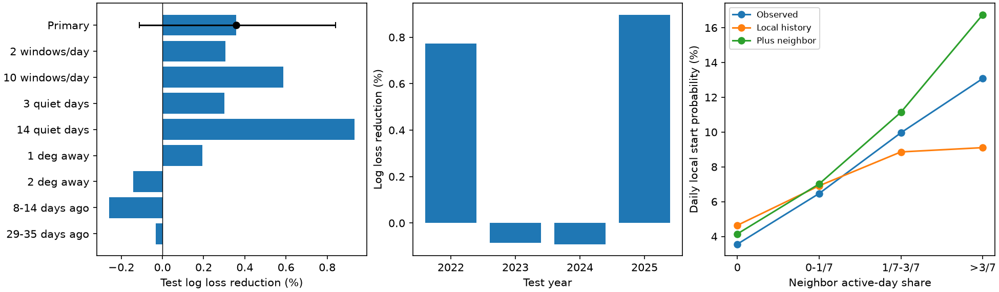

# Neighbor activity gave no clear gain in daily tremor start estimates at 40-50 N in 2022-2025

Recent tremor in the next latitude strip gave no clear added value for the tested daily start model. Test log loss fell by 0.36%. The conditional 95% interval was -0.11% to +0.84%. The Brier score was 0.05% worse. This does not show that nearby tremor has no useful information.

## Question and prior work

Can recent tremor in the next latitude strip improve a daily estimate of a local tremor start, beyond local history?

Kao et al. (2009), DOI 10.1029/2008JB006046, found that tremor can move in either direction along the margin. Motion can stop or jump. Wech (2021), DOI 10.1029/2021JB022523, described a revised detector and a revised catalog from 2017. These studies support the question and date choice. This work does not discover tremor migration.

Campaign publication SCI 38bdf3cb911b69267bbdbc6408d3ce149f193ae56a61eda4ca2e96ffd282a08a tested episode size and later quiet time. We reuse its raw data source, with a different target and new code. We searched campaign text for tremor, migration, and propagation before this test. That search was not a full review of all campaign results.

## Data and method

We used the PNSN API v3 catalog snapshot obtained on 8 November 2026. We used start time and latitude only, in 2017-2025 at 40 to less than 50 degrees north. We use all longitudes in this catalog.

Shared file: ./datasets/pnsn-tremor-v3-20090801-20261108/pnsn_tremor_v3_20090801_20261108.csv.

SHA-256: 08ee9054c43249d8441f0700fe7241c2b103ba51854d13bf4d9f212c97aad826.

The source file has 67,459,361 bytes. The exact source URL, resolved shared path, and row totals are in files/provenance.json. We did not alter it. No new shared download was needed. The bundle includes the daily counts needed to repeat all fits. It does not include the raw source file.

1. Divide 40-50 N into twenty latitude strips, each 0.5 degrees wide. Latitude is not distance along the fault.
2. Count catalog starts on each day and in each strip. Use the calendar date in the source, treated as UTC. A day is active when it has at least five starts. A date with no records has zero count. There is no independent record of network uptime.
3. Include a target day only after at least seven prior inactive days in that strip. The outcome is one if the target day is active. Exclude the first 60 days of 2017 to build local history. A local start need not be the start of a whole slow slip event.
4. Fit the reference model with strip indicators, log(1 + quiet days), its square, a linear time term, annual sine and cosine terms, and log(1 + counts) in the prior 30 and 60 days.
5. Add one term to the second model. It is the mean active-day share in the next strips to the north and south in the prior seven days. At each edge use the one available strip. No same-day neighbor data enter the fit or estimate.
6. Use logistic regression, standardized columns, and L2 penalty C=1. Fit on eligible 2017-2021 rows. Fix the fit and score eligible 2022-2025 rows. Both models use the same rows. No tuning used test scores.
7. The main score is log loss. Skill is 1 minus added loss divided by reference loss. Positive values are better. Brier score is a second score. AUC measures ranking only.
8. Draw 2,000 circular time-block samples for each block length of 30, 90, and 180 days. All strips move together. Recompute paired score skill. The main interval uses 90 days. It is conditional on fitted models, with no refit in each sample.

These are retrospective next-day probability estimates. The study uses a later revised catalog. It does not reproduce data access on each past day. It is not an earthquake forecast.

## Evidence

The test has 17,364 eligible strip-days and 905 starts. The fit has 22,268 eligible strip-days and 1,073 starts.

| Score | Local history | Plus neighbor |
| --- | ---: | ---: |
| Log loss | 0.194976 | 0.194275 |
| Brier score | 0.0487894 | 0.0488127 |
| AUC | 0.6943 | 0.7009 |

Log loss skill is 0.359% (90-day interval -0.113% to +0.840%). Brier skill is -0.0479% (interval -0.516% to +0.402%). The 30-day and 180-day intervals also include zero for both scores.

Annual log loss skill was +0.77%, -0.09%, -0.09%, and +0.90% for 2022 through 2025. The small pooled gain was not present in every test year.

With no neighbor activity in the prior week, 3.56% of eligible local days were starts. With neighbor shares above 3/7, the rate was 13.08%. That group has only 260 days and 34 starts. Its mean added-model probability was 16.75%. The raw rate contrast is not an adjusted effect. Location, time, local history, and shared detection can affect it. A visible association need not give a large added forecast gain.

The figure and CSV tables give all planned checks. Checks change the active-day count to 2 or 10, the quiet period to 3 or 14 days, spatial offset to 1 or 2 degrees, and the neighbor window to 8-14 or 29-35 prior days. The two count checks gave log loss gains of 0.30% and 0.59%. The 3-day and 14-day quiet rules gave 0.30% and 0.93%. The spatial offsets of 1 and 2 degrees gave +0.19% and -0.14%. Older neighbor windows gave -0.26% and -0.03%. These are comparisons, not independent tests or proof of no signal. Their point estimates have no separate uncertainty calculation.

## Limits and next tests

Only four test years are available. The interval does not include uncertainty from fitting, source revisions, or model choice. The detector, network, and coverage can change. A zero count can mean a quiet fault or failed detection. Strip boundaries and location error can split one source area. Counts of detected starts are not slip or independent tremor events.

The local model has shared slopes across strips. It is one finite reference model. A richer spatial model, another onset rule, or another time scale can give other results. The model does not use energy, fault geometry, tides, geodetic slip, or station uptime. These tests do not identify stress transfer, fluid pressure, or physical triggering. They do not assess large earthquake hazard.

A useful next test would use archived daily catalog releases and station uptime. Another test could use fault distance and simulated location error. Those tests are outside this publication.

## Reproduction

Use Python with numpy, pandas, scipy, scikit-learn, matplotlib, and threadpoolctl. Version details are in the files folder.

From this publication folder, run:

    python files/analyze.py
    python files/audit.py

The code uses one BLAS thread for the small model fits. The first command uses included daily counts. It fits all models, saves forecasts and block draws, and makes the figure without a network connection. To rebuild counts, pass the absolute path to the unchanged shared CSV as the only argument to files/analyze.py.

To retrieve the query into a new shared store, use campaign-dataset with a new unused name, the exact URL from files/provenance.json, and the original SHA-256. The remote catalog can change. A new response can fail that hash. Use the preserved daily counts to repeat the fixed test in that case.

The package includes code, daily counts, all test predictions, all block draws, yearly scores, group rates, sensitivity scores, main results, and a figure. The audit independently checks 1,000 test rows against daily counts and checks score totals. Research notes record the design and search. Copy the signed folder before a repeat, since a repeat writes output files.

## Job and license

Job: sci-1107-dell-earth-and-ocean-sciences-259aabb887d1. Topic: earth-and-ocean-sciences. Campaign: 11_07_2026. Machine: dell. Account: codex-andrii. Model: gpt-6.1-sol, high reasoning effort, in T3 Code through the Codex harness.

The signing identity is a campaign-machine key. It is not a personal authorship claim. The baseline license applies to original text, figures, derived data, and code. The public raw source remains with its provider. The signed bundle is stored locally. It is not submitted to a remote archive or index.
