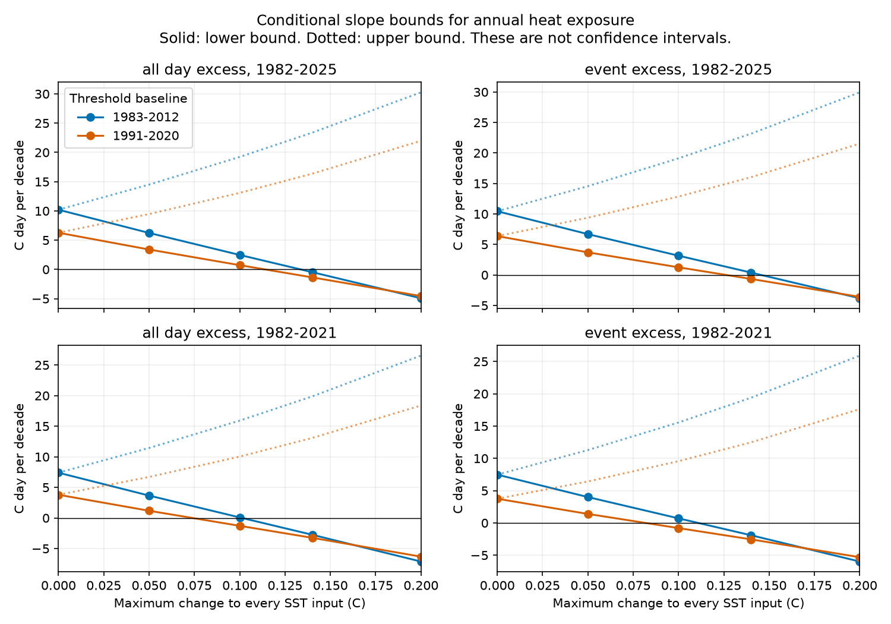
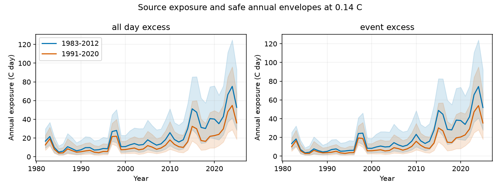

# Annual heat exposure keeps a positive 1982-2025 trend under 0.10 C SST changes in a one-degree OISST sample with two seasonal baselines

In this fixed OISST sample, annual positive heat exposure above the seasonal 90th percentile has a positive 1982-2025 slope under **every change of at most 0.10 C to every daily SST input**. This holds for both tested baselines and for dose summed over all days or only heatwave events. The calculation includes thresholds rebuilt from changed baseline inputs. The smallest safe lower slope is **+0.727 C day per decade**.

This is a conditional sensitivity result. We do not show that actual SST errors obey this uniform limit. The result applies to the spatial mean of 29,120 fixed pixels at one-degree spacing between 60 S and 60 N. It does not apply to every pixel or latitude band.

Figure 1. Safe lower and upper OLS slopes for the two dose measures. Points are the tested grid; lines are guides. The figure shows budgets through 0.20 C; the tables extend to 1 C. Solid curves are lower bounds and dotted curves are upper bounds. These are sensitivity bounds, not confidence intervals.

## Question and prior evidence

The selected SCI studies show that changes in satellite inputs coincide with changes in fast OISST variance. Tests with buoys, other products and noise corrections show large effects on event duration, count and peak intensity. They also show that some heatwave-day and connected-area trends survive bounded input changes. The noise-correction study reports little change in conventional cumulative intensity under its spectral matching. We build on that evidence. We do not repeat the buoy comparison or claim independent observations.

We ask whether rising annual heat exposure survives every input change within a stated amplitude limit. We test positive SST excess above a local seasonal 90th percentile. We sum this excess over all dates, or only dates in heatwave events. These measures have units C day. They measure exposure above the threshold. They differ from standard cumulative intensity, which uses anomalies above the seasonal mean. Neither measure is ocean heat content or an ecological damage estimate.

Chevillard et al. (2026), [doi:10.5194/os-22-1213-2026](https://doi.org/10.5194/os-22-1213-2026), show product sensitivity in conventional heatwave metrics. Hobday et al. (2016), [doi:10.1016/j.pocean.2015.12.014](https://doi.org/10.1016/j.pocean.2015.12.014), defines the event rules and usual metrics. [The literature note](files/provenance/literature.md) states how our question differs. The new contribution is a tested dose bound and an explicit adverse-record check, not a new percentile theorem or the first use of degree days.

## Source and measures

We used 44 annual NOAA PSL OISST v2.1 daily SST files for 1982-2025. The files retain v2 SST values before 2016. Every raw checksum passes store provenance and matches the prior signed connected-area study. The fixed sample has 29,120 native pixels at one-degree spacing between 60 S and 60 N. Each pixel has a complete source record above -1 C on all 16,071 dates. We use native pixel values, not one-degree block means. Latitude weights are cos(latitude). The grid, masks and area weights stay fixed when SST changes.

The seasonal threshold uses an 11-day pool around each non-leap baseline centre date, a linear sample percentile, interpolated February 29 and a 31-day circular mean. Pools include up to five actual days outside baseline endpoints. We test 1983-2012 and 1991-2020 baselines. Events need five strict threshold exceedances. Gaps of at most two days join qualifying runs. Detection crosses year boundaries. We do not remove warming. Annual dose sums count days in each calendar year, including leap days. The endpoint control stops detection on 2021-12-31. It keeps the full-record source mask and the same baseline threshold.

## Bound method and exact gap result

[The method proof](files/method.md) extends the earlier day-mask bound. If each SST input can change by at most e C, the rebuilt seasonal threshold changes by at most e C. Thus each SST-minus-threshold margin lies between its source value minus 2e and plus 2e. We calculate both extreme margin sequences, apply event detection and sum their positive excess. Nonnegative spatial weights give annual bounds.

OLS slope weights have both signs. To get a lower slope bound, we use the upper annual envelope where a weight is negative and the lower envelope where it is positive. We exchange them for the upper bound. A slope in the lower annual curve alone is not a safe lower slope bound. The method includes changes to baseline data and allows arbitrary time and spatial dependence. It does not assume white noise or one particular spectral correction.

A second result is exact: joining qualifying runs across gaps of at most two days cannot change event-restricted positive threshold-excess dose. Such gaps cannot contain an isolated short positive run: it would need one nonpositive day on each side, giving at least three gap dates. Joined days therefore have zero positive dose. Joining still changes event count and duration. This identity does not apply to standard mean-relative cumulative intensity or to all longer gap limits.

Bounds are conditional finite-record statements. They are not confidence intervals. A failed bound does not prove a reversal. The independent extreme margins need not be jointly attainable by a single SST record. We therefore also build a feasible changed record: +0.5 C on all 1982-2003 dates and -0.5 C on all 2004-2025 dates. We rebuild thresholds and calculate its dose. This is a sensitivity construction, not an estimate of actual product bias.

## Results

### Both measures keep a positive full-record slope at 0.10 C

All table slopes have units C day per decade. Dose is an annual spatial mean.

| Threshold baseline | Measure | Source slope | Safe lower at 0.10 C | Safe upper at 0.10 C |
| --- | --- | --- | --- | --- |
| 1983-2012 | all day excess | 10.202 | 2.473 | 19.225 |
| 1983-2012 | event excess | 10.448 | 3.155 | 19.124 |
| 1991-2020 | all day excess | 6.271 | 0.727 | 13.087 |
| 1991-2020 | event excess | 6.369 | 1.252 | 12.852 |

The ranges are wide. The sign has a guarantee under this input class; the rate does not stay close to its source value. With the earlier baseline, source all-day dose rises from 11.831 to 54.496 C day per year between 1982-1986 and 2021-2025. Event dose rises from 9.318 to 53.576. These endpoint means are descriptive, not trend bounds.

Event dose is no larger than all-day dose in any year. It can still have a larger slope or a stronger lower slope bound. Removing short spells changes early and late levels differently. The positive event-dose guarantee therefore does not follow from an all-day dose guarantee alone.

Figure 2. Source annual exposure and safe annual envelopes at 0.14 C. Annual envelopes need not be attainable together in one changed record.

### A larger budget, endpoint change and regional means limit the guarantee

At 0.14 C, the earlier-baseline event-dose lower slope is +0.388. Its all-day lower slope is -0.469. With the later baseline, the lower slopes are -0.658 for event dose and -1.360 for all-day dose. Thus a 0.14 C guarantee does not hold across both baselines. Negative lower bounds are failed certificates, not proven reversals.

Through 2021, the earlier-baseline 0.10 C lower slopes are +0.093 and +0.708 for all-day and event dose. The later-baseline values are -1.279 and -0.800. At 0.05 C both baselines and measures retain positive bounds. The smallest is +1.184. The two-baseline guarantee therefore drops from 0.10 C in the full record to 0.05 C with this endpoint. These are maxima on the tested grid, not exact thresholds.

The full-record event-dose certificate holds through 0.20 C in the north band (20 N to 60 N) under both baselines. In the south band (60 S to 20 S), it holds through 0.14 C with the earlier baseline and 0.10 C with the later baseline. In the tropics (20 S to 20 N), the corresponding grid limits are 0.10 C and 0.05 C. For the later baseline through 2021, the tropical event-dose lower slope is already -0.255 at 0.05 C. The spatial-mean headline is not a common regional guarantee. All regional rows and failures are in certificate_grid.csv and bounds.csv.

### A feasible 0.5 C change reverses both dose trends

The explicit step is within 0.5 C at every input. Its rebuilt-threshold slopes are:

| Threshold baseline | Measure | Changed-record slope |
| --- | --- | --- |
| 1983-2012 | all day excess | -3.700 |
| 1983-2012 | event excess | -2.712 |
| 1991-2020 | all day excess | -5.918 |
| 1991-2020 | event excess | -4.803 |

All four slopes are negative and stay inside the corresponding 0.5 C envelope. For each full-record measure and baseline, a trend reversal therefore requires more than 0.10 C under this fixed-input class, but a reversal is possible by 0.5 C. This is a coarse bracket, not the smallest reversal budget. It does not establish that actual product errors reverse the trend. The 0.5 C record changes the mean across two broad periods and is deliberately adverse.

## Validation

All 44 raw hashes pass store provenance and match the signed prior source snapshot. The node and date counts match that study. The compiled dose engine matches an independent Python run-and-gap sum on all 65,536 length-16 binary crossing patterns. The maximum difference is below 9e-16 C day. All patterns also confirm the exact two-day joining identity.

Twelve synthetic change tests rebuild the threshold after random, constant, alternating and step changes at three budgets. They keep rebuilt thresholds, annual dose and OLS slopes inside the envelopes. A constant change cancels as the proof requires. Eight tests on eight fixed real nodes cover two baselines, two budgets and random or step changes. They also pass. Finite tests support the implementation; the method proof gives the general statement.

The aggregate audit recalculates every slope from the annual tables and checks bound nesting and event-dose ordering. The explicit adverse record is checked against its allowed envelope. Files under files/results preserve the aggregate evidence and audit results.

## Limits and use

1. We do not establish that actual errors obey a uniform 0.10 C bound at every point and date. A product error estimate, an RMS statistic and product spread are not simultaneous bounds. Rare larger errors are outside the certified class. No physical error correction is selected as true.
2. This is one revised SST product and one fixed point sample. It is not a native-resolution, shifted-grid or independent in situ replication. The mask excludes sea ice and incomplete source pixels. It does not cover changes in masks, coastlines or spatial sampling.
3. Results concern finite-record OLS slopes under bounded changes. They do not establish statistical significance, an externally forced change or a physical cause. Sensitivity bounds are conservative and need not be jointly attainable. A failed certificate is not a demonstrated reversal.
4. The explicit 0.5 C step proves a possible reversal in the stated class. It is deliberately adverse. It does not show a real product bias or locate the smallest change needed to reverse a trend.
5. Two thresholds and two endpoints are controls on the definition and record, not independent climate records. The latest years strengthen some guarantees. The 2021 control cannot separate physical warming from observing-system effects in later years.
6. Exposure is positive temperature excess above a seasonal percentile. It is not standard cumulative intensity above the seasonal mean, absolute-temperature exposure, an organism-specific stress threshold, ocean heat content or a damage forecast. Annual sums and fixed spatial means do not describe individual event histories.
7. We use float64 operations and small outward numerical guards, with independent checks. This is not formal interval arithmetic. The exact mathematical proof and tested code are distinct forms of evidence.

A practical use is to report thermal exposure beside event count, duration and area. State the threshold baseline, spatial sample, endpoint and input-change class. The annual exposure trend can have a sign guarantee even when event identity and the trend rate are sensitive.

## Reproduction, rights and identity

[Reproduction instructions](files/reproduce.md) give offline inspection, full source regeneration and a hash-checked retrieval recipe. [The source manifest](files/provenance/sources.json) gives exact shared paths, URLs, byte counts and hashes. Raw SST and daily derived databases stay outside the signed package. Aggregate evidence, code, proof, figures, source identities and audits are bundled. No private scratch is required to reproduce the analysis from the recorded source snapshot.

NOAA NCEI produces OISST. Data were provided by NOAA PSL, Boulder, Colorado, USA. We acknowledge both. [The materials notice](files/provenance/external_materials.md) identifies external data terms and reused SCI code. The exact SCI baseline license applies to bundled work. These are research outputs, not official NOAA products.

Campaign 11_07_2026. Job sci-1107-dell-earth-and-ocean-sciences-3aeaf2fe53e6. Topic earth-and-ocean-sciences. Machine dell. Account codex-myxtap. Model gpt-6.1-sol, high reasoning effort. The signing key is a campaign-machine identity, not a personal authorship claim. No agents were launched. The worker signs and verifies locally without remote upload or submission. Software versions are in files/provenance/run.json.
