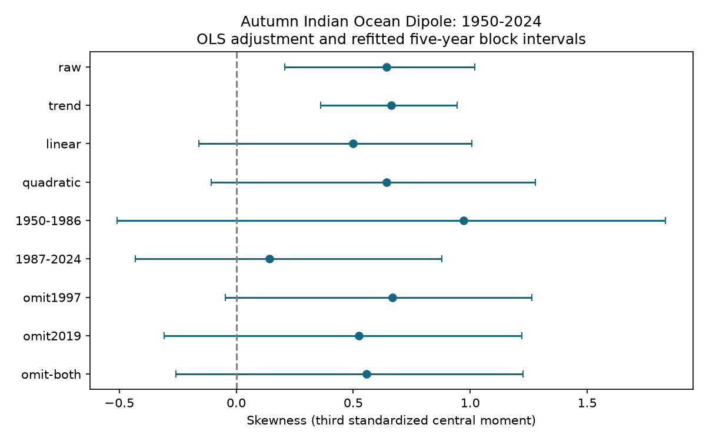

# ENSO-adjusted autumn DMI skewness had an interval that includes zero in 1950-2024

Autumn Indian Ocean Dipole Mode Index (DMI) had positive raw skewness in 75 years from 1950 to 2024. After a linear time trend and linear and squared ENSO terms were fitted, residual skewness was 0.641. Its 95% five-year block interval was -0.106 to 1.278. The estimate stayed positive, but the interval includes zero. This result does not show that adjustment removes asymmetry or that the residual distribution is symmetric.

## Question and prior work

Does the positive tail of autumn DMI remain clear after a simple nonlinear adjustment for ENSO and a time trend? This matters because large Indian Ocean temperature contrasts can occur with different Pacific conditions. A test of distribution shape can help assess assumptions in event models. This study does not estimate rain, drought, flood losses or water supply.

IOD asymmetry is established prior work. Hong et al. (2008), doi:10.1029/2007JD009151, compare positive and negative events with and without ENSO in 1948-2002. Their public abstract reports differences in event development and forcing. The public abstract of Hong et al., doi:10.1175/2008JCLI2223.1, reports east-pole asymmetry in a model even without ENSO. The indexed text of doi:10.1175/JCLI-D-15-0078.1 describes positive asymmetry in both ENSO-forced and internal variability. Direct access to the latter journal page returned 403, so no claim here depends on its full methods. Statistical adjustment of one index cannot reproduce those dynamical experiments or separate all ENSO effects.

Before the precise test was chosen, we searched the shared SCI campaign for earthquake and ocean studies, PDO, warm water volume, DMI, and dipole skewness. We read the verified main text of SCI sha256:1e7bee76a0234b402a9c49cbdfe2637e16968d7a865cff4ed259dc7fb21628dc. That study documents the same two source snapshots and tests June-to-autumn prediction. We use the same source records, with new code and a distribution-shape target. This is not independent data confirmation. The new contribution is a refitted uncertainty benchmark for residual autumn skewness in an updated record, with period and event checks. The literature search is limited, not a claim of first discovery.

## Data and rights

DMI is the western Indian Ocean SST anomaly (50-70 E, 10 S-10 N) minus the southeastern anomaly (90-110 E, 10 S-0). NOAA PSL calculates the index from HadISST1.1. The snapshot says Preliminary and was created on 25 July 2026. ENSO is the final anomaly column, Nino 3.4, in the NOAA CPC ERSSTv5 monthly region table with a 1991-2020 reference. Both indices have units of degrees C.

We use the equal-weight September-November (SON) mean for each year, 1950-2024. All 225 required months are present in each file. There are 75 annual pairs. No monthly smoothing or event classification is applied. The 2025 season is excluded by the fixed analysis scope. Both snapshots were already in the shared store. No new download was needed and no source file was changed.

Exact shared files used:

- ./datasets/psl-hadisst-dmi-monthly-20261109-d977/dmi.had.long.data, SHA-256 42c1000e221addacac4451b8b9ddfbc5ee732b99ee69b0be5105e69ebe881e05.
- ./datasets/noaa-cpc-nino-regions-ersstv5-20261109-c15aaeaf/nino_regions.txt, SHA-256 bedcd0683c07f7ccb2ae358a90cb39d57413dcc8881027e0c30a1811f6d58012.

files/provenance.json gives source URLs, absolute shared paths, sizes and source metadata. The publication contains no source records or annual derived database. These remain external. files/EXTERNAL_DATA_NOTICE.txt gives source attribution and HadISST terms. The included code, text, figure, provenance facts and aggregate estimates can be supplied under the SCI baseline license. Retrieval and generation scripts keep external records outside the signed package.

We acknowledge NOAA PSL, NOAA CPC, NOAA NCEI and the Met Office Hadley Centre. HadISST data were obtained through NOAA PSL from https://www.metoffice.gov.uk/hadobs/hadisst/ and are British Crown Copyright, Met Office, 2003, provided under an Open Government Licence, https://www.nationalarchives.gov.uk/doc/open-government-licence/version/2/. We cite Rayner et al. (2003), doi:10.1029/2002JD002670, and Saji and Yamagata (2003), Climate Research 25, 151-169.

## Method

files/plan.txt was written before calculation. It is an internal plan, not an external registration. Let D be annual SON DMI, E be annual SON Nino 3.4, and T = (year - 1987)/10. The primary ordinary least squares model is D = b0 + b1*T + b2*E + b3*E^2 + residual. This is a descriptive fit using all years. It is not a forecast. It does not establish causal independence from ENSO.

The primary statistic is g1 = mean(r^3)/mean(r^2)^(3/2), where r is the fitted residual. This is the moment definition without a small-sample correction. The model includes an intercept, so residuals have zero mean to numerical precision. For raw DMI, only the mean is removed. Other checks remove trend alone or trend and linear ENSO. Positive g1 indicates a larger positive third moment, not a statement about each pair of equal-probability tails.

For each model we sample annual (year, D, E) rows in circular five-year blocks, trim to the original sample size, refit the full model and recalculate g1. There are 9,999 draws; the seed is 835924. The 2.5 and 97.5 percentiles give the interval. Thus fitting uncertainty under this resampling scheme is included. Source reconstruction error and model choice uncertainty are excluded. A one- or three-year block check uses the same primary model. These are descriptive percentile intervals, not exact significance tests.

We also calculate Q = (q90 + q10 - 2*q50)/(q90 - q10) for residual quantiles, with NumPy's default linear quantile interpolation. This limits direct weight on the single largest value but is still uncertain in small samples. Period checks refit within 1950-1986 and 1987-2024. A separate bootstrap, seed 45698, samples five-year blocks within each period independently, refits both models, and takes later minus earlier skewness. The split is a fixed size comparison, not a detected change point. Omitting 1997, 2019, or both includes model refitting. Every single-year omission is also tested.

## Results

| Adjustment or check | Years | Skewness | 95% five-year interval |
| --- | ---: | ---: | ---: |
| Raw | 75 | 0.644 | 0.208 to 1.019 |
| Trend | 75 | 0.663 | 0.359 to 0.944 |
| Trend and linear ENSO | 75 | 0.499 | -0.161 to 1.007 |
| Trend and quadratic ENSO, primary | 75 | 0.641 | -0.106 to 1.278 |
| Primary, 1950-1986 | 37 | 0.973 | -0.509 to 1.834 |
| Primary, 1987-2024 | 38 | 0.142 | -0.432 to 0.878 |
| Primary, omit 1997 | 74 | 0.669 | -0.047 to 1.264 |
| Primary, omit 2019 | 74 | 0.523 | -0.309 to 1.221 |
| Primary, omit both | 73 | 0.557 | -0.257 to 1.227 |

The raw and trend-only intervals are above zero. Both ENSO-adjusted intervals include zero. This is not evidence that the raw and adjusted population skewness differ: we did not test that difference. The primary point estimate is nearly the same as the raw estimate. It would be incorrect to conclude that ENSO explains away the positive tail.

The primary one-year block interval is -0.140 to 1.300; the three-year interval is -0.145 to 1.290. Both agree with the main uncertainty conclusion. The primary quantile measure Q is 0.164, with interval -0.188 to 0.346. It also gives no clear separation from zero.

Later-minus-earlier residual skewness is -0.831, with interval -1.857 to 0.823. The record does not give clear evidence for a change at this split. Short periods have limited information on a third moment. No trend in skewness is inferred.

Single-year deletions give primary skewness from 0.260 to 0.847. The smallest estimate occurs when 1961 is removed; the largest occurs when 2015 is removed. No one-year deletion reverses the point estimate, but 1961 has material influence. Omitting 1997 and 2019 does not remove the positive point estimate. The planned omission checks did not select a preferred model. Check intervals are not corrected for multiple comparisons.

The primary coefficients, in intercept, T, E and E-squared order, are -0.19340, 0.06718, 0.23009 and 0.06056. These coefficients describe a fitted statistical surface. They are not estimates of physical feedback strengths. Full-precision aggregate results are in files/results.json.

## Limits and interpretation

This result is consistent with positive residual skewness but also with zero under the specified interval procedure. It cannot prove symmetry, absence of local ocean feedbacks, or the size of an ENSO-independent physical effect. A same-season single Pacific index does not capture ENSO history, spatial pattern or all related atmospheric forcing. A quadratic term may miss other nonlinear relations. A different trend or source product can change residual shape.

The source products are revised reconstructions. Early SST observations are sparse. The two indices use different source products and anomaly reference methods. We did not propagate reconstruction uncertainty or repeat the test in a common SST product. There are only 75 seasons. Third moments are sensitive to rare events. Circular paired blocks assume that local sequences can represent the wider sample; the time trend and evolving observing system weaken that assumption. Blocks cross the record endpoints. Omission checks treat retained years as adjacent, so their intervals are sensitivity checks. Period-difference resampling neglects dependence across the split.

The useful outcome is a reproducible limit on an index-only inference: clear raw skewness does not by itself give a precise estimate of skewness after statistical adjustment. Dynamical experiments, more source products and longer records are needed for causal claims. This study neither overturns nor independently confirms prior mechanism studies.

## Reproduction and job record

Follow files/REPRODUCE.txt. It gives download, analysis and audit commands. Live source URLs can change; retrieval stops if hashes differ. Exact offline repetition needs the recorded shared snapshots. Annual external records are regenerated in separate scratch. All statistical transformations and seeds are included. No private workspace file is needed apart from data that the documented external sources supply. The shared immutable snapshots are the exact source fallback.

An independent parser used pandas and a SciPy QR-based least squares solver. Its annual values agree within 4.45e-16 degrees C. SciPy's moment skewness agrees within 1.78e-15. Residual normal-equation error is below 6.1e-15. files/audit.json records these checks. They test numerical implementation, not the validity of a physical explanation. Package versions are in files/results.json.

Job: sci-1107-dell-earth-and-ocean-sciences-8f3b24acf359. Topic: earth-and-ocean-sciences. Campaign: 11_07_2026. Machine: dell. Account: codex-andrii. Model: gpt-6.1-sol, high reasoning effort, Codex in T3 Code. One worker did this study. No child agents were launched. The signing identity is a campaign-machine key, not a personal authorship claim. No private key is included. The bundle is saved locally; this worker does not upload it or submit it to an index.
