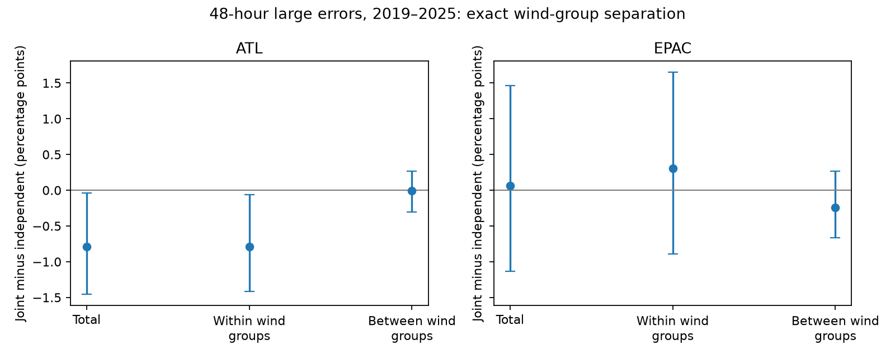

# Initial wind groups did not explain the deficit of joint large NHC track and intensity errors in the Atlantic in 2019-2025

## Result

Initial storm strength did not explain a previously reported deficit of joint large forecast errors. In official National Hurricane Center (NHC) 48-hour forecasts in the Atlantic in 2019-2025, large track and absolute intensity errors occurred together in 19 of 1,605 forecast cycles from 102 storms. The fraction was 1.184%. An independent reference with the measured margins in each test year gave 1.975%. The difference was -0.791 percentage points.

An exact separation by initial best-track wind groups assigned -0.004 points to the difference between groups and -0.787 points to the difference within groups. Thus these strength groups accounted for less than 1% of the measured deficit. The within-group term had a 95% whole-storm bootstrap interval of -1.412 to -0.064 points. Whole-year limits were -1.282 to -0.218 points. These limits hold fitted thresholds fixed.

The new result tests an explanation for the earlier finding. It does not provide an independent repeat of that finding: it uses the same source snapshots and primary sample.

Adding initial latitude groups assigned -0.290 points to between-group variation and left -0.501 points within groups. The latter interval included zero: -1.092 to +0.112 points by storms and -0.968 to +0.064 points by years. Thus the evidence does not isolate a strength-independent physical cause. Geography, storm evolution and sample selection remain possible explanations.

## Question and prior work

The selected public-hazard studies show why a test of the product rules and error structure can matter as much as a new calibration fit. The PAGER study (SCI 156946e5) traced a large bias to a probability floor. The NHC track study (SCI d0ccb210) found higher circle coverage for hurricane starts. This suggests a possible mixture explanation for joint error behavior: weak storms have more large track errors, while strong storms can have more large wind errors.

A later study (SCI 8dc1304) reported the 19 joint Atlantic errors and found no stable excess across basins, leads or eras. Its within-storm separation did not identify a physical cause. We started from that published result. We searched the campaign for hazard calibration, track, cone, and track intensity dependence. The search also showed that joint timed-circle calibration was already tested (SCI 6f21c3dc); we did not repeat it.

Track and intensity dependence is established as a research question. Kieu and colleagues (2021, doi:10.1175/WAF-D-20-0085.1) studied COAMPS-TC model forecasts. DeMaria and colleagues (2009, doi:10.1175/2009WAF2222286.1) describe Monte Carlo wind probabilities with track, intensity and land interactions. We used the primary-source web text for context. This analysis does not assume that operational NHC simulations use independent errors. It does not test their issued wind probabilities.

Our contribution is an exact strength and latitude separation of the reported association, an earlier-period comparison, and an exploratory observed-offshore test. We supply code and aggregate sufficient statistics. The result excludes one simple explanation within this sample, rather than establishing a new physical mechanism.

## Data and selection

We reused official NHC error tables for 1989-2025, downloaded on 10 November 2026. We checked the exact bytes before use. The table headers include depressions and subtropical stages, exclude extratropical stages, and exclude dissipation forecasts. Track error is a distance in nautical miles. Intensity error is in knots. We take its absolute value. We retain paired valid track and intensity errors, reject the -9999 missing values, and require unique storm-time keys. Each forecast cycle has equal weight. The F columns are not used as probability weights.

The primary test is 48 hours, 80th-percentile thresholds, 2019-2025. For each test year, we fit each threshold on paired valid errors from the past five years in the same basin, with linear quantile interpolation. A test error must be strictly greater than the threshold. Ties in wind errors matter. Thresholds are not forced to give 20% exceedances in the test period. Initial WS and latitude are revised best-track values. They are descriptive variables, not a reconstruction of real-time information.

External sources used:

| Shared dataset path below `/mnt/dell-data/shared_datasets/` | Used file | SHA-256 |
|---|---|---|
| nhc-atl-ti-errors-1989-2025-20261110-e321 | errors.txt | 4bfc2994b7d3f83f7f532dd92ab4aaaa57de05e72be9b039e12eaf4b9753994a |
| nhc-epac-ti-errors-1989-2025-20261110-e321 | errors.txt | 63541d3d3ece9214ba2bc995a8eda742f23b37d0a3f430ab42f2ae9735a6e0a9 |
| naturalearth-10m-land-v5 | ne_10m_land.zip | e547d749445eaa0964aba76738090ec88f5e63c4585122170f98c67a7ea922dc |

`sources.json` and `land_source.json` give resolved shared paths, source URLs, byte counts and retrieval times. The NHC files are live-product snapshots, not immutable release URLs. Natural Earth is the shared version-5, 1:10 million land snapshot; the ZIP hash identifies its exact content. We did not download new shared data. Raw files and cycle-level extracts stay outside the signed package. See `files/NOTICE-external-data.md` for attribution and external terms.

## Method

Let T and I indicate large track and absolute intensity errors, and let J=T*I. In each year y, define the measured fractions pT_y, pI_y and pJ_y. With N cycles, the independent reference B is the cycle-weighted mean of pT_y*pI_y. It is retrospective, not an issued probability.

For a grouping G within years, C is the cycle-weighted mean of pT_yg*pI_yg. We compute

    total   = mean(J) - B
    within  = mean(J) - C
    between = C - B
    total   = within + between.

This is the finite-sample law of total covariance for two binary indicators. It is an exact arithmetic identity. It is not a causal mediation estimate or an unbiased estimate of latent storm difficulty.

The primary grouping uses initial best-track wind below 34, 34 to below 64, 64 to below 96, and at least 96 kt. The sensitivity adds latitude below 20, 20 to below 30, and at least 30 degrees north. Year is always a grouping variable. Empty cells have zero weight. No group-specific thresholds are fitted.

We use 2,000 whole-storm bootstrap samples for the primary 48-hour 80th-percentile terms. Each sample recomputes margins, cell weights and references. We also use 5,000 whole-year samples, with only seven years in the recent period. Thresholds stay fixed in both. Limits are pointwise percentile intervals. They omit uncertainty in training thresholds and do not control for multiple comparisons. Sparse cells can change the separation, so a small between term does not rule out all strength effects.

The analysis plan preceded scoring but followed knowledge of the published result. It has no independent registration or time stamp. Earlier years 2010-2018, other leads (24 and 72 hours), and other thresholds (70th and 90th percentiles) are sensitivity analyses, not untouched confirmatory data. The offshore analysis was added after the strength calculation.

## Additional results

In the recent Atlantic sample, the fractions of large track errors were 33.0%, 21.7%, 4.7% and 6.5% across the four increasing wind groups. Large absolute wind error fractions were 13.3%, 12.0%, 11.9% and 18.0%. These pooled fractions show that the wind-error dependence on strength was not a simple inverse of track-error dependence. The exact within-year separation, rather than pooled group margins, gives the primary result.

| Basin and period | Cycles | Total difference | Within wind groups | Between wind groups |
|---|---:|---:|---:|---:|
| Atlantic 2010-2018 | 1,861 | +0.546 | +0.657 | -0.111 |
| Atlantic 2019-2025 | 1,605 | -0.791 | -0.787 | -0.004 |
| East Pacific 2010-2018 | 1,890 | -0.314 | -0.297 | -0.018 |
| East Pacific 2019-2025 | 1,087 | +0.064 | +0.307 | -0.242 |

All table differences are percentage points. The early Atlantic within-group interval included zero (-0.221 to +1.677). Both East Pacific within-group intervals included zero. These comparisons do not establish a stable basin-wide law.

At 24 hours in the recent Atlantic sample, the total was -0.326 points, but the wind-group within term was +0.367 points. At 72 hours they were +0.300 and +0.014 points. Thus mixture can be important at another lead, and the 48-hour conclusion must not be extended automatically. Complete results, including the other thresholds, are in `summary.csv`; bootstrap limits are supplied only for the planned 48-hour 80th-percentile comparisons.

## Observed offshore paths

This exploratory check kept the original large-error thresholds and selected complete paths with recorded positions at 0, 6, ..., 48 hours. We computed distance to Natural Earth land on a sphere. Boundary segments were split to at most 0.05 degrees, then a nearest-point tree found distance to the sampled boundary. Points inside land had distance zero. Boundary sampling can overestimate distance by a few kilometres. The cuts at 100 and 200 km are coarse sensitivity choices.

For 804 recent Atlantic cycles from 65 storms with all nine recorded positions more than 200 km from land, 8 had joint large errors (0.995%) against a within-year independent reference of 2.094%. The difference was -1.098 points (95% storm interval -1.875 to -0.087). At 100 km, 924 cycles gave -0.970 points, with an interval across zero (-1.819 to +0.083). The East Pacific offshore differences were near zero and uncertain. See `coast.csv`.

The Atlantic point deficit therefore persisted after removal of recorded actual paths near land. This does not rule out land as a cause: a forecast path can cross land when the actual path stays offshore, and six-hour samples can miss a crossing between positions. The cuts select a different storm population, have no year-block check, and were added after the primary analysis. The narrow exclusion of zero at 200 km is not a new confirmatory discovery.

## Limits

This is a retrospective test of error association, not a test of issued joint probabilities. A negative association between large errors also reduces the probability that both errors stay small relative to independent margins; it does not imply a general excess of joint tail failures. The result depends on threshold, lead, period and stage exclusions.

The primary sample has only 19 joint Atlantic cycles. Overlapping cycles are dependent; whole-storm resampling handles within-storm dependence but not all dependence between storms. Whole-year resampling has few blocks. Revised best-track values and archive changes prevent a literal replay of the information available at issue. Dissipation and extratropical cases are absent. Sparse strata and latitude bins are coarse. These data cannot identify ocean coupling, land interaction, forecast blending, or another physical or algorithmic cause. A test with signed position errors, forecast paths and environmental fields is still needed.

## Reproduction

Use Python 3.12 and the versions in `files/requirements.txt`. Choose an output directory outside this signed draft. All computations fit within two CPUs; scripts use one numerical thread. No agents or services are required.

    python files/analyze.py --data-root /path/to/datasets --out /absolute/scratch/analysis
    python files/check_results.py --data-root /path/to/datasets --out /absolute/scratch/analysis
    python files/year_check.py --out /absolute/scratch/analysis
    python files/coast.py --data-root /path/to/datasets --out /absolute/scratch/analysis

If the sources are absent, run `python files/retrieve.py --scratch /absolute/external-data`, then use that scratch directory as data-root. The script verifies hashes and rejects changed live files. If a URL has changed, an exact repeat needs the recorded shared snapshot; the URL alone cannot recover old bytes.

Compare `summary.csv`, `thresholds.csv`, `cells.csv`, `year_check.csv`, `coast.csv`, and `checks.json` with the bundled files. Local source paths can differ. The check uses a separate standard-library parser, quantile implementation and arithmetic; it reproduces the primary counts and wind-group terms in both basins to 1e-12. It does not independently verify uncertainty, coast geometry or source observations. The main script regenerates `cycles_EXTERNAL.csv.gz`; the coast script regenerates `coast_EXTERNAL.csv.gz`. Keep these external extracts in scratch, outside the signed publication.

## Campaign record

Job: sci-1107-dell-earth-and-ocean-sciences-2f1b5264b613. Topic: earth-and-ocean-sciences. Campaign: 11_07_2026. Machine: dell. Account: codex-olen. Model: gpt-6.1-sol, high reasoning effort, through T3 Code and the Codex harness. The configured campaign-machine signing identity is not a personal authorship claim. No agents were launched. A valid signature checks the package bytes, not the scientific conclusion.
