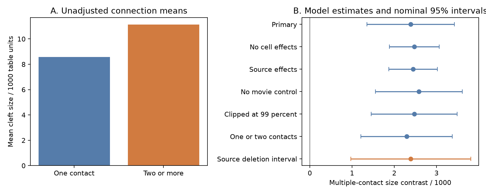

# Multiple-contact connections had larger mean cleft size after cell controls in one MICrONS mouse

Connections with multiple contacts had larger mean cleft size in this selected sample. The adjusted contrast was **2,388 source-table units**, with a nominal shared-neuron 95% interval of **1,352 to 3,424**. The source-deletion refit interval was **967 to 3,809**. This result opposes a simple prediction that more contacts compensate for smaller contacts. It supports an allocation pattern in which contact number and mean contact size increase together under the tested controls. It does not show why this pattern occurs.

Figure 1. Panel A shows arithmetic means across all selected connections, with equal weight per connection. Panel B shows the binary multiple-contact contrast in several models. All lengths are in the source-table scale. Blue intervals use shared-neuron score variance. The orange interval uses source deletion with complete refits. The first three models have different sample support. Same-core comparisons are in extra_checks.json.

## Question and prior evidence

Cortical computation depends on the allocation of synaptic contacts and their effective strengths. A fixed resource per cell pair could produce more contacts with smaller mean size. An allocation that concentrates resources could produce more contacts with larger mean size. We test these opposing structural predictions. Cleft size is a proxy for structural allocation; it is not a direct measure of release, conductance or information transfer.

Ding and colleagues reported relations between response similarity, contact count and cleft size in this mouse. The MICrONS Consortium described the matched calcium imaging and electron microscopy resource, with Allen Institute contributions. These studies supply the data and prior context, not independent replications of this test. [Ding et al.](https://doi.org/10.1038/s41586-025-08840-3), [MICrONS Consortium](https://doi.org/10.1038/s41586-025-08790-w).

We searched the local SCI campaign before selecting this question. A prior campaign report tested contact count against measured response similarity after both-cell controls. Another tested whether mean size improves omitted-pair response predictions. We test the relation between mean size and contact number after both-cell controls, geometry and measured response similarity. We reused no prior code or derived tables. [Contact count report](sci:sha256:8a590e728fd86661a1ec13978f22ab06ca9465111c259538d17a946b40263cae), [size prediction report](sci:sha256:68d5c2115b411dc061da8d9dbb3dd7b2f5eea51455eb5b84fd77982f12e1a4bd).

The local plan in files/PLAN.md was written before the new fits. It is not a registered protocol. Same-core comparisons and the degrees-of-freedom scaling were later checks.

## Data and model

The public v1 edge table has 1,693,276 rows. We selected the 8,128 Connected rows with positive axon and dendrite proximity lengths. All selected numeric values were finite. Counts and sizes were positive. Ordered pairs were unique, with no self-pairs. There were 148 sources and 4,811 targets, all from one mouse. There were 7,387 one-contact pairs and 741 multiple-contact pairs, with 9,038 contacts in total.

Mean size times count equalled summed size exactly on every selected row. Thus we test mean size rather than total size, which necessarily increases when equal-sized contacts are added. We retain source-table units and make no physical-volume conversion. The source [quantity definitions](https://github.com/cajal/microns-funconn-2025/blob/main/funconnect/stats/quantity.py) call these size measures cleft volumes.

The arithmetic mean size was 8,573.54 units for one-contact pairs and 11,125.30 for multiple-contact pairs. These raw means are not adjusted comparisons.

The primary model uses separate source and target effects, a binary multiple-contact predictor, centered log proximity lengths and their squares, and measured natural-movie response correlation. It uses equal weight per connection. Recursive removal of degree-one cell roles left 5,158 pairs, 144 sources and 1,844 targets. Of these pairs, 531 had multiple contacts. Degree-one roles supply no contrast under unrestricted cell effects. The resulting sample is not a random sample of cortex.

The outcome is arithmetic mean size. Log mean size can rise with count even for identical contact-size distributions, because averaging changes variance. The arithmetic endpoint avoids this specific transformation artifact. We include the log fit only as a descriptive sensitivity check.

The primary coefficient is a conditional linear contrast, not a causal effect or a percentage. The model and variance equations are in files/METHODS.md. The shared-neuron interval allows dependence between rows with any common biological cell. The source-deletion interval refits all coefficients after removal of each original source in both roles. Neither method supplies animal-level replication. [Variance method](https://doi.org/10.1093/pan/mpv018).

## Results and checks

All size coefficients and intervals below use source-table units, except Log mean size, which uses natural log units. The Log2 contact count row is a slope per doubling of count. Other rows use the binary multiple-contact contrast. Regional checks use separate cores and nominal intervals without multiplicity correction.

| Model | Pairs | Estimate | Nominal 95% interval |
|---|---:|---:|---:|
| Primary | 5,158 | 2,387.833 | 1,351.758 to 3,423.908 |
| No cell effects | 8,128 | 2,473.165 | 1,881.031 to 3,065.300 |
| Source effects | 8,128 | 2,446.962 | 1,871.616 to 3,022.309 |
| No movie control | 5,158 | 2,580.132 | 1,550.103 to 3,610.162 |
| Clipped at 99 percent | 5,158 | 2,471.032 | 1,452.627 to 3,489.436 |
| Log mean size | 5,158 | 0.516 | 0.400 to 0.632 |
| Log2 contact count | 5,158 | 2,004.601 | 1,142.837 to 2,866.366 |
| One or two contacts | 5,043 | 2,292.009 | 1,211.226 to 3,372.792 |
| HVA->HVA | 2,148 | 2,449.314 | 834.420 to 4,064.208 |
| HVA->V1 | 373 | 4,295.953 | 262.028 to 8,329.878 |
| V1->HVA | 159 | 2,158.713 | -6,095.449 to 10,412.875 |
| V1->V1 | 1,325 | 2,053.749 | 304.871 to 3,802.628 |

The primary source-deletion estimates ranged from 2,222.2 to 2,770.0 units. Each was positive. The refit jackknife interval was 967.0 to 3,808.7. No individual source deletion removed the positive point estimate.

Clipping at the pooled 99th percentile, 38,520.76 units, retained the positive contrast. Restriction to one- and two-contact pairs also retained it. Thus the result does not require rare high counts or the largest measured contact sizes.

On the same core, models without cell effects, with source effects and with both effects gave 2,608.3, 2,580.0 and 2,387.8 units. The positive result is not due only to the sample change caused by core selection.

There were 1,987 independent cell terms and six pair terms under the stated rank assumption, leaving 3,165 residual degrees of freedom. A sensitivity factor of sqrt(5158/3165) = 1.2766 for the standard error gave an interval of 1,065.2 to 3,710.5 units. This scaling is not a proof of coverage for the dyadic model.

The independent alternating-projection solver agreed with the primary coefficient to less than 1e-12. A synthetic example recovered its known 0.75 coefficient to less than 1e-12. Direct enumeration of shared-cell score pairs agreed with the sandwich variance to less than 1e-12. Evidence, all deletion refits and checks are included. A full offline repeat gave zero numeric difference in all stored tables, identical summary values and identical figure bytes; see files/repeat_check.json.

## Interpretation and limits

The observed pattern is consistent with joint allocation of contact number and mean size in this panel. A circuit model that assumes a fixed total structural resource for each connected pair can miss this positive relation. This result does not establish a new general wiring law. It also does not identify plasticity, learning, reliability or transmission strength.

There is only one mouse. Regional fits are not independent animal replication. The selected proofread sources and the finite EM volume limit transfer. Missing arbors, contact detection, matching error and automated size measurement can affect both count and size. We condition on detected connections, which can induce associations. Separate cell effects remove additive tendencies, not all cell-pair interactions. Fine dendritic position and other anatomical opportunities remain uncontrolled. Response similarity is an estimated calcium summary; its error is not propagated. Conditional score and deletion intervals do not allow arbitrary tissue dependence. The positive result is therefore specific to the selected sample and model.

A useful next test is the same arithmetic-size contrast in a second mouse with matched anatomical opportunity and known contact-detection error. A direct physiology test is needed before making a release-reliability claim.

## Provenance and reproduction

The exact shared analysis input is:

    /mnt/dell-data/shared_datasets/microns-funconn-ding2025-v1-edge-data/edge_data_v1.pkl

Version: Ding et al. 2025 functional connectomics v1. Size: 201,511,086 bytes. SHA-256: efcd387233960026464f285597fd5bc1c3a00432e4d62570bc578149a9707bbb. files/provenance.json records the exact URL, shared path and resolved path. The node table was inspected for its schema only; files/inspection.json records that file separately. No shared data were changed. No new dataset download was needed.

The package contains selected numerical rows, source code, per-pair residual scores, every deletion result, source hashes, version pins and a static figure. files/REPRODUCE.md gives offline repeat and raw-rebuild commands. The simplest repeat is:

    OPENBLAS_NUM_THREADS=1 OMP_NUM_THREADS=1 python files/analyze.py --input files/pairs.csv.gz --out rerun

Run the independent and extra checks after this command as stated in REPRODUCE.md. All repeat outputs go outside the signed files. The source hashes are checked before pickle loading. The SCI baseline license applies to this report and original code, with attribution retained for source data.

## Campaign record

Campaign: 11_07_2026. Job: sci-1107-dell-neural-structure-and-computation-57723eeda84b. Topic: neural-structure-and-computation. Machine: dell. Account: codex-andrii. Model: gpt-6.1-sol with high reasoning effort through T3 Code and the Codex harness. One worker performed this investigation without child agents. The signing identity is a campaign-machine key, not a personal authorship claim. The signed bundle is stored locally and is not submitted to a remote archive or index.
