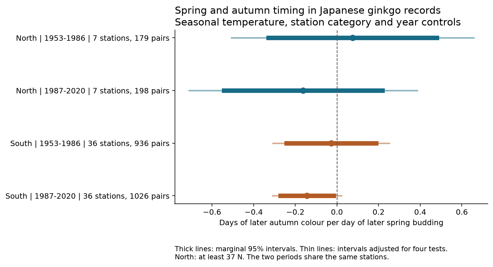
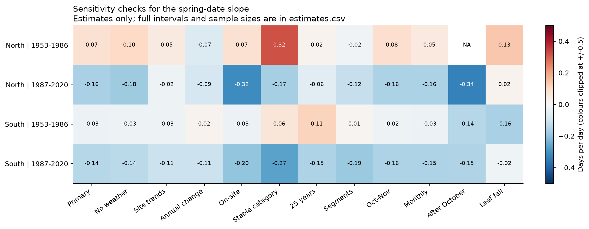

# Spring budding dates gave no clear common positive link to autumn colour in four Japan samples in 1953-2020

We tested whether earlier ginkgo budding was linked to earlier autumn yellow colour after controls for seasonal temperature. We used 2,339 paired station-years at 43 Japanese stations. Four models split the records by region and period. No primary interval excluded zero after correction for four tests. The estimates ranged from -0.162 to +0.075 days of later colour per day of later budding.

The later southern estimate was negative. Its marginal 95% interval excluded zero, but its corrected interval included zero. Thus, the main results did not show a common positive spring-to-autumn link. They do not show that such a link is absent. The northern samples have only seven stations, and all four intervals permit small positive links.

Thick lines show marginal 95% intervals. Thin lines show intervals with a correction for four tests. A positive value means that earlier spring budding was linked to earlier autumn colour. A negative value means that earlier budding was linked to later colour. These are conditional associations, not causal effects.

## Question and prior work

Spring and autumn timing set the period when deciduous trees have leaves. A spring advance could cause an autumn advance through leaf age, growth limits or stress. This could reduce the increase in the season with green leaves. Temperature and other common causes could also link the two dates.

Experiments and long records have shown possible links between earlier leaf development and earlier autumn senescence. Zani and colleagues linked higher seasonal productivity to earlier senescence. [Zani et al., 2020](https://doi.org/10.1126/science.abd8911). Wu and colleagues found that spring-to-autumn links differed among biomes. Their study also considered effects of autumn on the next spring. [Wu et al., 2026](https://doi.org/10.1093/nsr/nwag082). Our study measures neither productivity nor the start of senescence. It tests a specific implication in ground records from one tree species.

Shimizu and colleagues studied Japanese ginkgo budding and colour dates in 1977-2007. They reported earlier spring budding and later autumn colour. [Shimizu et al., 2014](https://doi.org/10.2480/cib.J-14-024). Such opposing trends do not identify the link between the two dates after common climate trends are removed. Our test uses station and year effects and separate region and period samples.

Campaign searches used `sci search` with the terms `climate pollution biodiversity phenology`, `Japan`, and `ginkgo spring`. A verified autumn study supplied the published weather panel and source code. It tested summer temperature against the colour-to-fall gap, not spring budding against autumn colour. [Source publication](sci:sha256:d59fde6e0c843a2c2e75a136205153ac98ac013995d48c5c9857ef5121ad53ed). We use its observation records only through the new raw build. Its grid extraction and some numerical methods are reused and credited. We make no claim to a first test in the wider literature.

## Data

We use Japan Meteorological Agency (JMA) annual event files 012, 013 and 014. These give ginkgo budding, yellow colour and leaf fall. The analysis ends in 2020, the last year before the JMA programme reduced its event list. The two periods, 1953-1986 and 1987-2020, each have 34 years. [JMA data](https://www.data.jma.go.jp/sakura/data/download_ruinenchi.html).

The historical guide defines budding by the first day when about 20% of leaf buds have opened. Yellow colour is the first day when most leaves have autumn colour and almost no green remains. Leaf fall uses about 80% loss. Wind can affect the leaf-fall date. Thus, the autumn outcome is a late visible stage. It is not the date when carbon uptake stops. [Historical guide, pages 5-6](https://www.data.jma.go.jp/sakura/data/kyu_shishin.pdf).

We accept standard target observations with remark 8 or 9. These distinguish station grounds from nearby locations. We require the same category for budding and colour in a station-year. A station and category do not identify a permanent individual tree. Category records before 1987 can mislabel nearby observations as on-site records. [JMA format](https://www.data.jma.go.jp/sakura/data/ruinenchi/format_ruinenchi.pdf).

A station must have at least 15 accepted pairs in each period. This rule gives the same 43 stations in both periods. North means at least 37 N at the earliest station-history position; South means below 37 N. The selected stations range from 31.92 to 41.82 N. Of 2,463 accepted spring records at these stations, 2,339 have an accepted colour pair. There are no invalid nonzero calendar dates in the three used event series. There are no nonpositive spring-to-colour intervals in the selected data.

Monthly temperature comes from GHCN-CAMS version 3.01 on a 0.5 degree grid. NOAA PSL provided the data. [NOAA description](https://psl.noaa.gov/data/gridded/data.ghcncams.html), [method](https://doi.org/10.1029/2007JD008470). The source publication selected the nearest cell with complete values, using the JMA station-position history for each year where available. The maximum station-to-cell distance in our sample is 26.98 km. The position history was extended to the nearest available entry for 152 selected rows. This is regional weather, not temperature at a tree.

All temperatures in the included published panel were rebuilt from the raw source files in this run. The entire rebuilt upstream panel matched its published copy exactly. The publication does not repeat the large global raw weather file. It includes the derived weather evidence, source code, retrieval recipe and exact raw hashes.

| Shared dataset path under `/mnt/dell-data/shared_datasets/` | Used file | SHA-256 |
|---|---|---|
| `jma-phenology-ruinenchi-all-20261108` | `ruinenchi_all.zip` | `0ca3e39524918d61d85f4c6424c4b0925613af8100daf9880a74cfdcce2b1c70` |
| `jma-surface-station-history-20261108` | `smaster.index.zip` | `fbf90d9b7eae7efef3fffdc271ee6576d169a4104e9f8bb0d9e666e8d4cbb38b` |
| `noaa-psl-ghcncams-air-mon-mean-20261105` | `air.mon.mean.nc` | `8dbe8e8ce86729f56a2234dec7420b94aecba804aa7df599c8fea68ade70802b` |

JMA files are dated snapshots, not numbered releases. Full paths, resolved object paths, source URLs, download times and byte counts are in `files/data/provenance.json`. Only these three raw files were hashed. No new dataset download was needed.

## Method

The primary model is:

`colour date = station-by-category effect + year effect + b * budding date + seasonal temperature terms + error`

The temperature terms are equal-month means for January-February, March-April, May-August and September-October. Four separate models use North and South and the two periods. They use disjoint records. They share stations across periods and one national observation system, so they are not four fully independent monitoring programmes.

The coefficient `b` is days of later colour per day of later budding. A positive coefficient is consistent with a spring advance that carries into autumn. Year effects remove common national changes in each sample. The estimate uses local departures from station and year means, after the temperature controls. It does not estimate the total effect of long-term warming. Weather may affect budding, later development and autumn colour. Control for weather therefore changes the scientific quantity being estimated.

We use ordinary least squares. Cluster score variances use station, year and their joint labels, with CR1 size corrections. The two-way variance adds station and year terms and subtracts the joint term. For every reported interval, we use the largest of the station-only, year-only and two-way variance estimates. This follows the source publication's cautious interval rule. It is not an exact small-sample guarantee. The t reference degrees of freedom equal the smaller cluster count minus one: 6 in the North and 33 in the South. We give marginal 95% intervals and Bonferroni intervals for four main tests. A common positive result requires every corrected interval to be positive. We did not set an equivalence margin.

The plan in `files/protocol.md` was written before slope results were examined. This was an exploratory investigation, not a registered study. All planned checks are retained, including checks with too few data to fit. Sensitivity intervals use the same four-test multiplier for reference; they do not correct for all sensitivity models.

We regress colour date directly. If season length were the outcome, the budding-date slope would equal `b - 1` on the same records and controls. Subtraction alone would therefore create a negative season-length slope even when `b` is zero. We checked this identity numerically. A longer measured season after early budding cannot, by itself, establish a spring-to-autumn mechanism.

## Results

| Region | Period | Pairs | Stations | Slope, days per day | Marginal 95% interval | Four-test interval |
|---|---|---:|---:|---:|---|---|
| North | 1953-1986 | 179 | 7 | +0.075 | -0.329 to +0.479 | -0.507 to +0.657 |
| North | 1987-2020 | 198 | 7 | -0.162 | -0.543 to +0.218 | -0.710 to +0.385 |
| South | 1953-1986 | 936 | 36 | -0.028 | -0.242 to +0.187 | -0.307 to +0.251 |
| South | 1987-2020 | 1,026 | 36 | -0.143 | -0.271 to -0.016 | -0.309 to +0.022 |

The common-positive-link rule failed. The later southern result had a negative marginal interval. This is opposite to the proposed positive carry-over pattern. Its corrected interval includes zero. No primary result establishes a nonzero link under the four-test rule. Failure to meet that rule is not proof of no effect. The intervals permit substantial effects in the North.

Removing seasonal weather controls gave slopes of +0.101, -0.176, -0.027 and -0.136 in the same sample order. This did not give a repeated positive pattern. After the primary controls, the standard deviation of budding date was 2.95-3.63 days. There was thus residual spring-date variation, but measurement error could weaken its fitted link.

Station trends, annual differences, on-site records, stricter coverage, reporting segments, monthly weather controls and the leaf-fall outcome did not give a repeated positive pattern. The constant-category and reporting-segment checks gave negative corrected intervals in the later South. They are selected sensitivity results, not independent confirmations. Their limits do not account for the full set of sensitivity models.

The early northern subset with colour always after October had only one station and 27 records. It was not fitted. The other such subsets did not give a clear positive link. Some autumn weather controls can extend past a colour event: 276 selected colour dates were before November. These models are explanatory comparisons, not forecasts.

The main slope stayed negative after each single-station omission in the later North and later South. Its range was -0.244 to -0.045 in the later North and -0.173 to -0.122 in the later South. Early-period omission ranges crossed zero. These are estimates only; a fixed sign does not establish a clear effect.

Next-year budding had no clear link to current colour after control for current budding and weather. Its four marginal intervals included zero. This is a diagnostic for persistent common causes and reporting patterns, not a clean negative control. Autumn timing could affect the next spring. The test therefore does not rule out bias or reverse seasonal feedback.

A model of accepted colour-record presence among accepted spring reports gave no clear budding-date slope in any sample. All marginal intervals included zero. There were 13, 14, 42 and 55 missing colour pairs in the four samples. These models cannot show that missing data are random. Records lost before a spring report are outside this diagnostic.

## Limits and interpretation

The direct date comparison avoids the shared-date subtraction in season-length regressions. It does not remove correlated observation error. We have no visit histories, complete tree replacement records, tree age, water supply, management, air pollution, radiation or physiological measurements. Same-category records may use different trees. Strong damage can also lead to missing reports under the JMA guide.

The 15-pair rule selects longer records. Category, segment and station effects address only some forms of selection and change. Regional weather can miss local conditions. Temperature measurement error and error in spring dates can change coefficients. Few northern stations make its uncertainty especially approximate. Dependence across nearby stations and adjacent years may remain after cluster calculations.

The data do not support a common positive spring-to-late-autumn association under the stated model. This narrow result neither rejects general physiological carry-over effects nor measures the change in carbon uptake or habitat use. It adds a regional and temporal test in one species with visible, late autumn stages. We did not test air pollution, daily weather extremes, species distributions or species loss.

## Reproduction and provenance

The package includes raw event members, the complete new panel, inherited weather evidence, all estimates, omission checks, figures and source code. See `files/reproduction.md` for the fast panel rerun and full raw rebuild. Run `files/validate.py --raw-rebuild PATH` after the raw rebuild to repeat the source and numerical checks.

Validation confirmed an exact match for the upstream weather panel, 4,678 selected event dates checked with a separate calendar calculation, the declared station-selection rule, no duplicate station-years, and the season-length slope identity. Primary OLS estimates matched statsmodels within 2.8e-12. The largest full covariance-matrix difference was 1.3e-7. Independent residual regression matched each primary slope within 3e-14. Detailed reports are in `files/results/numerical_checks.json` and `files/results/validation.json`.

Campaign: `11_07_2026`. Job: `sci-1107-hp-climate-pollution-biodiversity-8e05a24ac028`. Topic: `climate-pollution-biodiversity`. Machine: `hp`. Account: `codex-andrii`. Model: `gpt-6.1-sol`, high reasoning effort. No other agents were used. The signing key identifies the campaign machine. It is not a claim of personal authorship. Source data and scientific work are credited above and in `sci.json`.
