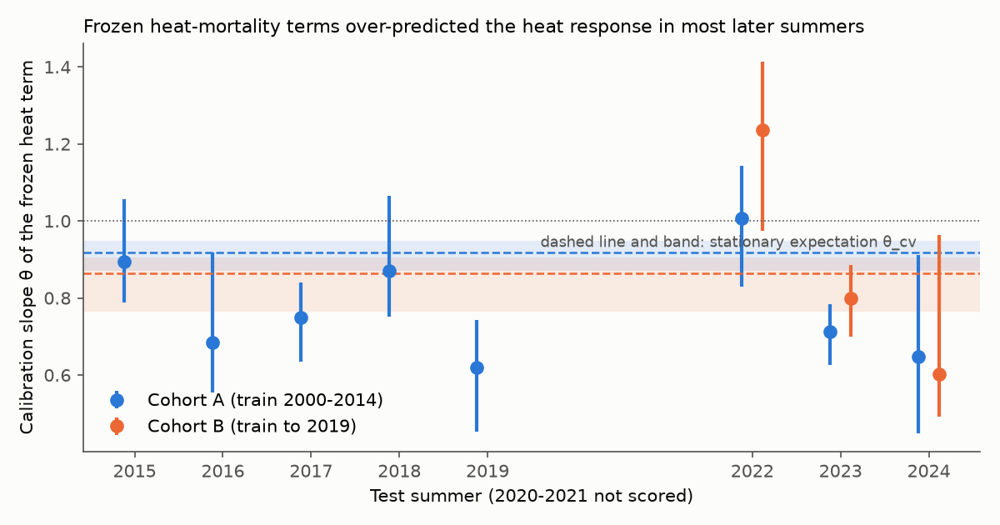
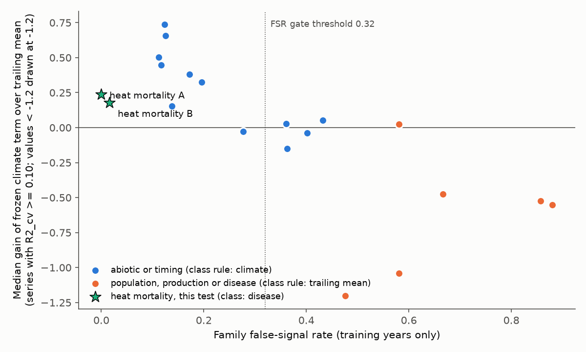
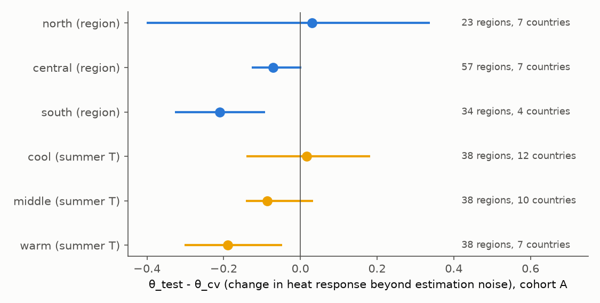

# Heat-mortality relations fitted on 2000-2014 deaths improved 2015-2024 summer forecasts in 114 European regions, but the heat response was smaller than expected, mostly in warm regions

Job `sci-1107-dell-climate-pollution-biodiversity-e834d4e913c8` · campaign 11_07_2026 · topic climate-pollution-biodiversity · machine dell · model claude-opus-5-5 (Anthropic). The signing key is a campaign-machine key. It is not a personal authorship claim.

## Summary

Earlier campaign forward tests found that population and disease responses to climate seldom keep forecast skill in later years (dengue, West Nile disease, coccidioidomycosis, bird and butterfly counts). A response-class rule says: use climate only for abiotic and timing responses. A training-only false-signal gate (FSR) says: use climate when a shifted-climate null seldom gives a false training signal. Heat mortality is a large climate-health claim, and agencies use fitted heat curves to count heat deaths. This campaign did not test it before.

We froze and timestamped a plan before we fitted a model to observed deaths. Then we tested summer heat-mortality relations in European NUTS 2 regions with Eurostat weekly deaths and E-OBS daily temperature.

- **Cohort A (primary):** 114 regions in 18 countries. Training summers 2000-2014. Test summers 2015-2019 and 2022-2024 (11,791 region-weeks, ISO weeks 23-35). 2020-2021 were not scored (COVID).
- **Cohort B (secondary):** 94 regions in 10 countries (France, Italy, Greece, Netherlands, Czechia, Romania, Denmark, Cyprus, Malta, Montenegro). Training from the first complete summer (2011-2015) to 2019. Test summers 2022-2024.

Main results (cohort A unless stated):

1. **The frozen heat term added forecast skill (H1 passed).** A trailing 5-year level plus the frozen 2000-2014 heat term (M2) had a lower error than the temperature-blind trailing mean (R2). The median skill over regions was 0.18 (95% country-cluster bootstrap interval 0.08 to 0.25). In hot weeks (above the training 95th percentile of weekly temperature), it was 0.59 (0.50 to 0.66). Skill was positive in 86% of regions. Cohort B gave 0.11 (0.02 to 0.19) and 0.43 in hot weeks.
2. **The heat response was smaller than the stationary expectation (H2 passed: decline).** The calibration slope of the frozen heat term was 0.79 (0.71 to 0.88) in the test summers. Held-out training summers gave 0.92 (0.87 to 0.95). This value includes the loss that estimation noise alone causes. The difference was -0.13 (-0.21 to -0.04). Thus the later heat response was about 14% smaller than a stationary relation would give. If we remove any one country, the difference stays between -0.09 and -0.14. In cohort B the difference was -0.07 (-0.20 to +0.14), which is not a detectable change. With week effects estimated in the test years, it was -0.22 (-0.38 to -0.03).
3. **The decline was in warm regions (exploratory).** The difference was -0.21 (-0.33 to -0.09) in southern regions (Spain, Portugal, Bulgaria, Serbia) and -0.19 (-0.30 to -0.05) in the warmest third of regions. It was +0.02 (-0.14 to +0.18) in the coolest third and +0.03 in northern regions.
4. **2022 was the exception.** The slope was 1.01 (0.83 to 1.14) in 2022 in cohort A and 1.24 (0.97 to 1.41) in cohort B. In 2016, 2017, 2019, 2023 and 2024, it was 0.62 to 0.75. A COVID wave (Omicron BA.5) overlapped the 2022 heat, so we cannot separate the two causes. Without 2022, the cohort A difference was -0.17 (-0.25 to -0.06).
5. **The FSR gate chose correctly and the class rule did not (H3).** The heat term had a cross-validated training signal (R2_cv >= 0.10) in 69% of regions. No shifted-climate null draw reached that level (FSR = 0.00; cohort B 0.02). So the gate chose the climate model. The class rule (mortality is a population or disease response) chose the trailing mean. The climate model was better: median skill against the training mean 0.49 against 0.32, difference +0.16 (0.08 to 0.22). In the campaign false-signal comparisons, heat mortality is the first disease-type family that falls with the forecastable abiotic and timing families (Figure 3).
6. **The training signal ranked the regions (H4 passed).** Spearman rho between training R2_cv and test skill was 0.58 (cohort A) and 0.32 (cohort B), one-sided permutation p < 0.001.
7. **Level shifts again (H5 passed).** The trailing mean beat the stale training mean (median skill 0.32 in A, 0.20 in B).

Main limitation: we used observed weather (a perfect temperature forecast) and all-age, all-cause deaths. The weekly design differs from the annual design of earlier campaign families. A smaller heat response can come from adaptation, but also from changes in the temperature data, in harvesting of frail persons, or in reporting. We did not test these causes.

*Figure 1. Calibration slope (theta) of the frozen heat term in each test summer, with 95% country-cluster bootstrap intervals. A value of 1 means that the frozen term predicted the right size of heat-related changes in weekly deaths. Dashed lines and bands: stationary expectation from held-out training summers (theta_cv), which includes the loss from estimation noise.*

## Question

Which climate-response claims are operationally forecastable? Earlier campaign work (sci:sha256:17f2e323, 7b03c5d9, 8804b69f, 6081bf76) proposed two rules: a response-class rule and a training-only false-signal gate. Disease tests in the campaign (dengue, West Nile disease, coccidioidomycosis) mostly gave no forecast gain. We asked three questions for a system that the campaign did not test:

1. Does a summer heat-mortality relation fitted on earlier years improve later weekly death forecasts over a trailing baseline?
2. Did the frozen relation keep its size, or did the heat response fall beyond the loss that estimation noise causes?
3. Which campaign rule chooses correctly for this disease-type response?

## Data

- **Deaths:** Eurostat `demo_r_mwk2_ts` (deaths by week, sex and NUTS 2 region), both sexes, retrieved 2026-11-11 (SHA-256 of our extract: `83b539d2...aefb3a` in `files/provenance/inputs.csv`). Recent weeks are provisional.
- **Temperature:** E-OBS v32.0e daily mean temperature, ensemble mean, 0.25 degree grid (to 2025-06-30). Area-weighted mean over grid cells with centres inside each NUTS 2 polygon (GISCO NUTS 2021; 2016 or 2024 version for other codes; 17 of 271 regions use the nearest cell). T0 = mean of the ISO week; T1 = mean of the previous 7 days.
- **Units:** ISO weeks 23-35. A region-summer is eligible if all 13 weeks have deaths and temperature. Regions need a mean of at least 20 deaths per week in training.

## Methods (frozen before analysis)

The plan is `files/plan/frozen_plan.md`. The script hashes are in `files/plan/script_hashes.txt`. The FreeTSA RFC 3161 timestamp (2026-11-11 15:59:08 UTC) covers `files/plan/frozen_bundle.txt` (plan plus hashes; SHA-256 `cfdaaab6...56cf0dd`). Verify with `openssl ts -verify -data files/plan/frozen_bundle.txt -in files/plan/frozen_bundle.tsr -CAfile files/plan/cacert.pem -untrusted files/plan/tsa.crt`. Before the freeze we looked only at data structure and ran the engine on simulated deaths. The four frozen scripts are unchanged in this bundle.

**Model.** For each region, with training summers only: log(deaths + 0.5) = year effect + week effect + b0 max(T0 - tau, 0) + b1 max(T1 - tau, 0). We fit it by ordinary least squares. tau is the 50th, 75th or 90th training percentile of weekly temperature; we chose it by in-sample error.

**Forecasts** for test year t and week w (one step ahead, with observed weather). Each forecast uses weeks w-1 to w+1 and the 5 most recent eligible years before t (2020-2021 not used):
- R1: training mean.
- R2: trailing mean.
- M1: frozen model with the training level.
- M2: trailing heat-adjusted level plus the frozen heat term.

Skill = 1 - MSE(model)/MSE(reference) on log weekly deaths. O3 = M2 against R2 (primary). O2 = R2 against R1.

**Training diagnostics.** R2_cv is the leave-one-summer-out skill of the heat model over a week-effect-only model for within-summer anomalies, with tau chosen again in each fold. The null circularly shifts whole training summers of temperature by 1 to m-1 years. FSR = (share of null R2_cv >= 0.10) / (share of observed R2_cv >= 0.10).

**Calibration slope theta.** We regress within-summer anomalies of log deaths (minus training week effects) on within-summer anomalies of the frozen heat term, pooled over regions. theta_cv uses held-out training summers (each predicted by a model without that summer). It is the stationary expectation and includes the loss from estimation noise. theta_test uses the test summers.

**Engine check on simulated deaths** (real temperatures, Poisson deaths; `files/results/simulation/`): with a stationary heat effect, theta_test - theta_cv = +0.03 (-0.04 to 0.08). With the heat effect halved in test years, it was -0.41 (-0.45 to -0.35).

**Uncertainty.** Country-cluster bootstrap with 2,000 draws (500 for single summers).

## Results of the pre-registered tests

| Test | Criterion | Cohort A | Cohort B |
|---|---|---|---|
| H1 median O3 > 0, interval > 0 | primary | 0.178 (0.076, 0.246) **passed** | 0.115 (0.021, 0.185) passed |
| pooled O3 | reported | 0.158 (0.082, 0.229) | 0.104 (0.030, 0.161) |
| H1b median O3 in hot weeks | interval > 0 | 0.592 (0.505, 0.662) **passed** | 0.430 (0.398, 0.673) passed |
| H2 theta_test - theta_cv | interval < 0 = decline | -0.128 (-0.205, -0.036) **decline** | -0.071 (-0.198, 0.142) no detectable change |
| theta_cv / theta_test | reported | 0.918 / 0.789 | 0.865 / 0.794 |
| S3 theta_test_2w - theta_cv | sensitivity | -0.177 (-0.250, -0.098) | -0.219 (-0.376, -0.026) |
| H3 FSR; gate choice; better fixed | gate right? | 0.00; M2; M2 **gate right, class rule wrong** | 0.016; M2; M2 gate right |
| M2 minus R2 (median skill against R1) | reported | +0.163 (0.082, 0.220) | +0.084 (0.024, 0.179) |
| H4 Spearman R2_cv vs O3 | rho > 0, p < 0.05 | 0.585, p < 0.001 **passed** | 0.315, p = 0.0006 passed |
| H5 median O2 > 0 | level shift | 0.323 **passed** | 0.201 passed |

Rule_q (climate only in regions with q <= 0.2 and R2_cv >= 0.10) used climate in 69% of regions in A and had median skill against R1 of 0.473. Climate for all regions had 0.486.

**Pre-registered sensitivities** (`files/results/sensitivity/`):

| Run | median O3 | theta_test - theta_cv |
|---|---|---|
| A, S1: 2020-2021 allowed in trailing sets | 0.172 (0.062, 0.244) | -0.128 (-0.205, -0.036) |
| A, S2: 2022 not scored | 0.142 (0.061, 0.229) | -0.170 (-0.248, -0.062) |
| B, S1 | 0.104 (-0.034, 0.166) | -0.071 (-0.198, 0.142) |
| B, S2 | 0.041 (-0.024, 0.172) | -0.173 (-0.269, 0.081) |

Cohort A results did not change in direction. Cohort B results are weaker: training had a median of 7 summers, the test had 3 summers, and skill was not clearly positive without 2022 or with COVID years in the trailing sets.

*Figure 3. Family false-signal rate (training years only) against the median gain of the frozen climate term over the trailing mean, for series with R2_cv >= 0.10. Circles: 18 units of earlier campaign tests (sci:sha256:7b03c5d9, 8804b69f, 6081bf76; data from `h2_points.csv` of 6081bf76). Stars: heat mortality, this test. The heat-mortality design is weekly within summers, not annual. Thus the comparison is approximate.*

*Figure 4 (exploratory). Change in the heat response beyond estimation noise (theta_test - theta_cv), cohort A, by macro-region and by tercile of training mean summer temperature. 95% country-cluster bootstrap intervals.*

## Exploratory results (after the tests; not decisions)

Files: `files/results/exploratory.json`, `e1_theta_groups.csv`, `e2_calibration_bins.csv`, `e3_heat_deaths.csv`, `e5_loco_A.csv`; figures `fig2_calibration_bins.png`, `fig5_screen.png`.

- **Size of the training heat effect.** The median increase in weekly deaths per 1 degree C of weekly mean temperature above tau (b0 + b1) was 3.4% (interquartile range 2.0% to 5.2%) in A and 4.1% in B. tau was the 50th percentile in 83 of 114 regions.
- **Where the decline was.** See result 3 and Figure 4. In cohort B, the warm tercile also had a negative point estimate (-0.13), but the interval was wide (-0.21 to +0.42).
- **Leave one country out.** The cohort A difference stayed between -0.092 (without Portugal) and -0.141 (without Hungary). Spain alone gave -0.18 and Portugal alone -0.37.
- **Calibration bins.** In the test summers, the observed anomaly was lower than the frozen prediction in the upper heat bins (for example 0.043 against 0.058 and 0.102 against 0.121 in log deaths). In held-out training summers, the two values were closer (0.049 against 0.057, 0.113 against 0.119).
- **Implied heat-attributable deaths.** We summed deaths times (1 - exp(-z)) over test weeks. This is attributable to weekly temperature above the regional threshold. It is not the same measure as published heat-death counts. The frozen 2000-2014 curves gave 174,000 deaths in cohort A over 8 summers. The curves scaled by the summer calibration slope gave 138,000 (ratio 1.26). The ratio was 1.0 in 2022 and 1.4 to 1.6 in 2016, 2019, 2023 and 2024.
- **Trend of theta over the test summers.** A linear fit gave -0.006 per year in A (8 summers). This is not a clear trend, because 2022 had a high value.

## Interpretation

Heat mortality behaves like a physically direct climate response. The link is short (days), strong and repeated every summer. A training-only false-signal check identified it as forecastable, and the class label "disease" did not. This agrees with the campaign finding that training signal, not response class, ranks forward skill (sci:sha256:7b03c5d9, 8804b69f, 6081bf76). It also extends the finding to a disease-type outcome.

The frozen relation still lost size. In warm regions, the later heat response was about 20% below the stationary expectation. This agrees with published reports of falling heat sensitivity in southern Europe after the 2003 heat wave and the start of heat-health warning plans. But this test cannot identify the cause. If a heat-death count uses a curve fitted on older years, it can over-count heat deaths in warm regions in normal hot summers. The 2022 summer did not follow this pattern.

The trailing level was again necessary. A stale training level lost against the trailing mean in both cohorts (population size and age structure change).

## Limitations

- **Observed weather.** The forecasts use observed temperature. Real warnings use temperature forecasts, so operational skill is lower.
- **Coverage.** Cohort A has no regions from France, Germany, Italy or the UK. Spain (17 regions) and Poland (17) are large parts of it. Cohort B has short training (median 7 summers) and 3 test summers.
- **Exposure.** Area-weighted E-OBS cell means, not population-weighted. A change in station density in E-OBS over time can change the noise in regional temperature. More noise in the test years would reduce theta (attenuation). We did not test this.
- **Outcome.** All-cause, all-age deaths. Provisional recent weeks can change. We did not model age groups, ozone, humidity or harvesting over more than one week.
- **COVID.** 2020-2021 were excluded. 2022 had COVID deaths in summer. Results without 2022 are in the sensitivity table.
- **Model form.** A linear hinge above one threshold per region with two weekly lags. The FSR of this family uses a weekly design and short null shifts (1 to m-1 years). Earlier families used annual series and 5 to m-5 year shifts.
- **The threshold rule of the gate (0.32) and the class labels come from earlier campaign work.** Heat mortality gave an FSR far from the threshold, so the gate result does not depend on its exact value.

## Reproduction

1. `bash files/code/run_all.sh SCRATCH_DIR [EOBS_NC]` runs all steps. It calls `01_fetch_inputs.sh`, which downloads Eurostat, GISCO and (if not given) E-OBS into `SCRATCH_DIR/raw`, never into this bundle. Python 3.12 with numpy, pandas, scipy, shapely, netCDF4 and matplotlib. Total run time is about 20 minutes on 2 CPUs.
2. Steps: `02_region_temp.py` (region daily temperature), `03_build_panel.py` (weekly panel), `04_forecast.py` (engine; cohort A or B; sensitivity flags `HM_TRAIL_COVID=1`, `HM_DROP2022=1`; simulation arguments), `05_tests.py` (tests), `06_exploratory.py`, `08_loco.py`, `07_figures.py`.
3. Eurostat revises recent weeks. A new download can give slightly different values for 2023-2024.

Bundled results: per-region model statistics (`regions_A.csv`, `regions_B.csv`: training mean deaths, threshold percentile, slopes, R2_cv, null shares, MSE and skills), test results (`tests_*.json`, `theta_by_year_*.csv`), sensitivity and simulation outputs, exploratory tables, the region-to-grid table, and the figures. We do not bundle weekly deaths, temperature series or week-level model inputs. See `files/EXTERNAL_DATA_NOTICE.md`.
