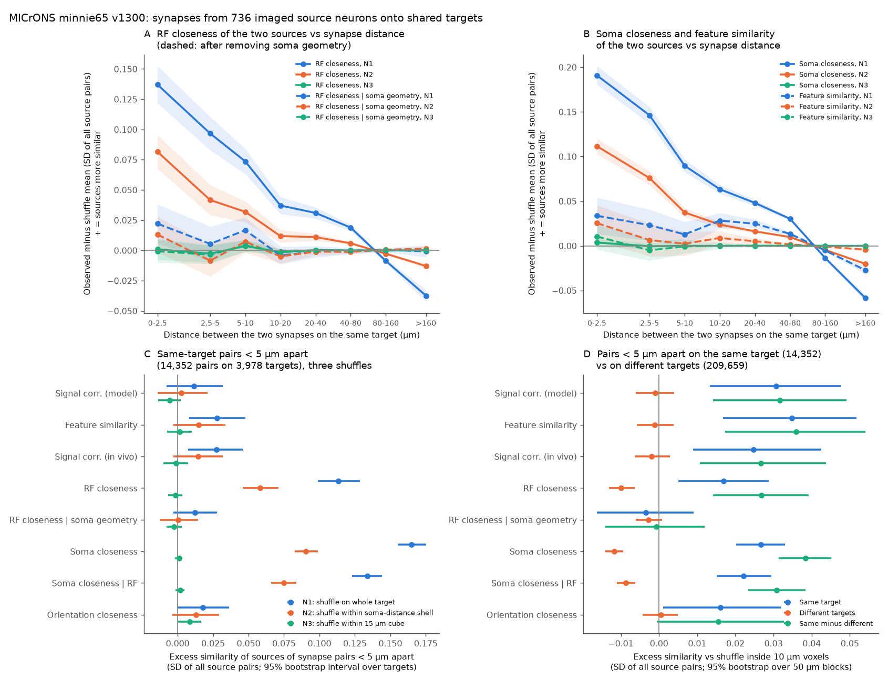
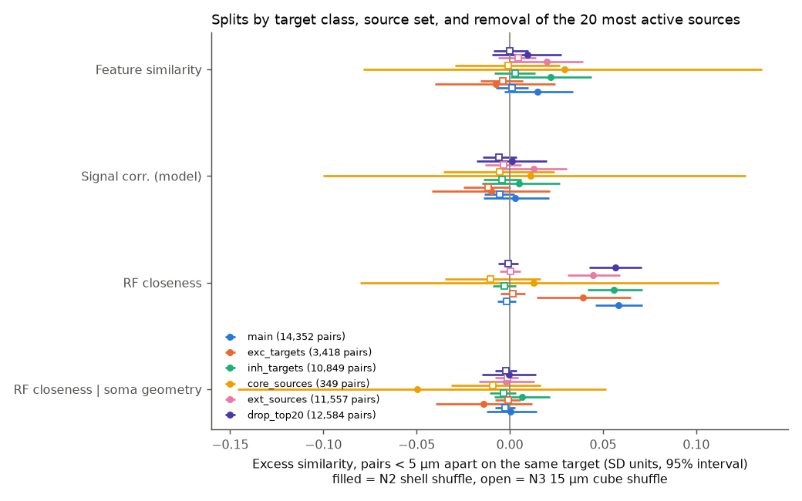

# In one MICrONS mouse, synapses less than 5 µm apart on a shared target show no extra response similarity at fine scale; coarse RF clustering follows source soma positions

## Main result

We used the MICrONS electron-microscopy volume of one mouse (minnie65, synapse release v1300). We selected 736 source neurons that have calcium-imaging responses and proofread axons. These neurons made 289,289 synapses onto 37,290 target cells that received input from at least two of the sources. We examined 14,352 pairs of synapses from two different sources that were less than 5 µm apart on the same target. We asked if the two sources of such a pair had more similar visual responses than chance.

1. **Fine scale: no clustering.** We compared each close pair with pairs on the same target in the same 15 µm cube (null N3). Close pairs did not have more similar sources for any planned measure. The 95% intervals were -0.014 to +0.002 SD for model signal correlation, -0.007 to +0.010 SD for response-feature similarity, and -0.003 to +0.007 SD for receptive-field (RF) closeness. The unit is the SD of each measure over all source pairs.
2. **Coarse scale: RF clustering that soma position explains.** When we shuffled sources over the whole target (N1) or within soma-distance shells (N2, the planned primary null), close pairs had closer RFs: +0.113 SD (N1) and +0.058 SD (N2, 95% interval 0.046 to 0.071; permutation p = 0.001). This excess fell with synapse distance and stopped at about 80 µm (Figure 1A). When we removed the part of RF distance that the soma positions of the two sources predict, the N2 excess became +0.0005 SD (interval -0.013 to +0.015). Soma closeness had a larger excess (+0.091 SD under N2) and kept most of it after we removed the part that RF distance predicts (+0.075 SD).
3. **Feature similarity: very small or zero.** Response-feature similarity, the measure that predicts connections in Ding et al. (2025), had +0.028 SD under N1, +0.015 SD under N2 (interval -0.003 to +0.034) and +0.001 SD under N3.
4. **Same target against different targets.** Close pairs on one target had more similar sources than close pairs on different targets at the same place (Figure 1D). This agrees with the known target-level input preference. The positional tests in items 1 and 2 show that this preference does not extend to where the synapses sit on the target.

These results do not support functional clustering of inputs from these neurons at the scale of a few micrometres. A geometric rule explains the coarse spatial order in these data: the axons of nearby source neurons put synapses on the same part of a target. The RF map then follows from the retinotopic map of the source somata.

**Figure 1.** (A) Excess RF closeness of the two sources of a synapse pair on one target, as a function of synapse distance. Solid lines: RF closeness. Dashed lines: RF closeness after we removed the part that soma geometry predicts. Colours: three shuffles. Bands: ±2 SD of the shuffle distribution. (B) The same for soma closeness (solid) and response-feature similarity (dashed). (C) Excess for pairs less than 5 µm apart on the same target under N1, N2 and N3, with 95% bootstrap intervals over targets. (D) Pairs less than 5 µm apart on the same target and on different targets, compared with a shuffle inside 10 µm voxels. Units are SD over all source pairs. Positive values mean more similar sources.

## Question and prior work

Spine imaging in mouse V1 found that neighbouring spines on L2/3 pyramidal dendrites often have overlapping receptive fields, but that orientation preference is not clustered [Iacaruso et al. 2017; Jia et al. 2010]. In ferret V1, co-tuned inputs cluster by orientation [Wilson et al. 2016]. Ding et al. (2025) used MICrONS and found that response features, and not RF position, predict synaptic connections beyond axon-dendrite proximity. Thus an open question was whether inputs that connect by the like-to-like rule also sit together on the target dendrite, and which similarity controls their position. Imaging cannot identify the presynaptic cell of each spine. MICrONS gives the presynaptic cell and the synapse position, with function for the source cells.

We searched the campaign record for MICrONS dendritic clustering, synapse position, shared targets and like-to-like work. We found no test of synapse position. Related campaign results examined which targets functional axons share ([sci:sha256:6b411edc01aa...](sci:sha256:6b411edc01aac6a505419424e27a32af7104f88fd17dd3987d6701c442c3f049)), higher-order input groups ([sci:sha256:100b9f6bfd76...](sci:sha256:100b9f6bfd76176b28c79e9f524e1861b687d199ffcea463ce5119694551c1e2)), shared inhibitory inputs ([sci:sha256:39d8642414d0...](sci:sha256:39d8642414d03fdf8dc98c23a06ce196b522117141a4986741a9f309fcfa3510)) and cleft size against reliability ([sci:sha256:0ebb1ccef445...](sci:sha256:0ebb1ccef4451692bc0af63585390af43a16b45aea2ca9e2d0792170d439605c)). None of them used the position of synapses on the target. This publication is the first test of that question in the campaign. It uses its own code and no derived tables from other work.

## Data

All inputs are public MICrONS data under CC BY 4.0. We used the copies in the campaign shared dataset store. Exact paths, URLs, sizes and SHA-256 hashes are in `files/inputs.json`.

- Ding et al. (2025) node table v1 (12,894 imaged neurons with responses, RF positions and readout weights).
- MICrONS v1300 `connections_with_nuclei` (root-to-nucleus map at v1300) and `synapses_pni_2_v1_filtered_view` (synapse positions; 20 GB).
- MICrONS v1507 AIBS metamodel cell types (target class and soma position) and proofreading status.

**Sources.** The core set has the 148 proofread neurons of Ding et al. The extended set has 588 more imaged neurons with a v1507 axon proofreading label whose root ID did not change after v1300. Thus their v1300 axon is the proofread axon. **Targets** are all cells with a nucleus. **Synapse position** is the post-synaptic point. Distances are Euclidean, not path lengths along the dendrite.

**Similarity of two sources.** We reproduced the Ding et al. edge values from the node table (r > 0.999): model signal correlation over the in-silico responses (S1), cosine similarity of the readout feature weights (S2) and RF-centre distance (S3, screen units scaled by 99.1 and 56.2 to approximate degrees). In-vivo signal correlation (S4) was secondary. After the first look at the data, we added these exploratory measures: S5 = RF distance minus its mean in bins of source soma lateral distance (25 µm) and depth difference (50 µm); S6 = difference in preferred orientation; S7 = lateral soma distance; S8 = S7 minus its mean in 1-degree RF-distance bins.

## Method

`files/PLAN.txt` gives the plan. We wrote it before we computed any result on synapse positions. It was not registered outside the campaign.

For each target, we took all pairs of synapses from different sources. The statistic is the mean similarity of the two sources over pairs less than 5 µm apart, minus its mean when we shuffled source labels among the target's synapses and kept the synapse positions. N1 shuffles over the whole target. N2 shuffles within strata of the target: above or below the soma in cortical depth, crossed with 30 µm shells of distance from the soma. N2 was the planned primary null. N3 (added after the first look) shuffles within 15 µm cubes on the target. Thus N3 compares pairs less than 5 µm apart with pairs on the same local part of the target. Each null had 1,000 shuffles in the main run and 300 in the splits. We report two-sided permutation p values and 95% intervals from 2,000 bootstrap resamples of targets.

For the axon co-location control, we found all close pairs (less than 5 µm) from different sources on the same target and on different targets. We compared both with a shuffle of source labels inside 10 µm voxels (500 shuffles, bootstrap over 50 µm blocks).

Splits: excitatory and inhibitory targets, core and extended sources, and removal of the 20 sources with the most synapses.

## Results

| Measure (SD units, + = more similar) | N1 whole target | N2 shells (primary) | N3 15 µm cube |
|---|---:|---:|---:|
| S1 model signal correlation | +0.011 (-0.008, +0.032) | +0.003 (-0.014, +0.021) | -0.006 (-0.014, +0.002) |
| S2 feature similarity | +0.028 (+0.008, +0.048) | +0.015 (-0.003, +0.034) | +0.001 (-0.007, +0.010) |
| S3 RF closeness | +0.113 (+0.099, +0.129) | +0.058 (+0.046, +0.071) | -0.002 (-0.007, +0.003) |
| S5 RF closeness given soma geometry | +0.012 (-0.003, +0.028) | +0.001 (-0.013, +0.015) | -0.003 (-0.008, +0.003) |
| S7 soma closeness | +0.165 (+0.155, +0.175) | +0.091 (+0.083, +0.099) | +0.001 (-0.002, +0.003) |

Main run: 14,352 close pairs on 3,978 targets. One SD equals 0.114 (S1), 0.099 (S2), 4.64 degrees (S3), 4.18 degrees (S5) and 215 µm (S7). Thus the N2 RF excess is 0.27 degrees, and the N3 interval for the RF-distance excess is -0.016 to +0.031 degrees. All values are in `files/results/summary_table.csv`. Per-run JSON files are in `files/results/`.

- In the N2 test, S2 and S4 had permutation p = 0.025 and 0.024, but their bootstrap intervals over targets included zero. The permutation test holds the targets fixed. The bootstrap also includes variation between targets. We do not claim these two effects.
- Exploratory: orientation difference (S6) was 0.24 degrees smaller than the N3 shuffle (p = 0.014; 0.009 SD). With eight measures and three nulls, we do not treat this as a finding.
- Same target against different targets, inside 10 µm voxels: S2 +0.036 SD (same minus different, interval +0.017 to +0.054). Soma closeness +0.038 SD. RF closeness given soma geometry (S5) -0.001 SD (interval -0.014 to +0.012).

**Figure 2.** Close-pair excess under N2 (filled) and N3 (open) for each split. Excitatory targets: 3,418 close pairs. Inhibitory targets: 10,849. Core sources: 349. Extended sources: 11,557. Without the 20 sources with the most synapses: 12,584. In all splits, the N3 intervals include zero for S1, S2, S3 and S5. The N2 RF excess occurs on excitatory and inhibitory targets, and S5 removes it in all splits.

## Limits

- One mouse, one EM volume, three visual areas (V1, RL, AL). We do not claim a rule across animals.
- Sources are imaged neurons with proofread axons. Most are L2/3 to L5 excitatory cells. Inputs from thalamus, unimaged cells and inhibitory cells are not in the test. Iacaruso et al. measured all spine inputs, so the two tests use different input populations.
- 76% of the close pairs are on inhibitory targets. On excitatory targets, we did not separate spine and shaft synapses or apical and basal dendrites beyond the N2 strata. The excitatory-target sample (3,418 close pairs) is smaller.
- Distances are Euclidean. Two synapses less than 5 µm apart can be on different branches of the same cell. This mixing reduces sensitivity to clustering along a branch. A test with skeleton path distance is still necessary.
- N3 removes all structure above about 15 µm. A clustering that extends evenly over 5 to 20 µm would partly fall into the N3 shuffle. The N2 test with S5 has no such limit, and it also found no residual RF effect.
- Responses come from calcium imaging and a model (digital twin). Measurement noise in the similarity measures reduces sensitivity. The intervals above include this noise but do not correct for it.
- Target dendrites are mostly not proofread. Merge errors can join two cells and add false pairs.
- S5 to S8 and N3 were added after the first look. The planned primary analysis (N2 with S1 to S3) is reported in full.
- The S3 scale to degrees is an approximation fitted to the Ding edge values (r = 0.9985).

## Open questions for the next study

- Use skeleton path distance along the dendrite and split by branch, spine and shaft.
- Repeat with the Allen V1DD volume or another EM volume with function (a second animal).
- Test whether inputs from other sources (thalamic axons, or cells with RFs measured by sparse noise) cluster when imaged cortical inputs do not.
- Test whether the coarse soma-geometry order changes the dendritic integration of targets in a model.

## Provenance and reproduction

Job: sci-1107-hp-neural-structure-and-computation-b2df59dacbec. Topic: neural-structure-and-computation. Campaign: 11_07_2026. Machine: hp. Account: claude-myxtap. Model: Claude Opus 5.5 (claude-opus-5-5). The signing key is a campaign-machine key. It is not a personal authorship claim.

We used the shared datasets in place, under `./datasets/` (compatibility path `/mnt/dell-data/shared_datasets/`). We did not change any dataset. `files/REPRODUCE.txt` gives the steps. `files/code/retrieve.sh` downloads and checks the inputs. `files/code/extract.sh` writes the record-level working tables to a separate scratch folder (expected hashes in `files/inputs.json`). `files/code/analyze.py` runs the tests, and `files/code/figures.py` makes the table and figures. Seed 20261112. Software versions are in `files/environment.json`.

During the work, we found and corrected one error. The first extraction converted 18-digit root IDs to floating point and matched almost no synapses. The corrected scripts keep IDs as text. Only results from the corrected extraction are reported.

The bundle has no MICrONS record-level data. `files/EXTERNAL_NOTICE.txt` gives the external sources, their CC BY 4.0 terms, the attribution and the changes that we made. The SCI baseline LICENSE applies to the new code, text, figures and aggregate results of this publication.

## References

- MICrONS Consortium (2025). Functional connectomics spanning multiple areas of mouse visual cortex. Nature 640, 435-447. doi:10.1038/s41586-025-08790-w
- Ding Z. et al. (2025). Functional connectomics reveals general wiring rule in mouse visual cortex. Nature 640, 459-469. doi:10.1038/s41586-025-08840-3
- Iacaruso M.F., Gasler I.T., Hofer S.B. (2017). Synaptic organization of visual space in primary visual cortex. Nature 547, 449-452. doi:10.1038/nature23019
- Jia H. et al. (2010). Dendritic organization of sensory input to cortical neurons in vivo. Nature 464, 1307-1312. doi:10.1038/nature08947
- Wilson D.E. et al. (2016). Orientation selectivity and the functional clustering of synaptic inputs in primary visual cortex. Nature Neuroscience 19, 1003-1009. doi:10.1038/nn.4323
