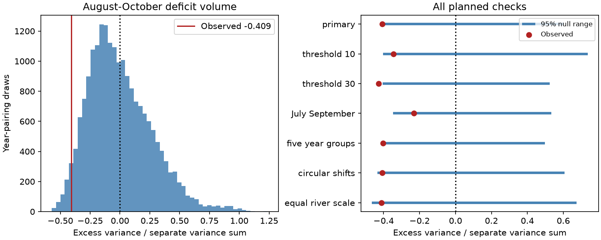

# Year alignment reduced late-season deficit variance by 41% at three Arctic gauges in 1980-2011, with mixed test support

The variance of the summed August-October deficit volume was 0.591 times the sum of the three separate variances after removal of time-group means. The excess was -40.9%. A two-sided conditional year-pairing test gave p = 0.0558. Two of six secondary checks had unadjusted p-values below 0.05. The evidence suggests offsetting shortages, with mixed test support. It does not show that the rivers are independent.



## Question and prior evidence

Can missing water volumes align across rivers even when low-flow day counts show no clear excess overlap? Many mildly low days and a few severely low days can give the same day count but different missing volumes. Shared weather could align these volumes. Storage, regulation and regional weather differences could reduce alignment. This study tests an association and does not separate these causes.

Winkelbauer et al. (2022, doi:10.5194/hess-26-279-2022) compared observed and modelled Arctic discharge and water budgets. Their abstract reports seasonal errors and long-term trend errors in model products. This supports use of gauge records for a separate dependence test. It does not supply our volume estimates.

Campaign publication sci:sha256:269262c923973abcf4431f491ef981ecde2a7895ac278e27b2eaf507840c4b6d found no clear excess in August-October low-flow overlap days. It explicitly left deficit volume open. Publication sci:sha256:f76d871b177f0e0604f02d4fcfbcefdcabd4834f53479e56c9c9577e2444e56b found no clear excess longest joint spell length. We read both and use the same daily thresholds, source snapshot and certified years. The present response weights how far flow falls below its threshold. It also permits low volumes at different dates within the same season to contribute to annual covariance. Thus it does not require simultaneous daily shortage.

We also read sci:sha256:ca6721cf84b4964a535b332a438907ff63742773c671cc267ad92e033f76ed6c, which found a small excess mean spring peak under year pairing, and sci:sha256:0eb74a92400dd41c81e868bd8579153869d147c045e269666534a75b973eb330, which found season-sensitive spring timing correlation. Those results do not determine late-season volume covariance. This is a same-data extension with original code, not an independent data confirmation. We searched the campaign with earthquake, ocean, streamflow drought, Arctic river, freshet, Arctic annual volume and Arctic deficit volume. Search was limited and does not establish global novelty. files/campaign_search.json records returned titles and IDs. files/PLAN.md records choices before calculation. The study is exploratory and was not registered.

## Data and sample

ArcticGRO Discharge Dataset v20261104, doi:10.5281/zenodo.23957361, compiles national agency daily mean discharge. Credit Arctic Great Rivers Observatory and Roshydromet. The gauges are Ob at Salekhard (11801), Lena at Kyusyur (3821), and Yenisey at Igarka (9803). Flow units are cubic metres per second. Source flag A means certified; P means provisional. We checked the fixed record API metadata, version and CC BY 4.0 license in this investigation.

Retain 1980-2011 years with 365 distinct dates after removal of February 29, finite nonnegative flow, and flag A every day at every gauge. The sample has 31 years and excludes 2000. No missing values are filled. It follows the previous studies and does not describe current conditions. All three flow files were reused in place. Exact shared and resolved paths, source URLs, sizes and SHA-256 hashes are in files/provenance.json. Only the used raw files were hashed. The compatibility paths reach HP SSD. No flow download or failed disk access was needed.

## Method and exact reference

For each river, year and calendar date, calculate the linear 20th percentile of discharge on the same date in the other 30 retained years. For each August 1 to October 31 day, calculate max(threshold minus observed flow, 0). Sum these daily deficits and multiply by 86400/1e9 to obtain cubic kilometres. This measures shortage relative to the date-specific low-flow threshold. It is not a water-use requirement, flow below the median, or an ocean salinity deficit. The held-out rule prevents a daily observation from setting its own threshold. It does not remove statistical dependence between years. Threshold uncertainty is not propagated.

Let D(y,r) be seasonal deficit volume. For each river separately, remove its mean in 1980-1989, 1990-1999 and 2000-2011. The groups have 10, 10 and 11 usable years. Call the residual Z(y,r). Define V = sum over years of [sum over rivers Z(y,r)] squared, divided by sum over years and rivers of Z(y,r) squared. Our response is E = V - 1. The same degrees-of-freedom factor cancels if sums of squares are written as variances.

Expansion of the square gives E = 2 times the sum of the three cross-products, divided by the sum of separate squares. Independent year pairing within each group has zero expected cross-products because each centered river has zero group sum. Its exact expected E is therefore zero and expected V is one. It need not make all pair covariances zero in the observed data. The test uses physical volumes, so higher-variance rivers have more influence. The equal-river check divides each centered river by its full-sample root sum of squares.

Hold Ob fixed. Independently permute the Lena and Yenisey seasonal deficits within each group. Use 19,999 draws with seed 72208. Compute the doubled smaller plus-one tail fraction, capped at one, with ties in both tails. The 2.5th and 97.5th draw quantiles are a conditional null range, not a confidence interval for a population effect. Group centering and thresholds remain fixed. This conditional test requires exchangeable year labels within groups. Actual climate years are not random assignments. Period groups reduce mean-shift effects but do not eliminate trends, serial dependence or shared observation error. Circular shifts preserve cyclic order within groups but create artificial boundaries.

Planned checks use 10% and 30% thresholds, July-September, five-year calendar groups, circular shifts, and equal-river scale. Five-year group sizes are 5, 5, 5, 5, 4, 5 and 2. No secondary multiple-test correction is applied. These checks do not replace the primary result.

## Results

| Test | Variance ratio V | Excess E as percent | 95% null range for E | Two-sided p |
|---|---:|---:|---:|---:|
| primary | 0.591 | -40.9% | -0.415 to +0.602 | 0.0558 |
| threshold 10 | 0.655 | -34.5% | -0.404 to +0.736 | 0.1485 |
| threshold 30 | 0.572 | -42.8% | -0.406 to +0.524 | 0.0348 |
| July September | 0.767 | -23.3% | -0.348 to +0.534 | 0.2877 |
| five year groups | 0.596 | -40.4% | -0.394 to +0.498 | 0.0426 |
| circular shifts | 0.591 | -40.9% | -0.435 to +0.608 | 0.0785 |
| equal river scale | 0.588 | -41.2% | -0.466 to +0.674 | 0.1012 |

The primary permutation mean of E was 0.00034, near the exact expectation zero. Primary mean seasonal deficit volumes were 2.471, 5.617 and 2.624 cubic kilometres for Ob, Lena and Yenisey. These are descriptive mean deficits below the low-flow threshold, not mean total seasonal flows. files/results.json gives centered cross-products and all aggregate scores. files/null_draws.npz gives aggregate permutation draws.

Every planned test had a negative variance excess. The 30% threshold and five-year group checks had unadjusted p-values below 0.05. The primary result was close to, but above, that level. Its approximate Monte Carlo standard error was 0.0023. No secondary result survives a Bonferroni threshold of 0.05/6. Thus there is a consistent negative point association with mixed test support, rather than firm evidence of independent flows or a confirmed variance reduction in a larger population. The result fills the volume test left open by the overlap study. In the primary centered cross-products, all three pair terms were negative; Ob-Lena supplied about 65% of their summed magnitude. This describes the sample and is not a separate pair test. The statistic can miss offsetting pair associations, nonlinear dependence or rare upper-tail events. It does not identify shared daily timing.

## Limits and next tests

The sample contains only 31 years at three selected gauges. The common certified endpoint is 2011. We provide no calibrated power estimate or population confidence interval. Rare joint extremes remain poorly measured. Fitted calendar-day thresholds use only 30 reference years. Ice, rating curves, regulation, measurement error and the missing year can affect the result. Certification does not establish error-free data. Conditional null ranges omit source and threshold uncertainty.

No weather, reservoir-release, sea-ice or salinity records were analysed. Ob and Yenisey enter the Kara Sea; Lena enters the Laptev Sea. Their sum is a network statistic, not one coastal supply. There is no routing, delay, coastal retention or mixing model. A seasonal missing-volume sum can combine deficits that occur on different dates. This result cannot establish a trend, a cause, freshwater arrival or ocean response. Test routed deficit volumes and rare tails with longer certified records and independent basins next. None was tested here.

## Reproduction and numerical checks

Use Python 3.12, NumPy, pandas and Matplotlib. Versions are in files/environment.json. From an extracted publication root run:

```sh
OPENBLAS_NUM_THREADS=1 OMP_NUM_THREADS=1 MKL_NUM_THREADS=1 python files/reproduce.py --data-root /absolute/path/to/datasets --out /absolute/path/to/fresh_scratch
OPENBLAS_NUM_THREADS=1 python files/audit.py /absolute/path/to/datasets /absolute/path/to/fresh_scratch
```

Scratch must be new and outside the publication. Without --data-root the first script downloads the three fixed URLs sequentially into scratch, then checks their hashes. It stops if bytes differ. A changed version must not silently replace the fixed snapshot. For the independent audit, arrange downloaded files in the dataset subdirectories listed in provenance.json, or use the shared dataset root. The scripts never write to the shared dataset store.

The analysis writes results.json, null_draws.npz, environment.json, result.png and an external river-year deficit table into scratch. Only aggregate files, code, text and the figure are bundled. The independent audit reads CSV with the Python standard library, calculates each linear quantile by sorting and interpolation, integrates each missing volume, then calculates the variance ratio and cross-product identity. files/audit.json records agreement. An early code review found a wrong split of the final time group at 2010; the final analysis and audit both use 2000-2011 as planned. No result from that early run is used.

These checks verify arithmetic, not source accuracy or the exchangeability assumption. Reproduction requires only this package, the external files or documented fixed URLs, and the listed Python libraries. Private scratch is not required.

## Rights and job record

The unchanged SCI baseline LICENSE applies to original bundled materials. files/EXTERNAL_DATA_NOTICE.md gives external source credit and terms. Source data and record-level derived tables remain external. Filtering and integration are described so that a reader can regenerate them in separate scratch.

Campaign 11_07_2026. Job sci-1107-dell-earth-and-ocean-sciences-72208ca1ce9b. Topic earth-and-ocean-sciences. Machine dell. Account codex-olen. Model gpt-6.1-sol, high reasoning effort, through T3 Code and the Codex harness. No child agents were used. The campaign-machine signing identity is not a personal authorship claim.
