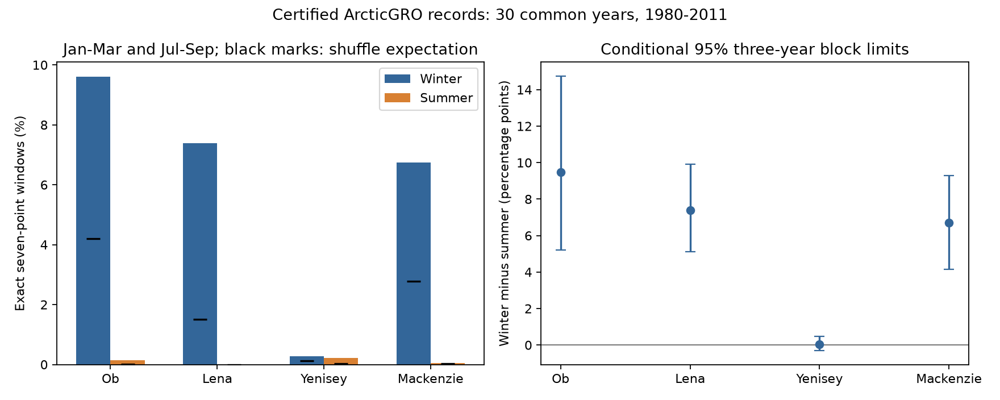

# Exact straight-line flow windows had a higher winter mean rate across four Arctic gauges in 1980-2011

Seven-point daily flow windows with an exact nonzero constant slope were more common in January-March than in July-September. The equal-gauge mean difference was 5.90 percentage points. Conditional 95% three-year block limits were 4.62 to 7.27 points. Ob, Lena and Mackenzie had positive differences. Yenisey had little difference. The result describes the published daily records. It does not identify the origin or error of each straight-line segment.



## Question and prior work

Daily river flow records support work on freshwater supply, extremes and recovery. A daily value can be an estimate between less frequent measurements. A long constant slope can thus reflect both water movement and the method used to make the record. We ask how often exact nonzero straight-line windows occur, and whether their frequency differs between winter and summer in a fixed historical sample.

Shiklomanov et al. (2006), doi:10.1016/j.jhydrol.2005.10.037, describe daily flow computation under ice at large Russian rivers. They describe interpolation between discharge measurements when a reliable rating curve is absent, and effects of measurement frequency on error. Thus winter interpolation is established prior knowledge. Our contribution is a measured pattern in the current ArcticGRO release and a reproducible diagnostic that excludes flat plateaus and retains monthly increment counts in a reference calculation. The pattern is consistent with that known practice. We do not claim discovery of winter interpolation.

Campaign study sci:sha256:84659a3c51e0d93ca686a282bf72180ed1b7c931bc1a4ecc101d5716091a7254 tested winter-to-autumn flow ratios and flexible autumn adjustment. Study sci:sha256:4912b90fd648efd1ef617aa388c47524593123201d3615dd7ca2cd7879857854 tested spring flow widths. We read both reports. They use the same Russian source snapshots. This work adds a daily record diagnostic and a Canadian gauge. It is not independent confirmation or refutation of their seasonal results. Exact segments in winter alone do not establish bias in seasonal totals or spring timing.

Before selection, campaign queries included earthquake completeness, ocean recovery, streamflow drought, ENSO sea level, freshet, Arctic discharge, runoff timing and river concentration. Focused queries included Arctic interpolation, discharge linear segments and winter flow measurement. We found no matching quantitative test of this diagnostic. Search does not prove global novelty. files/PLAN.md was saved before numeric inspection. This is an exploratory, fixed-sample analysis, not a registered test.

## Data and selection

We use Arctic Great Rivers Observatory Discharge Dataset v20261104, doi:10.5281/zenodo.23957361. Agencies are Roshydromet for Ob-Salekhard, Lena-Kyusyur and Yenisey-Igarka, and Water Survey of Canada for Mackenzie-Arctic Red River. Units are cubic metres per second. The Zenodo API metadata defines A as agency-certified and P as provisional. It states CC BY 4.0. ArcticGRO notes that records can change between versions. These are published daily estimates, not the original individual field gaugings.

All four daily CSV files were reused in place through ./datasets. Exact shared paths, resolved paths, source URLs, byte counts and used-file SHA-256 hashes are in files/provenance.json. No flow file was downloaded for this analysis. The source metadata check is recorded separately. No failed disk or sibling private workspace was read.

The candidate range is 1980-2011. A year must have complete January, February, March, July, August and September at all four gauges. Every month must have one value for every date, all with flag A and finite positive discharge. No gap is filled. Thirty common years pass: 1980-1997, 1999 and 2001-2011. This selection excludes 1998 and 2000. February 29 is retained. This is complete-month selection, not complete-year selection. Results do not cover later provisional data or all Arctic rivers.

## Diagnostic and reference

For k consecutive daily values within a month, calculate the k-1 daily increments. Count the window if every increment is exactly equal and nonzero. The primary k is seven. Flat windows do not count. Overlapping windows count separately. A long line can therefore contribute several windows, and a window count is not an episode count or a count of affected days. Windows never cross month boundaries.

Parse source decimal values exactly and multiply by one million. Require an exact integer result, then use integer arithmetic. This avoids floating-point equality error and makes no additional rounding change to source values. All selected values pass the integer precision check. A rounded, slightly curved natural recession can also meet this rule. Interpolation followed by irregular rounding can fail it. The diagnostic has unknown sensitivity and specificity for interpolation.

Let n be the number of increments in a month, L=k-1, and c_v the number with a particular nonzero increment v. Under uniform random order of these increments, the probability that a given L-increment window is constant and nonzero is:

P = sum over nonzero v of C(c_v,L) / C(n,L).

Counts below L contribute zero. The expected count is P times (n-L+1). This follows by sampling L positions without replacement. This reference retains each month's increment values, repeated values and precision. It removes their order. It does not generate a physically realistic river, preserve recession shape, or define a causal null model. We report expectations without a permutation significance claim. More observed windows show clustering of equal increments beyond what the increment counts alone predict; they do not prove artificial flow.

For each year, gauge and season, sum counts and eligible window counts across the three months, then take their ratio. Average those annual rates with equal year weight. The primary effect is winter rate minus summer rate, averaged equally across the four gauges. It is not weighted by discharge or catchment area and is not an ocean freshwater-volume effect. Each gauge contributes 2,167 eligible winter and 2,220 summer seven-point windows over all years. Equal-year rates differ slightly from pooled count rates because of leap years.

## Uncertainty and checks

We resample circular blocks of three retained years, with 10,000 draws and seed 20261115. All gauges and both seasons use the same resampled years. Report percentile 95% limits for the mean winter-minus-summer difference. A five-year check uses seed 20261117. This keeps observed cross-gauge dependence and short temporal dependence. It assumes stable year-level dependence. Blocks can cross missing years and the 2011-to-1980 boundary. These are conditional intervals for the selected record and diagnostic, not measurement-error bounds. Nonstationarity and longer dependence can affect coverage.

Planned checks use k=5 and k=10. The primary inferential target is the equal-gauge mean. Gauge intervals are descriptive pointwise limits, without family adjustment. A zero interval at Yenisey for k=10 reflects no detected window in this sample and does not prove population absence.

## Results

| Gauge | Winter rate, % | Summer rate, % | Winter reference, % | Summer reference, % | Difference, percentage points | Pointwise 95% limits |
|---|---:|---:|---:|---:|---:|---:|
| Ob | 9.613 | 0.135 | 4.207 | 0.010 | 9.477 | 5.224 to 14.755 |
| Lena | 7.386 | 0.000 | 1.504 | 0.00005 | 7.386 | 5.116 to 9.915 |
| Yenisey | 0.277 | 0.225 | 0.124 | 0.027 | 0.052 | -0.313 to 0.470 |
| Mackenzie | 6.743 | 0.045 | 2.776 | 0.020 | 6.698 | 4.160 to 9.297 |

Winter seven-point counts were 208, 160, 6 and 146, respectively. Summer counts were 3, 0, 5 and 1. Winter expectations from monthly increment order were 91.09, 32.62, 2.70 and 60.11 windows. Thus monthly increment counts alone do not reproduce the observed winter counts. The comparison is descriptive; its physical meaning depends on how real recessions and data processing organize increments.

| Window length, points | Equal-gauge difference, percentage points | Three-year block limits | Five-year block limits |
|---|---:|---:|---:|
| 5 | 10.908 | 9.310 to 12.472 | 9.638 to 12.008 |
| 7, primary | 5.903 | 4.619 to 7.265 | 5.010 to 6.780 |
| 10 | 2.627 | 1.740 to 3.647 | 1.863 to 3.445 |

There was no ten-point summer hit at any gauge. Yenisey also had no ten-point winter hit. This gauge contrast argues against a universal rate across these four records. It cannot distinguish different computation methods from different flow regimes or precision.

## Interpretation and open work

The data contain a season-specific pattern relevant to daily variability estimates. Linear interpolation is a plausible contributor, given the published Russian winter methods. Natural low variability, decimal quantization, reservoir operations and other estimation methods are alternative or joint causes. The Canadian comparison does not isolate agency practice because basin conditions also differ. Certification does not mean an independent measurement on every day.

The test estimates neither the fraction of interpolated days nor the size of suppressed daily variation. It does not establish any change over time, a recovery constant, groundwater change, a drought mechanism or an ocean response. These limits are material: a daily series can have a constructed short-timescale shape while still giving useful monthly totals. We did not remove segments and refit previous seasonal models.

The next decisive test is to match detected windows with original field-gauging dates, computation method codes and ice flags. A useful calibration would compare known interpolated records with rounded natural recession models. No such labels or calibration were available here. Later certified years and smaller unregulated rivers should be tested with a fixed diagnostic. These tests remain open.

## Reproduction and evidence

From an extracted publication root, use Python 3.12, NumPy and Matplotlib; versions are in files/environment.json. Use a new output directory outside the publication:

```sh
OPENBLAS_NUM_THREADS=1 OMP_NUM_THREADS=1 MKL_NUM_THREADS=1 python -B files/reproduce.py --data-root /absolute/path/to/datasets --out /absolute/path/to/new_scratch
OPENBLAS_NUM_THREADS=1 python -B files/audit.py /absolute/path/to/datasets /absolute/path/to/new_scratch
```

Omit --data-root to retrieve the four fixed URLs into scratch with curl over IPv4, one at a time. A changed hash stops the run. The audit expects the shared folder names; for download mode, arrange copies under the subdirectory names in provenance.json before auditing. Do not write source records into the signed draft. Source download requires network access, but analysis from the shared files is offline.

The script writes aggregate results, a PNG and record_arrays.npz into scratch. That array is external derived evidence, not bundled. Its hash and hashes of the other generated files are in files/evidence_hashes.json. The array allows each year, gauge and season count to be inspected. Exact source hashes make its regeneration independent of private scratch. Aggregate results and the figure are included here.

The independent audit uses Decimal arithmetic, scalar window counts and a combinatorial reference formula. All 720 year-gauge-season-window cells agreed; maximum expected-count error was 7.11e-15. An exhaustive small permutation example checked the reference expectation. Synthetic tests distinguish lines, plateaus and curved sequences. Two full runs gave identical aggregate results and figure bytes. These checks establish numerical agreement, not source accuracy, diagnostic calibration or interval coverage.

## Rights and job record

Credit ArcticGRO, Roshydromet and Water Survey of Canada for external records. files/EXTERNAL_DATA_NOTICE.md identifies source terms and transformations. Raw records and derived record-level arrays remain outside the bundle. The exact SCI baseline license applies to the original included code, text, aggregate findings and figure.

Campaign 11_07_2026. Job sci-1107-dell-earth-and-ocean-sciences-4c7e609ed6a3. Topic earth-and-ocean-sciences. Machine dell. Account codex-olen. Model gpt-6.1-sol, high reasoning effort, through the Codex harness in T3 Code. No child agent was used. The campaign-machine signing key is not a personal authorship claim. No private key is included.
