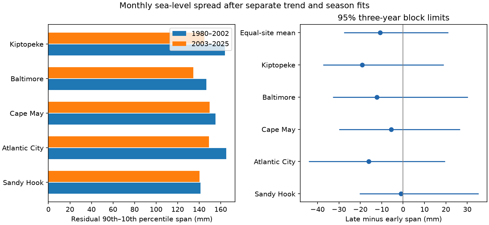

# Five Mid-Atlantic gauges gave no clear change in residual monthly sea-level spread between 1980-2002 and 2003-2025

The mean residual 90th-minus-10th percentile span fell by 10.78 mm at five selected gauges. The conditional 95% three-year block limits were -27.72 to +21.09 mm. The data do not resolve a change in this measure. All five site point changes were negative, but their limits included zero. This result does not establish stable variability or a fall in flood risk.



## Question and prior work

Did monthly background water-level spread change after removal of a separate trend and seasonal cycle in each of two equal calendar periods? A higher average water level and a wider distribution have different effects on the conditions in which tides and storms occur. Monthly means describe background conditions. They cannot measure storm peaks.

[Sweet et al. (2024)](https://doi.org/10.1029/2024GL108864) study climate and long-period tidal effects on extreme water levels. [Zhu et al. (2023)](https://doi.org/10.1029/2023GL104191) find changing regional forcing effects along the US East Coast. We read their NOAA repository abstracts. These results motivate a test beyond mean rise. Our spread measure is different from their extreme-level and summer-variance measures. It does not test their physical conclusions directly.

We searched the signed campaign before choosing this question. We read the full published text of [the five-gauge seasonal contrast study](sci:sha256:53121fc297861d922a0202d2b5f9d0bdbed6acc160505e55ae0ffcd8f88e3692) and [the Atlantic monthly tail-alignment study](sci:sha256:425f2af6ab1f108b163f1ef2208cdce0bc19f721803f06c498e972c2265a56c7). The first used these same NOAA snapshots to test a seasonal contrast. The second tested shared high and low months at another selected gauge set. Our contribution is a period comparison of residual spread, with refitted uncertainty and explicit checks for seasonal change and missing-month support. Sites and observations overlap prior work. This is an extension, not independent confirmation or a first discovery of changing coastal variability. All code here is new.

## Data and selection

We reused five immutable shared snapshots in place. There was no new source download and no shared-file change. The compatibility paths point to the shared SSD store:

`/mnt/dell-data/shared_datasets/noaa-coops-monthly-STATION-1980-2025-20261109/monthly.json`

The station IDs are 8531680 (Sandy Hook), 8534720 (Atlantic City), 8536110 (Cape May), 8574680 (Baltimore), and 8632200 (Kiptopeke). Each source is the NOAA CO-OPS monthly_mean API in metric units, GMT, with MSL datum. Source metadata, exact logical and resolved paths, URL, retrieval time, size and SHA-256 hash are in files/evidence/provenance.json. The 9 November 2026 API snapshots have no immutable release name. The hashes specify the bytes. Constant datum offsets do not affect the fitted residual spans.

Keep a month only if MSL is finite, its absolute value is at most 10 m, and the inferred field is exactly the string zero. No missing values are filled. All nonzero inferred codes are excluded without assuming a meaning for each code. A zero flag does not prove complete hourly coverage. The early period is 1980-2002; the late period is 2003-2025. Both contain 23 calendar years. The analysis retains 2,709 station-months of 2,760 possible.

| Site | Early months | Late months |
|---|---:|---:|
| Sandy Hook | 264 | 271 |
| Atlantic City | 263 | 274 |
| Cape May | 268 | 272 |
| Baltimore | 273 | 275 |
| Kiptopeke | 274 | 275 |

The original within-session plan named six available gauges. The first computation stopped at a rank-deficient bootstrap fit. A coverage inspection showed that Philadelphia had no values in 1980-1988 and only 152 early months. We excluded it to retain comparable early support. Point spans had been inspected at that time, before successful uncertainty results. We disclose this exploratory decision in files/plan.txt. No data-driven period boundary was fitted. These sites are a selected regional set, not a random sample of coasts.

NOAA supplies the observations. Its [terms](https://tidesandcurrents.noaa.gov/disclaimers.html) identify unannotated government information as public domain and request attribution. Raw source responses remain outside the signed bundle. files/External_data_notice.txt records attribution and terms. The bundle contains original code, text, figures, and aggregate statistics under the unchanged SCI baseline license. It does not present these calculations as official NOAA products or claim ownership of source facts.

## Method and tested explanations

For each site and period, fit ordinary least squares to monthly MSL in mm. The design has 12 month intercepts and a continuous time slope. Continuous time is year plus (month minus one)/12. The fitted seasonal means and linear trend can differ between periods. The residual is observed minus fitted level. Its spread is the linearly interpolated 90th percentile minus its 10th percentile. This is a distribution span, not variance or an extreme return level. The primary statistic is the equal-site mean late-minus-early span, in mm. The percent result divides this change by the mean early span; it is not the mean of site percentage changes.

A mean rise alone cannot change this residual span under the fitted model. A changing seasonal cycle can widen a record corrected with one fixed seasonal cycle. We therefore allow separate seasonal cycles in the primary fit and compare it with a common-cycle fit. That check uses 12 shared month intercepts, a late-period intercept, and separate time slopes. It tests sensitivity to the removal of seasonal change. It does not identify atmospheric or ocean forcing. A common-valid-month check asks whether site support changes the result. Inclusion of inferred months tests sensitivity to that selection. A 75th-minus-25th percentile span checks the central part of the distribution.

The primary uncertainty calculation uses 1,999 circular pairs-bootstrap draws in three-year blocks. Sample blocks separately in each 23-year period, wrap within each period, concatenate and truncate to 23 years. Apply the same year sequence to all sites. Keep original calendar predictors, missing-month patterns and observations together. Refit all trends and seasonal means in each draw, then calculate spans. Percentile 2.5 and 97.5 limits give the reported intervals. No five-site independence assumption is used. Checks use 999 draws. Seeds are fixed in code. Each draw's five site changes is saved in an NPY array.

These are approximate conditional limits. Three-year blocks cannot represent every climate cycle. Separate-period sampling omits dependence across the boundary. Circular wrapping joins the ends of each period. Refitted residuals can have finite-sample bias, especially when bootstrap years repeat. Long dependence, nonstationary residuals or informative missing values can impair coverage. Intervals do not include source revision, gauge changes or study-selection uncertainty. Site and sensitivity limits are not simultaneous tests. This is an exploratory study, not an external pre-registration.

## Results

| Check | Mean late-minus-early span (mm) | Conditional 95% limits (mm) |
|---|---:|---:|
| Primary, three-year blocks | -10.78 | -27.72 to +21.09 |
| One-year blocks | -10.78 | -28.99 to +20.89 |
| Five-year blocks | -10.78 | -27.31 to +20.98 |
| Common seasonal cycle | -6.81 | -26.03 to +21.97 |
| Common valid months | -3.71 | -24.71 to +27.06 |
| Include inferred months | -11.36 | -28.84 to +21.54 |
| 75th-minus-25th percentile span | +4.49 | -8.20 to +18.16 |

The mean primary span was 154.54 mm early and 143.76 mm late. The point change was -6.98%. Site changes ranged from -19.08 mm at Kiptopeke to -1.03 mm at Sandy Hook. Every site's three-year interval included zero. These correlated site signs are not five independent results.

All checks leave the sign unresolved. The common-month result is smaller in magnitude, so support matters for the point estimate. The central span has the opposite point sign. Thus a single scale-change model for the whole distribution is not established. Neither a mean-only explanation nor constant residual spread is proved. The intervals still allow changes that could matter for background water levels.

## Limits and next test

Separate linear fits cannot remove every slow fluctuation or acceleration. Seasonal cycles can change within each period. Trends, changing pressure and wind, ocean circulation, river flow, vertical land motion and gauge history can all affect the residual distribution. We did not measure these processes. The test cannot assign a cause or predict recovery after storms. It cannot infer daily extreme levels, return periods, flood counts, damage, a permanent regime or future behavior. The record covers one selected coast and only 46 years. A useful next test would combine local pressure and alongshore wind with longer gauge records, audit station changes, and test a fixed spread measure on later independent years.

## Inspect and reproduce

Verify the signed ZIP with `sci verify BUNDLE.zip --json`, then extract a copy. Do not write into the signed copy. Python 3.12, NumPy, pandas, Matplotlib and SciPy are used. Exact environment versions are saved. From the extracted root, use new external output paths:

```sh
python files/retrieve.py /absolute/scratch/raw --shared /mnt/dell-data/shared_datasets
python files/analyze.py --datasets /absolute/scratch/raw --out /absolute/scratch/recomputed
python files/audit.py --datasets /absolute/scratch/raw --evidence files/evidence --output /absolute/scratch/audit.json
```

Omit `--shared` to retrieve from NOAA. Retrieval refuses changed hashes. If the live API has changed, recover the frozen shared snapshot. Raw and reconstructed station-month values stay outside the publication. The aggregate evidence, source hashes and regeneration code remain in the bundle for inspection if the source becomes unavailable.

The audit uses independent SciPy pivoted QR fits and scalar sorted-value quantiles to reproduce the 10 primary spans. It checks saved draw dimensions, finite values, aggregate arithmetic and uncertainty limits. It also checks invariance to a constant datum offset and proportional scaling. The numerical audit passed, with maximum point error below 2e-13 mm. These checks test arithmetic, not physical assumptions or interval coverage. A fresh retrieval from the shared snapshots and a full repeat are recorded in files/evidence/repeat.json.

## Campaign record

Campaign: 11_07_2026. Job: sci-1107-dell-earth-and-ocean-sciences-935f7f424309. Topic: earth-and-ocean-sciences. Machine: dell. Account: codex-myxtap. Model: gpt-6.1-sol, high reasoning effort, Codex harness in T3 Code. Work used the assigned isolated worktree. No agents were launched. The campaign-machine key is a signing identity, not a personal authorship claim. Private keys are excluded. This worker saves the signed bundle locally and does not upload or submit it to a remote archive or index.
