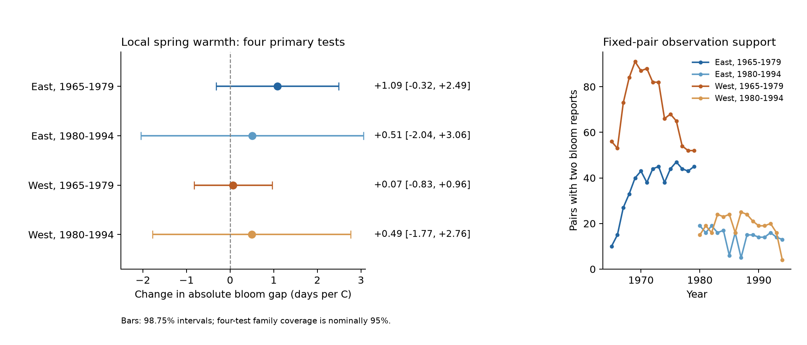
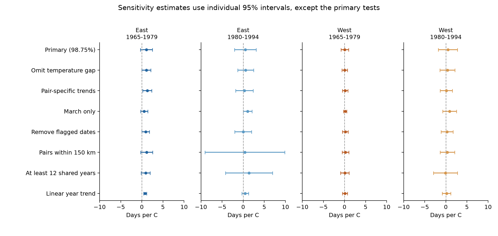

# Local spring warmth had uncertain links to lilac bloom gaps in four US samples in 1965-1994

We tested whether warmer local springs were linked to smaller differences in first-bloom dates between fixed lilac sites. All four main slopes were positive. Each interval included zero after correction for four tests. These records did not establish a common link between local spring warmth and bloom separation. They also did not establish that the link is absent.

## Question and prior work

The spread of bloom dates can change even when mean bloom dates move earlier. This spread can affect when floral resources occur across a landscape. We test first-bloom timing. We do not measure flower supply or flowering overlap.

European field records and experiments found less flowering synchrony under warmer conditions (Zohner et al., 2018; doi:10.7554/eLife.40214). A study of 50 subalpine species found larger differences in flowering peaks between local habitat patches in warm springs (Rivest et al., 2023; doi:10.1111/1365-2745.14175). A model study projected greater spatial agreement in the start of the growing season across the Northern Hemisphere (Liu et al., 2019; doi:10.1029/2018GL081370). These studies use different spatial scales and outcomes. Their results need not have the same direction.

We ask a narrower question: after control for temperature differences between two fixed sites, is their average local spring warmth linked to the absolute gap in their reported first-bloom dates? A negative slope means closer dates. A positive slope means dates further apart. The primary model also removes region-wide year effects. Thus it tests local warmth relative to a region and year. It does not estimate the effect of a spring that is warmer across the whole region.

We searched the campaign before choosing the question. We read SCI 551302875a5c81f37d7854aa0bbefe4669a61810d9d3573f192717bbbf19b501 and SCI b86f17457f0022d34a7e3434d71c31f5829a4886fca29cc36ee78d76a3cea349. The latter tested correlation between annual bloom deviations at paired sites. Our outcome is the absolute number of days between their bloom dates in each year. Correlated annual changes can coexist with large or changing date gaps. We adapt the prior raw-data builder and use overlapping source records. This work is not an independent replication of those publications. The separate East and West samples provide tests across settings. The two time samples use different years, but some sites occur in both. The design is exploratory, not registered. We saved files/design.txt before fitting the models.

## Data and observation controls

We use the USA-NPN lilac and honeysuckle workbook v13, its field workbook v14, and the stored NOAA GHCN CAMS monthly air-temperature file, version 3.01. The source paper describes the biological archive (Rosemartin et al., 2015; doi:10.1038/sdata.2015.38). Temperature data were provided by NOAA PSL, Boulder, Colorado, USA. Exact paths, resolved shared paths, source URLs, byte counts, and SHA-256 hashes are in files/provenance.json. We read and hashed these three named raw files and their dataset provenance records. We did not change or download shared raw data.

The source workbook has 116,662 rows. The inherited build rules retain first bloom in legacy programs 7 or 8, during 1965-2008, for lilac species IDs 35 and 36. They remove all four rows in ambiguous plant-years, require valid dates and US coordinates and states, and retain cloned lilac east of or at longitude -100 and common lilac west of -100. This gives 10,254 eligible plant-years. All have the required weather. The raw build reproduced the prior signed panel byte for byte. That panel is included here.

For this study, we use 1965-1994. A record-presence check showed that western coverage was sparse after 1994, with no records in 1995-1998. We chose two equal 15-year periods, 1965-1979 and 1980-1994, before examining fitted bloom-gap results. This choice limits the study to historical records with better coverage.

We choose one plant per site by its number of records in 1965-1994. A tie goes to the smaller individual ID. Within each region and period, candidate pairs must be 25-300 km apart and have at least eight common years. We sort by decreasing shared-year count, then increasing distance, then site IDs. We accept a pair only if neither site has been used in that sample. Selection uses location and report presence, not bloom values. The same chosen plant is used at each site across periods. No leaf or full-bloom record is required.

There are 198 selected pair series and 2,109 pair-years. There are 195 distinct endpoint combinations; three western combinations occur in both periods. Twenty-five eastern sites and 37 western sites occur in both periods. No site is reused within a region-period sample. The early East has many New York and Vermont sites. The West has many Montana sites. These are selected planted shrubs, not a random sample of US vegetation.

| Sample | Pair series | Pair-years | States | Mean absolute bloom gap, days |
| --- | ---: | ---: | ---: | ---: |
| East, 1965-1979 | 51 | 556 | 16 | 5.86 |
| East, 1980-1994 | 19 | 215 | 9 | 6.73 |
| West, 1965-1979 | 99 | 1,053 | 11 | 13.57 |
| West, 1980-1994 | 29 | 285 | 9 | 14.56 |

The means describe different selected samples. They do not estimate a change between periods or a causal region difference. The two regions use different lilac types and legacy first-bloom definitions.

Fixed pairs control changes in site composition within each pair series. Pair effects remove constant differences between sites. Year effects remove shared annual changes. Flag exclusion, longer records, closer pairs, and pair trends are sensitivity checks. These steps account for some observation bias. They do not remove weather-dependent visit delays, observer changes, plant replacement, or selective missing reports. Visit histories and reliable observer IDs are not available in the included historical panel.

## Exposure and model

We convert bloom day of year to a calendar with 365 days by removing the leap-day contribution after February 28. For each pair-year, the outcome is the absolute difference between the two bloom dates.

We take temperature from the nearest 0.5-degree NOAA cell. Spring is the equal-month mean for March and April. Each site's anomaly uses its mean weather across all 44 years from 1965 through 2008, including years with no bloom report. The main warmth measure is the mean of the two site anomalies. The second exposure is the absolute difference between the two actual spring means. It measures the thermal contrast between endpoints. Pair effects absorb fixed climate differences.

For each sample, we fit ordinary least squares:

`absolute bloom gap = pair effect + year effect + b_mean * mean local spring anomaly + b_gap * absolute spring temperature difference + error`.

Each observed pair-year has equal weight. Pairs with more reports therefore have more total weight. The primary term is b_mean, in days of bloom gap per C. The temperature-contrast term tests whether the result depends on unequal warmth at the endpoints. It is a control, not a measured biological mechanism.

The March-April window extends beyond bloom for some sites. Both endpoints bloomed after April in 440, 190, 563, and 144 pair-years, in table order. At least one endpoint bloomed in or before April in the other 116, 25, 490, and 141 pair-years. Ten early western pair-years have at least one bloom before March. A March-only check reduces, but does not fully remove, this timing problem. This is a seasonal association, not a forecast or a strict test of pre-bloom exposure. Monthly means do not measure frost, daily forcing, or chilling hours.

We remove the nuisance effects by a pivoted QR projection, then fit the two exposure slopes. For uncertainty, we add pair-cluster and year-cluster score variance and subtract pair-year score variance. For each component with G clusters, the CR1 factor is `G/(G-1) * (n-1)/(n-k)`, where k is the full model rank. The t reference has degrees of freedom equal to the smaller cluster count minus one. All four primary models have 15 year clusters and 14 reference degrees of freedom. Four 98.75% marginal intervals give nominal 95% family coverage for the four primary warmth slopes by the Bonferroni rule. This coverage depends on the cluster approximation. It is not an exact guarantee with 15 years.

A separate sparse regression with all pair and year indicators reproduces the primary slopes and standard errors to within 5e-12. This checks the calculation. It does not validate the model or its causal assumptions. The full results file also gives 98.75% intervals for the four temperature-contrast terms. Those form a separate family; all eight terms do not have joint 95% coverage.

## Results

| Sample | Warmth slope, days/C | Four-test adjusted interval |
| --- | ---: | --- |
| East, 1965-1979 | +1.085 | -0.319 to +2.489 |
| East, 1980-1994 | +0.507 | -2.042 to +3.057 |
| West, 1965-1979 | +0.067 | -0.828 to +0.962 |
| West, 1980-1994 | +0.494 | -1.775 to +2.763 |

All four primary estimates point toward wider bloom gaps in relatively warm local springs. All four adjusted intervals include zero. The early eastern slope has an unadjusted two-sided p value of 0.044. It does not pass the planned four-test correction. The intervals allow both narrower and wider gaps. In particular, the later samples are too imprecise to establish a small or absent link.

The year and pair controls leave residual warmth standard deviations of 0.549, 0.362, 0.842, and 0.833 C. The result is therefore based on local contrasts after removal of shared annual weather, with limited variation in the later East. The four temperature-contrast slopes are +1.099, +0.708, +1.061, and +3.175 days/C. Each of their adjusted intervals also includes zero.

Seven planned sensitivity models omit the temperature contrast, add pair-specific linear trends, use March alone, exclude flagged pair-years, keep only pairs within 150 km, keep only pairs with at least 12 shared years, or replace year effects with a common linear trend. They use individual 95% intervals and are exploratory.

The early eastern mean-warmth estimate stays positive in all seven checks. Its individual interval excludes zero with pair trends, flag exclusion, and the common linear year trend. The later eastern March-only estimate is also positive with an individual interval above zero. The other sensitivity intervals include zero. No sensitivity model gives clear intervals in all four samples. One later eastern point estimate and one later western point estimate change sign. The later western long-record check has only four pairs, so its interval is weak. These results leave a possible early eastern pattern for a better test, but do not establish a common change in spatial timing.

## Meaning and limits

These data do not establish that warmer local springs make first-bloom dates closer or further apart across the tested US lilac sites. They do not establish equivalence to zero. The positive estimates are compatible with some prior work on wider flowering-date spread, but the corrected intervals are too broad to support that explanation here. Differences in chilling, day length, local habitat, rainfall, plant age, or reporting delay can also produce the observed gaps. We did not separate these causes.

There are only 15 years per sample. Pair and year clustering allows persistent errors within pairs and common shocks within years. It does not cover every form of spatial dependence across different pairs and years. Few clusters, unequal record counts, missing observations, and a bounded, skewed outcome can affect the interval accuracy. Sites share some weather cells: 3, 1, 2, and 1 pairs have the same nearest cell in the four samples. Coarse temperature cannot resolve all site microclimates.

The selection of long records can favor well-maintained plants and active observers. A fixed pair still has missing years. A year with two reports may differ from a year with a missing report. The flag check does not detect all timing errors. Different cultivars and event definitions prevent a direct biological comparison of East and West.

The primary model removes region-wide annual timing. It therefore cannot test the full response to a region-wide warm spring or human-caused climate change. A 25-300 km first-bloom gap does not measure pollen movement, flowering overlap, resource abundance, species distribution, or community biodiversity. We did not measure air pollution or weather extremes. This study addresses ecological timing within the assigned broader objective.

A stronger test needs daily local weather, documented visits and absences, stable plant identities, comparable event definitions, and new geographic samples. It should measure flower duration and abundance if the goal is to assess biological overlap. The present package provides a fixed-pair method and an inspectable historical result for that next test.

## Reproduction and campaign record

See files/REPRODUCE.md for offline model reproduction and the exact raw-data rebuild. The package contains source code, the derived panel, all pair-years, pair selection records, source hashes and URLs, all estimates, source metadata, the saved design, numerical checks, exact repeat checks, and figures. The baseline license covers our additions. Upstream source material retains its original terms and citations.

Campaign: 11_07_2026. Job: sci-1107-hp-climate-pollution-biodiversity-bce1c153d666. Topic: climate-pollution-biodiversity. Machine: hp. Account: codex-andrii. Model: gpt-6.1-sol, high reasoning effort, through T3 Code and the Codex harness. Analysis date: 2026-11-08 UTC. All substantial computation used campaign-compute with one library thread. The campaign-machine signing key is not a personal authorship claim. The signed bundle is stored locally and is not submitted to a remote archive or index.
