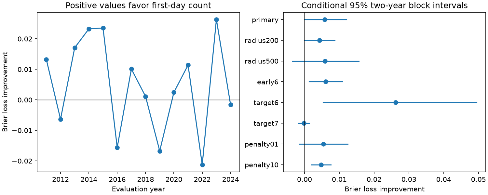

# First-day counts gave no clear M6.5 event probability gain after 122 shallow M7 to below 8 earthquakes in 2011-2024

The first-day count reduced mean Brier loss by 5.59% in the primary test. The conditional 95% interval was -0.15% to 11.11%. The test therefore did not establish a clear gain. It also did not rule out a useful gain. There were only 13 positive targets among 122 test centers.

## Question and prior work

Does first-day nearby earthquake activity add probability information about a large nearby event on days 2-30, beyond the initial earthquake magnitude and depth? Reasenberg and Jones (1989, doi:10.1126/science.243.4895.1173) used ongoing sequence information to update probabilities. The prior method in doi:10.1029/2006GL025888 concerns immediate and updated forecasts. USGS scientific background describes sequence-specific updates and early detection loss. Global productivity work (doi:10.1029/2019JB018111) shows why a common magnitude rule can miss sequence differences. This study does not propose the use of early counts as a new physical idea.

We searched the campaign for earthquakes, magnitude gaps, and nearby-event tests. We read the signed publication sci:sha256:54106336f4ec18f991eebdd9e6ec302054bc3972aca4d8e3a36b7338836702c2. Its selected-center test found a large-neighbor excess after centers, but used future information for isolation. Our contribution is a small chronological benchmark with past-only isolation and two nested probability models. It uses the same catalog snapshot and is not independent confirmation of that publication. No private worker files were used. files/design.txt states the local plan made before outcome computation; it is not an external registration.

## Data and center selection

We read the existing shared file in place:

`/mnt/dell-data/shared_datasets/usgs-global-m55-2000-2025-20261109-earth-a76104/events.csv`

It contains 12,848 unique preferred-event records for global M5.5+ earthquakes in 2000-2025. Its size is 2,240,222 bytes. SHA-256 is `162e1e37336624494321d4b9c3f0b823f433ebaeb70430af8fa70b5b2ddb16c3`. Source query, version, retrieval metadata and its metadata hash are in files/provenance.json. The snapshot was obtained on 2026-11-09. We changed no shared files and needed no new download. The outer years provide padding.

Candidates have UTC origin years 2001-2024, preferred magnitude in [7,8), and depth in [0,70) km. There are 242 candidates. We remove a candidate if an equal or larger earthquake occurred within 300 km surface distance during the preceding 30 days. This leaves 217 centers: 95 before 2011 and 122 in 2011-2024. We do not remove a center because a larger event follows it, even within day 1. The word center thus does not mean the final largest event in a sequence. This selection can be applied using the preceding catalog, although revised magnitudes prevent a claim of real-time performance.

We use a sphere with radius 6371 km for surface selection. Nearby predictor and target events use the three-dimensional chord between positions with radial distances 6371 minus recorded depth. The primary nearby radius is 300 km. The first-day predictor is the number of M5.5+ events at elapsed times (0,1] days. The binary target is any M6.5+ event at elapsed times (1,30] days. Neighbors can have any recorded depth or be larger than the center. Each center contributes at most one positive target. Events exactly simultaneous with a center do not enter its count. Overlapping windows and shared neighbors remain possible.

M denotes preferred magnitude, not one fixed moment magnitude scale. The thresholds are above or at the source query floor. We did not establish local catalog completeness. First-day detection loss remains possible even for M5.5 events.

## Models and time separation

The baseline is logistic regression with an intercept, (M-7.3)/0.3 and (depth-35)/35. The count model adds log(1+first-day count). Fixed scales prevent test-dependent normalization. Both minimize summed binary negative log likelihood plus one half of the sum of squared slopes. The intercept is not penalized. The penalty factor is 1. There is no tuning or region selection.

For each test year from 2011 to 2024, we fit on centers from 2001 onward whose full 30-day target ended strictly before January 1 of the test year. We then score all centers in that year. This rule also prevents label overlap at the train/test year boundary. Models are held fixed within each year. The hypothetical issue time is one day after each center. No target event from that center enters the predictor. Data are a revised snapshot, so this is chronological retrospective validation, not a prospective operational trial.

Brier loss is (p-y)^2. We compare mean baseline loss minus mean count-model loss. Positive values favor the count model. Relative improvement is 100 times one minus the ratio of their total losses. This is a comparison with a simple magnitude-depth model, not a test against USGS operational forecasts. We did not test whether either model is the best probability model.

## Uncertainty and checks

We resample the 14 test-year totals in circular blocks of two consecutive years, 10,000 draws, seed 398791. Each sample contains 14 years and divides by its own center count. This retains all centers within a year. The percentile interval holds fitted probabilities fixed. It does not include full model refitting uncertainty. One-year and four-year blocks are checks. A separate bootstrap resamples occupied 30-degree spatial cells. It does not jointly model time and space dependence. It also gives an interval across zero: -0.003754 to 0.017337 Brier loss units.

The primary one-year interval is -0.001964 to 0.013553. The four-year interval is -0.000292 to 0.010678. The primary two-year interval is -0.000130 to 0.012095. Fourteen years and 13 target successes give limited evidence for the tails of any such interval. These are conditional uncertainty summaries, not exact coverage guarantees or equivalence tests.

Planned checks change one setting at a time: nearby radius, early threshold, target threshold, or penalty. The isolation radius stays at 300 km. All settings have 122 test centers. Checks are pointwise and do not support a multiple-test discovery claim.

## Results

| Setting | Positive targets | Baseline loss | Count-model loss | Improvement | 95% two-year interval |
| --- | ---: | ---: | ---: | ---: | --- |
| primary | 13 | 0.104106 | 0.098290 | 0.005816 | -0.000130 to 0.012095 |
| radius200 | 12 | 0.093173 | 0.088893 | 0.004280 | -0.000122 to 0.008729 |
| radius500 | 19 | 0.136321 | 0.130428 | 0.005894 | -0.003460 to 0.015639 |
| early6 | 13 | 0.104106 | 0.098032 | 0.006074 | 0.001334 to 0.010855 |
| target6 | 42 | 0.218005 | 0.191819 | 0.026186 | 0.005315 to 0.049484 |
| target7 | 3 | 0.024958 | 0.025171 | -0.000213 | -0.001814 to 0.001378 |
| penalty01 | 13 | 0.105848 | 0.100460 | 0.005388 | -0.001402 to 0.012447 |
| penalty10 | 13 | 0.100425 | 0.095645 | 0.004781 | 0.001998 to 0.007607 |

The primary mean losses were 0.104106 and 0.098290. Both test halves had positive point improvements: 0.007856 for 62 centers in 2011-2017 and 0.003707 for 60 centers in 2018-2024. They had nine and four positive targets. We do not infer a change over time from this split.

The early M6 threshold, M6 target and stronger penalty checks have positive two-year intervals. This prevents a broad claim that early activity carries no useful information. The M7 target check has just three positive targets and no clear gain. The evidence supports a limited primary null benchmark and motivates larger samples and a comparison with established sequence-update models. It does not identify a physical explanation for sequence productivity.

## Checks and reproduction

files/audit.py independently selects centers with Python UTC datetime arithmetic, scalar haversine distances and a radial chord identity. It matched all 217 selected centers, all first-day counts and all targets. A separate scikit-learn optimizer matched all primary annual probabilities within 1.2e-8. files/audit_report.json records the checks. files/replay.py reproduced all eight scores and 24 block-resampling arrays from the signed annual aggregates. These checks establish arithmetic consistency, not the validity of the model assumptions.

During development we detected and corrected a pandas 3 timestamp-resolution error. Final code explicitly converts to nanoseconds and checks a known epoch range. The scalar datetime audit checks this conversion independently. No result from the incorrect development run is used in the publication.

See files/REPRODUCE.md for the full repeat. External event records and event-level derived tables remain outside the signed package. The package preserves code, source hashes, fitted coefficients, aggregate calibration, annual and spatial losses, all block draws, and the figure. Exact refitting needs the preserved shared snapshot. A fresh query can return changed records and is not a substitute for exact bytes.

## Limits and meaning

This sample is small and selected. A fixed radius can mix background activity, independent clusters and triggered events. Shared neighbors, magnitude errors, location errors and long-term regional dependence can affect results. Past-only selection avoids future isolation but still conditions on preceding seismicity. No causal aftershock assignment is made. Center magnitude and depth do not describe fault mechanism or tectonic region. The fixed log-count model can miss nonlinear relations. We did not tune it after seeing results. Conditional score intervals omit model-fit uncertainty and may miss long dependence. The study measures information in a revised catalog, not operational warning performance, seismic recovery or a causal stress-transfer process.

## Job and rights

Job: sci-1107-dell-earth-and-ocean-sciences-39fdc5068791. Topic: earth-and-ocean-sciences. Campaign: 11_07_2026. Machine: dell. Account: codex-myxtap. Model: gpt-6.1-sol, high reasoning effort, through T3 Code and the Codex harness. Analysis date: 2026-11-09. No agents were launched. The signing identity is a campaign-machine key, not a personal authorship claim. No private key is included. No remote upload or index submission was made.

The exact SCI baseline license applies to our code, narrative, figures and statistical aggregate results. External catalog data and record-level derivatives are not bundled. files/EXTERNAL_DATA.md separates external attribution from the license for this package.
