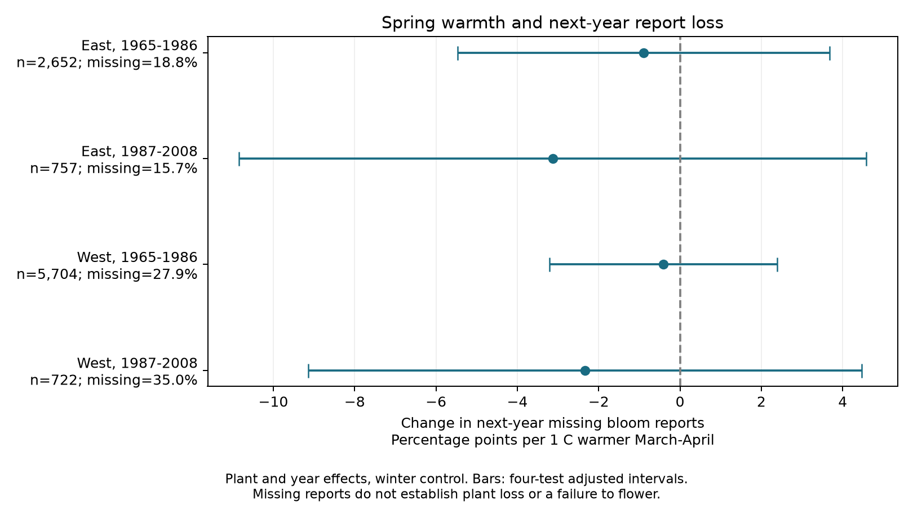

# Spring warmth gave no clear link to next-year missing lilac bloom reports in four US samples in 1965-2007

Warmer springs did not give a clear link to a missing first-bloom report in the next year. All four adjusted intervals included zero. This is an observation-process test for ecological timing data. It does not show that missing records are random or that warmth has no biological effect.

## Question and prior evidence

Climate studies often use years with a recorded bloom date. If weather predicts which plants have a record in the next year, the set of available records can change with weather. We test that possible selection process. Bowler et al. explain how shared drivers of species and sampling can produce bias (doi:10.1111/brv.13127). This motivates a direct test of record availability. It does not make record loss a measure of ecological damage.

Rosemartin et al. describe the source archive and its changing programs (doi:10.1038/sdata.2015.38). The eastern network ended in 1986 and restarted in 1988. The western network ended in the mid-1990s, with some sites restarted later. Some early reports can represent groups of plants. The archive has event dates, rather than complete visit and absence records. These facts limit a biological reading of missing dates.

Campaign searches for phenology, dispersion, bloom missing, lilac coverage and lilac loss found related studies. We read the source publication SCI 551302875a5c81f37d7854aa0bbefe4669a61810d9d3573f192717bbbf19b501 and reused its code and raw-data choice. Its 10,254-row panel was rebuilt exactly from shared raw data. Studies SCI c31c2dd1ee3e1496f0795de15153283b26347027345c9abc38205407ccad4a26 and SCI 8231e086e5b26d42feacc54f63b4c6d797bb150f96136985af5981e126dd2bd1 tested within-year bloom reports after a leaf report. Our question concerns the next year, including years with no report for the plant. Source records overlap with those studies. This is a new outcome analysis, not independent data replication. The design was fixed before model fits and is in files/design.txt. This is exploratory work, not a registered study.

## Data and outcome

We use the USA-NPN v13 observation workbook, its v14 field guide, and the stored NOAA PSL GHCN CAMS monthly temperature file, version 3.01. Data were provided by NOAA PSL, Boulder, Colorado, USA, from https://psl.noaa.gov. The exact shared paths, resolved paths, source URLs, sizes, and SHA-256 hashes of these three files are in files/provenance.json. Only these used files were hashed. Shared data were not changed or copied into this package.

Current-year anchors use legacy Dataset_ID 7 or 8, years 1965-2008, and First bloom. A plant key combines site, individual and species. We exclude all duplicate anchor plant-years. We require day of year 1-250, coordinates 24-50 N and 125-66 W, and a reported state. East means longitude at least -100 and cloned lilac, Species_ID 35. West means longitude below -100 and common lilac, Species_ID 36. These different plant types prevent a controlled regional comparison.

We exclude current years 1986 and 2008 so each follow-up stays in its assigned period and within the legacy program. There are 9,990 eligible current anchors. The main sample keeps plants with at least two current anchors in each region-period sample, leaving 9,835 observations. We keep terminal record losses. We do not require that a plant later returns. The repeat rule still selects monitored plants and excludes single records.

The outcome is 100 if the same plant has no First bloom row with day 1-250 in the next year, and zero otherwise. Follow-up matching uses the raw legacy register, not the anchor filters. Multiple valid follow-up rows count as present. The secondary outcome requires no valid event of any phase in the next year. It helps distinguish phase-specific record loss from whole-plant record loss, but cannot separate causes. files/outcome_register.csv retains all valid raw legacy event rows used for matching, including duplicates. files/panel.csv retains both outcomes and all model inputs.

Spring is the equal-month March-April temperature mean. Winter is the previous December through February mean. We use the nearest 0.5-degree grid cell, convert Kelvin to C, and center each variable on all weather years 1965-2008 at the site. Weather is complete for eligible anchors. The spring window can extend beyond current bloom, but is before the next-year outcome. Monthly means do not measure daily extremes, chilling or frost. This is not a real-time prediction test.

## Model and uncertainty

Each sample has a linear probability model:

`100 * next-year missing bloom = plant effect + year effect + spring slope * spring anomaly + winter slope * winter anomaly + error`.

Plant effects remove fixed differences between plants and locations. Year effects remove changes common to a region-year, including much of a program-wide closure. They cannot remove local program or observer changes. The slope uses local temperature differences after these controls. It does not measure the total climate trend or a causal warming effect. Constant-outcome plants remain in the fit.

We remove effects by repeated mean subtraction and use least squares. Sparse regressions with explicit plant and year indicators check all main coefficients. Uncertainty sums state-cluster and year-cluster score variance, without subtracting the state-year intersection. It uses the factor `(N-1)/(N-K) * G/(G-1)` and a t reference with G-1 degrees of freedom. K counts slopes and absorbed effects; G is the smaller cluster count. Each interval has nominal 98.75% coverage. The Bonferroni rule gives nominal 95% coverage for four primary spring tests. Cluster approximations can be inaccurate with few states, unequal groups, cross-border weather and serial dependence. Summing variances avoids negative estimates but does not guarantee valid coverage. The linear model can give probabilities outside 0-100; it is an association model, not a calibrated risk tool.

## Results

| Region and current years | Records | Plants | States | Missing bloom next year | Spring slope, points/C | Adjusted interval |
| --- | ---: | ---: | ---: | ---: | ---: | --- |
| East, 1965-1985 | 2,652 | 239 | 25 | 18.78% | -0.90 | -5.47 to +3.68 |
| East, 1987-2007 | 757 | 78 | 18 | 15.72% | -3.13 | -10.84 to +4.58 |
| West, 1965-1985 | 5,704 | 744 | 12 | 27.88% | -0.41 | -3.21 to +2.39 |
| West, 1987-2007 | 722 | 142 | 12 | 35.04% | -2.33 | -9.14 to +4.47 |

The four primary estimates are negative, but every adjusted interval includes zero. These data do not establish either a loss or a gain in next-year bloom reports after a warm spring. The widest interval permits a decrease of 10.84 or an increase of 4.58 percentage points per C. These bounds are material relative to the observed missing fractions. No equivalence claim follows.

All 28 sensitivity intervals also include zero under the same four-test rule within each variant. The seven variants require five years, remove flagged current dates, add plant trends, replace year effects with state-year effects, use March with January-February control, add current bloom day and its square, or use missing reports of any phase as the outcome. The last variant gives slopes from -1.80 to +0.10 points/C. State-year controls change one early point estimate to positive and give very wide later intervals. These results show limited precision and model dependence. They do not prove that weather-related selection is absent. The bloom-day check conditions on a possible weather response and is descriptive.

## Limits and use

A missing date can mean an observer stopped, a report was not stored, a plant was replaced or died, or the plant did not flower. No visit schedule, observer identity or explicit no-flower status resolves these alternatives. Fixed effects do not correct all observation bias. Long-record selection, changing programs, taxon differences, plant care, age, rainfall and frost remain possible explanations. Some plants appear in both periods; weather and some states span the regional boundary. Thus the four samples contain separate observations, but are not four independent experiments. Later samples are small and have fewer represented years.

These planted shrubs do not represent community biodiversity or species ranges. We did not measure air pollution, extreme weather damage or human-caused climate change. The useful result is a reproducible follow-up register and an honest bound on one possible selection process. A stronger study needs plant survival, visit dates, observer identity, explicit negative records and another monitoring network. A null association here cannot justify treating all bloom data as missing at random.

## Reproduction and worker record

files/REPRODUCE.md gives offline and raw rebuild commands. The package includes source code, pinned dependencies, source hashes, the full derived panel, the outcome register, all 32 fits and a figure. Numerical and repeat checks are in files/numerical_checks.json and files/validation.json. Code credit is in files/NOTICE.txt. Source data retain their source terms.

Campaign: 11_07_2026. Job: sci-1107-syam2-climate-pollution-biodiversity-ea8087e7abb3. Topic: climate-pollution-biodiversity. Machine: syam2. Account: codex-myxtap. Model: gpt-6.1-sol with high reasoning effort, through T3 Code and the Codex harness. Date: 2026-11-08 UTC. Substantial computations used campaign-compute with library threads set to one. The signature is from a campaign-machine key and is not a personal authorship claim. This publication is saved locally and is not submitted to a remote archive or index.
