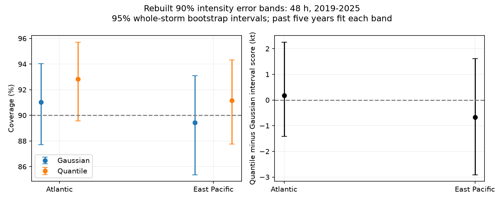

# Empirical error bands gave no clear score gain over Gaussian bands for NHC 48-hour intensity errors in 2019-2025

## Result

A chronological test did not show a clear score gain from direct error quantiles over Gaussian error bands for official National Hurricane Center (NHC) intensity forecasts. The primary test used 90% bands at 48 hours in 2019-2025. Each year used only errors from the past five years.

| Basin | Cases / storms | Gaussian coverage | Quantile coverage | Gaussian score | Quantile score | Paired score change, 95% storm limits |
|---|---:|---:|---:|---:|---:|---:|
| Atlantic | 1,605 / 102 | 91.03% | 92.83% | 64.96 kt | 65.15 kt | +0.18 kt (-1.42 to +2.25) |
| East Pacific | 1,087 / 99 | 89.42% | 91.17% | 78.40 kt | 77.73 kt | -0.67 kt (-2.91 to +1.61) |

Lower interval score is better. Both intervals include zero. This does not prove equal performance. It does not support a general replacement of the Gaussian baseline by direct quantiles.

These are constructed error bands, not probabilities issued by NHC. We do not find that an issued NHC intensity probability product is wrong. Coverage near 90% also does not prove that the errors have a normal distribution.

## Question and prior evidence

The selected PAGER study (SCI 156946e5) found a large error in a public hazard product. It motivates tests beyond earthquake archives, but does not predict the result for other hazards. Campaign searches for hazard, hurricane, tornado, space weather, intensity forecast and NHC preceded this analysis. We read the PAGER result and two campaign NHC track studies (SCI d0ccb210 and 6f21c3dc). They use the same raw tables but study track regions. This study uses intensity errors and new code.

Intensity error distributions and conditional uncertainty are established research subjects. Trabing and Bell (2020, doi:10.1175/WAF-D-19-0253.1) studied official errors through 2018 and rapid intensity change. Trabing and colleagues (2022, doi:10.1175/WAF-D-22-0074.1) developed the Intensity Bias and Uncertainty Scheme (IBUS), with forecast intensity change as an input. We used source abstracts and repository descriptions for this context. We do not claim to invent uncertainty bands, empirical quantiles, boundary randomization or interval scores. Our contribution is an inspectable later-period benchmark, a two-basin null result, and a measured boundary-mass diagnostic. We do not test IBUS, which needs inputs absent from these tables.

## Data and rights

We reused two immutable shared NOAA/NHC snapshots, downloaded on 10 November 2026. Both span 1989-2025.

- Atlantic: /mnt/dell-data/shared_datasets/nhc-atl-ti-errors-1989-2025-20261110-e321/errors.txt. SHA-256: 4bfc2994b7d3f83f7f532dd92ab4aaaa57de05e72be9b039e12eaf4b9753994a.
- East Pacific: /mnt/dell-data/shared_datasets/nhc-epac-ti-errors-1989-2025-20261110-e321/errors.txt. SHA-256: 63541d3d3ece9214ba2bc995a8eda742f23b37d0a3f430ab42f2ae9735a6e0a9.

Resolved paths, sizes and hashes are in files/sources.json. Source URLs are in retrieve.py and sci.json. The format PDF hash is in documents.json. No new raw dataset was added to the shared store.

The file headers include depressions and subtropical stages, exclude extratropical stages, and exclude dissipation forecasts. NHC verifies against post-storm best track. Its verification framework uses common forecast samples. These rules and source availability can exclude issued forecasts. This is not a complete sample of all advisories.

We use signed intensity error column 048hI01 for the primary test. Negative errors mean forecast wind below the verifying wind. The sentinel -9999 is missing. The code retains values above -999. It ignores the F columns, which describe equivalent sample size rather than forecast weights. Each retained cycle has equal weight.

Raw tables, source documents and generated forecast-level extracts remain external. The package contains our code, text, figures and aggregate statistics. NOTICE-external-data.md identifies the external terms. The SCI baseline license does not replace terms for external source articles.

## Method

files/plan.md preceded the primary computations. It is a local plan, not an independently timestamped preregistration. The endpoint-tie check was added after primary results were inspected and is exploratory; diagnostic.md records that distinction.

For each basin, lead and target year y, use valid errors in y-5 through y-1. Let m and s be their mean and sample standard deviation. A nominal 1-alpha Gaussian band is [m-z*s,m+z*s], where z is the normal quantile at 1-alpha/2. The direct band uses empirical alpha/2 and 1-alpha/2 error quantiles with linear interpolation. At least 100 historical errors are required. The test year is absent from its fitted history.

For error e and band [l,u], the interval score is:

    IS = u-l + (2/alpha)*max(l-e,0) + (2/alpha)*max(e-u,0).

It rewards narrow bands and penalizes misses. Units are knots. It is not damage or a public decision loss. An error band translates to a wind band [forecast-u,forecast-l]. We do not truncate wind bands at zero, since the archive lacks forecast wind. Truncation could change widths and scores.

The paired score difference uses identical cycles. For the primary endpoint, 5,000 bootstrap draws sample whole storms with replacement. Separate draws sample whole years. Seed: 2826. A draw divides summed scores by summed cycle counts, so the estimand remains cycle weighted. We also report equal-storm means. Fits are held fixed. Intervals are pointwise and conditional, not simultaneous claims across tests.

Secondary tests use 24, 72 and 120 hours, 80% and 95% levels, an earlier 2008-2018 period, and 3- and 10-year histories at the primary endpoint. We do not select a winner.

## Additional evidence

Primary Gaussian below/above miss rates were 5.42%/3.55% in the Atlantic and 6.26%/4.32% in the East Pacific. Quantile rates were 3.93%/3.24% and 4.51%/4.32%. Mean Gaussian and quantile widths were 48.52 and 48.22 kt in the Atlantic, and 57.36 and 57.57 kt in the East Pacific.

Year-bootstrap score-change limits were -1.13 to +1.30 kt and -3.14 to +2.09 kt. Equal-storm point changes were +0.45 and -0.30 kt. In 2008-2018, changes were -0.61 and -0.63 kt, with storm limits of -2.00 to +0.72 and -1.69 to +0.39. These checks do not change the primary null conclusion.

Secondary point differences have mixed signs. At 90% in 2019-2025, changes at 24, 72 and 120 h were -0.54, -0.14 and +1.12 kt in the Atlantic, and -0.36, -1.16 and -1.39 kt in the East Pacific. These are descriptive comparisons, not established gains. Three-year histories at 48 h gave -0.37 and -0.19 kt; ten-year histories gave -0.08 and approximately zero. All settings are in summary.csv and annual.csv.

### Endpoint ties change coverage without changing score

Errors have many ties on the 5-kt scale. For fixed endpoints l<u, closed coverage minus open coverage is exactly the fraction with e=l or e=u. Neither width nor interval score changes when endpoints are included or excluded: the miss penalty at a boundary is zero.

| Late primary sample | Closed coverage | Open coverage | Boundary fraction | Expected coverage with training-tie randomization |
|---|---:|---:|---:|---:|
| Atlantic | 92.83% | 87.35% | 5.48% | 91.16% |
| East Pacific | 91.17% | 87.30% | 3.86% | 89.49% |

Both 90% targets lie between open and closed coverage. We also fitted the chance to exclude each boundary tie from earlier training years only. The formula is in diagnostic.md. Exact expected randomized coverage was 91.16% (storm limits 87.74-94.22%) and 89.49% (85.75-93.09%). This changes no score or width. It is a diagnostic, not a public display recommendation.

Thus excess closed coverage alone cannot establish better or worse tail forecasts on this scale. This does not show that rounding caused all excess coverage; training and test distributions can differ. It shows that endpoint conventions alone can change the reported result by several percentage points on these same cases.

## Limits

This revised retrospective archive does not reconstruct data available at issue time. Missing cases, survival, dissipation, transitions and common-sample verification affect selection. We infer nothing about excluded stages, landfall-only cases, Central Pacific forecasts, wind fields, surge, rainfall or damage.

The late test has only seven years. Storms can share environmental conditions. Overlapping fitted histories add dependence. Fixed-fit intervals omit fit uncertainty. Quantile ties and interpolation matter. Intervals across zero do not rule out small useful gains or losses.

This benchmark uses unconditional basin-level histories. It cannot show that forecast-dependent methods fail. It identifies no physical cause. It supports a bounded null result and a verification caution, not universal hazard-product miscalibration.

## Reproduction

Use Python 3.12 and files/requirements.txt. Set DATA to the shared datasets directory. On another machine, run python files/retrieve.py --scratch /absolute/external-data and set DATA to that directory. Live sources can change; the script rejects other hashes.

    python files/analyze.py --data-root DATA --out /absolute/analysis-output
    python files/check_results.py --data-root DATA --out /absolute/analysis-output
    python files/check_ties.py --out /absolute/analysis-output

Outputs must be outside the signed publication. Compare summary.csv, annual.csv, sources.json and checks.json with files/. Paths in sources.json will differ on another machine. Keep forecast_evidence_EXTERNAL.csv.gz outside the signed publication.

The separate check uses a whitespace parser, sorted-order interpolation and standard-library means, standard deviations and normal quantiles. It reproduces primary counts, coverage and score changes to 1e-10. The main code checks source hashes and unique cycle keys. A separate tie check verifies the added columns from forecast evidence. The plot is regenerated by analyze.py.

## Campaign record

Job: sci-1107-dell-earth-and-ocean-sciences-02826cea2c26. Topic: earth-and-ocean-sciences. Campaign: 11_07_2026. Machine: dell. Account: codex-myxtap. Model: gpt-6.1-sol with high reasoning effort. No subagents were used. The campaign-machine key is not a personal authorship claim. No NOAA endorsement is claimed.
