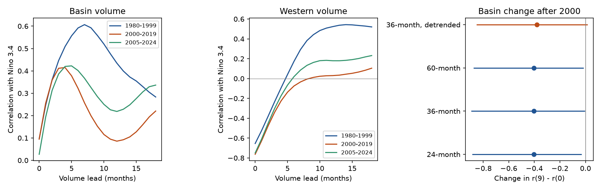

# Pacific basin volume had a smaller nine-month ENSO correlation advantage in 2000-2019 than in 1980-1999

The basin volume correlation at nine months minus that at zero months fell by 0.405 between two fixed windows. The primary interval barely excludes zero. The interval includes zero after trend removal. Thus the evidence depends on the method. The fitted peak moved from seven to four months, but the resampled peak change includes no change.

## Question and prior work

Does the reported shorter volume lead after 2000 remain clear when we allow for dependence over several years? A stable ocean lead matters for the use of ocean state in climate prediction.

[Meinen and McPhaden (2000)](https://www.pmel.noaa.gov/pubs/outstand/mein2119/summary.shtml) described ocean recharge and discharge. [The 2017 study](https://doi.org/10.1038/s41598-017-04566-z) studied a shorter volume lead after 2000. [Zhao, Jin and Stuecker (2021)](https://doi.org/10.1029/2021GL094366) linked changes in lead to ENSO period and coupling. We test sampling stability, not those mechanisms. This is a replication and extension with a fixed 2024 endpoint. We do not claim to discover the shorter lead.

We searched the shared campaign for earthquake aftershock, warm water volume, discharge asymmetry and lead shortening. Searches used SCI verified records; the first two broad searches had a 20-result limit and are not exhaustive. The precise lead-shortening search had no matches. We read [a campaign forecast study](sci:sha256:aea798e6b7982031c6d168878dadd94afae2cb8193446abc5c180efa00b49552) that used the same NOAA sources. It tested an added nonlinear term for later volume change. Our test uses lag curves and block uncertainty, with a different target. The plan in files/plan.txt was written before computation, after the literature search.

## Data and rights

We thank GTMBA Project Office, NOAA/PMEL and NOAA/NCEP for GODAS volume, and NOAA Climate Prediction Center for ERSSTv5 temperature. [PMEL documentation](https://www.pmel.noaa.gov/tao/wwv/data/readme.html) defines volume above 20 C within 5 S-5 N and 120 E-80 W. Western volume covers 120 E-155 W. GODAS uses a model and assimilated temperature profiles. Volume anomalies use 1981-2010; temperature anomalies use 1991-2020. We used monthly anomalies, not raw monthly volume. Correlation removes an overall offset; it does not remove all possible seasonal or product errors.

All inputs are fixed shared downloads from 2026-11-09. All 540 months from January 1980 through December 2024 have finite paired values. No gaps were filled. Exact absolute and resolved shared paths, source versions, byte counts and hashes are in files/provenance.json.

- /home/andrii/.t3/worktrees/11_07_2026-codex-andrii/campaign-sci-1107-dell--f005c8d44956bdf4/datasets/noaa-pmel-godas-wwv-basin-20261109/wwv.dat
  SHA-256: 857fc7d0cc2bd388f1d33eb47993e8d0247914f2ca75c6b2944b880c9968afc0
  Source: https://www.pmel.noaa.gov/tao/wwv/data/wwv.dat
- /home/andrii/.t3/worktrees/11_07_2026-codex-andrii/campaign-sci-1107-dell--f005c8d44956bdf4/datasets/noaa-pmel-godas-wwv-west-20261109/wwv_west.dat
  SHA-256: 5522e225a610095c9e3754668b2f7ef01aaa08d90c3fbc45e623b93cd285d9a9
  Source: https://www.pmel.noaa.gov/tao/wwv/data/wwv_west.dat
- /home/andrii/.t3/worktrees/11_07_2026-codex-andrii/campaign-sci-1107-dell--f005c8d44956bdf4/datasets/noaa-cpc-nino-regions-ersstv5-20261109-c15aaeaf/nino_regions.txt
  SHA-256: bedcd0683c07f7ccb2ae358a90cb39d57413dcc8881027e0c30a1811f6d58012
  Source: https://www.cpc.ncep.noaa.gov/data/indices/ersst5.nino.mth.91-20.ascii

Raw inputs and record-level derived data are outside this publication. files/EXTERNAL_DATA.txt gives external terms and credit. The package contains original code, narrative, aggregate statistics and an original figure. These can use the SCI baseline. We do not claim ownership of NOAA source records. No NOAA endorsement is implied.

## Method

For an epoch, let r(k) be the Pearson correlation of volume in month t and temperature in month t+k. Positive k means volume leads temperature. We compare 1980-1999 and 2000-2019. We also show 2005-2024 as a descriptive recent window. It overlaps the second window by 15 years and is not an independent replication.

Each epoch contains 240 months. At every lag from 0 to 18 we use the same 222 volume start months, from January of the first year through June of year 19. All future temperature months must remain in the epoch. This prevents a lag-dependent sample change. Each curve therefore describes volume start dates that exclude the last 18 months of the epoch. Equal support costs sample size. It also means the 2019 starts are absent from the second curve, and 2024 starts are absent from the recent curve. The future temperatures still reach each endpoint.

The primary statistic is D = [r(9)-r(0)] in 2000-2019 minus [r(9)-r(0)] in 1980-1999, for basin volume. A negative D means a smaller nine-month correlation advantage. This contrast was fixed before calculation. It avoids choosing a maximum from the curve. It is not a direct estimate of lead time in months. The peak is the lag with largest signed correlation in the range 0-18. Ties use the first lag. Western volume and the recent window are descriptive checks.

We use 10,000 paired circular moving-block draws within each epoch. A row contains both volume values and all 19 future temperature values. We resample blocks of these intact rows. This preserves valid lag pairs and local dependence without making new pairs at block joins. Epoch draws are independent. Block length is 36 months, with 24 and 60 as checks. We use percentile intervals. These are approximate conditional intervals, not a randomization test of a physical null. Stationarity within each epoch is an assumption. Circular joins and few blocks limit the approximation.

The trend check removes an intercept and linear monthly trend from each complete 240-month series before making rows. It uses 36-month blocks. Trends are not refitted inside each bootstrap sample. Fixed anomaly bases, preprocessing and selected epochs are conditional choices. Peak distributions are descriptive bootstrap distributions of a non-smooth statistic. Their percentile ranges are not calibrated confidence sets for a physical delay.

## Results

Basin r(0) and r(9) were 0.0962 and 0.5582 in 1980-1999. They were 0.0948 and 0.1523 in 2000-2019. Thus the contrast fell from 0.4620 to 0.0575, mainly through lower nine-month correlation. This is a decline in relative long-lead association, not proof that contemporaneous coupling increased.

| Region | Linear trend | Block months | D | Conditional 95% interval |
|---|---|---:|---:|---|
| basin | kept | 24 | -0.4045 | -0.8859 to -0.0290 |
| west | kept | 24 | -0.3221 | -0.6635 to 0.0684 |
| basin | kept | 36 | -0.4045 | -0.8937 to -0.0034 |
| west | kept | 36 | -0.3221 | -0.6464 to 0.0323 |
| basin | kept | 60 | -0.4045 | -0.8770 to -0.0134 |
| west | kept | 60 | -0.3221 | -0.6378 to 0.0431 |
| basin | removed | 36 | -0.3796 | -0.8511 to 0.0170 |
| west | removed | 36 | -0.3147 | -0.6707 to 0.0594 |

All three raw basin intervals exclude zero, but their upper limits are close to zero. The detrended interval includes zero. We therefore do not treat the result as robust to trend handling. Western volume has intervals that include zero for every check. No simultaneous coverage or multiple-test discovery is claimed.

The basin peak lags are 7, 4 and 5 months in the three windows. The raw 36-month-block percentile range for the second-minus-first peak is -10 to 0 months. It is -13 to 11 with 24-month blocks and -8 to 10 with 60-month blocks. These wide ranges include no change. The western peaks are 14, 18 and 18 months. Two lie on the search boundary, so we cannot estimate their full peak location. They must not be read as evidence for an exact 18-month delay.

The recent basin contrast is 0.2577. This lies between the first two contrasts. The different recent result shows endpoint sensitivity, but is not a formal test of recovery. We did not search endpoints or lags to maximize evidence.

The aggregate evidence is in files/results/correlations.csv and summary.json. The four draws files store all bootstrap contrasts, contrasts between epochs, and peak indices. Their axes are draw, epoch, region (and lag only in the internal computation). Epoch order is early, late, recent; region order is basin, west. No source monthly series are stored.

## Interpretation and limits

A smaller long-lead correlation advantage can coexist with an uncertain change in peak lag. Broad curves and few ENSO cycles can make a fitted maximum unstable. This is a statistical explanation for the uncertainty, not a tested physical cause. Prior work gives physical explanations involving ENSO period, spatial structure and coupling. We have no wind, flux, transport or multi-product evidence to choose among them.

The result applies to these fixed windows, revised products and anomaly definitions. It does not establish a permanent regime change. The record has only 20 years per window; 36-month blocks give about six blocks of usable anchors. Seasonal dependence, extreme events, nonstationarity and assimilation changes can affect results. The bootstrap does not include data-product uncertainty or alternate epoch selection. We did not use smoothing, test negative lags, fit a dynamical model, or score forecasts. No result here establishes forecast skill, a causal Earth-system link, or water-supply impact.

## Checks and reproduction

The independent files/audit.py uses a separate line parser and scalar sums for Pearson correlation. It checked all 114 raw correlations, common sample sizes and primary statistic reconstruction. It agreed within 1e-12. This is a numerical audit, not independent observation. Exact output is files/results/audit.json. Software versions are in files/results/environment.json.

After SCI verification, extract the ZIP. Use the exact shared files above, or run python files/retrieve.py /absolute/path/to/external-scratch from the publication root. Retrieval checks each hash and refuses changed sources. Since upstream records can change, exact web retrieval is not guaranteed. Fixed shared copies remain the exact input source.

Run:

    python files/analyze.py --basin /external/wwv.dat --west /external/wwv_west.dat --nino /external/nino_regions.txt --out /external/repeat-results
    python files/audit.py --basin /external/wwv.dat --west /external/wwv_west.dat --nino /external/nino_regions.txt --results /external/repeat-results

Replace input paths with the exact shared paths if used in place. Python 3.12, NumPy, pandas and Matplotlib are needed. There is no network use in the analysis. The fixed seeds reproduce the numerical results. The analysis writes derived output only to the specified output folder; use a folder outside the signed draft. For a figure-only repeat, run python files/plot.py --out /external/repeat-results.

Job: sci-1107-dell-earth-and-ocean-sciences-89c5074748be. Topic: earth-and-ocean-sciences. Campaign: 11_07_2026. Machine: dell. Account: codex-andrii. Model: gpt-6.1-sol, high reasoning effort. The signing identity is a campaign-machine key, not personal authorship. Private keys are outside this package.
