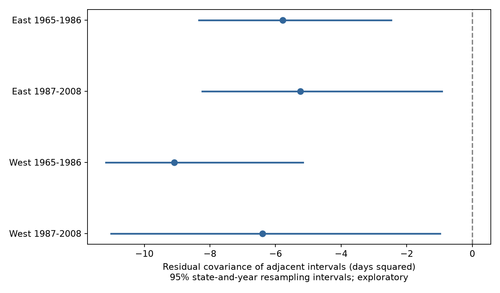
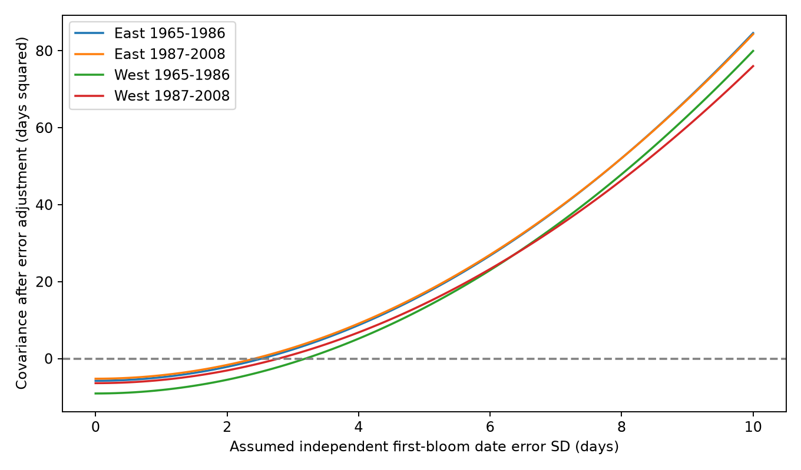

# Adjacent spring-stage intervals had negative residual covariance in four US shrub samples in 1965-2008

We tested whether the leaf-to-first-bloom interval and the first-to-full-bloom interval had opposite annual deviations. Four separate East and West samples in 1965-1986 and 1987-2008 contained 13,320 plant-years. After plant, year, and March-April temperature adjustment, residual correlations ranged from -0.251 to -0.179. Each exploratory 95% resampling interval for covariance was below zero. A first-bloom date occurs with opposite signs in the two intervals. Under an independent date-error model, an error standard deviation of 2.42 to 3.19 days would remove the negative covariance at the point estimates. These values fit the residual variance limits. They do not measure actual error. Missing visit records, selected complete triples, mixed taxa, coarse weather, and model assumptions prevent a claim of biological compensation. The package gives a data audit, code, source hashes, an error-sensitivity method, and figures.

## Question and prior work

A plant can take more time to reach first bloom and less time to reach full bloom. This pattern could suggest that later development makes up for an earlier delay. It could also arise from error in the date that both intervals share. We test this problem in public spring-stage records. The aim is to improve the use of ecological timing data for climate studies. We do not test air pollution or species loss.

The paper *Climatic drivers and ecological implications of variation in the time interval between leaf-out and flowering* (2023; doi:10.1016/j.cub.2023.06.064), examines how stage timing can respond differently to climate. We use it as context, not as a result to reproduce. Mathematical coupling from shared measurements is an established problem (doi:10.1152/jappl.1986.60.1.335). We apply that principle to a three-stage shrub panel and give the date-error scale at which a negative covariance can reach zero.

We searched the campaign with `sci search "climate pollution biodiversity phenology" --in ./campaign`, then `sci search "phenology" --in ./campaign --limit 200` and a shared-boundary search. We read SCI a6bd7c1e84535d597843343c4a01f2a4bd059556507d1a74452d47094cc7f060. That study tested first-to-full bloom warmth slopes. Its source records overlap with ours. It did not test covariance with the preceding interval. We use its archive description and split design; we build a new triple-stage panel from raw sources. This is an exploratory study. It is not registered. No claim of a new general mathematical identity is made.

## Data and selection

We use the USA-NPN lilac and honeysuckle v13 workbook described by Rosemartin and colleagues (doi:10.1038/sdata.2015.38). We use legacy Dataset_ID 7 and 8, US sites at 24-50 N and 66-125 W, and years 1965-2008. A plant key contains Site_ID, Individual_ID, and Species_ID. We reject a plant-year if any selected stage has more than one record. We require first leaf, first bloom, and full bloom on day 1-250. We retain leaf-to-first-bloom intervals from 0 to 90 days and first-to-full-bloom intervals from 0 to 60 days. The analysis requires five eligible years per plant within each region and period. Zero intervals remain in the main sample.

West means longitude below -100 degrees. East contains the other sites. The periods are 1965-1986 and 1987-2008. These are separate observations, but some plants occur in both periods and regional weather is not independent. Species and monitoring programs differ across regions. These samples provide checks of repetition, not matched biological replications.

Data from NOAA PSL, Boulder, Colorado, USA, supply the GHCN CAMS 3.01 monthly temperature. We extract the nearest 0.5-degree cell and take the equal-weight March-April mean in C. This measure is an adjustment variable, not a causal exposure or forecast input. It can include weather after a stage. The analysis without weather tests dependence on this adjustment. Files provenance.json and audit.json give exact shared paths, source URLs, source hashes, file sizes, and selection counts. Raw shared files were read in place and were not changed.

The source has 116,662 rows. After stage selection and ambiguous-record removal, it gives 17,756 complete triples. Location and interval limits leave 17,490 triples. The five-year rule gives 13,320 plant-years in the four main fits. files/taxon_coverage.csv gives the taxon mix before the five-year rule. The later West has only 18 represented years.

## Analysis and date-error calculation

Let L be first leaf, F first bloom, and U full bloom. Define A = F - L and B = U - F. For each region-period we remove plant indicators, year indicators, and a linear spring-temperature term from A and B. Let M be the residual projection. We report C = (MA)'(MB)/n and the residual Pearson correlation. We use denominator n for variances and covariance. All three residuals use exactly the same design.

Let e be first-bloom date error. If leaf and full-bloom dates have no error, the recorded intervals are A_true + e and B_true - e. For a fixed selected sample and design, if e is independent of both true intervals, has a common variance sigma squared, and has mean zero after the design effects, then:

`E[C_recorded | true intervals, design] = C_true - k * sigma^2`,

where `k = trace(M)/n = (n - design rank)/n`. The rank uses the connected components of the plant-year graph, plus one temperature column. We assume that column adds rank. Full sparse least-squares fits check all reported residuals. More generally, the exact change is `C(e, B_true - A_true) - Var(e)` after projection. Independence is thus a substantive assumption.

For C below zero, `sqrt(-C/k)` is the error SD at which the adjusted point covariance reaches zero. Subtracting `k*sigma^2` from each observed interval variance must also leave nonnegative variances. This check holds in all four main samples. The calculation shows a possible second-moment explanation under the stated model. It is not a fitted measurement-error model and does not reproduce the full distribution or the date-order constraints.

For scale only, independent continuous uniform delays from 0 to h have SD `h/sqrt(12)` after removal of their mean. A seven-day range gives 2.02 days; a fourteen-day range gives 4.04 days. The point thresholds correspond to ranges of 8.38-11.06 days. A constant delay does not induce this covariance. Correlated delays across stages can change the result. For stage errors eL, eF, and eU, the error covariance before projection is `Cov(eF,eU) - Var(eF) - Cov(eL,eU) + Cov(eL,eF)`. If all stages share the same delay, it cancels from both intervals.

Complete triples, positive date order, and duration limits are selected using recorded dates. These steps can violate the assumed independence of error in the selected panel. The sensitivity curve is conditional and idealized. It is not an identified correction for selection or reporting bias.

We independently resample states and years with replacement, use the product of their counts as weights, and refit each sample. The seed is 11072026. There are 399 draws for each main fit. The 95% percentile intervals are exploratory marginal intervals. They do not control four-test family error. Few states, unequal state sizes, cross-state weather, and short later records can make the intervals inaccurate. We do not assign intervals to the error thresholds. Sensitivity fits remove weather, remove quality flags, or require both intervals to be positive. Each sensitivity sample again requires five years per plant.

## Results

| Region | Period | Plant-years | Plants | Correlation | Covariance, days squared | 95% interval | Error SD at zero, days |
| --- | --- | ---: | ---: | ---: | ---: | --- | ---: |
| East | 1965-1986 | 3174 | 283 | -0.205 | -5.78 | -8.33 to -2.48 | 2.53 |
| East | 1987-2008 | 957 | 78 | -0.251 | -5.24 | -8.24 to -0.93 | 2.42 |
| West | 1965-1986 | 8285 | 886 | -0.179 | -9.08 | -11.17 to -5.16 | 3.19 |
| West | 1987-2008 | 904 | 141 | -0.179 | -6.40 | -11.01 to -0.99 | 2.79 |

The negative point covariance repeats in all four samples. All four marginal intervals are below zero. This supports a descriptive association in the selected records. It does not show biological compensation. The correlations are modest. Omitting weather, removing flags, and removing zero gaps keep negative point estimates in all samples; these checks have no resampling intervals and are not separate confirmations of significance.

An independent first-bloom date error SD of about 2.4-3.2 days is sufficient to remove each negative point covariance under the idealized model. A seven-day uniform delay range is insufficient at all four point estimates; a fourteen-day range is sufficient. Neither delay range is measured in these legacy records. We cannot choose between shared-date error, real developmental compensation, other weather, selection, or a combination of these causes. The useful result is the required error scale and a warning that a repeated negative association alone does not separate them.

## Limits and next test

The archive covers planted indicator shrubs at selected sites. It does not measure a natural plant community, flower supply, or pollinator mismatch. Complete reporting and long records select the sample. Plant effects do not remove observer changes, plant replacement, pruning, watering, or plant age. Quality flags are incomplete. Monthly gridded weather misses local and daily conditions, chilling, rain, and extremes. Temperature adjustment is linear. We do not estimate a causal climate-change effect. We do not claim that all timing associations are artifacts.

An independent test needs repeated visits that bracket each stage, comparable taxa in separate regions, and local daily weather. A useful model should fit latent stage dates jointly with visit records and allow stage errors to correlate. It should test the two adjacent intervals and the total leaf-to-full-bloom interval together. Error in F cancels exactly from the total. Our code verifies that identity and the covariance formula with simulated error. These checks verify the method, not the field error assumptions.

## Reproduction and worker record

Run `python files/analyze.py` and `python files/validate.py` from this publication folder. Use `--raw-root /mnt/dell-data/shared_datasets` for a full raw-source rebuild. See files/REPRODUCE.md for dependencies, retrieval, and data fields. The panel, results, figures, source hashes, and validation output are preserved. Source data retain their original terms. The baseline license applies to our code, text, figures, and derived evidence, subject to source rights.

Campaign: 11_07_2026. Job: sci-1107-dell-climate-pollution-biodiversity-c8ebfff2f69d. Topic: climate-pollution-biodiversity. Machine: dell. Account: codex-andrii. Model: gpt-6.1-sol, high reasoning effort, through T3 Code and the Codex harness. Date: 2026-11-08 UTC. The campaign-machine signature is not a personal authorship claim. This publication stays in the local campaign. No remote submission is made.

The independent raw-date check matches all 17,490 selected dates for each of the three stages. files/raw_date_check.json records this check. files/validation.json records 4,000 simulated error columns and the exact algebra checks. The largest main sparse-projection residual difference is below 3e-8 days.
