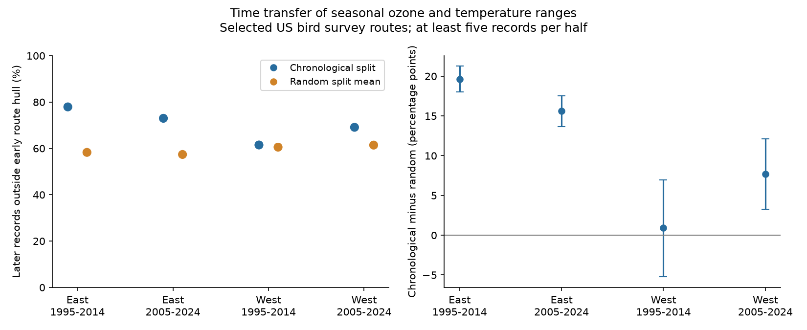

# Later ozone and warmth pairs fell outside earlier route ranges more often than random splits in eastern US bird samples in 1995-2024

## Result

Later seasonal ozone and temperature pairs fell outside the earlier exposure range of the same route more often than random splits of the same size. This result was clear in both eastern windows. The early western route interval included zero; the later western route interval was above zero. It is a result about exposure data used for biodiversity research. No bird response was fitted.

| Region and survey window | Routes | Later records | Outside earlier hull (%) | Random split (%) | Excess (points), 98.75% route interval |
|---|---:|---:|---:|---:|---:|
| East 1995-2014 | 763 | 6503 | 77.90 | 58.28 | 19.62 [18.03, 21.25] |
| East 2005-2024 | 811 | 6256 | 72.99 | 57.38 | 15.61 [13.68, 17.52] |
| West 1995-2014 | 99 | 802 | 61.47 | 60.53 | 0.94 [-5.24, 6.98] |
| West 2005-2024 | 158 | 1175 | 69.11 | 61.42 | 7.69 [3.26, 12.11] |




The early and late survey blocks are 1995-2004 versus 2005-2014, and 2005-2014 versus 2015-2024. The corresponding exposure years are one year earlier. Table counts sum to 14,736 distinct later records. Some of these also train the second window. There are 1,171 distinct selected routes. The two windows overlap. The first target block is the second training block. Regions have different routes, but broad weather and policy drivers can be shared. The four cells are not independent experiments.

## Question and prior work

Do time-ordered exposure holdouts have less joint range support than short records alone would predict? A species response model can be easy to fit while its target exposures lie outside the training range. Mesgaran et al. distinguish new individual covariate ranges from new combinations ([2014](https://doi.org/10.1111/ddi.12209)). Antonelli and Zigler use convex hulls to assess specified pollution contrasts ([2024](https://doi.org/10.1093/aje/kwae115)). Liang et al. report bird benefits from air pollution control using a different observation source and design ([2020](https://doi.org/10.1073/pnas.2013568117)). We do not retest their biological result.

We searched the signed campaign for climate, pollution, phenology, bird wind, and ozone temporal hull results. SCI f39827b3 tested pooled and route ranges for centered exposure rectangles and transfer between pooled region-period ranges. Our contribution is the same-route chronological holdout test with a size-matched random split benchmark. These analyses share observations. This is not a new geometric method.

## Data and observation bias

The direct input is `files/analysis_panel.csv.gz` from verified SCI f39827b3114890e70858bdac1a31022bf3578de8844e34d9e485a7517d46bbbd. SHA-256: `c4d42504c47d98a74cb13ebc12957a84a4eea9c13f8cfa4795cb9fa5e511c880`. It has 32,458 eligible route-years. We did not apply the parent response model's singleton removal because this audit fits no outcome model. We selected routes with at least five records in each ten-year block. `selection.csv` gives all available and retained route counts. The seven-record check further selects long records.

The inherited panel combines USGS BBS 2025 release data for 1966-2024, EPA AQS ozone, NOAA county weather and Census locations. Ozone is the prior May-September mean daily maximum eight-hour value (`o3_prev`, ppb). Temperature is the prior May-June mean daily maximum (`tmax_prevC`, C). This is seasonal warmth, not extreme heat. East is longitude above -100 degrees; West is at or below -100 degrees. No 2020 surveys occur. The panel uses accepted standard surveys, complete exposure fields and plausible survey conditions. The source ozone rule uses monitors within 50 km with at least 75% valid days. Eligibility also requires some current weather, prior-month ozone and survey fields that this audit does not use directly. The dictionary and build code preserve source details.

Using the same routes prevents route replacement alone from producing the comparison. Matching split sizes prevents unequal sample size alone from producing the random benchmark difference. Eligibility filters reduce some survey and observer differences. They do not remove bias from selected monitor coverage, observer detection, or missing route-years. We make no count, species loss or abundance inference. Long-record selection can change the population described. County weather and route-start monitor estimates can miss local exposure. Monitor replacement can create artificial temporal changes.

No shared raw dataset was read or downloaded. We checked current relevant names and used the completed signed panel in place of a new download. `provenance.json` gives its exact campaign path, entry name, bytes and checked hash. `raw_source_provenance.json` gives inherited raw source versions, URLs and hashes. Those historical raw hashes were not checked in this job; old paths may no longer exist after disk failure. We did not read the failed disk or change shared data.

## Method

For each route, form the convex hull of its early ozone-temperature pairs. This is the smallest convex polygon that contains those points. Classify every late pair as inside or outside with tolerance 1e-9 in hull equations. A hull permits interpolation across gaps and is a permissive range test. Membership is unchanged by a common shift of a route or a positive change of units. It is not conditional positivity given all model controls.

For each route, shuffle the combined early and late pairs 399 times. Keep the actual training and test sizes. Calculate the fraction outside the random training hull. Average those fractions and compare them with the chronological fraction. Weight routes by late record count. Random splits are a finite-panel benchmark under random time labels, not a claim that environmental years are exchangeable. Serial correlation, gradual trends, variance changes and monitor changes can all cause a chronological excess.

We bootstrap routes 9,999 times for each of four primary excesses. Each resample recalculates the record-weighted ratio. The displayed 98.75% percentile intervals use Bonferroni tail levels for four comparisons. They are descriptive resampling intervals, not guaranteed population coverage. Shared state and national drivers can invalidate independent-route sampling. A separate state bootstrap and equal-route weighting test sensitivity. Monte Carlo errors from random splits are distinct from sampling uncertainty; `mc_se` gives their estimated standard error. Maximum main Monte Carlo error was 0.102 percentage points. The fixed seed is 38026.

`PLAN.txt` was saved before computation. State bootstrap and mean alignment were added as validation extensions before inspecting results; they are sensitivity checks. No p-value or causal effect is claimed.

## Explanations and sensitivity

| Region and window | Outside marginal box (%) | Inside box, outside hull (%) | Ozone below early minimum (%) | Heat above early maximum (%) |
|---|---:|---:|---:|---:|
| East 1995-2014 | 61.74 | 16.16 | 42.64 | 21.11 |
| East 2005-2024 | 43.91 | 29.08 | 34.29 | 7.66 |
| West 1995-2014 | 46.63 | 14.84 | 30.30 | 6.98 |
| West 2005-2024 | 47.74 | 21.36 | 24.34 | 18.81 |


Outside-box and joint-only fractions partition the hull failure. Directional ozone and heat fractions can overlap and must not be added. All seven directional and box checks are stored. They describe the location of transfer failure; they cannot identify its physical cause.

Route-weighted mean late-minus-early changes in ozone ranged from -4.53 to -1.15 ppb, and changes in seasonal warmth ranged from -0.02 to 0.74 C. These are selected exposure measurements, not an attribution to emissions or climate change. Aligning each late block's two means to its early means left 37.9-48.3% outside the early hull. Mean alignment uses the held-out block and is an explanation check, not a deployable correction.

The state-bootstrap lower bounds ranged from -11.0 to 15.8 percentage points. The states are still not independent environmental systems. With at least seven records in each half, the forward excesses were 20.6, 15.4, 0.5, 8.7 points in table order. Reverse transfer excesses were 21.2, 19.4, 18.4, 13.3 points. Thus direction and sample size can be inspected rather than assumed. All primary and secondary results are in `summary.csv` and `sensitivity.csv`.

An independent linear-program test agrees with 400 sampled record labels. It tests whether a target is a convex combination of training points. Source self-containment, affine invariance, exact record decompositions and all route and summary aggregations pass. `validation.json` records these checks.

## Limits and use

Chronological validation reveals a data support problem that random validation can hide in this selected panel. This supports reporting a time-transfer audit alongside exposure response models. It does not show that a parametric model is biased or unidentified. A common response function can borrow information across routes, and some models can extrapolate well. The hull says neither how far outside a record lies nor whether predictions there are wrong. We did not assess all confounders, daily extremes, ecological timing, species distributions, smoke or causal biodiversity change. The result is a reusable method application and evidence about the limits of one public environmental-biological panel.

## Reproduce

From an extracted bundle with Python and the versions in `files/environment.json`, use a new local output directory:

```sh
python files/analyze.py files/analysis_panel.csv.gz /tmp/sci038-reproduce
python files/validate.py files/analysis_panel.csv.gz /tmp/sci038-reproduce
python files/sensitivity.py files/analysis_panel.csv.gz /tmp/sci038-reproduce
```

This requires NumPy, pandas, SciPy and matplotlib. The analysis prints completed cells and writes final tables and a static PNG. No network or shared raw data is needed for this audit. Do not write into a signed folder. The raw retrieval recipe is context for a full rebuild; obtain the raw pipeline in cited SCI 2603c41c and the survey build inputs from SCI 1476b687. `inherited_build.py` alone is not a complete raw entry point. Mutable raw URLs may require archived bytes with matching hashes. Exact panel reproduction above avoids that dependency.

## Work provenance and rights

Job: sci-1107-dell-climate-pollution-biodiversity-038e26dee0ff. Topic: climate-pollution-biodiversity. Campaign: 11_07_2026. Machine: dell. Account: codex-andrii. Model: gpt-6.1-sol with high reasoning effort, Codex harness through T3 Code. No child agents were used. Computations ran directly in the isolated worktree. The campaign key is a machine key, not a personal authorship claim. No private key is included. The baseline license covers new text, figures, code and reused SCI evidence. Source attribution is retained. This publication stays in the local campaign with no remote submission.
