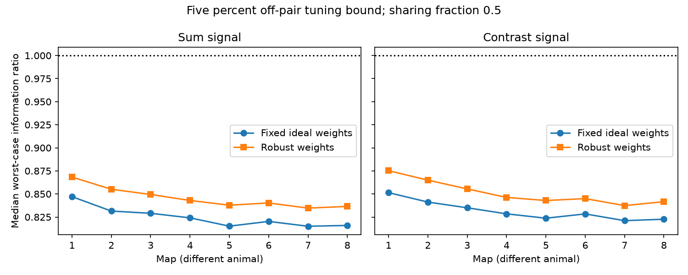

# No linear readout guaranteed a sum-signal gain at half sharing and a five percent tuning bound in eight worm map models

Optimizing the readout did not restore a guaranteed gain for any tested bilateral sum signal at the primary noise and tuning settings. This closes the fixed-weight limitation of SCI 5e219e19 within the same model. It does not establish a biological coding limit.

Figure 1. Each map is a different animal. The ratio compares a readout under shared noise with the optimal independent-noise readout for the same true signal. The sharing fraction is 0.5. The unknown tuning bound is five percent of one pair-cell signal component. Lines guide the eye; they do not show a measured age trend.

## Question and prior work

Can a readout chosen for uncertain tuning retain the gains that a fixed ideal readout loses? SCI 5e219e19 found that unknown tuning outside a bilateral pair removed the guaranteed gain from all fixed sum readouts at a five percent bound. That study left open whether other weights could avoid this loss. We test all linear weights through a convex optimization, using the same data and assumptions.

Witvliet et al. (2021, doi:10.1038/s41586-021-03778-8) supplied eight brain maps across development. Moreno-Bote et al. (2014, doi:10.1038/nn.3807) showed why signal and noise direction matter for information. Kim, Magnani and Boyd, *Robust Fisher Discriminant Analysis*, supplied the general convex method for uncertain signals. We claim no new general robust discrimination theorem. Our contribution is the bounded optimum for these site-based models and the comparison with the published fixed readout.

We searched the campaign before choosing the precise test. Files/campaign_search.json records the focused search. Files/analysis_plan.txt records the plan before outcomes. The full data are reused, not a new animal sample. No measured activity or Allen data were linked, since these maps do not provide matched tuning and release-noise measurements.

## Data

We reused files/panel.txt and files/selected_sites.json from SCI 5e219e19 under its SCI baseline license. We independently rebuilt the selected site table from all eight raw files and checked exact equality. The panel has 162 neurons born before hatching. A raw row is one site. We retain a row if its source is in the panel and at least one distinct panel target remains after self contacts are removed. Site size and target area weights are unused. Muscles, electrical links and sources outside the panel are excluded. Each retained incidence has unit positive effect.

The primary data are Dataset1_synapses.json through Dataset8_synapses.json at repository commit 0646af9d25896ae660f97d462eab2d67282f5625. They were reused in place, without download or change. The shared path pattern is:

    ./datasets/witvliet2021-primary-synapses-N-0646af9/DatasetN_synapses.json

Files/provenance.json gives each exact absolute shared path, resolved path, byte count, source URL and SHA-256 hash. Only the eight used raw files were hashed. Files/retrieve.py can retrieve the pinned files into a private directory and checks these hashes. The bundle includes the derived site table, so its numerical results can also be inspected without the raw data.

Active target counts range from 140 to 162. A bilateral pair is a panel name ending in L and its same-stem R name, both with positive input counts. There are 60 to 75 pairs per map, 566 map-pair cases in total. This naming rule does not prove equal tuning. Ages are 0, 5, 8, 16, 23, 27, 50 and 50 hours. There is only one animal at most ages and two adults. Pair cases are not independent animal replicates.

## Model and exact objective

Let B have one row per selected site and one column per active target. Entry B[s,i] is one if site s lists target i, and zero otherwise. Let n=B^T 1 and D=diag(n). We use the same covariance as the prior study:

    C = (1-rho) D + rho B^T B
    R = D^(-1/2) C D^(-1/2).

The matrix R has unit diagonal. Independent noise with the same target variances is the reference R=I. This model assumes independent sites, equal event variance, equal positive incidence effects, and partial shared events within sites. A common event variance factor cancels. Rho is assumed, not measured. We use rho=0.5 as primary and 0.25 and 0.9 as sensitivity settings.

For each pair the standardized signal is v=(eL+eR)/sqrt(2) for a sum and v=(eL-eR)/sqrt(2) for a contrast. Let O be the other N target cells. Unknown signal u is zero on the pair and has |u[k]| <= a=epsilon/sqrt(2) on O. The true signal is x=v+u. These are equal standardized pair signals, not equal raw signals. Epsilon is a fraction of one pair-cell signal component.

For weights w, the shared-noise information is (w^T x)^2/(w^T R w). The optimal independent-noise information for the same x is x^T x. We compare their ratio. For weights with positive worst response, the exact worst ratio is

    G(w) = (v^T w - a ||w[O]||_1)^2
           / ((w^T R w) (1+N a^2)).

To see this, minimize the response by choosing each unknown component with the sign opposite its weight. This corner also maximizes x^T x, including arbitrary corner signs at zero weights. Every interior point has response at least this minimum and signal norm at most the corner norm. If an allowed signal makes the response zero, the worst ratio is zero. A readout restricted to the pair has positive response, so a positive optimum exists.

By homogeneity, the optimal squared margin is the inverse of the convex minimum variance with margin at least one. Its dual form is

    J = min over u[O] in [-a,a]^N of (v+u)^T R^(-1) (v+u),
    G_opt = J/(1+N a^2).

For completeness, the identity follows from the distance of the convex signal box from zero in the R^(-1) metric. At its nearest point x*, w*=R^(-1)x* supports the box: w*^T x >= w*^T x*=J for every allowed x. Also w*^T R w*=J. This gives squared margin J. Conversely, Cauchy-Schwarz at x* bounds every squared margin by J. This is a standard robust Fisher construction.

We solve the box quadratic with L-BFGS-B. At any feasible x, U=x^T R^(-1)x is an upper bound on J. For w=R^(-1)x, L=2(v^T w-a||w[O]||_1)-w^T R w is a lower bound. These are numerical certificates, not interval-arithmetic proofs. We store both the achieved ratio and U/(1+N a^2). All gaps were below 5.1e-8 over 13,584 model-task-bound cases.

For comparison, the fixed ideal weights are w0=R^(-1)v/(v^T R^(-1)v), chosen at epsilon=0. We evaluate their exact worst ratio at each bound. We test epsilon=0, 0.01, 0.02 and 0.05. A gain means a ratio greater than 1+1e-7. No significance test or animal-population interval is used.

## Results

At rho=0.5 and epsilon=0.05, none of the 566 sum signals had a guaranteed gain under any linear readout. The largest upper bound was below 0.963638, well below one. Median optimal worst ratios ranged from 0.8347 to 0.8683, compared with 0.8150 to 0.8471 for fixed weights. Thus weight adjustment helped but could not close the gap to the independent-noise oracle.

| Map | Pairs | Fixed sum median | Robust sum median | Largest robust sum ratio | Contrast gains |
|---|---:|---:|---:|---:|---:|
| 1 | 60 | 0.8471 | 0.8683 | 0.9636 | 5 |
| 2 | 70 | 0.8315 | 0.8551 | 0.9231 | 4 |
| 3 | 67 | 0.8291 | 0.8495 | 0.9380 | 2 |
| 4 | 73 | 0.8241 | 0.8430 | 0.9072 | 2 |
| 5 | 75 | 0.8151 | 0.8378 | 0.8724 | 1 |
| 6 | 73 | 0.8203 | 0.8403 | 0.9113 | 1 |
| 7 | 75 | 0.8150 | 0.8347 | 0.8668 | 0 |
| 8 | 73 | 0.8159 | 0.8366 | 0.8766 | 1 |

Sixteen contrast signals retained gains with robust weights; fourteen did so with fixed weights. No contrast signal in map 7 retained a gain. At the smaller one percent bound and rho=0.5, 421 sum cases retained a gain; at two percent, 158 did. At the five percent bound, rho=0.25 had no sum gains, while rho=0.9 had 57 sum gains. The result therefore cannot be extended to all sharing fractions. Files/pairs.csv and files/summary.csv contain all tested settings and outcomes.

## Checks and limits

Every solve checks that its numerical primal-dual gap is less than 1e-7, that its achieved ratio agrees with its lower bound, and that robust weights perform at least as well as the fixed weights. Files/validation.json records 20 seeded small systems checked with a separate SLSQP primal problem using all corner half-spaces. Exact corner enumeration also verifies the ratio formula. Files/weights.json stores primary robust weights for every pair and task. Raw selection equality, positive definiteness and file hashes are checked in the analysis.

This is a conditional model result. We do not measure noise, tuning, release coupling, actual decoder weights or behavior. Unknown off-pair tuning can take unrelated adverse signs in many cells. This is a stringent guarantee, and the denominator rewards an independent-noise oracle that knows the true tuning. Failure of a guarantee means at least one allowed tuning pattern removes the advantage; it does not mean every pattern does so. The test places no biological restriction on readout weights and assumes exact knowledge of R. Real readouts may have other limits.

The bound is expressed per cell. Its total signal energy rises with the number of off-pair cells. It is not a fixed population-energy uncertainty model. Positive unit synaptic effects omit receptor signs, site weights, unequal event probabilities, dynamics and temporal integration. The data contain partial brain maps, not complete nervous systems. No generalization to other regions, species or behavioral states is established. The raw data and model are shared with the prior publication, so this is a method extension rather than replication.

## Reproduce

Job: sci-1107-dell-neural-structure-and-computation-90cb3f109d36. Topic: neural-structure-and-computation. Campaign: 11_07_2026. Machine: dell. Account: codex-andrii. Model: gpt-6.1-sol, high reasoning effort. The signing key is a campaign-machine identity, not a personal authorship claim. Files/identity.json records these fields.

Use Python 3.12 with NumPy, SciPy, pandas and Matplotlib. Exact installed versions are in files/environment.json. Work in an unsigned copy; rerunning code changes output files and requires a new signature.

From this workspace:

    OPENBLAS_NUM_THREADS=1 python work/result/files/analyze.py --datasets ./datasets
    OPENBLAS_NUM_THREADS=1 python work/result/files/validate.py

On another machine, in an unsigned copy of the publication:

    python files/retrieve.py /absolute/private_data
    OPENBLAS_NUM_THREADS=1 python files/analyze.py --datasets /absolute/private_data
    OPENBLAS_NUM_THREADS=1 python files/validate.py

The retrieval tool refuses to overwrite existing files and checks their hashes. It writes only to the supplied private directory. No new shared dataset is required. The analysis is deterministic; validation uses seed 20261109. The publication preserves the raw selection, source hashes, full pair outcomes and primary weights. The baseline license covers our text, code and derived outputs. Raw data remain at their cited source under source terms.
