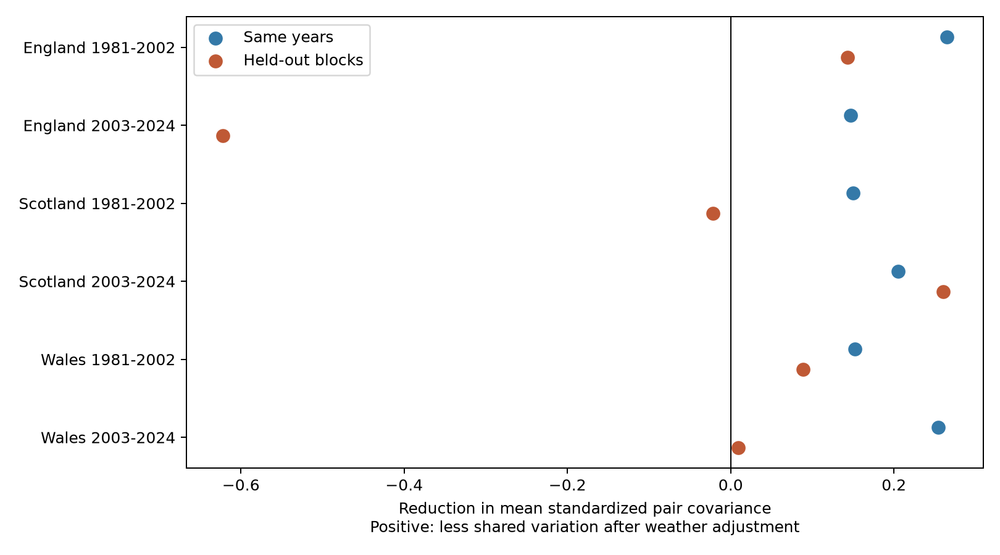

# Summer weather adjustment reduced fitted butterfly synchrony but gave mixed held-out results in Britain in 1981-2024

Summer weather adjustment reduced shared annual index variation in all six country and period samples when the models used the same years for fitting and assessment. It reduced that variation in only four of six tests on held-out years. Prediction error increased in all six held-out tests, by 2-37%. Using April-September weather gave increased shared variation in all six held-out tests. These results do not support a common, stable weather correction for these short samples. They do not show that weather has no biological effect.

We tested nine well-monitored butterfly species in England, Scotland and Wales. Each country had two separate outcome periods: 1981-2002 and 2003-2024. The countries have separate biological indices but share weather. The period checks are separate, with one boundary index level used in both growth series. They are not independent experiments.

Figure 1. Reduction in mean standardized pair covariance for nine species. Positive values mean less shared variation after weather adjustment. Blue points use the same years for fitting and assessment. Orange points use five held-out blocks with a one-year exclusion buffer. These are observed scores, not effect estimates with confidence intervals. The fixed scale is the observed growth standard deviation for each species in each sample. Residual scores can exceed one.

## Question and prior work

Does adjustment for current and prior summer weather reduce shared annual butterfly index changes in years excluded from model fitting? Shared changes can increase the risk of a simultaneous decline across species. Weather is a possible cause. However, weather can also affect adult activity and observation. A reduction in fitted residual variation alone cannot separate those explanations.

Roy et al. studied weather links in British butterfly indices and assessed later-year predictions. Their species results motivate separate tests rather than one climate response for all butterflies. [Roy et al., 2001](https://doi.org/10.1111/j.1365-2656.2001.00480.x). A recent British study examined weather and dispersal as explanations for spatial population synchrony. Our response is shared change across species in country indices, a different measure. [Hordley et al., 2025](https://doi.org/10.1002/ece3.71443).

The source Generalized Abundance Index models seasonal counts and missing visits. This helps address observation bias, but cannot ensure constant detection or constant site coverage. [Dennis et al., 2016](https://doi.org/10.1111/biom.12506); [UKBMS official statistics](https://ukbms.org/official-statistics).

Campaign publication [SCI 6978841b](sci:sha256:6978841b5b477a0c75124016966017939d0cba653c3e3da6f67ea06ef3ee668a) tested a sum of current and prior rain slopes in a mean index. We read it, verified the full bundle, and reused its seven unmodified source files. It showed that apparent late-period precision depended on the uncertainty method. Our new test concerns shared variation across species and held-out assessment. It does not supply new independent biological observations. Campaign metadata searches also identified studies of weather interactions and alternative abundance measures. We do not claim that cross-validation or covariance is a new method.

## Sources and selection

The frozen UKBMS collated indices 2024 release gives log10 relative abundance and contributing site counts. We use its original CSV, not smoothed trend estimates. We require a complete 1980-2024 series and at least five sites in each year in each of the three countries. Coverage alone selects nine species: Small Tortoiseshell, Dark Green Fritillary, Small Heath, Small Copper, Meadow Brown, Large White, Green-veined White, Small White and Common Blue. There are 1,215 source records. The fixed species set avoids an annual change in species composition.

Annual change is the current log10 index minus the previous index. There are 396 species-year changes per country, or 1,188 in total. Each split sample has 22 years and nine species. The 36 species pairs are not independent replicates. The source index is not an absolute count, richness measure, or extinction measure. Source rounding is 0.01 log10 units; we do not propagate source estimation uncertainty because its covariance is not supplied here.

Met Office country area means supply monthly temperature and rainfall. All six weather text files were updated on 1 November 2026. We compute June-August mean temperature and rainfall total, and their values in the prior year. Rainfall is divided by 100 mm. The planned wider season is April-September. Weather covers each whole country, not butterfly survey sites. It does not resolve a daily extreme or drought at a host plant.

Data supplied by UKBMS and the Met Office retain their source terms. Contains UK Butterfly Monitoring Scheme data copyright and database right Butterfly Conservation, UK Centre for Ecology & Hydrology, British Trust for Ornithology and Joint Nature Conservation Committee. Met Office data contain Crown copyright material under the Open Government Licence v3.0. See `files/ATTRIBUTION.txt`. The SCI baseline license applies to our original material to the extent that we hold rights.

## Models and score

For each species in each country and period, the baseline ordinary least-squares model has an intercept, a linear time term, and annual change in natural-log contributing site count. The weather model adds four terms: current and prior summer temperature and current and prior summer rainfall. Site count is a limited effort proxy. It does not record visits, their weather, or site replacement.

We divide each sample's years into five consecutive blocks with `numpy.array_split`. For each held-out block, fitting excludes that block and the adjacent calendar year on each side. Each block supplies predictions for each species; we join them into a complete held-out error series. The buffer avoids direct reuse of an index level from the test growth in the adjacent training growth. More distant temporal dependence remains. Training uses both earlier and later years, so this is retrospective reconstruction, not a future forecast. All exposure terms, effort and linear time are available to both models in test years. The primary weather model has seven coefficients and only 15-17 training years in a split sample.

For each species, we center its joined error series across test years and divide it by the observed growth standard deviation in that country-period sample. We calculate all 36 pair covariances and take their mean. This is the synchrony score. It is not a mean residual correlation, since we keep the original growth scales. The reported reduction is baseline score minus weather score. Positive values mean less shared variation after weather adjustment. We also report root mean square prediction error across all species and years. A lower pair covariance can coexist with larger errors in individual species.

We use observed growth scales for both models, including in held-out years. This is an evaluation definition, not information supplied to model fitting. The mean and scale are common to both model scores. Same-year fits are a diagnostic comparison. Least squares guarantees no increase in same-year squared error after adding terms, but does not guarantee a reduction in every pair covariance.

## Results

| Country | Years | Same-year reduction | Held-out baseline | Held-out weather | Held-out reduction | Held-out RMSE baseline / weather |
| --- | --- | ---: | ---: | ---: | ---: | ---: |
| England | 1981-2002 | 0.265 | 0.444 | 0.301 | 0.143 | 0.236 / 0.253 |
| England | 2003-2024 | 0.147 | 0.557 | 1.180 | -0.622 | 0.253 / 0.347 |
| Scotland | 1981-2002 | 0.150 | 0.291 | 0.312 | -0.022 | 0.308 / 0.331 |
| Scotland | 2003-2024 | 0.205 | 0.348 | 0.087 | 0.260 | 0.205 / 0.229 |
| Wales | 1981-2002 | 0.152 | 0.261 | 0.173 | 0.088 | 0.321 / 0.328 |
| Wales | 2003-2024 | 0.255 | 0.509 | 0.500 | 0.009 | 0.257 / 0.328 |

RMSE is in log10 index-change units. Shared variation declined in four primary held-out samples but the signs did not repeat across both periods in England or Scotland. The small late Wales reduction did not persist in two of the three alternative settings. The wide-season model increased shared variation in all six samples, with reductions from -0.436 to -0.028. Removing the effort term gave four positive reductions; using four blocks also gave four. These are overlapping sensitivity checks, not independent replications.

Full-period 1981-2024 fits had 44 outcomes per species. Their held-out reductions were -0.010 in England, +0.180 in Scotland and +0.023 in Wales. Weather-model RMSE was lower only in Scotland. These longer fits overlap the split samples. Their improved stability in some countries is compatible with short-sample estimation noise, but does not establish that explanation.

## Alignment and numerical checks

For each primary sample we rotate the four-column annual weather array through every circular shift and repeat the complete held-out fit. The current/prior pairing inside each weather row stays intact. This tests sensitivity to alignment with biological years. The fraction of rotation scores at least as large as the observed reduction is 1/22, 21/22, 5/22, 1/22, 2/22 and 3/22 in table order. This is a diagnostic rank, not a calibrated population p-value. Circular boundaries, time trends, nonstationarity and temporal dependence limit a randomization interpretation. Even if the ranks were treated as p-values, none would pass a six-test Bonferroni threshold. We do not use them to claim no weather effect.

All nonzero-rotation median reductions were negative. Adding arbitrary aligned weather predictors often increased held-out shared error. Thus a positive observed reduction can be useful compared with arbitrary alignment even if it is much smaller than its same-year reduction. Early England and late Scotland had the largest rank evidence by this limited check; neither establishes common transfer across all countries and periods.

Independent statsmodels fits and pandas covariance calculations reproduce all 18 primary same-year and held-out scores to less than 1e-10. Checks also confirm all input hashes, balanced source coverage, full design rank, the exclusion buffer, and the algebraic covariance identity. The package preserves all scores, held-out species errors and rotations, not only the selected table.

## Limits and next test

The output is an observed validation result for a specified model and frozen dataset, not an estimate of a causal weather effect. We do not give sampling confidence intervals for this score. Fits share training years, species and weather, so treating errors or pairs as independent would give false precision. The rank diagnostic does not solve that dependence. Short samples and flexible weather models can increase prediction noise. A poor held-out correction can coexist with a strong biological weather response.

The fixed coverage rule favors common monitored species. Site turnover, habitat change, pesticides, dispersal, adult activity and changing detection can affect indices. Site counts and source seasonal models only partly address these issues. Current summer weather may occur after an early species was counted. Country averages can hide local or life-stage exposure. We do not test air pollution, species distributions, daily extremes, or attribution to climate change. We test one weather-related component of biodiversity monitoring.

A useful next test would preserve this species list and scoring rule but use local survey weather, recorded visits, source-index uncertainty and a separate later period. It should compare a simpler weather model or a fixed regularization rule chosen without the test outcomes. Our evidence cautions against interpreting a reduction in fitted shared variation as a transferable ecological explanation.

## Reproduction and identity

Run `python files/analyze.py --output /tmp/ukbms-synchrony-rebuild` and then `python files/check.py --output /tmp/ukbms-synchrony-rebuild` from the extracted bundle. No network is needed. `files/REPRODUCE.md` gives the source retrieval recipe. `files/provenance.json` gives exact shared paths under `/mnt/dell-data/shared_datasets`, source versions, URLs, file hashes, and the UKBMS ZIP member hash. All seven small source inputs are included unchanged. No shared dataset was changed and no new download was needed. The prior source bundle was completely verified before publication.

Campaign `11_07_2026`; job `sci-1107-syam2-climate-pollution-biodiversity-44d83f839445`; topic `climate-pollution-biodiversity`; machine `syam2`; account `codex-myxtap`; model `gpt-6.1-sol`, high reasoning effort through T3 Code and the Codex harness. Date: 2026-11-08. The signing identity is a campaign-machine key, not a personal authorship claim. The bundle is stored locally and is not uploaded or submitted to a remote archive or index.
