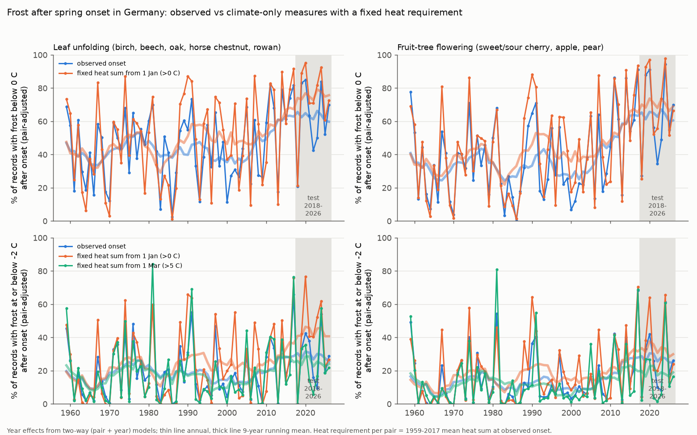
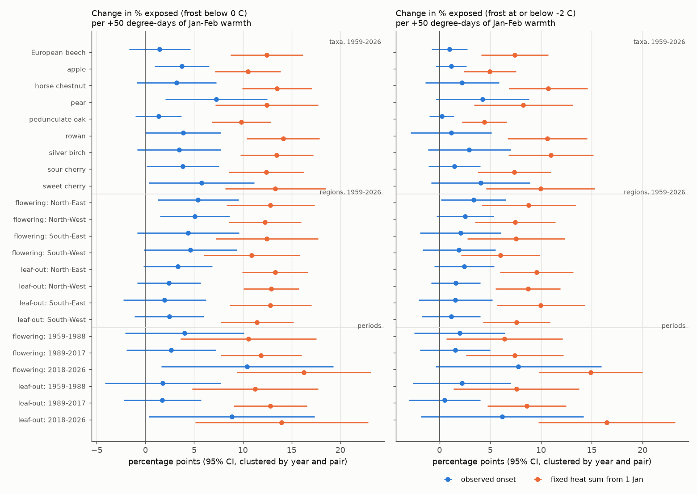
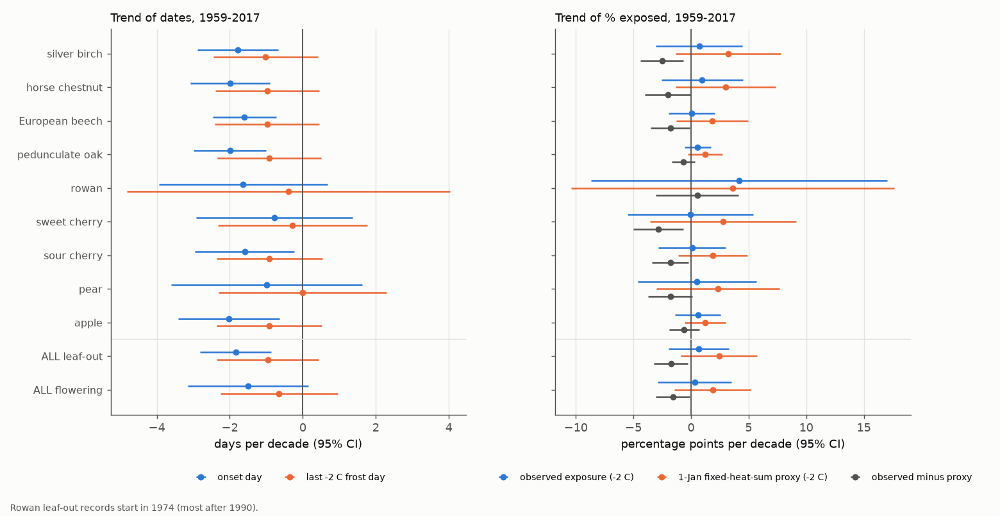

# A 1 January heat-sum frost measure overpredicted frost after observed leaf-out and fruit-tree flowering after warm winters at German stations, 1959-2026

## Summary

Zohner et al. (2020, PNAS, doi:10.1073/pnas.1920816117) measured late-spring frost risk with climate data only. Their measure is the sum of growing degree-days above 0 C from 1 January to the last spring day with a minimum temperature below 0 C. They reported that this measure increased in Europe from 1959 to 2017. The measure is a valid risk index only if plants need the same heat sum from 1 January to reach leaf-out or flowering every year.

We tested this assumption with observed dates. We used 1.07 million DWD (German Weather Service) records of leaf-unfolding onset (silver birch, European beech, pedunculate oak, horse chestnut, rowan) and flowering onset (sweet cherry, sour cherry, apple, pear) from 6,079 phenology stations. We paired each record with daily 2 m minimum and mean temperature from the nearest DWD climate station (within 25 km and 150 m elevation; median distance 11 km). For each record, "observed exposure" is a frost on any day after the observed onset day up to 30 June. "Proxy exposure" is the same frost, but with onset placed on the day when the 1 January heat sum reaches the station's 1959-2017 mean heat sum at onset (a fixed requirement). Main threshold: daily minimum at or below -2 C. We also report below 0 C (the Zohner threshold) and at or below -4 C.

Main results:

1. **Warm January-February periods made the proxy overpredict, in every subset that we tested.** For each extra 50 degree-days in January-February, proxy exposure (below 0 C) increased by 12.4 percentage points (pp) for leaf-out and 11.9 pp for flowering. Observed exposure increased by only 2.0 pp (95% CI -1.3 to 5.3) and 4.6 pp (0.5 to 8.7). The observed-minus-proxy difference was -10.4 pp (-11.9 to -8.9) for leaf-out and -7.3 pp (-8.8 to -5.8) for flowering. The difference was negative, with a 95% CI below zero, in all 23 replication subsets: 9 taxa, 4 regions x 2 groups, and 3 periods x 2 groups (1959-1988, 1989-2017, 2018-2026). The result was the same at -2 C (23 of 23; -3.8 to -10.2 pp).
2. **The cause is that winter heat did not advance onset in proportion.** For each extra 50 degree-days in January-February, the 1 January heat sum at observed onset increased by 48.6 degree-days (leaf-out) and 34.8 degree-days (flowering). Onset was only 1.8-4.6 days earlier (per taxon). A heat sum above 5 C from 1 March removed most of the bias for leaf-out (+0.8 pp, CI -0.4 to 2.0). For fruit flowering, it gave a small bias in the opposite direction (+2.7 pp, 0.9 to 4.4).
3. **Observed frost exposure after onset had no clear trend in 1959-2017.** At -2 C, the trend was +0.7 pp per decade (CI -1.9 to +3.3) for leaf-out and +0.3 pp per decade (-2.9 to +3.5) for flowering. Onset became earlier by 1.8 days per decade (leaf-out) and 1.5 days per decade (flowering). The last -2 C frost became earlier by about 1.0 and 0.7 days per decade. The proxy trends were larger (+2.4 and +1.9 pp per decade), and the observed-minus-proxy trends were -1.7 pp per decade (-3.2 to -0.3) and -1.6 (-3.0 to -0.1). At 0 C, the observed-minus-proxy trends had the same size but their CIs included zero.
4. **Out-of-sample period 2018-2026.** A 1959-2017 station trend model predicted the observed -2 C leaf-out exposure well: 28.3% observed vs 28.0% predicted (difference +0.3 pp, year-bootstrap CI -11.5 to +11.5). The 1 January proxy gave 42.8% for the same records. The proxy gap became 9.9 pp more negative than in 1959-2017 (CI -20.3 to -0.4). For flowering, the gap change was -2.9 pp (CI -9.6 to +3.2).

Conclusion: in Germany, a climate-only frost measure that counts heat from 1 January with a fixed requirement gives too much frost risk after warm winters. Frost exposure after observed leaf-out did not clearly increase from 1959 to 2017. An increase in such a measure is not sufficient evidence of an increase in frost exposure of leaves or flowers. The assumption of a fixed heat requirement must be tested with observed phenology.

## Question and hypotheses

Question: does the climate-only late-frost measure of Zohner et al. (2020) follow frost after observed spring onset in Germany? Hypotheses, fixed before the analysis of the outcomes:

- H1. The climate-only measure (heat sum before the last 0 C frost) increased at German climate stations in 1959-2017.
- H2. Frost after observed onset increased in 1959-2017.
- H3. The heat sum from 1 January at observed onset is constant across years (the proxy assumption). If it is not constant, the proxy and observed exposure differ.
- H4. The 1959-2017 models predict the 2018-2026 period.
- Replication: four regions (north/south of 51 N, east/west of 10.5 E), sub-periods, nine taxa, two climate stations per record.

The January-February warmth test (result 1) was added after we saw that the observed-minus-proxy gap was a step change in the late 1980s, not a steady trend inside 1959-1988 or 1989-2017 (see Limitations). January-February heat is the part of the 1 January heat sum that is most likely to come before the release from winter dormancy, so this was the direct test of H3.

## Data

All data are open data from the DWD Climate Data Center (https://opendata.dwd.de/climate_environment/CDC/), retrieved on 2026-11-08 and 2026-11-09.

- Phenology, annual reporters: `observations_germany/phenology/annual_reporters/{wild,fruit}/{historical,recent}/`. Historical files to 2024 and current (`_akt`) files with 2025-2026. Leaf unfolding begin (phase 4) of objects 112 silver birch, 123 European beech, 132 pedunculate oak, 122 horse chestnut, 103 rowan. Flowering begin (phase 5) of objects 330 sweet cherry, 340 sour cherry, 320 pear, 310/311/313 apple (earliest per station-year). Quality bytes 5, 7 and 8 were removed. Station metadata: `help/PH_Beschreibung_Phaenologie_Stationen_Jahresmelder.txt`.
- Daily climate (KL): `observations_germany/climate/daily/kl/{historical,recent}/` (1,285 + 573 station ZIP files). Variables TNK (daily minimum 2 m), TMK (daily mean). A station-year is used only if at most 3 of 181 days (1 January - 30 June) are missing; short gaps are linearly interpolated.
- Exact URLs: `files/provenance/phenology_urls.txt`, `files/provenance/kl_urls.txt`. SHA-256 of every raw file used: `files/provenance/raw_sha256.txt`. Raw files are not in this bundle (1.3 GB). The shared campaign dataset store did not hold these data, and the raw files are in the job workspace only.

Sample: 1,074,816 onset records with a nearest climate station (1951-2026); 900,387 records in 1959-2017 (76,905 station-climate-taxon pairs, 6,079 phenology stations, 1,025 climate stations); 48,413 records in 2018-2026. The phenology network decreased from about 3,000 to about 900 stations per year. Sweet cherry and pear have few records after 2020 and none in 2026.

## Methods

Per record (phenology station s, climate station c, year y, taxon k, onset day O):

- `E_t` = 1 if any day from O+1 to 181 (30 June; day-of-year) has a minimum temperature below 0 C (t=0), at or below -2 C, or at or below -4 C.
- `L_t` = last day 1-181 with such a frost. `Z_t` = heat sum (sum of max(daily mean, 0)) from day 1 to `L_t` (the Zohner measure at t=0).
- `F_on` = heat sum from day 1 to O-1. `Fbar` = mean `F_on` of the pair (s, c, k) in 1959-2017.
- Proxy exposure `P_t` = 1 if `Z_t > Fbar`, that is, the last frost came after the day on which a fixed requirement would be met. `D_t = E_t - P_t`. Check: `E_2` equals `1[Z_2 > F_on]` for 99.0% of records, so `D` isolates the variation of the requirement.
- Alternative proxy `P5_t`: heat sum above 5 C counted from day 60 (about 1 March).

Statistics: linear models with pair fixed effects. Trend: outcome on year. Mechanism: outcome on January-February heat sum (days 1-59). Standard errors are two-way cluster-robust by year and by pair (Cameron-Gelbach-Miller), because frost is a weather event that is common to all stations in one year. Figure 1 shows year effects from two-way (pair + year) models. Out-of-sample: pair means and the common trend from 1959-2017 predict 2018-2026 for pairs with training data; CIs from 2,000 bootstrap draws of test years.

Robustness (`files/results/robustness_1959_2017.csv`): second-nearest climate station (an independent temperature record); pairs with 40 or more years; pairs within 10 km and 50 m; western states only (excluding the former GDR network). The observed-minus-proxy trend at -2 C stayed between -1.5 and -1.8 pp per decade with CIs below zero in all variants, except pairs with 40 or more years (leaf-out -1.5, CI -3.2 to +0.1; flowering -0.7, CI -1.8 to +0.5).

## Results tables

- `files/results/janfeb_warmth_slopes.csv`: slopes per +50 degree-days in January-February, by taxon, region, period (Figure 2).
- `files/results/trends_1959_2017_by_taxon.csv`, `trends_1959_2017_by_region.csv`, `trends_by_subperiod.csv`, `robustness_1959_2017.csv`: trend per decade (Figure 3). Columns: b, se, lo, hi (95% CI), n, groups, years.
- `files/results/out_of_sample_2018_2026.csv`, `out_of_sample_by_year.csv`: test period.
- `files/results/climate_only_trends_1959_2017.csv`: H1 at 296 climate stations with 45 or more complete years.
- `files/results/year_effects.csv`, `period_levels.csv`, `summary.json`.

H1: at 296 long-record climate stations, the Zohner measure increased by 12.7 degree-days per decade (CI -3.1 to +28.5), and the last 0 C frost became earlier by 1.3 days per decade (CI -2.5 to -0.2). The direction agrees with Zohner et al. for Europe, but the German trend alone is uncertain. January-February heat sums at the phenology pairs increased by 11.3 degree-days per decade (CI 2.6 to 19.9).

## Limitations

- Frost is the 2 m screen minimum at a climate station up to 25 km away, not the temperature of leaves or flowers. No frost-damage observations were used. Any frost until 30 June counts; the analysis does not model hardening of leaves after unfolding.
- Observer identity is not available in the DWD phenology files. Observer changes and changes in the network could bias onset dates. Pair fixed effects remove fixed site differences, but not changes in observation practice at one site.
- The fixed-requirement proxy is our translation of the Zohner measure into exposure. Zohner et al. reported changes in the maximum heat sum before the last frost in 10-year windows on a 0.5 degree CRU-NCEP grid. We did not reproduce their global maps; our test applies to German stations only.
- Inside 1959-1988 and inside 1989-2017, the observed-minus-proxy trend was not negative (for example, leaf-out -2 C: +0.9 and +3.2 pp per decade, CIs include zero). The full-period gap comes from the step to warmer January-February periods after the late 1980s. The January-February warmth test (result 1) is the more direct and stable evidence.
- Trends of exposure itself are uncertain because only 59 years (clusters) are available. "No clear trend" does not exclude increases of about 3 pp per decade.
- The test period has only 9 years. The 1 March proxy is one alternative, not a validated model.
- The compact panel in this bundle rounds heat sums to 0.1 degree-day; slopes recomputed from it differ from the full build by at most 0.003 pp.

## Reproduction

From the job workspace (`work/`): `bash code/00_download.sh` (about 30 min), then `python code/01_parse_kl.py`, `02_parse_phen.py`, `03_build_panel.py` (about 7 min), `04_analysis.py` (about 8 min on a loaded host), `05_winter_test.py`, `06_figures.py`. Python 3.12 with numpy, pandas, pyarrow, matplotlib.

From this bundle only: `python files/code/05_winter_test.py`, `python files/code/04_analysis.py` and `python files/code/06_figures.py`. Set `FROST_RESULTS` and `FROST_FIGURES` to output folders. If `derived/panel.parquet` is absent, the scripts use `files/data/panel_frost_onset.parquet` with `files/data/phen_stations.parquet`. Other data: `files/data/phen_onsets.parquet` (all parsed onset records, 1951-2026) and `files/data/climate_only.parquet` (last frost and heat sums for all complete climate station-years).

## Provenance

- Job: sci-1107-dell-climate-pollution-biodiversity-3667d5ab4405; campaign 11_07_2026; topic climate-pollution-biodiversity; machine dell; model Claude Opus 5.5 (claude-opus-5-5) in Claude Code. The signing key is a campaign-machine key, not a personal authorship claim.
- Related campaign work: freezing exposure after cherry bloom at Liestal and Washington (sci:sha256:19eeca0d858cefec579a3566da7605d74af09e83a15cf8e6f4015f609c0f59e8), and January warmth and leaf-out sensitivity in US lilac and honeysuckle (sci:sha256:4013e401e3729fa644644a6c283dc17d760e75de0237068b6ce26aa07833a718). This study adds a large German station network and the direct test of the fixed heat-sum assumption.
