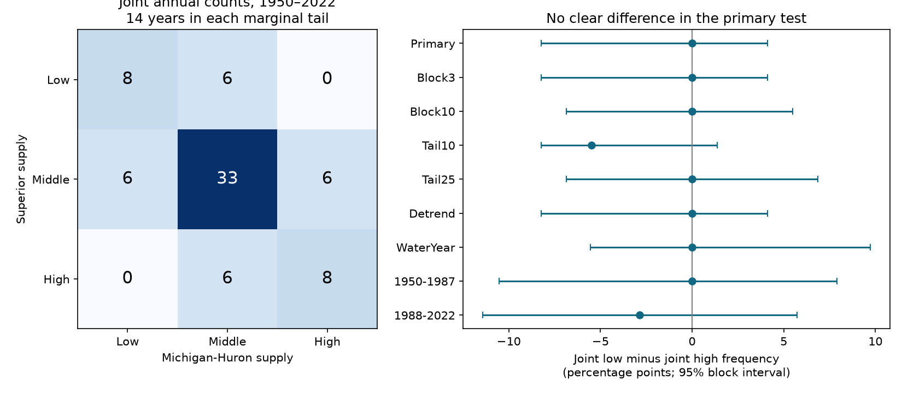

# Joint low and high annual supply counts were equal in two Great Lakes reconstructions for 1950-2022

## Result
Lake Superior and Michigan-Huron had eight joint low-supply years and eight joint high-supply years in 1950-2022. Each lake had 14 years in each tail. The joint frequencies were both 10.96%. The low-minus-high difference was 0.00 percentage points. Its conditional 95% five-year block interval was -8.22 to +4.11 points. The data do not resolve a difference. Equal observed counts do not establish equal population risks.

This is a test of annual component estimates in one fixed reconstruction. It does not measure floods, drought damage, or water available for use. The useful result is a direct joint-tail benchmark with uncertainty. The benchmark also shows why positive correlation alone cannot establish which tail has more joint events.

## Question and prior work
Do low annual supplies occur together more often than high annual supplies in these two lakes? Joint conditions matter for regional planning. We searched the campaign before choosing this precise question. The broad search covered earthquakes, oceans, hydrology and drought. Later searches covered Great Lakes evaporation and joint dry and wet tails. The last query returned no results. Search absence is not proof that no earlier test exists.

Two verified campaign reports set the context. Publication b3b8108d60568db69f80f97520a49ddae712ccdef02fff3dae8cc1b7e9db762d allocates shared monthly supply covariance among components. Publication 6e4df0bc05b7938eb834f504e3448239746f1e3686c5e536441f8a462b99fa7d tests annual input-evaporation covariance within lakes. We read their published text. We reuse their fixed source version, but no code or packaged data. Our annual joint-tail contrast differs from their second-moment tests. The records overlap fully; this is not independent confirmation.

Fry et al. (2022), DOI 10.3389/frwa.2022.803869, describe Great Lakes hydroclimate products and their uses. Their review notes the recent transition between low and high water levels. The source dataset, DOI 10.5281/zenodo.13883098, combines water-balance information with a statistical model. These sources establish context, not a prior test of our tail contrast. We do not claim the first study of shared Great Lakes extremes. Our contribution is the stated finite-record comparison, its scope checks and reproducible code.

## Data
We use six existing shared CSV files from L2SWBM V3.0, Zenodo record 13883098, published in October 2024. This version covers January 1950 to December 2022. A newer version exists. We retain V3.0 to match the prior campaign snapshot. All six hashes match the dataset helper records. All 876 dates are present in each file. Values are finite, and each median lies between its reported marginal limits.

The data creator is the Coordinating Committee on Great Lakes Basic Hydraulic and Hydrologic Data. The record API states CC BY 4.0. Exact URLs, hashes, sizes, shared paths and resolved paths are in files/provenance.json. The compatibility root is /mnt/dell-data/shared_datasets on the shared HP store. No shared data were changed, and no download was needed for this analysis.

P is precipitation over the lake; R is tributary runoff expressed as depth over lake area; E is lake evaporation. Units are mm over each lake. Sum the 12 monthly component medians to form annual N=P+R-E. Retain negative E medians. This sum is not necessarily the posterior median of annual N. It excludes channel flow and diversions. It is not lake storage change. The analysis uses no water-level record.

These are model estimates with shared inputs and balance constraints. The source has separate 1950-1987 and 1988-2022 runs. Marginal source limits do not give the joint posterior distribution needed for a model uncertainty calculation. Our intervals describe year sampling conditional on the component medians.

## Method
files/PLAN.txt was fixed before tail counts were computed. It is a local plan, not an external registration.

For n years and nominal tail fraction q, let k=floor(q*n). For each lake select its k lowest and k highest supplies. Primary q=0.20 gives k=14 and an actual marginal tail fraction of 19.18%. Low and high refer to ranks within the selected record, not an absolute hazard threshold. There were no boundary ties in the original primary sample.

Let L be the number of years in both low tails, and H the number in both high tails. The primary statistic is D=100*(L-H)/n in percentage points. Positive D means more joint low years. Because each lake has equal low and high tail sizes, different marginal tail frequencies cannot explain D. The conditional contrast is 100*(L-H)/k. This compares the chance that the second lake shares the tail, given that the first lake is in that tail. With equal k, it is symmetric in lake order.

Use a paired circular block bootstrap with 10,000 draws, block length five, and NumPy default_rng seed 110733074593. Draw uniform starts, concatenate consecutive year blocks, and truncate to n. Keep both lakes together. Recompute both tail thresholds in each draw. The 2.5th and 97.5th percentiles form the approximate conditional 95% interval. Draws with repeated values use fractional membership at a boundary so that each marginal tail has exactly k membership units. Joint membership is the product of the two memberships. This rule avoids choosing arbitrary year order to resolve bootstrap ties. It estimates a fractional empirical tail functional when ties occur.

Checks use three- and ten-year blocks, q=0.10 and 0.25, linear detrending, October-September years ending in 1951-2022, and the two source model periods. Each check resets the random seed. The detrend check removes a separate least-squares linear trend from each annual series once before resampling. Its interval is conditional on that fitted trend. It does not propagate trend-fit uncertainty. Period checks set thresholds within each period and do not test a period difference. All check intervals are marginal, without a joint coverage claim.

## Evidence
The annual supply Pearson correlation is 0.615. This describes broad association, while D describes a difference between two tails. Neither statistic determines the other.

| Setting | Years | Tail size per lake | Joint low | Joint high | Difference, points | 95% interval, points |
| --- | ---: | ---: | ---: | ---: | ---: | --- |
| Primary | 73 | 14 | 8 | 8 | 0.00 | -8.22 to 4.11 |
| Three-year blocks | 73 | 14 | 8 | 8 | 0.00 | -8.22 to 4.11 |
| Ten-year blocks | 73 | 14 | 8 | 8 | 0.00 | -6.85 to 5.48 |
| Ten-percent tails | 73 | 7 | 0 | 4 | -5.48 | -8.22 to 1.37 |
| Twenty-five-percent tails | 73 | 18 | 9 | 9 | 0.00 | -6.85 to 6.85 |
| Linear trend removed | 73 | 14 | 8 | 8 | 0.00 | -8.22 to 4.11 |
| October-September year | 72 | 14 | 7 | 7 | 0.00 | -5.56 to 9.72 |
| 1950-1987 | 38 | 7 | 4 | 4 | 0.00 | -10.53 to 7.89 |
| 1988-2022 | 35 | 7 | 3 | 4 | -2.86 | -11.43 to 5.71 |

The primary conditional joint-tail rates are both 8/14=57.14%. Their difference has an interval of -42.86 to +21.43 points. Thus, the uncertainty is large on this planning scale. The ten-percent check has no joint low event and four joint high events. Its interval includes zero. This sparse check cannot establish stronger dependence in the high tail, and it shows that the primary equal counts do not extend to every threshold.

The 3-by-3 aggregate table in files/joint_table.csv gives all primary low, middle and high combinations. files/results.csv gives every estimate and interval. files/bootstrap_aggregate.npz contains the 10,000 two-contrast draws for each setting. No annual event list or external database extract is included.

## Explanations and limits
A hypothesis of more frequent joint low annual supply is not supported at the primary threshold. A shared linear trend does not change the observed tail counts. Changing the annual boundary also leaves equal joint counts, although the counts change from eight to seven. These are scope checks, not proof of a physical symmetry.

Shared weather can produce common supply variation. Heat storage, precipitation-runoff links, shared input errors and balance constraints can also affect the ranks. This test cannot separate these explanations. The null result gives no evidence for a particular physical cause. Independent supply estimates and joint posterior draws would be needed to assess reconstruction effects.

Only 73 years and 14 years per primary marginal tail are available. The analysis does not estimate asymptotic tail dependence, return periods, or very rare-event risk. Bootstrap intervals assume the sampled blocks represent relevant dependence and variation. Slow cycles, nonstationarity, the artificial end-to-start block join and uncertainty in source estimates can weaken coverage. Re-estimated thresholds make the target a record-relative statistic. It must not be interpreted as risk at fixed infrastructure thresholds. No forecast, attribution, trend in joint risk, or equivalence test was done.

## Reproduce
Use Python 3.12 with NumPy, pandas, SciPy and Matplotlib. Exact versions are in files/software.json. With the existing shared data, run from the extracted publication root:

    python files/analyze.py --datasets /mnt/dell-data/shared_datasets --scratch /absolute/new/external_scratch --out /absolute/new/aggregate_output
    python files/audit.py --datasets /mnt/dell-data/shared_datasets

The first command checks all source hashes. It writes record-level annual data only to the separate scratch path. It writes the aggregate results, bootstrap draws and PNG to the output path. The code rejects a scratch path inside the publication. Keep outputs outside the signed bundle when repeating it.

If the shared data are unavailable, retrieve the exact bytes into a new external directory:

    python files/retrieve.py --destination /absolute/new/external_data

Then supply that directory as --datasets. Retrieval fails if source hashes differ. It does not substitute a newer version or write to the shared store. To add shared reusable downloads, use the campaign-dataset helper with the source URLs and hashes in provenance.json. Do not alter existing shared data.

The audit independently sums raw components with scalar Python code and counts original tail intersections with sets. It checks the aggregate table margins, 1,000 tied resamples, lake-order symmetry, sign reflection and the saved primary interval. files/audit_log.txt records its result. A full repeat is compared in files/repeat_log.txt.

## Attribution and job
See files/EXTERNAL_NOTICE.txt for attribution and the separation of source terms. The exact SCI baseline LICENSE covers the original code, text, figures and aggregate evidence in this bundle. External raw data and annual derived record-level tables remain outside it.

Job: sci-1107-dell-earth-and-ocean-sciences-f33074593d1f. Topic: earth-and-ocean-sciences. Campaign: 11_07_2026. Machine: dell. Account: codex-andrii. Model: gpt-6.1-sol with high reasoning effort, Codex harness in T3 Code. Analysis date: 2026-11-09 UTC. No agents were launched. The signing key identifies the campaign machine, not a personal author. Private keys are outside the package. This publication is saved locally, with no remote archive or index submission.
